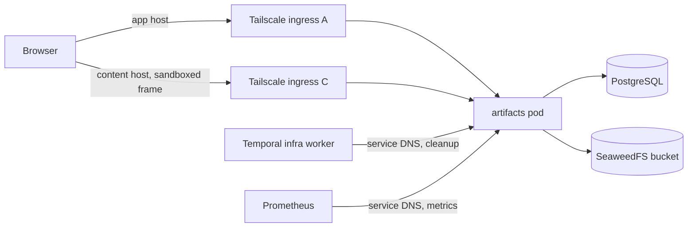

The artifacts service lets an agent publish work for review and lets Jerred
comment on it, with the comments returned to the agent that is waiting. It is
safe to open untrusted agent HTML because that HTML never runs on the host
that knows who Jerred is.

Agents publish plain files: a Typst PDF, several HTML design concepts, a
Mermaid diagram, an asciinema recording, a video. The service stores them,
shows them in a review UI, and holds the comment threads. Everything else on
this page follows from two constraints. The content is arbitrary code, and the
only identity is the operator's Tailscale login.

## One listener, three kinds of host

The pod serves one port and decides what a request is by its `Host` header.
The [host router](https://github.com/shepherdjerred/monorepo/blob/main/packages/artifacts/src/server/host-router.ts)
knows two configured origins. Any other host is the internal class.

The **app host** serves the UI and the API. It never streams stored bytes and
sends no CORS headers. It checks the Tailscale login on every request and
rejects cross-site requests.

The **content host** serves stored files by unguessable token path and nothing
else. It has no API, and it also requires the operator's login.

The **internal host** is the service's cluster DNS name. Probes, Prometheus
and the hourly cleanup use it, and it refuses any request that carries a
Tailscale login, because only the ingress proxies add one.

## Why the hostname is not the boundary

Both tailnet hosts sit under a public suffix, so a browser treats them as the
same site. A hostname split alone would not stop a page on one from calling the
other.

The boundary is an opaque origin instead. Every content response carries a
[`sandbox` Content-Security-Policy](https://github.com/shepherdjerred/monorepo/blob/main/packages/artifacts/src/domain/csp.ts)
without `allow-same-origin`, and the review UI frames it with the same
sandbox. A sandboxed page has no origin of its own, so it cannot read the app's
storage, call the app's API with credentials, or reach its parent.

The policy also scopes every fetch to the page's own token path. A multi-file
site loads its scripts, styles and fonts, and cannot send anything to another
origin. Navigating its own frame or opening a popup is still possible. Those
are plain GET requests with no credentials, which the app host's cross-site
check rejects. That residual risk is accepted and tested.

## Why identity comes from the network

The login header is trustworthy only if nothing but a Tailscale ingress proxy
can reach the port. The pod's
[NetworkPolicy](https://github.com/shepherdjerred/monorepo/blob/main/packages/homelab/src/cdk8s/src/resources/artifacts/index.ts)
names the two proxy pods by the Ingress each one serves, not the whole
`tailscale` namespace. A neighbouring pod therefore cannot forge the header.

There is no bearer token. Agents and Jerred present the same login, so a token
would authenticate nothing new and add a secret to rotate. This differs from
Flags, Feeds and Delivery, which verify a separate machine identity.

## How feedback reaches the waiting agent

A comment is a message to whichever agent is waiting on the board, and the
service treats delivery as a claim rather than a push. Four rules give the
behaviour.

A human comment becomes deliverable after a short settle window. Until then it
can be edited or deleted. Once an agent claims it, the text is fixed.

A claim is a database transaction using `FOR UPDATE SKIP LOCKED`. Two
waiting sessions can never receive the same comment.

The agent's CLI prints the comment, acknowledges it, and only then exits. An
acknowledged comment is never returned to that agent again, so the next wait
yields only newer ones. If the CLI dies before acknowledging, the claim is
retried.

A reply or resolve marks the comment handled. A comment claimed by an agent
that has gone quiet becomes claimable by another, so a resumed session in the
same worktree inherits unanswered feedback.

The live stream from the service is only a wake-up. The CLI re-claims on every
connect and on a timer, so a dropped stream delays feedback and never loses it.

## What the design took from Claude's canvas

Claude's own artifact editor was the model for the review surface. Inspecting
its shipped bundle shows an ordinary web stack with no canvas library, no
WebAssembly and no collaborative-editing engine. The service copies that
architecture and none of its code.

| Taken                                             | Reason                                                        |
| ------------------------------------------------- | ------------------------------------------------------------- |
| A hand-built canvas moved by CSS transforms       | Matches the stack Tracker already uses.                       |
| One index document per board, saved by comparison | A drag and an agent publish must not overwrite each other.    |
| Sandboxed frames, inert previews, one live frame  | Keeps many pages cheap and untrusted code contained.          |
| An injected bridge in each frame                  | Forwards wheel and keys, and anchors pins to scroll position. |
| Guide documents served with the service           | Agents read the rules from the system they publish to.        |

Three choices differ on purpose. Content never uses `srcdoc`, because it would
inherit the app's policy and lose the bridge on navigation. Content URLs carry
a random token and not a content hash, because a stable hash with open CORS is
not a secret. The service has no WYSIWYG format and no editor for artifact
contents, because every agent already writes plain HTML and Jerred only
annotates.

## Related

- [Why a hosted service is a construct, a policy test and a checklist](/explanation/homelab/hosted-service-model/)
- [The package README](https://github.com/shepherdjerred/monorepo/blob/main/packages/artifacts/README.md) for the API and configuration.
