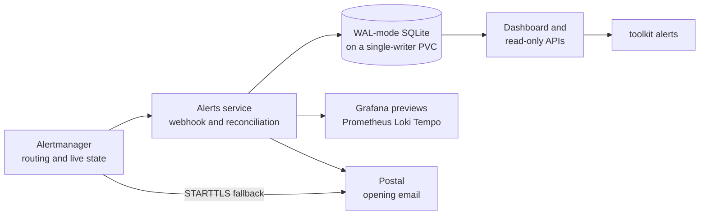

Alerts is the human-facing ledger for the homelab's Alertmanager data.
It adds history and browsing without becoming an on-call system or taking over
routing, grouping, inhibition, silences, or current-state authority.

## System map



## Current deployment boundary

Hub (`alert-dashboard`) owns durable incident history and sends grouped opening
emails for ordinary warning and critical alerts through its SQLite outbox over
Postal's HTTP API (`alert-dashboard-email-enabled` on by default). Alertmanager's
`alerts` receiver delivers webhook events to Hub without duplicating email, while
`postal-fallback` retains an independent notification path for alerts that
diagnose Hub or its webhook.

Alertmanager's Postal fallback does not use that HTTP API. It submits mail
through Postal's inbound SMTP listener and requires STARTTLS with cluster-CA
validation — see [Postal SMTP TLS](/explanation/homelab/postal-smtp-tls/).
Both the dashboard outbox and `postal-fallback` send operator alert mail from
`Hub Alerts <alerts@sjer.red>` to `alerts@sjer.red`, while operational summaries
use `Hub Digest <digests@sjer.red>` to `digests@sjer.red`. The retired
`claude@sjer.red` and `dependencies@sjer.red` mailboxes are no longer used.

[`prometheus.ts`](https://github.com/shepherdjerred/monorepo/blob/main/packages/homelab/src/cdk8s/src/resources/argo-applications/observability/prometheus.ts)
mounts `ops-email.tmpl` from
`packages/homelab/src/cdk8s/src/resources/argo-applications/observability/alertmanager-email-template.ts`
onto `postal-fallback`. Fallback messages therefore keep the shared console
look and plain-English layout even while Hub is unreachable. The template takes
its colours from the ops-model email palette (itself pinned to the console-ui
tokens), picks per-severity colour with static classes or fixed branches rather
than template actions inside styles, and shows a status dot with a severity
group heading per run of alerts.

## Why email notifies while Hub holds the evidence

Inbox volume degrades when routine clear checks, operational digests, and alert
notifications compete for attention or embed sprawling raw logs. Hub's
`/reports` explorer unifies scheduled Temporal reports, daily and weekly
operational digests, ad-hoc agent task runs, and incident outbox mail in one
durable SQLite ledger
([`schema.prisma`](https://github.com/shepherdjerred/monorepo/blob/main/packages/alert-dashboard/prisma/schema.prisma)).

Separating notification from inspection lets each medium do one job well.
Unchanged clear daily checks and consecutive healthy daily digests stay quiet in
Postal while still recording fresh heartbeats and 30-day Pacific history in Hub.
When an email does send — for an incident opening, an automated pull request, or
a weekly review — it stays concise and links straight to Hub for raw collector
commands, excerpts, passing checks, sibling runs, and linked alert occurrences.
See [Temporal report emails](/reference/temporal-report-emails/) for the
schedule, routing, quiet-suppression, and deep-link contracts.

## SQLite persistence boundary

Alerts runs one replica with a recreate deployment strategy. Both the migration
container and application mount the same ZFS-backed PVC and open one SQLite
file. WAL mode improves read and write concurrency within that process, but it
does not make the volume safe for multiple writers.

The deployment therefore keeps write serialization process-local and treats
the replica count, PVC, and backup policy as one persistence boundary. This is
less operational surface than a database operator while preserving durable,
snapshot-backed incident history.

There is no database transport to verify. The ledger is a file on a mounted
volume rather than a network service, so the former PostgreSQL certificate
authority, server certificate, and `verify-full` connection requirements no
longer exist and are not part of this deployment.

The predecessor PostgreSQL database contained no application tables at the
migration audit, so the SQLite ledger began empty. Its retained PVC is outside
this persistence boundary and requires a separate teardown decision.

## Operator workflow after activation

The UI provides active, suppressed, and historical occurrence views. The CLI
uses the same read-only API for focused checks:

```bash
toolkit alerts list --state open
toolkit alerts list --opened-from 2026-08-03T00:00:00Z --json
toolkit alerts list --resolved-from 2026-08-03T00:00:00Z --json
toolkit alerts show <occurrence-id>
```

An occurrence can resolve through a webhook or reconciliation; neither means a
human acknowledged or manually closed it. Alert acknowledgement, assignment,
manual resolution, silence management, paging, and on-call schedules are not
part of this service.

## Where to look

- Service and UI: `packages/alert-dashboard/`, which also serves the
  [operations overview](/explanation/homelab/operations-overview/).
- Deployment definitions: `packages/homelab/src/cdk8s/src/resources/alert-dashboard/`.
- Operator CLI: `packages/toolkit/src/handlers/alerts.ts`.
- Postal SMTP fallback TLS: [Postal SMTP TLS](/explanation/homelab/postal-smtp-tls/).
- Activation and retention work: Tracker.
