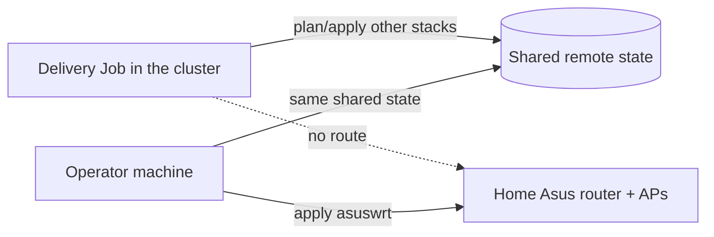

The `asuswrt` OpenTofu stack tracks the home Asus router and its access points
as real OpenTofu state, yet no automation ever applies it.

That split — shared remote state, local-only apply — is the whole point of this
page. The state object is as durable and as shared as every stack Delivery
applies; only the actor and the network path differ.

## Why automation cannot own it

Most stacks under `packages/homelab/src/tofu/` are validated on each pull
request by
[the OpenTofu lanes](https://github.com/shepherdjerred/monorepo/blob/main/packages/woodpecker-config-extension/src/pipeline/lanes/tofu.ts),
then planned and applied by Delivery after merge. Each stack's mode is declared in the
[platform policy](https://github.com/shepherdjerred/monorepo/blob/main/packages/ops-model/platform-policy.json).

A few stacks are `operator-only`, each for its own reason. `asuswrt` is out
because a Job in the cluster reaches the shared state backend but has no
network route to the home LAN where the router lives. An apply therefore has to run from a
machine that can reach **both** the LAN and the state backend.

The alternative — exposing the router's admin interface to the cluster network —
trades a manual step for a permanent attack surface on the device that fronts
the house. The manual step is the cheaper cost.

## Why the wireless write path is not trusted

Reads and imports are reliable across these devices' firmwares, and `plan`
converges to no changes after import. Writes are a different question.

Firmware-specific `wl_bw` codes, chanspec sideband forms, and SAE `wl_mfp`
handling are not fully modeled by
[`terraform-provider-asuswrt`](https://github.com/shepherdjerred/monorepo/tree/main/packages/terraform-provider-asuswrt).
A wireless apply could therefore reformat a working radio into a configuration
the firmware accepts but nobody intended.

So the wireless surface is treated as track-only until an apply has been
verified against real hardware. Import and plan are safe today; that is a
smaller promise than "managed", and it is the honest one.

## The WiFi password is tracked but never verified

`wpa_passphrase` is treated as write-only. The provider can send it, but
[`readWireless`](https://github.com/shepherdjerred/monorepo/blob/main/packages/terraform-provider-asuswrt/internal/provider/wireless_network_resource.go)
never assigns the router's value back onto the model, so state keeps whatever
Terraform last wrote.

The consequence is not plan churn — a configured passphrase produces a clean
no-op plan, because there is nothing to compare and nothing to differ. The
consequence is **drift-blindness**: if someone changes the PSK on the router
directly, this provider cannot see it and will never report it. `plan` staying
quiet means nothing here.

That is the tradeoff being accepted, and it is why the WiFi password is really
managed out of band. Treat a clean plan as silence about the passphrase, not
as evidence it matches.

## What that leaves tracked

System settings, DHCP static leases, and port forwards (router only — AP mode
disables the latter two), plus wireless SSID, auth, crypto, channel, bandwidth,
and hidden flags.

## Related

- [Apply the asuswrt stack](/how-to/apply-the-asuswrt-stack/)
- [About the homelab](/explanation/homelab/overview/)
