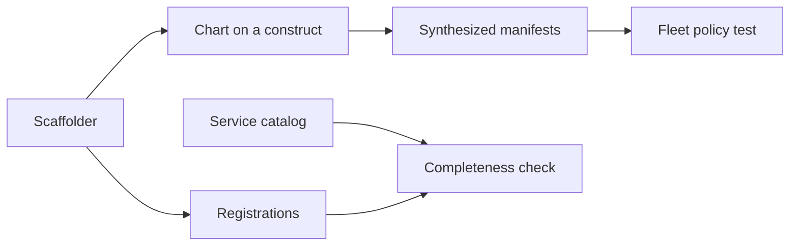

A hosted service is correct when three independent things agree: its shape, the
rules every workload obeys, and the places that have to know it exists.

Each of the three has one owner in the repository. A construct owns the shape.
A fleet policy test owns the rules. A completeness check owns the
registrations, and a scaffolder writes exactly what that check reads. To add a
service, follow [Add a hosted service](/how-to/add-a-hosted-service/).

## The cost was never the workload

A service's Deployment is a small part of adding it. The image needs a registry
entry, a build target, a bake target and a smoke run. The chart needs a Helm
manifest and an Argo Application. The catalog needs a group and a service.
Missing one of them fails late: in the image pipeline, at chart publication, or
at the first release.

Adding the tracker touched 23 files outside its own package. Nothing listed
them. The next author rediscovered each one from a failing pipeline.

## A construct owns the shape

[`FirstPartyWebService`](https://github.com/shepherdjerred/monorepo/blob/main/packages/homelab/src/cdk8s/src/misc/first-party/web-service.ts)
and
[`FirstPartyWorker`](https://github.com/shepherdjerred/monorepo/blob/main/packages/homelab/src/cdk8s/src/misc/first-party/worker.ts)
are the two shapes a first-party workload takes. A web service is one
Deployment, its Service and ServiceMonitor, the hosts it is reached on and the
NetworkPolicies around it. A worker is the same without anything routing to it.

The constructs make the common decisions once. Probes come from the declared
health paths. Every container states its resources, so BestEffort is never an
accident. Policies are a required argument, so a workload cannot be written
without saying who may reach it.

Argo Applications follow the same idea. The
[factories](https://github.com/shepherdjerred/monorepo/blob/main/packages/homelab/src/cdk8s/src/misc/argo/application.ts)
derive the project, destination and chart source. The sync policy has no
default, because an Application body is a Delivery recipe revision and each one
should spell out what it renders.

## A policy test owns what a construct cannot force

A construct only constrains the code that uses it. Older charts predate the
constructs, and upstream charts never will use them. The
[fleet policy test](https://github.com/shepherdjerred/monorepo/blob/main/packages/homelab/src/cdk8s/src/fleet-policy/fleet-policy.test.ts)
therefore reads the synthesized manifests, where every workload looks the same
regardless of how it was written.

Each rule holds for the whole fleet except the entries in a
[debt allowlist](https://github.com/shepherdjerred/monorepo/blob/main/packages/homelab/src/cdk8s/src/fleet-policy/debt-allowlists.ts).
The rule is asserted in both directions. Nothing outside the allowlist may break
it, and nothing inside may satisfy it. A fixed workload therefore has to leave
the list, so the debt only shrinks.

A service built on a construct passes these rules without anyone thinking about
them. That is the point of pairing the two: the construct makes the right shape
the easy one, and the test catches whatever went around it.

## A completeness check owns the registrations

The
[service catalog](https://github.com/shepherdjerred/monorepo/blob/main/packages/ops-model/catalog-document.json)
is the registry of record. The
[completeness check](https://github.com/shepherdjerred/monorepo/blob/main/scripts/checks/service-registration.ts)
walks every catalog service that ships a first-party image or chart and asserts
that each other place agrees with it. A gap prints as a checklist line that
names the file to edit.

Deriving the checklist from the catalog matters. A hand-kept list of "places to
update" goes stale the day a new place appears. The check runs with the
repository's script tests, so a new place becomes a new assertion that every
existing service has to pass.

Real gaps exist, and the check names them instead of hiding them. An exemption
carries its reason. An exemption that no longer applies fails the check, so it
cannot outlive the gap it described.

## The scaffolder writes what the check reads

`scripts/misc/new-service.ts` is a plain file writer. It creates the package,
the chart on the matching construct, the Application and the Helm manifest, and
it adds the service to each registration the check inspects.

The check is the scaffolder's specification, and a test holds the two together.
It scaffolds a throwaway service into a copy of the registration files and
asserts the check finds nothing. It then removes one piece at a time and asserts
the check asks for exactly that piece. A registration added to the check and
not to the scaffolder fails that test.

The scaffolder writes ordinary files once instead of generating registrations
on every build. Generated registrations would need every service to fit one
template, and the fleet has deliberate exceptions. A file that is written once
and checked forever stays reviewable and editable.

## Prepared comes before active

The scaffolder leaves the service prepared. Its chart publishes an inactive
marker and the root renders no Application, so nothing deploys.

Two steps are honest about what exists. A new service has no published image,
and Delivery deploys only builds it has on record. An Application rendered
before then would sync a chart that cannot resolve its image. The prepared
state lets the image pipeline and chart publication run and be watched first.

Activation is its own reviewed change for the same reason
[releases are recorded selections](/explanation/homelab/release-safety/): a
definition that merges should change nothing that runs. Activation adds the
environment, the Delivery delegation and the secrets, and those deserve their
own diff.

## What stays manual, and why

A few inventory tests assert a literal count of images or charts. They guard
against a loader that silently reads nothing, so a derived count would defeat
them. The scaffolder leaves them for the author to bump.

The service's own substance is also out of scope: its secrets, its egress rules,
its storage and its backup class. Those are decisions, and a scaffold that
guessed them would be a default nobody chose.

## Related

- [Add a hosted service](/how-to/add-a-hosted-service/) is the procedure.
- [About the homelab](/explanation/homelab/overview/) covers the topology these
  workloads run on.
- [Why releases are shaped this way](/explanation/homelab/release-safety/)
  explains what activation hands to Delivery.
- [Why module boundaries are a lint gate](/explanation/architecture-enforcement/)
  applies the same "a rule must be able to fail" reasoning to imports.
