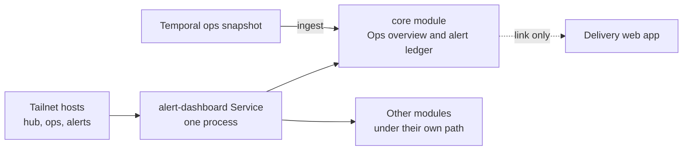

Hub is the one web app for the homelab's personal tools. It began as the
operations overview and the alert ledger, and further tools join it as modules
rather than as separate apps.

Hub keeps a single shell, theme, Home page, and ⌘K palette. Delivery stays a
separate app, and Hub only links to it. Hub's deployed identity is still
`alert-dashboard`, because renaming it would put the alert ledger at risk.

## One app, many modules

Each personal tool used to be its own app. Every one needed its own image,
chart, ingress, Argo CD Application, theme, and navigation. Most of these tools
are small: a page or two over data that already exists. Paying the whole
deployment cost for each one made small tools expensive to add and hard to
find.

Hub pays that cost once. A tool becomes a module with a client half and a
server half. The
[client contract](https://github.com/shepherdjerred/monorepo/blob/main/packages/alert-dashboard/src/client/platform/module.ts)
declares routes, navigation, commands, search, and Home cards. The
[server contract](https://github.com/shepherdjerred/monorepo/blob/main/packages/alert-dashboard/src/server/platform/module.ts)
mounts everything under `/api/<id>`. The router, the navigation, the palette,
and Home are all generated from one
[composition root](https://github.com/shepherdjerred/monorepo/blob/main/packages/alert-dashboard/src/client/modules.ts).
A new module is therefore findable from the palette as soon as it is
registered.

The operations overview and the alert ledger form the built-in `core` module.
It is the only module served at the root, so every existing URL and bookmark
still works. Other modules sit under their own path prefix.

### Sharing a process has a cost

Modules share one process, and that process holds the alert ledger. A module
that misbehaves could slow or crash the thing that records incidents. Three
choices contain that risk.

- Readiness is split. `/readyz` reports only the core database, and each module
  reports at `/readyz/<id>`, as the
  [server](https://github.com/shepherdjerred/monorepo/blob/main/packages/alert-dashboard/src/server/app.ts)
  shows. One module's outage cannot take the pod out of service.
- Imports are fenced. The
  [architecture rules](https://github.com/shepherdjerred/monorepo/blob/main/packages/alert-dashboard/architecture.config.ts)
  forbid a module from importing another module or the core domain,
  application, and infrastructure layers.
- Storage stays outside. A module that needs its own database lives in its own
  workspace package and plugs into Hub through an adapter.

The process already had memory trouble before modules existed. The
[deployment](https://github.com/shepherdjerred/monorepo/blob/main/packages/homelab/src/cdk8s/src/resources/alert-dashboard/index.ts)
records why its limit was raised. Every module's memory footprint therefore
counts against the ledger's headroom, not only its own.

## Why Delivery stays separate

Delivery is the release control plane. It owns PostgreSQL state, approvals,
and the decisions that move a version into an environment. Hub is read-only by
design, as the
[operations overview](/explanation/homelab/operations-overview/) explains.
Folding a write-heavy control plane into a read-only page would mix two very
different trust levels in one process.

Even a read-only Delivery panel in Hub would cost more than it looks. Hub would
need its own credential for Delivery, a 1Password grant, a network egress rule,
and an export on Delivery's side. It would also break the rule that every
operations surface reads the same Temporal snapshot. A Delivery summary, when
one is wanted, belongs in the `ops-snapshot` collector instead.

So Hub links to Delivery and does not embed it. The browser-facing hosts of
both apps live together in
[`tool-links.ts`](https://github.com/shepherdjerred/monorepo/blob/main/packages/ops-model/src/tool-links.ts).
Hub's own release-flow page is labelled **Flow** rather than "Delivery", so the
name points at only one app. How Delivery presents a release is covered in
[how the Delivery web app follows a change](/explanation/homelab/delivery-hub/).

## Why the deployed name is still `alert-dashboard`

Hub is a product name. Everything that runs stays named `alert-dashboard`: the
workspace package, namespace, Service, persistent volume claim, Flipt
namespace, image, metrics, 1Password item, and Argo CD Application.

Renaming the
[Argo CD Application](https://github.com/shepherdjerred/monorepo/blob/main/packages/homelab/src/cdk8s/src/resources/argo-applications/observability/alert-dashboard.ts)
or its namespace would not move the workload. Argo CD would create a new one
and prune the old one, including the volume that holds the alert ledger. The
ledger is the only durable record of past incidents, and a rename gains nothing
a user can see. The same reasoning keeps the webhook URL that Alertmanager
posts to.

The `hub` tailnet host is added beside `ops` and `alerts`, not in place of
them. Alert email, the toolkit, and existing bookmarks already use the older
hosts, and all three reach the same Service.

## Related

- [Operations overview](/explanation/homelab/operations-overview/)
- [Alerts and incident history](/explanation/homelab/alerts/)
- [How the Delivery web app follows a change](/explanation/homelab/delivery-hub/)
- [Hub package README](https://github.com/shepherdjerred/monorepo/blob/main/packages/alert-dashboard/README.md)
