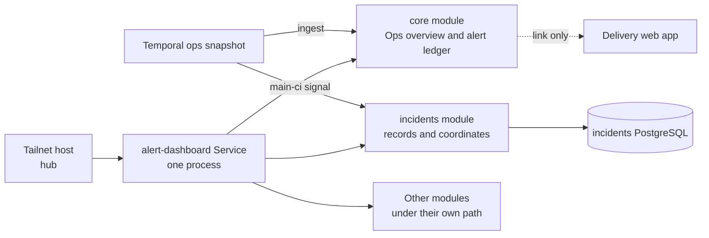

Hub is the one web app for the homelab's personal tools. It began as the
operations overview and the alert ledger, and further tools join it as modules
rather than as separate apps.

Hub keeps a single shell, theme, Home page, and ⌘K palette. Its modules may
record and coordinate, as Incidents does, but none holds authority over the
systems it describes. Delivery holds that authority, so it stays a separate
app that Hub only links to. Hub's deployed identity is still
`alert-dashboard`, because renaming it would put the alert ledger at risk.

## One app, many modules

Each personal tool used to be its own app. Every one needed its own image,
chart, ingress, Argo CD Application, theme, and navigation. Most of these tools
are small: a page or two over data that already exists. Paying the whole
deployment cost for each one made small tools expensive to add and hard to
find.

Hub pays that cost once. A tool becomes a module with a client half and a
server half. The
[client contract](https://github.com/shepherdjerred/monorepo/blob/main/packages/alert-dashboard/src/client/platform/module.ts)
declares routes, navigation, commands, search, and Home cards. The
[server contract](https://github.com/shepherdjerred/monorepo/blob/main/packages/alert-dashboard/src/server/platform/module.ts)
mounts everything under `/api/<id>`. The router, the navigation, the palette,
and Home are all generated from one
[composition root](https://github.com/shepherdjerred/monorepo/blob/main/packages/alert-dashboard/src/client/modules.ts).
A new module is therefore findable from the palette as soon as it is
registered.

The navigation is a sidebar of named groups, not one menu per module. Each
navigation entry names its group, and entries from different modules can share
one. A page therefore sits beside the pages it relates to, whichever module
serves it. A flat bar gave every page a top-level slot, and it ran out of
width before the list of pages did. On a phone the same groups open as a
drawer.

A page that must also run outside Hub keeps its content separate from the
shell. The Storm's promotion report is one: Hub lists it in the sidebar, and a
[standalone entry](https://github.com/shepherdjerred/monorepo/blob/main/packages/alert-dashboard/src/client/promotion/main.tsx)
serves the same content from a laptop without the shell.

The operations overview and the alert ledger form the built-in `core` module.
It is the only module served at the root, so every existing URL and bookmark
still works. Other modules sit under their own path prefix.

Home is the operations overview itself, not a summary that links to one. A
summary with a fuller page behind it shows the same status and the same lists
twice, and leaves the area cards at the bottom of the second page. Home opens
on the overall status, the headline figures, and a table of every area, so
the first screen says whether anything is wrong and where. The lists that
take reading come after. `/overview`, the address of an earlier separate
page, redirects to Home.

### Sharing a process has a cost

Modules share one process, and that process holds the alert ledger. A module
that misbehaves could slow or crash the thing that records incidents. Three
choices contain that risk.

- Readiness is split. `/readyz` reports only the core database, and each module
  reports at `/readyz/<id>`, as the
  [server](https://github.com/shepherdjerred/monorepo/blob/main/packages/alert-dashboard/src/server/app.ts)
  shows. One module's outage cannot take the pod out of service.
- Imports are fenced. The
  [architecture rules](https://github.com/shepherdjerred/monorepo/blob/main/packages/alert-dashboard/architecture.config.ts)
  forbid a module from importing another module or the core domain,
  application, and infrastructure layers.
- Storage stays outside. A module that needs its own database lives in its own
  workspace package and plugs into Hub through an adapter. Incidents is the
  first: its
  [adapter](https://github.com/shepherdjerred/monorepo/blob/main/packages/alert-dashboard/src/modules/incidents/server.ts)
  only checks the package's object against the server contract.

The process already had memory trouble before modules existed. The
[deployment](https://github.com/shepherdjerred/monorepo/blob/main/packages/homelab/src/cdk8s/src/resources/alert-dashboard/index.ts)
records why its limit was raised. Every module's memory footprint therefore
counts against the ledger's headroom, not only its own.

## Incidents takes writes, and why that is acceptable

Hub began read-only. The
[operations overview](/explanation/homelab/operations-overview/) links to
native tools and never acts on them. Incidents breaks the read-only part on
purpose. People and agents declare incidents, take command, post updates, and
resolve them, from the browser and from `toolkit incident`.

Coordination needs a shared, writable record. Agents blocked by the same
broken system used to pile up Forum notices. Nobody knew who was fixing it.
One incident per system, with one commander, answers that question.

The writes are acceptable inside Hub for three reasons.

- **The writes stay outside the ledger.** Incidents keeps its own PostgreSQL
  database, separate from the alert ledger's SQLite. It reports readiness only
  at `/readyz/incidents`. A database outage stops incident writes; the
  overview and the ledger keep serving.
- **Actors are attribution, not authorization.** As with Tracker, the tailnet
  is the access boundary and the actor is self-asserted. A browser write is
  attributed to the Tailscale user Hub's ingress names, as the
  [viewer rule](https://github.com/shepherdjerred/monorepo/blob/main/packages/incidents/src/server/viewer.ts)
  shows.
- **Incidents holds no control-plane authority.** It records and coordinates.
  It never deploys, rolls back, approves, retries CI, or pages anyone. A bad
  write leaves a wrong record or a wrong commander, and a person corrects it.

The line Hub draws is therefore authority, not reads versus writes. A Hub
module may keep its own record of the work. It may not change the systems the
record describes. The
[incidents package README](https://github.com/shepherdjerred/monorepo/blob/main/packages/incidents/README.md)
covers its contract and coordination rules.

## Why Delivery stays separate

Delivery is the release control plane. It owns PostgreSQL state, approvals,
and the decisions that move a version into an environment. Its writes act on
the cluster. Incidents' writes only describe it. Folding Delivery into Hub
would put a process that releases software beside pages any tailnet device can
write to. That mixes two very different trust levels in one process.

An incident about Delivery shows the difference. Incidents records who is
fixing a stuck release and links the deployment. The fix itself happens in
Delivery, under Delivery's own authority.

Even a read-only Delivery panel in Hub would cost more than it looks. Hub would
need its own credential for Delivery, a 1Password grant, a network egress rule,
and an export on Delivery's side. It would also break the rule that every
operations surface reads the same Temporal snapshot. A Delivery summary, when
one is wanted, belongs in the `ops-snapshot` collector instead.

So Hub links to Delivery and does not embed it. The browser-facing hosts of
both apps live together in
[`tool-links.ts`](https://github.com/shepherdjerred/monorepo/blob/main/packages/ops-model/src/tool-links.ts).
Hub's own page for pull requests and work is named **Flow** and served at
`/flow`, not "Delivery", so the name points at only one app. Its earlier
`/delivery` URL redirects there. How Delivery presents a release is covered in
[how the Delivery web app follows a change](/explanation/homelab/delivery-hub/).

## Shared look, separate apps

Hub, Go link, Flags and Mail look like one product: the same sidebar beside an
inset panel, the same colours and type, and the same app switcher at the top
of the sidebar. They are still four apps, each on its own host with its own
deployment. What they share is `@shepherdjerred/console-ui`, a package of styles,
tokens and small components that each app bundles into its own client.

Sharing a package rather than a process keeps the reasons above intact. Go
link, Flags and Mail own their own data, and their writes act: a flag changes
live behaviour, and Mail sends. Like Delivery, folding them into Hub would mix
trust levels in one process. A shared look costs them
nothing at runtime: there is no shared server to call and no shared outage.

The app switcher and Hub's launcher both read one list of consoles,
`CONSOLE_LINKS` in
[`tool-links.ts`](https://github.com/shepherdjerred/monorepo/blob/main/packages/ops-model/src/tool-links.ts),
so adding a console to that list adds it everywhere. Go link's own index is
the catch-all for every other service. The tokens and the contrast pairs they
must meet are listed in the [console UI reference](/reference/console-ui/).

## Why the deployed name is still `alert-dashboard`

Hub is a product name. Everything that runs stays named `alert-dashboard`: the
workspace package, namespace, Service, persistent volume claim, flag catalog
(`alert-dashboard/prod`), image, metrics, 1Password item, and Argo CD
Application.

Renaming the
[Argo CD Application](https://github.com/shepherdjerred/monorepo/blob/main/packages/homelab/src/cdk8s/src/resources/argo-applications/observability/alert-dashboard.ts)
or its namespace would not move the workload. Argo CD would create a new one
and prune the old one, including the volume that holds the alert ledger. The
ledger is the only durable record of past incidents, and a rename gains nothing
a user can see. The same reasoning keeps the webhook URL that Alertmanager
posts to.

`hub` is the only tailnet host. Alert email, the digest, the toolkit, and the
Delivery health probe all use it. The earlier `ops` and `alerts` hosts are
retired, so a bookmark or an old email link that names one no longer resolves;
the same path under `hub` does.

## Related

- [Operations overview](/explanation/homelab/operations-overview/)
- [Alerts and incident history](/explanation/homelab/alerts/)
- [Incidents package README](https://github.com/shepherdjerred/monorepo/blob/main/packages/incidents/README.md)
- [How the Delivery web app follows a change](/explanation/homelab/delivery-hub/)
- [Console UI reference](/reference/console-ui/)
- [Hub package README](https://github.com/shepherdjerred/monorepo/blob/main/packages/alert-dashboard/README.md)
