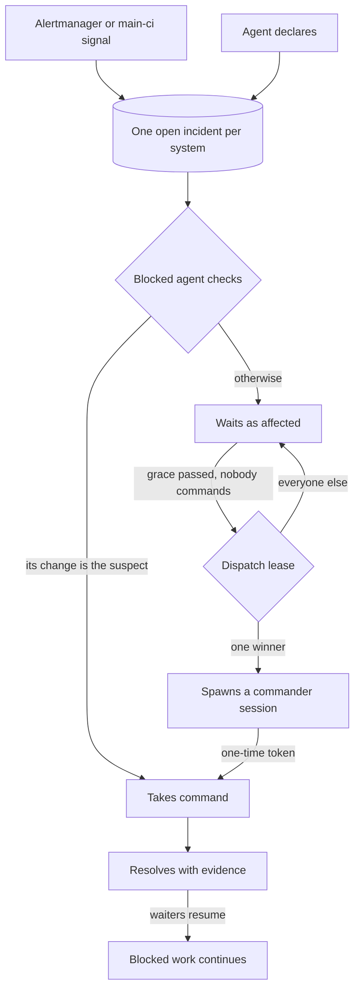

A broken shared system gets one Hub incident with at most one commander. Every
other agent it blocks waits on that record instead of starting its own
recovery.

Many agents work in parallel, and a red `main` or a stuck Delivery queue blocks
most of them at once. Incidents gives them one place to learn whether someone
is fixing it. If nobody is, exactly one of them arranges for someone to.

## Why not Forum notices

Forum notices worked while one agent at a time met a red `main`. With many
agents they produced two problems. Two agents posted separate notices for the
same failing pipeline. And an unowned notice stayed unowned, because every
reader assumed someone else would claim it.

A notice is also the wrong shape. It carries prose and an exit condition, but
nothing that says which system is broken. So nothing can stop a duplicate, and
nothing can attach the alert that keeps firing.

An incident names its systems from a closed list in the
[wire contract](https://github.com/shepherdjerred/monorepo/blob/main/packages/incidents/src/shared/contract.ts).
That closed list makes "one open incident per system" enforceable: a second
declaration is refused and points at the first. Notices remain for what they
suit: a lease on a contended resource, such as the shared test database.

## Who should fix it

The agent that caused a breakage is usually the fastest to fix it. Its session
knows the change. So an incident records a suspect: the failing commit, its pull
request, and the session from the commit's `Claude-Session:` trailer. A
blocked agent whose session or branch matches is told to take command
instead of waiting. The
[command rules](https://github.com/shepherdjerred/monorepo/blob/main/packages/incidents/src/domain/command.ts)
reserve the incident for the suspect or the declarer during a short takeover
grace.

If the grace passes with nobody in command, someone else must step in, or every
blocked agent waits forever. Waiting agents are the natural trigger. They are
already watching, and they are the ones who need progress.

## Exactly once, without a lock service

When the grace passes, every waiting agent tries to take a dispatch lease. The
server decides with one compare-and-set on the incident's revision: one write
wins and every other write is refused. The waiter that wins starts a new
worktree and agent session through Herdr. The session's first message carries
a one-time token, which becomes command when the session claims it
([`wait`](https://github.com/shepherdjerred/monorepo/blob/main/packages/toolkit/src/lib/incidents/wait.ts),
[spawn](https://github.com/shepherdjerred/monorepo/blob/main/packages/toolkit/src/lib/incidents/spawn.ts)).

The lease expires on its own. If the spawn fails, the waiter gives the lease
back. If the new session never claims it, the lease lapses. Either way the next
waiter may dispatch again, so a crashed agent cannot strand an incident.

No separate lock, queue, or orchestrator exists. The incident row is the lock,
and the blocked agents are the orchestrator. Adding a scheduler would need its
own credentials for Herdr and its own failure handling. It would also guarantee
nothing more than the single conditional update already does.

Maintenance windows never dispatch. They are planned, so they have an owner
from the start, and nothing about them is waiting to be rescued.

## Signals open incidents too

Some breakage has no agent to declare it. Two producers open incidents without
one. Curated Delivery alerts arrive through a dedicated Alertmanager receiver,
mapped by
[alert rules](https://github.com/shepherdjerred/monorepo/blob/main/packages/incidents/src/shared/alert-rules.ts).
The Temporal ops snapshot already computes whether `main` is red every five
minutes, and it posts that state with the failing commit as the suspect.

Both go through one
[signal rule](https://github.com/shepherdjerred/monorepo/blob/main/packages/incidents/src/domain/signals.ts).
A firing signal opens the system's incident or attaches to the open one. A
cleared signal is recorded in the timeline. An incident that nobody ever
commanded resolves itself once every signal has cleared. An incident with a
commander waits for that commander's evidence instead, because the commander
may know the signal cleared for the wrong reason.

## What an incident does not do

An incident coordinates; it does not act. Commanding the `delivery` incident
grants no Delivery permission, and resolving it releases no barrier. Recovery
still runs through Delivery's own tools and the usual authorization. That
boundary is also why Incidents can live in Hub, as
[why Hub is one app built from modules](/explanation/homelab/hub/) explains.

## Related

- [Alerts and incident history](/explanation/homelab/alerts/)
- [Why Hub is one app built from modules](/explanation/homelab/hub/)
- [Incidents package README](https://github.com/shepherdjerred/monorepo/blob/main/packages/incidents/README.md)
