Internal SMTP workloads submit mail to `@shepherdjerred/mail` on
`mail.mail.svc.cluster.local:25` over `STARTTLS` validated against
`homelab-cluster-ca`.

First-party TypeScript services submit structured messages over HTTP on `:7371`
(`/v1/messages`). Three workloads speak SMTP instead: Alertmanager's
`mail-fallback` receiver, XenForo (`storm-forum`), and Seerr. Requiring
verified `STARTTLS` lets every SMTP caller authenticate without sending
credentials in cleartext, before `@shepherdjerred/mail` relays queued mail over
`[smtp.fastmail.com]:587`.

## Why a cluster CA, not a self-signed leaf

`@shepherdjerred/mail` runs in namespace `mail`, while its SMTP callers live in
`prometheus`, `storm-forum` (and `storm-forum-beta`), and `torrents`.
A self-signed leaf certificate that acts as its own trust anchor breaks callers
the first time the leaf rotates. `cert-manager`'s `rotationPolicy: Always` mints
a new key, `tls.crt` changes, and cross-namespace clients have no coordinated
reload against the broker.

The two-tier CA avoids that coupling. A long-lived CA (`homelab-cluster-ca`) with
`rotationPolicy: Never` is the trust anchor. `ClusterIssuer` `homelab-ca-issuer`
signs both the rotating `mail-smtp-tls` server leaf and per-namespace client
secrets. Callers trust `ca.crt`, never `tls.crt`.

```mermaid
flowchart LR
  accTitle: Mail SMTP certificate issuance and trust
  accDescr: A self-signed Issuer in cert-manager issues the non-rotating homelab-cluster-ca. ClusterIssuer homelab-ca-issuer signs the rotating mail-smtp-tls leaf presented by Mail on port 25 STARTTLS and distributes ca.crt to Alertmanager, XenForo, and Seerr across their namespaces before Mail relays outbound over smtp.fastmail.com:587.

  SS[Self-signed Issuer] -->|issues, key never rotates| CA["Cluster CA<br/>homelab-cluster-ca"]
  CA -->|backs| CI["ClusterIssuer<br/>homelab-ca-issuer"]
  CI -->|issues, key rotates| LEAF["Mail SMTP leaf<br/>mail-smtp-tls"]
  CI -->|issues ca.crt per namespace| TRUST["Caller CA secrets<br/>ca.crt"]
  LEAF -->|"STARTTLS on :25"| MAIL["@shepherdjerred/mail<br/>mail.mail.svc.cluster.local:25"]
  TRUST --> CALLERS["Alertmanager · XenForo · Seerr"]
  CALLERS -->|"AUTH over STARTTLS"| MAIL
  MAIL -->|"Submission :587"| FM["[smtp.fastmail.com]:587"]
```

[`cert-manager.ts`](https://github.com/shepherdjerred/monorepo/blob/main/packages/homelab/src/cdk8s/src/resources/argo-applications/platform/cert-manager.ts)
owns the root CA and `ClusterIssuer`.
[`mail-smtp.ts`](https://github.com/shepherdjerred/monorepo/blob/main/packages/homelab/src/cdk8s/src/resources/mail/mail-smtp.ts)
issues `mail-smtp-tls` for `mail.mail.svc.cluster.local`, and
[`mail/index.ts`](https://github.com/shepherdjerred/monorepo/blob/main/packages/homelab/src/cdk8s/src/resources/mail/index.ts)
mounts it on the broker and configures outbound relay to
`[smtp.fastmail.com]:587`
([`relay.ts`](https://github.com/shepherdjerred/monorepo/blob/main/packages/mail/src/server/relay.ts)).

This CA is cluster-scoped on purpose. Temporal's PostgreSQL CA stays a
namespace-local `Issuer` because only database peers in `temporal` use it — see
[Temporal PostgreSQL's TLS identity](/explanation/temporal/postgresql-tls-identity/).
Cross-namespace SMTP callers share `homelab-ca-issuer` so each namespace
receives `ca.crt` without minting another root.

## How each caller trusts `ca.crt`

Every `:25` caller validates `mail.mail.svc.cluster.local` against `ca.crt`
through its runtime's TLS store before sending `PLAIN` or `LOGIN` credentials:

- **Alertmanager (`mail-fallback`)**: Go's SMTP client refuses `PLAIN` on
  cleartext connections;
  [`prometheus.ts`](https://github.com/shepherdjerred/monorepo/blob/main/packages/homelab/src/cdk8s/src/resources/argo-applications/observability/prometheus.ts)
  mounts `ca.crt`, sets `smtp_require_tls: true`, and pins `server_name`.
- **XenForo (`storm-forum`)**:
  [`release.ts`](https://github.com/shepherdjerred/monorepo/blob/main/packages/storm-forum/src/release.ts)
  combines `/etc/ssl/certs/ca-certificates.crt` with
  `/etc/storm-forum/smtp-ca/ca.crt` from
  [`storm-forum/index.ts`](https://github.com/shepherdjerred/monorepo/blob/main/packages/homelab/src/cdk8s/src/resources/storm-forum/index.ts)
  into PHP's `openssl.cafile`, and `RequiredStartTlsTransport` refuses cleartext
  authentication.
- **Seerr**: Node.js keeps its Mozilla root bundle for public HTTPS and extends
  trust with `ca.crt` in
  [`seerr.ts`](https://github.com/shepherdjerred/monorepo/blob/main/packages/homelab/src/cdk8s/src/resources/torrents/seerr.ts)
  for `STARTTLS` submission on `:25`.

## Why Prometheus syncs after the cluster CA

Alertmanager mounts its CA secret non-optionally. Making that mount optional
would let the pod start with an unissued certificate and hide the fault until
`mail-fallback` tried to send during an incident.

Prometheus therefore syncs at wave `-1`, after `homelab-cluster-ca` and the
`prometheus`-namespace trust certificate at waves `-4` through `-2` in
[`application-release-policy.ts`](https://github.com/shepherdjerred/monorepo/blob/main/packages/homelab/src/cdk8s/src/application-release-policy.ts).
Temporal follows at wave `0` so its `ServiceMonitor` resources still find
Prometheus CRDs.

## Certificate renewal without pod restarts

`TlsCertificateLoader` in
[`tls-loader.ts`](https://github.com/shepherdjerred/monorepo/blob/main/packages/mail/src/server/tls-loader.ts)
reloads `mail-smtp-tls` without restarting the `mail` pod. On each `STARTTLS`
upgrade in
[`smtp-server.ts`](https://github.com/shepherdjerred/monorepo/blob/main/packages/mail/src/server/smtp-server.ts),
the loader `stat`s the mounted `tls.crt` and `tls.key` files and reuses cached
X.509 material while their `mtime`, `ctime`, inode, and byte size match.

When `cert-manager` renews `mail-smtp-tls` 30 days before expiry and kubelet
atomically updates the mounted secret projection, the next `STARTTLS` handshake
reads the new PEM pair and updates the certificate-expiry metric in place.
Callers trust `ca.crt`, which stays constant across leaf renewals; only
regenerating `homelab-cluster-ca` requires rolling client pods.

## Related

- [Alerts and incident history](/explanation/homelab/alerts/)
- [Temporal PostgreSQL's TLS identity](/explanation/temporal/postgresql-tls-identity/)
