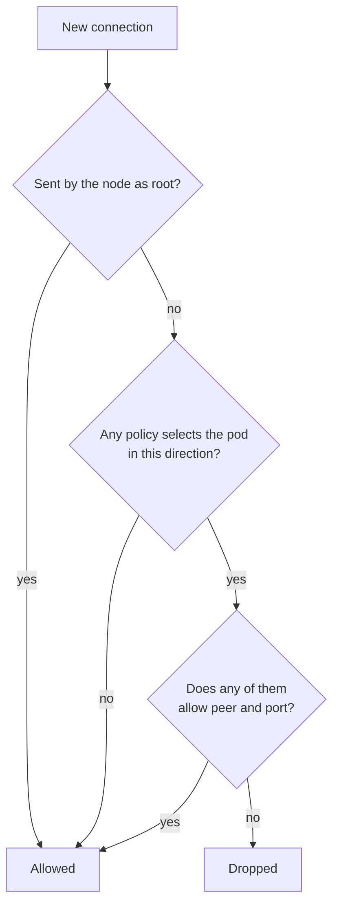

The cluster renders NetworkPolicies but nothing enforces them yet. Enforcement
is switched on once for the whole cluster, and each namespace then moves to its
own policies separately, behind a staging policy that keeps it open until it
is ready.

Flannel is the only network plugin, and flannel ignores NetworkPolicy objects.
Every policy in the repository is therefore a declaration today. A pod that a
policy forbids from reaching Tracker still reaches it.

## What enforces

Talos can run the
[`kube-network-policies`](https://github.com/kubernetes-sigs/kube-network-policies)
agent as a second container in the `kube-flannel` DaemonSet. Talos's flannel
network-policy setting, `kubeNetworkPoliciesEnabled`, turns it on. Only the
control-plane node carries the setting, because the control plane renders the
DaemonSet for every node. Flannel and kube-proxy stay as they are, so nothing
about how pods get addresses or reach Services changes.

Replacing flannel with a policy-capable plugin was the alternative. It was
rejected because production runs on one node. A plugin migration there is a
full outage, while the sidecar is a DaemonSet roll that leaves running pods in
place.

The switch is made in a maintenance window. Until then the agent container does
not exist, and every statement below about enforcement describes the cluster
after it.

## Default-open and additive

A [NetworkPolicy](https://kubernetes.io/docs/concepts/services-networking/network-policies/)
only ever allows. There is no deny rule. Two consequences follow, and the whole
rollout rests on them.

A pod that no policy selects is fully open. Policies restrict only the pods
their selector names, and only in the directions their `policyTypes` list. A
namespace with no policy at all behaves the same with enforcement on as off.

Policies add up. When several policies select one pod, a connection passes if
any one of them allows it. A broad policy cannot be narrowed by adding a
stricter one beside it.

## Why every namespace has a staging policy

The agent has no audit mode. It cannot log what it would have dropped while
still letting traffic through. Whatever policies select a pod apply from the
first packet after the switch.

None of the existing policies has ever been tested against real traffic, so
switching them all on at once would be a cluster-wide experiment. The staging
policy is the substitute for the missing audit mode. It uses additivity
against itself.

Every namespace that has policies gets one more, named
`enforcement-staging-<namespace>`. It allows all traffic in both directions.
While it selects every pod, some policy allows every connection, so the
namespace's real policies decide nothing. That stage is `"open"`.

Cutting a namespace over changes only the staging policy's selector, to a
label no pod carries. The policy then selects nothing and the real policies
decide alone. That stage is `"enforced"`. Because only a selector changes,
cutover and revert are in-place updates of one object and never wait on a
prune.

The stage of every namespace is one entry in
[`enforcement-stages.ts`](packages/homelab/src/cdk8s/src/fleet-policy/enforcement-stages.ts).
[`applyEnforcementStaging`](packages/homelab/src/cdk8s/src/enforcement-staging.ts)
renders the staging policies from that map over the finished app, so a
namespace cannot gain a policy without being staged. A namespace with a policy
and no entry fails synthesis.

Two kinds of namespace do not fit the simple case, and the same file declares
both.

`STAGED_WITHOUT_RENDERED_POLICY` lists namespaces whose policies synthesis
cannot see. `argocd` and `prometheus` get theirs from an upstream Helm chart.
One namespace holds a policy that exists only in the cluster. Each still needs
a staging policy, so the map names the chart that carries it.

`ENFORCED_WITHOUT_STAGING` lists namespaces that are deliberately not staged.
They hold the isolation policy of a finished restore rehearsal or recovery and
run no pod. Isolation is the intent there, so enforcement applies to them the
moment the cluster enforces.

## What the fleet checks prove

The [fleet policy tests](packages/homelab/src/cdk8s/src/fleet-policy/fleet-policy.test.ts)
read every rendered manifest and evaluate the policies the way the enforcer
will. They ignore the staging policies, so an open namespace cannot hide a
wrong rule.

They prove that the declared topology is consistent with itself:

- a Service endpoint named in a workload's literal environment is allowed by
  the policies on both ends;
- a cross-namespace rule on one side has its counterpart on the other;
- every probed port admits the blackbox prober and the proxy or tunnel that
  routes to it;
- every Tailscale Ingress backend admits its proxy;
- every pod with an Egress policy can reach cluster DNS;
- rules for the API server name the address it advertises.

They cannot prove that the declared topology is the real one. A test reads
manifests, not traffic.

An endpoint that comes from a Secret is invisible, because synthesis never
sees the value. So is an endpoint the application builds in code, or reads
from a database row, or follows from a redirect. Address rules are only partly
checked, since no pod or node address exists at synthesis time. The tests
resolve an `ipBlock` only when it covers every address.

The live gate, `check-namespace.ts`, closes part of that gap after a cutover.
It checks pod readiness, Service endpoints, the namespace's public and tailnet
URLs, and its blackbox probes. All of those are connections _into_ the
namespace. A blocked outbound call to a third-party API changes none of them.
It shows up only in the enforcer's log and in the application's own behaviour,
which is why a cutover ends with the namespace's user flow.

## Node traffic and host-network pods

The agent filters pod traffic. Two kinds of traffic never reach it.

Traffic that the node itself originates as root bypasses the agent. Kubelet
probes are the important case. A policy that forgets the kubelet does not make
a pod unready.

A pod on the host network shares the node's network namespace, so no policy
selects it. Home Assistant and Scrypted run that way. A policy in their
namespace governs only the pod-network pods beside them. Their own connections
carry the node's address, which no namespace or pod selector matches.

The reverse case matters for `ipBlock` rules. A client that reaches a pod
through a `hostPort`, or a NodePort Service with
`externalTrafficPolicy: Local`, keeps its own address. Policies admit those
clients by address, not by namespace.

## Where a connection appears to come from

The enforcer evaluates a connection after Service translation. A rule is
matched against the backend pod and its port, never against the Service name
or its cluster IP. The same holds for the API server: a pod's connection to
the `kubernetes` Service is judged against the control-plane node's address.

A request from outside the cluster arrives from whatever pod carried it in.

A tailnet route is served by a Tailscale proxy pod in the `tailscale`
namespace. The backend sees that pod as the source, not the person's device.
A workload behind a Tailscale Ingress must admit the `tailscale` namespace on
its pod port.

A public route is served by cloudflared, which the Cloudflare operator runs
beside itself in `cloudflare-operator-system`. The `cloudflare-tunnel`
namespace holds only the tunnel's definition and has no pods.

The shared rules for both live in
[`network-policies.ts`](packages/homelab/src/cdk8s/src/misc/network-policies.ts),
so a chart names the source instead of retyping its namespace.

## Fail-open

If the agent container stops, traffic passes. It does not fail closed.

That is the safer default for a cluster with one production node, where a
crashed enforcer that dropped everything would take down every service. The
cost is silence. A dead agent looks exactly like a cluster with no policies,
and nothing a user does reveals it.

Policies are therefore a second boundary, not the only one. The workloads that
must not reach a destination under any failure keep a pod-local firewall, as
the [agent task boundary](/explanation/temporal/agent-task-boundary/) does.

## Limits

Enforcement covers what the policies cover, and they do not cover everything.

Most upstream-chart namespaces have no policy and stay fully open after the
switch. Writing policies for them is separate work, tracked as Tracker AI-600.
Until it lands, a pod in one of those namespaces can still reach any open pod,
and any pod can reach them.

A namespace in the `"open"` stage is not protected either, however complete
its policies look. The stage map is the honest statement of how much of the
cluster is enforced.

The break-glass policy is a third way a namespace can be open. It is applied
by hand, outside source, and it overrides the stage until someone removes it.

The agent also exposes something new. It serves its metrics on port 9080 on
every node address, so they are readable from the LAN and the tailnet. No
Talos firewall rule closes the port. The first such rule makes Talos create a
host input chain that drops invalid-state packets for all inbound traffic,
which is a larger change than the exposure it would fix. The agent flag that
binds the port to loopback arrives with Talos 1.15.

## Related

- [Cut a namespace over to enforced policies](/how-to/cut-a-namespace-over-to-enforced-policies/)
- [Open a namespace in an emergency](/how-to/open-a-namespace-in-an-emergency/)
- [Agent task boundary](/explanation/temporal/agent-task-boundary/)
