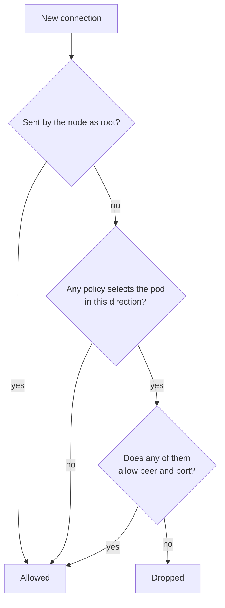

The cluster enforces NetworkPolicies through an agent that runs beside
flannel on every node. Each namespace's own policies decide its traffic from
the first packet after they sync, and a hand-applied break-glass policy is the
only way to open a namespace faster than a release.

Flannel is the only network plugin, and flannel itself ignores NetworkPolicy
objects. Enforcement comes entirely from the agent described below.

## What enforces

Talos can run the
[`kube-network-policies`](https://github.com/kubernetes-sigs/kube-network-policies)
agent as a second container in the `kube-flannel` DaemonSet. Talos's flannel
network-policy setting, `kubeNetworkPoliciesEnabled`, turns it on. Only the
control-plane node carries the setting, because the control plane renders the
DaemonSet for every node. Flannel and kube-proxy stay as they are, so nothing
about how pods get addresses or reach Services changes.

Replacing flannel with a policy-capable plugin was the alternative. It was
rejected because production runs on one node. A plugin migration there is a
full outage, while the sidecar is a DaemonSet roll that leaves running pods in
place.

The switch was made once, in a maintenance window;
[How to switch on network policy enforcement](/how-to/switch-on-network-policy-enforcement/)
is that procedure and its rollback.

## Default-open and additive

A [NetworkPolicy](https://kubernetes.io/docs/concepts/services-networking/network-policies/)
only ever allows. There is no deny rule. Two consequences follow, and
everything below rests on them.

A pod that no policy selects is fully open. Policies restrict only the pods
their selector names, and only in the directions their `policyTypes` list. A
namespace with no policy at all behaves the same with enforcement on as off.

Policies add up. When several policies select one pod, a connection passes if
any one of them allows it. A broad policy cannot be narrowed by adding a
stricter one beside it.

## No audit mode, and what stands in for one

The agent has no audit mode. It cannot log what it would have dropped while
still letting traffic through. A policy applies from the first packet after it
syncs, so a wrong rule is an outage, not a warning.

Two things make that tolerable. Before a change merges, the fleet checks below
compare every policy with the rest of the rendered topology. After it syncs,
the live gate in
[Check a namespace under enforced policies](/how-to/check-a-namespace-under-enforced-policies/)
and the enforcer's denial log show what broke.

When something breaks faster than a fix can ship, additivity is the way out.
One more policy that selects every pod and allows everything opens the
namespace, whatever its other policies say. The
[break-glass procedure](/how-to/open-a-namespace-in-an-emergency/) applies
exactly that, by hand, as an object ArgoCD does not track. Self-heal cannot
revert it, and nothing removes it but an operator.

The same property made the rollout safe. Every namespace first carried such
an allow-all policy, and each was then moved to its own policies one at a
time. Those policies were removed when the rollout finished.

## What the fleet checks prove

The [fleet policy tests](packages/homelab/src/cdk8s/src/fleet-policy/fleet-policy.test.ts)
read every rendered manifest and evaluate the policies the way the enforcer
does.

They prove that the declared topology is consistent with itself:

- a Service endpoint named in a workload's literal environment, or in a code
  default declared in `CODE_DEFAULT_ENDPOINTS` that the environment leaves
  unset, is allowed by the policies on both ends;
- a rule naming pods on one side has its counterpart on the other, whether
  those pods are in another namespace or the rule's own, such as an app and
  its database;
- every probed port admits the blackbox prober and the proxy or tunnel that
  routes to it;
- every Tailscale Ingress backend admits its proxy;
- every pod with an Egress policy can reach cluster DNS;
- rules for the API server name the address it advertises;
- a PostgreSQL cluster an Egress policy binds can still reach the API server,
  where Patroni keeps its leader lease.

They cannot prove that the declared topology is the real one. A test reads
manifests, not traffic.

An endpoint that comes from a Secret is invisible, because synthesis never
sees the value. So is an endpoint the application builds in code without a
declaration, or reads from a database row, or follows from a redirect. A
default such as Birmel's Loki logs URL is visible only once it is declared in
[`configured-endpoints.ts`](packages/homelab/src/cdk8s/src/fleet-policy/configured-endpoints.ts),
whose test also checks the value is still in the named source file. Address rules are only partly
checked, since no pod or node address exists at synthesis time. The tests
resolve an `ipBlock` only when it covers every address.

The live gate, `check-namespace.ts`, closes part of that gap after a change.
It checks pod readiness, Service endpoints, the namespace's public and tailnet
URLs, and its blackbox probes. All of those are connections _into_ the
namespace. A blocked outbound call to a third-party API changes none of them.
It shows up only in the enforcer's log and in the application's own behaviour,
which is why a check ends with the namespace's user flow.

## Node traffic and host-network pods

The agent filters pod traffic. Two kinds of traffic never reach it.

Traffic that the node itself originates as root bypasses the agent. Kubelet
probes are the important case. A policy that forgets the kubelet does not make
a pod unready.

The bypass goes by the sending socket's owner, not by the address. It is the
agent's
[`meta skuid 0 accept` rule](https://github.com/kubernetes-sigs/kube-network-policies/blob/v1.1.2/pkg/dataplane/controller.go#L682-L698).
A host process that runs as another user is checked like any client. It
arrives from the node's address on the pod bridge, `10.244.0.1` on torvalds,
and needs an `ipBlock` rule for that address.

Kubelet probes still appear in the agent's log as connections from
`10.244.0.1` to the probe port. In an enforced namespace some of those packets
are dropped while the pod stays Ready. The probe's own packets match the
bypass; only stray packets of the connection reach the agent.

The agent also
[re-checks established connections](https://github.com/kubernetes-sigs/kube-network-policies/blob/v1.1.2/pkg/dataplane/controller.go#L375-L455)
at most every 30 seconds, logged with packet `id=0`. A failed re-check drops
nothing by itself: it clears the connection's accept mark, so the agent
decides its next queued packet again. The re-check
[builds its packet from the connection-tracking entry](https://github.com/kubernetes-sigs/kube-network-policies/blob/v1.1.2/pkg/dataplane/conntrack.go#L23-L50),
and entries outlive the pods that made them. A departed pod's entry is named
after whichever pod now holds its address. A replay of the log has to set
those lines, and the probe ones, apart from real traffic.

A pod on the host network shares the node's network namespace, so no policy
selects it: the agent leaves host-network pods out of
[its address index](https://github.com/kubernetes-sigs/kube-network-policies/blob/v1.1.2/pkg/podinfo/ipresolver.go#L30-L41).
Home Assistant and Scrypted run that way. A policy in their namespace governs
only the pod-network pods beside them. Their own connections carry the node's
address, which no namespace or pod selector matches. Home Assistant's
websockets to zwave-js-ui and eufy-security-ws arrive from torvalds' LAN
address, so
[the `home` chart](packages/homelab/src/cdk8s/src/cdk8s-charts/home.ts) admits
that address on port 3000.

The reverse case matters for `ipBlock` rules. A client that reaches a pod
through a `hostPort`, or a NodePort Service with
`externalTrafficPolicy: Local`, keeps its own address. Policies admit those
clients by address, not by namespace.

## Where a connection appears to come from

The enforcer evaluates a connection after Service translation. A rule is
matched against the backend pod and its port, never against the Service name
or its cluster IP. The same holds for the API server: a pod's connection to
the `kubernetes` Service is judged against the control-plane node's address.

A request from outside the cluster arrives from whatever pod carried it in.

A tailnet route is served by a Tailscale proxy pod in the `tailscale`
namespace. The backend sees that pod as the source, not the person's device.
A workload behind a Tailscale Ingress must admit the `tailscale` namespace on
its pod port.

A public route is served by cloudflared, which the Cloudflare operator runs
beside itself in `cloudflare-operator-system`. The `cloudflare-tunnel`
namespace holds only the tunnel's definition and has no pods.

The shared rules for both live in
[`network-policies.ts`](packages/homelab/src/cdk8s/src/misc/network-policies.ts),
so a chart names the source instead of retyping its namespace.

## Fail-open

If the agent container stops, traffic passes. It does not fail closed.

That is the safer default for a cluster with one production node, where a
crashed enforcer that dropped everything would take down every service. The
cost is silence. A dead agent looks exactly like a cluster with no policies,
and nothing a user does reveals it. Only monitoring does: an alert fires when
a node has no running enforcer or one restarts, as listed under
[Watching the enforcer](/how-to/check-a-namespace-under-enforced-policies/#watching-the-enforcer).

Policies are therefore a second boundary, not the only one. The workloads that
must not reach a destination under any failure keep a pod-local firewall, as
the [agent task boundary](/explanation/temporal/agent-task-boundary/) does.

## Limits

Enforcement covers what the policies cover, and they do not cover everything.

Most upstream-chart namespaces have no policy and stay fully open after the
switch. Writing policies for them is separate work, tracked as Tracker AI-600.
Until it lands, a pod in one of those namespaces can still reach any open pod,
and any pod can reach them.

A break-glass policy opens a namespace completely, however complete its
policies look. It is applied by hand, outside source, and it stays until
someone removes it; an alert fires while it exists.

The agent also exposes something new. It serves its metrics on port 9080 on
every node address, so they are readable from the LAN and the tailnet. No
Talos firewall rule closes the port. The first such rule makes Talos create a
host input chain that drops invalid-state packets for all inbound traffic,
which is a larger change than the exposure it would fix. The agent flag that
binds the port to loopback arrives with Talos 1.15.

## Related

- [Check a namespace under enforced policies](/how-to/check-a-namespace-under-enforced-policies/)
- [Open a namespace in an emergency](/how-to/open-a-namespace-in-an-emergency/)
- [Agent task boundary](/explanation/temporal/agent-task-boundary/)
