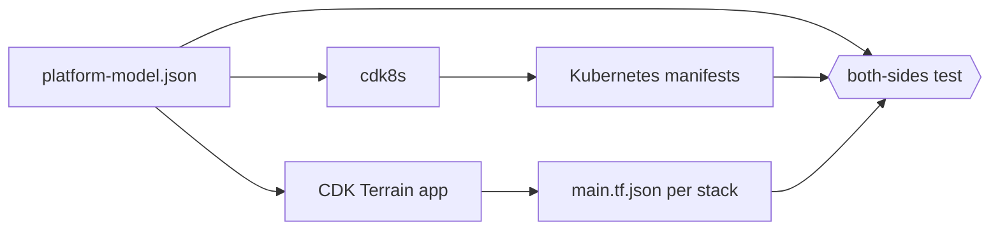

Two TypeScript programs synthesize the homelab, and neither imports the other.
The facts both must agree on live in one typed model that each one reads.

cdk8s writes the Kubernetes manifests. The CDK Terrain ("cdktn") app writes
OpenTofu configuration. A test compares both outputs with the model, so a fact
rendered on one side only fails before merge.

## Two programs, one engine each

[cdk8s](packages/homelab/src/cdk8s/README.md) renders the charts that ArgoCD
syncs. The [cdktn app](packages/homelab-cdktn/src/app.ts) renders one
`main.tf.json` per stack into `packages/homelab/src/tofu/<stack>/`.

OpenTofu is still the engine for the second half. Synthesis only writes JSON.
Planning and applying are OpenTofu reading that file, exactly as it would read
HCL. The app's `SYNTHESIZED_STACKS` list names the stacks written this way; a
stack is either synthesized or hand-written HCL, never both.

## Why a shared model and not an import

Some facts are rendered twice. A public hostname is a `TunnelBinding` in the
cluster and a proxied CNAME in Cloudflare. Written separately, the two halves
drift: a hostname gains a binding and no record, or a record outlives its
workload.

The obvious fix is to let one synthesizer import the other's constructs. That
was rejected for three reasons.

- **A construct is a rendering, not the fact.** A `TunnelBinding` construct
  knows how Kubernetes spells a hostname. The hostname itself belongs to
  neither tool.
- **An import couples two builds.** cdktn stacks need generated provider
  bindings that are never committed. A cdk8s build that imported a stack would
  need them too, and the reverse import would pull chart code into every stack.
- **Other readers exist.** Tests and repository checks need the same facts
  without running either synthesizer.

So the facts are data.
[`platform-model.json`](packages/homelab/src/platform-model.json) holds them in
a language-neutral file, and
[`platform-model.ts`](packages/homelab/src/platform-model.ts) validates it and
exposes typed lookups. Both synthesizers depend on that module and on nothing
of each other's.

## What is declared once

The model has five kinds of definition. Each has a Kubernetes half and an
OpenTofu half.

- A **public hostname** is a `TunnelBinding` to a Service, and a proxied CNAME
  to the tunnel.
- A **static site** is a Caddy host serving a bucket, and that bucket with its
  expiry and its zone's cache rule.
- A **tailnet service** is a Tailscale ingress, Service or device, and the tag
  owners in the tailnet policy.
- A **bucket consumer** is a bucket name in a workload's environment, and the
  SeaweedFS bucket.
- A **scoped credential** is a `OnePasswordItem` naming a title, and the
  `onepassword_item` that writes it.

The model does not copy a fact another registry already owns. Mail-policy hosts
come from the domain registry, and workload credentials from the `google` and
`anthropic-federation` desired state. The
[homelab README](packages/homelab/README.md#platform-model) is the reference
for the definitions and their lookups.

## What each side renders

cdk8s renders everything it can from the model. Its constructs take a model
entry where they once took a string, and a lookup for an undeclared id throws
during synthesis. A value taken from a lookup cannot disagree with its
definition.

On the OpenTofu side, two stacks read the model through the same accessors.
The `cloudflare` stack's
[`platform.ts`](packages/homelab-cdktn/src/stacks/cloudflare/platform.ts)
turns every public hostname into a tunnel CNAME and every zone's immutable
prefixes into a cache rule. The `seaweedfs` stack creates a bucket for every
static site and bucket consumer, and expires each site's immutable prefixes.

A stack still declares what the model has no definition for. The `seaweedfs`
stack names the buckets no site or workload consumes, such as the one holding
OpenTofu state. The stacks that write 1Password items do not read the model.

That asymmetry is why the model alone is not enough.

## The both-sides test

The
[both-sides test](packages/homelab/src/cdk8s/src/platform-model/rendered-on-both-sides.test.ts)
holds every definition against both renderings. It reads the synthesized
manifests and the JSON OpenTofu actually runs, and compares them value by
value. A record written outside the model is caught the same way as one
written from it.

Its rules come in pairs. One asks whether a declared fact is rendered. The
other asks whether a rendered fact is declared. The second is how a hostname
added to one tool only is found.

Real disagreements existed when the model arrived. They are listed in
[`debt-allowlists.ts`](packages/homelab/src/cdk8s/src/platform-model/debt-allowlists.ts),
and the test asserts that list in both directions. A disagreement that is not
listed fails. A listed entry that no longer disagrees also fails, until it is
deleted. So the list can only shrink, and it cannot be used to wave a new
hostname through.

The `cloudflare` stack carries the same exceptions in its own source, because
removing one changes live DNS or caching. Each removal is a reviewed plan of
its own, not a side effect of tidying the list.

## Why stacks were ported in two passes

A resource's address comes from where its construct sits in the tree. Wrapping
a resource in a shared construct renames it, and OpenTofu reads a rename
without a `moved` block as a destroy and a create.

A port therefore changes one thing at a time. The first pass is
address-identical: every resource sits directly in the stack with its old
name. An empty plan against live state then proves the port changed nothing.
The second pass moves resources into constructs, each with an explicit move,
and is accepted on a plan that shows only moves.

Combining the passes would save a pull request and lose the evidence. A plan
with both a rewrite and a restructure cannot say which one caused a diff. The
[cdktn README](packages/homelab-cdktn/README.md#the-two-pass-rule) holds the
port rules and the known cdktn behavior that shaped them.

## Why the synthesized JSON is committed

Generated files are usually built, not committed. These are committed because
of where OpenTofu runs.

Delivery plans and applies each stack from an immutable archive of its
directory, frozen by CI on every `main` build. The Job that runs OpenTofu
holds the stack's provider credentials. It has no synthesis step, no provider
bindings and no reason to run repository TypeScript beside those credentials.

Committing `main.tf.json` keeps it that way. The archive already contains the
exact configuration, and the reviewed diff shows the exact change OpenTofu
will see. The repository checks that compare both sides read the same file.

The cost is a generated file that can go stale. The cdktn `build` task closes
that gap: it fails when a committed file differs from a fresh synthesis.

## Related

- [Change an OpenTofu stack](/how-to/change-an-opentofu-stack/) — the steps
  from an edit to an applied plan.
- [Why a hosted service is a construct, a policy test and a checklist](/explanation/homelab/hosted-service-model/) —
  the cdk8s constructs that take model entries.
- [Why releases are shaped this way](/explanation/homelab/release-safety/) —
  why an OpenTofu approval is bound to the saved plan.
