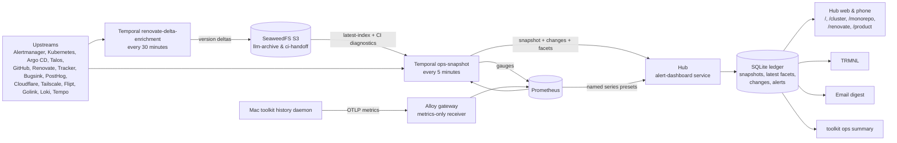

The operations overview gives one answer to "is anything wrong, and what is
waiting on me?". Every surface reads the same collected state, while Hub pairs
that snapshot with latest-only facets for deep-dive inventories. Hub, the TRMNL
screen, the email digest, and `toolkit ops summary` never query external
upstreams themselves.

## The questions it answers

The design starts from recurring operator questions, not from the data sources:

| Question                                             | Where it is answered                                                      |
| ---------------------------------------------------- | ------------------------------------------------------------------------- |
| Is anything wrong right now?                         | Home: overall status, area cards, "Needs attention" list                  |
| Something broke — what changed, and where?           | Service detail with its change timeline and drill-down links              |
| What is in flight, and what is waiting on me?        | Flow (`/flow`), Renovate (`/renovate`), and "Waiting on you" on Home      |
| How healthy are workspace builds and caches?         | Monorepo (`/monorepo`): package directory, Turborepo cache ratios, audits |
| Which subscription should I use, and am I on budget? | AI section: quota windows, spend, projection, usage by tool               |
| What is rotting, and how healthy is the cluster?     | Maintenance section and Cluster (`/cluster`)                              |
| Are my sites up and used?                            | Product (`/product`) for probes, PostHog traffic, vitals, and funnels     |
| How did the week go?                                 | Review page and the weekly digest                                         |

In Hub these answers start on one page. Home shows the overall status, a card
for each section, and a single "Needs attention" list. That list holds every
signal at attention severity or waiting on Jerred, and a filter narrows it to
the ones that wait on him. It is a filter and not a second list because the
two overlap: a failed restore both needs attention and waits on him.

Home stays scannable because it caps every list to what needs action now. Deeper
inventory questions belong on dedicated pages: `/cluster`, `/monorepo`,
`/renovate`, and `/product`. Those pages join structured facets with Prometheus
trends, while Grafana remains the place for ad-hoc Explore queries and raw
dashboards.

## System map

## One model, many renderers

Five consumers ask the same questions. Building a web page first and scraping
it later would give each surface its own interpretation of "healthy". Instead,
the contract lives in [`packages/ops-model`](packages/ops-model/src/snapshot.ts).

Every upstream fact becomes a **signal**. A signal has a severity, a source, an
optional service, a `needsMe` flag, a start time, and links. Signals group into
fixed **sections**. Each section rolls up to its worst severity. The snapshot
rolls up its sections the same way.

The severity scale is `ok < info < unknown < warning < error`. `unknown` sits
above `info` on purpose. A source that failed to answer must never look
healthy, but a known problem still sorts ahead of a blind spot.

Severity is decided once, where the fact is collected. A renderer shows that
verdict and never derives its own. Subscription quota is the case that needs
this. A five-hour window at 95% that resets within the hour heals itself, so
the collector reports it as informational. A page that judged the ratio alone
would call the same window an error.

Lists of signals stay short however many signals there are. Three or more
signals of the same kind, section, severity, and `needsMe` collapse into one
counted row, such as "100 Renovate updates awaiting approval". Only the kinds
allowlisted in
[`signal-groups.ts`](packages/ops-model/src/signals/signal-groups.ts) collapse.
Every Alertmanager alert shares the kind `alert`, so alerts never hide behind a
group, and a new kind stays visible row by row until someone adds it. The web
pages, the digest email, and `toolkit ops summary` all group the same way. Each
web list then shows only its worst entries, ten or fewer, and expands in place.

## Why a scheduled snapshot, not live queries

A Temporal schedule collects every five minutes and stores the result. This
choice has three consequences.

- Every surface agrees, because they all read the same document.
- History comes for free. The collector sets Prometheus gauges for PR counts,
  the Renovate backlog, Tracker, Bugsink, and Talos. The dashboard keeps hourly
  snapshots for trends.
- The dashboard needs no upstream credentials. Tracker uses private,
  credentialless reads. PostHog and GitHub access lives only in the Temporal
  worker, which already held the Talos, GitHub App, and Bugsink credentials.

The cost is up to five minutes of lag. Alerts are the exception, because
Alertmanager already pushes them to the dashboard's ledger in real time.

Each source is isolated. A failed source becomes a failed `SourceStatus`, and
its section renders `unknown`. The rest of the snapshot still publishes. At
read time the dashboard applies a staleness budget of three intervals. An old
snapshot degrades to `unknown` instead of staying green. A Prometheus rule
alerts when publishing stops.

Adding a source spans two deploys. Collector activities update with every
release, but the snapshot workflow is pinned to the central Worker Deployment
version. Until that version advances, a newly declared source is reported as
failed ("not collected by this workflow build") rather than blocking the whole
snapshot. Traces arrived this way: error and slow root traces come from Tempo's
TraceQL search, grouped by root service.

## Why rich inventories live in latest-only facets, not the hourly snapshot

The core [`Snapshot`](packages/ops-model/src/snapshot.ts) stays under 160 KiB
because every consumer reads the whole document and SQLite retains hourly copies
for 90 days per [`OPS_POLICY`](packages/ops-model/src/policy.ts). Embedding full
workload tables, package directories, and PostHog site rows in `Snapshot` would
bloat 90-day retention and strain TRMNL and digest consumers.

Rich inventories travel instead as
[`OpsFacets`](packages/ops-model/src/facets/index.ts) on the same five-minute
`OpsIngest` delivery.
[`PrismaOpsRepository`](packages/alert-dashboard/src/infrastructure/prisma-ops-repository.ts)
upserts each facet key as a single latest-only `OpsFacet` row in SQLite and
caches the parsed payload in memory. Current inventory stays fast to read and
bounded on disk, regardless of how many rows `/cluster`, `/monorepo`,
`/renovate`, or `/product` inspect. For `/monorepo`,
[`monorepo-diagnostics.ts`](packages/temporal/src/activities/ops/facets/monorepo-diagnostics.ts)
compacts recent `diagnostics-verify.json` artifacts from the `ci-handoff`
SeaweedFS S3 bucket so raw task logs never enter SQLite.

Dropping facet history loses nothing because time-series trends belong in
Prometheus, not in repeated JSON blobs. Pages pair the latest facet with named
[`PrometheusSeries` presets](packages/alert-dashboard/src/domain/ops-series.ts)
so browsers request preset identifiers rather than raw PromQL.

## Why Renovate version deltas run out-of-band in S3

Summarizing changelogs across dozens of pending updates requires release fetches
and LLM calls that cannot fit inside `ops-snapshot`'s 60-second collector
timeout.
[`renovate-delta-enrichment`](packages/temporal/src/workflows/ops/renovate-delta-enrichment.ts)
therefore runs out-of-band on its own 30-minute Temporal schedule.

For each candidate,
[`version-resolver.ts`](packages/temporal/src/activities/ops/renovate-delta/version-resolver.ts)
resolves the live cluster `runningVersion` alongside `main`'s `pinnedVersion`.
Comparing from `runningVersion` covers every intermediate release missing in
production when a live cluster rollout lags Git.
[`llm-synthesizer.ts`](packages/temporal/src/activities/ops/renovate-delta/llm-synthesizer.ts)
then synthesizes cumulative changelogs and consumer impact through
`@shepherdjerred/llm-runtime`, falling back to deterministic extraction when
synthesis fails.

[`s3-cache.ts`](packages/temporal/src/activities/ops/renovate-delta/s3-cache.ts)
writes each summary into content-addressed `llm-archive` S3 objects and updates
`latest-index.json`. Content addressing lets unchanged version jumps reuse their
cached delta without repeating GitHub or LLM calls. During the five-minute
`ops-snapshot`,
[`renovate-facet.ts`](packages/temporal/src/activities/ops/facets/renovate-facet.ts)
joins `latest-index.json` in one S3 read and degrades to unenriched rows if S3
is unreachable.

## The service catalog is the join key

Triage and product questions only work if names from different systems meet.
[`services.json`](packages/ops-model/services.json) maps each service to its
namespaces, Argo CD applications, Bugsink projects, analytics sites, Grafana
dashboards, and deploy variants.

Namespaces do most of the joining. Probes, pods, Argo CD destinations, and Loki
streams already carry them. The catalog only needs explicit entries for names
with no namespace, such as Bugsink project slugs and PostHog site keys.

Tests keep the catalog honest. Every Argo CD application and every analytics
site must belong to exactly one service. `toolkit deployed` derives its service
table from the same file.

## Mac usage stays push-only

Personal Claude Code, Codex, and subscription quota data exist only on the
Mac. The `toolkit history` daemon pushes them as OTLP metrics. The cluster
never reaches into the laptop, and a sleeping Mac simply stops reporting.

Two details make the counters trustworthy.

- Transcripts get pruned, and the history index can be rebuilt. A separate
  export ledger only ever adds events it has not seen, so totals never
  decrease.
- The first run seeds the ledger without exporting. History starts at rollout;
  it is not backfilled.

Usage is priced at API rates, so the AI page shows each tool's month as
API-equivalent spend. Most of that usage runs on fixed-price subscriptions.
The figure compares how much each tool is used; it is not money spent.

The Alloy gateway exposes a separate metrics-only receiver on the tailnet. It
forwards only `ai_usage_*` and `ai_subscription_*` series to Prometheus. The
trace receiver stays cluster-internal. See
[Enable Mac usage metrics](/how-to/enable-mac-usage-metrics/).

## Read-only by design

The overview links to native tools and never acts on them. It cannot approve a
Renovate update, silence an alert, or merge a PR. That keeps every token
read-scoped. It also leaves the tailnet boundary as the only access control a
read-only page needs.

The dashboard writes only ingested telemetry and viewer state. It stores
snapshots, latest facets, and changes, and it records which signals a viewer
has already seen.

The email digest follows the same rule. A daily glance and a weekly review
summarize the stored snapshots. Alertmanager remains the only paging path.

## Why it lives beside the alert ledger

The alert ledger already had the durable SQLite store, the Postal outbox,
Grafana deep links, and a tailnet UI. The overview extended that service in
place rather than adding a sibling. Together they are the `core` module of
Hub. [Why Hub is one app built from modules](/explanation/homelab/hub/)
explains that app, its hosts, and why it is still deployed as
`alert-dashboard`. See
[Alerts and incident history](/explanation/homelab/alerts/) for the ledger
itself.

## Where to look

- Contract, facets, policy, and catalog: [`packages/ops-model/`](packages/ops-model/README.md).
- Upstream clients: [`packages/ops-clients/`](packages/ops-clients/).
- Collector and Renovate delta workflows: [`ops-snapshot.ts`](packages/temporal/src/workflows/ops-snapshot.ts) and [`renovate-delta-enrichment.ts`](packages/temporal/src/workflows/ops/renovate-delta-enrichment.ts).
- Collector and facet activities: [`packages/temporal/src/activities/ops/`](packages/temporal/src/activities/ops/).
- Hub UI, digest, and API: [`packages/alert-dashboard/`](packages/alert-dashboard/README.md).
- Mac export and Alloy receiver: [`packages/toolkit/src/lib/history/`](packages/toolkit/src/lib/history/) and [`alloy-gateway.ts`](packages/homelab/src/cdk8s/src/resources/argo-applications/observability/alloy-gateway.ts).
- Operator authentication: [Homelab control-plane access](/reference/homelab-control-plane-access/).
