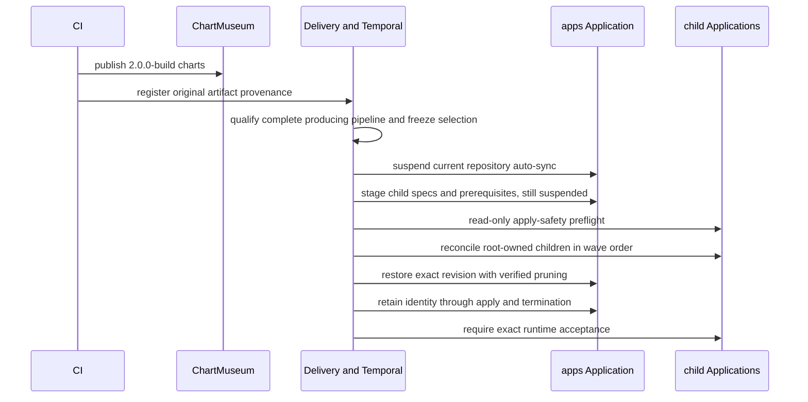

Build qualification, release selection, and reconciliation have separate owners.

Woodpecker builds and qualifies immutable artifacts. Delivery keeps selected
versions and release history in PostgreSQL. Temporal executes frozen deployment
requests, and ArgoCD reconciles Kubernetes resources. Git retains reviewed
registrations and pipeline definitions, with no selected deployment versions.

The root path below shows the guarded reconciliation protocol. Delivery
invokes it after artifact qualification; it preserves exact revision,
lifecycle, operation ownership, and prune checks.

## Why application releases delegate selection

Delivery-owned applications keep their exact desired versions and deployment
history in PostgreSQL. Git retains infrastructure, application registration,
deployment templates, and reviewed pipeline definitions. This separates a
successful build from a selected release and from an accepted running release.

The [application release policy](https://github.com/shepherdjerred/monorepo/blob/main/packages/homelab/src/cdk8s/src/application-release-policy.ts)
marks explicitly delegated applications. The root owns their registration and
lifecycle; Delivery owns the selected chart revision and complete release
parameter list. Static chart values remain under infrastructure ownership.
Root synchronization preserves those delegated fields during application, as
well as ignoring them during comparison. A comparison ignore alone would allow
the next root sync to overwrite PostgreSQL's selection.

The [root release command](https://github.com/shepherdjerred/monorepo/blob/main/packages/homelab/scripts/argocd/argocd.ts)
leaves delegated children out of its release reconciliation and acceptance
checks. It also avoids local manifest overrides for those children, which could
reintroduce an older selection. Each application therefore has one release
owner, while root pruning and infrastructure changes retain their existing
safety checks.

Delivery's executor records external intent before changing ArgoCD. An
interrupted or ambiguous operation keeps its environment locked for recovery.
Application acceptance includes exact operation identity, deployment history,
running image digests, and runtime checks. A green comparison alone cannot
accept a release.

Static sites publish standard tar archives with SHA-256 digests. Scout's beta
and production frontend flavors are built separately in the same version set,
each bound to its exact backend image. Selecting a flavor activates those
published bytes without rebuilding them. Bucket delegation is explicit; an
unregistered or mismatched owner blocks the adapter. Publication alone cannot
activate a site. Acceptance reads back every selected S3
object, compares public entrypoint bytes with the selected archive, and checks
an identity-bound release marker before recording success. A successful HTTP
status or cache purge acknowledgement alone cannot accept stale frontend HTML.

Browser identity terminates at Tailscale Serve inside the Delivery Pod. Serve
forwards to the API over loopback, which is the only peer trusted to supply
Tailscale user headers. The cluster-visible API requires machine credentials.
This authentication boundary does not rely on NetworkPolicy enforcement by the
cluster's CNI. The state volume preserves the sidecar's tailnet identity across
restarts; its OAuth credential can register only the dedicated Delivery tag.

## Why production recipes remain distinct

One deployment record can coordinate several effects without pretending they
have the same acceptance criteria. The
[execution contract](https://github.com/shepherdjerred/monorepo/blob/main/packages/temporal/README.md)
keeps those checks in fixed recipes rather than arbitrary user-authored commands.

Scout's selected backend, Workflow workers, and matching frontend archive form
one release. The production decision approves that complete selection. A host
baseline or drained-worker retirement cannot accept the application release.

Worker versions remain independently addressable after promotion. PostgreSQL
retains each original artifact, baked source identity, host, and replica intent.
An older pinned execution can therefore finish on its original worker. The
execution control plane has its own chart and Application. Its original image
advances separately from application workers. An application rollback therefore
cannot restore older executor settings or interrupt its own release.

Minecraft accepts a candidate only after backup preservation, isolated restored
world validation, and production runtime checks. The controller records durable
intent outside the release Workflow. Forum releases retain their licensed
bundle identity, maintenance boundary, backup, and migration checks. These
stateful recipes cannot use an ordinary image rollback as a recovery procedure.

Root releases retain the exact chart inventory and call the guarded
`release-root` procedure. OpenTofu applies consume a single-use encrypted plan
bound to the source, stack, native Job, and state identity. Existing automatic
stacks remain automatic; reviewed credential stacks require their exact saved
plan's human decision. Root and state changes share a PostgreSQL ownership lock
and explicit prerequisites, so a newer build cannot silently replace the
selected inputs midway through execution.

Writer ownership transfers in one coordinated cutover. Existing CI deployment
work stops before Delivery imports observed state and receives release authority.
An imported observation never fabricates a qualified artifact or accepted release.
This boundary prevents two deployment systems from independently choosing the
same application's desired state. CI retains immutable package publication and
repository automation; it holds no application deployment or provider credentials.

TRMNL plugin templates are immutable artifacts bound to the selected backend
image. Delivery publishes the frozen plugin archive and independently reads back
all three plugin targets. Partial publication keeps the environment locked until
an identity-bound repair or recovery proves the external state.

## Why `release-root` stages and restores the root

The second suspended root apply is the part people delete when simplifying, and
it is the part that matters.

The public pipeline surface is nevertheless one command. `release-root` owns
the entire identity-bound sequence in one process, so there is no handoff gap
between staging, reconciliation, final pruning, and scoped health. The bounded
operations underneath it remain separate because they prove different things.

New child-level safety settings have to exist _before_ those children sync.
But enabling floating auto-sync before every chart is published would let a
child pick up a partially published release.

The staged root release applies unchanged resources with exact-revision,
source-selective syncs. Child Applications are the only resources changed:
local manifest overrides keep their auto-sync disabled regardless of whether
their source is internal or external. Child settings and root-owned
prerequisites such as admission policies therefore land before reconciliation
without starting an automatic child operation. Keeping unchanged resources on
the source path is significant: Argo applies the chart-owned object itself,
rather than treating a local manifest as an alternate desired tree whose result
may be reported as applied without updating a cluster-scoped prerequisite. The
[manifest-override batcher](https://github.com/shepherdjerred/monorepo/blob/main/packages/homelab/scripts/argocd/argocd-manifest-overrides.ts)
splits only the rewritten Application requests at 750 kB. ArgoCD v3.4.5's
[operation-state constructor](https://github.com/argoproj/argo-cd/blob/564b94973b284b8de98da7cee6eeade2cb941e46/controller/sync.go#L76-L81)
copies the original request into status. In this cluster, a request near the
observed 2 MiB controller message ceiling can therefore be accepted but never
acquire visible operation state, matching
[upstream reports of oversized operation-state patches](https://github.com/argoproj/argo-cd/issues/14224#issuecomment-1636337124).
The batcher also keeps each request within one numeric Argo sync wave and sends
waves in ascending order. Argo applies all targets in a wave before waiting for
their health; separating waves prevents a degraded child Application in an
earlier wave from leaving root-owned prerequisites in a later wave unapplied.
Once every selected resource in a staged wave is applied, the release command
terminates that exact operation instead of waiting for aggregate health. A
failed resource with an actual Argo hook type still blocks termination; health
for ordinary child Applications remains the final scoped release gate's job.
Argo omits `operation.sync.revision` from manifest-override operations, so the
release command also persists the exact revision in the operation info list
beside its request and operation UUIDs. Either representation can prove the
revision, but disagreement between them is a hard identity failure.

The waves are an architecture contract, not incident-specific ordering.
Admission policy objects land first, followed by the 1Password controller and
items, infrastructure providers, certificate resources, the root Application,
Kueue, dependent configuration, CI, and leaf workloads. This also makes
an ordinary manual global sync safe: all members of a wave apply before ArgoCD
waits on health, and no prerequisite is hidden behind a leaf workload.

Disabling every child creates a second ordering obligation: the release must
explicitly reconcile external children as well as charts published by this
repository. The release renders the exact root revision again, orders its
Application manifests by numeric sync wave, and combines two revision sources.
Repository charts use the immutable revision inventory produced by the publish
step; external charts and Git sources use their complete root-manifest source,
including Helm values. The staging parser preserves that nested source object;
dropping fields there can rewrite every external Application to chart defaults.
This lets a controller upgrade such as cert-manager finish before a later
repository workload depends on it. It also fences the inventories in both
directions so a published child cannot disappear from the root and a
repository child cannot silently fall back to its semver range.

ArgoCD's comparison status is not deployment proof during this transition. A
staged Application can report `Synced` at its new comparison revision while
its latest deployment history still names the old source. For an external
child, the complete history entry source must match the complete rendered root
source before reconciliation skips it. A Git tag may resolve to a commit SHA,
so comparing only the history revision to the root's tag would create a
permanent mismatch; comparing only the source target would miss changed Helm
values at the same chart version.

Once that exact source has been deployed, ordinary same-source drift remains
the external Application's responsibility after auto-sync is restored. A child
that declares pruning must also report `Synced` before reconciliation skips it:
retired chart resources otherwise remain and block the final root operation.
Prometheus declares pruning so replacing the renderer's generated Secret with
the shared 1Password Secret retires the unused chart-owned Secret. This does not
broaden the release-scoped health gate. Repository-published children keep the
stricter boundary: sync status, exact resolved revision, latest deployment
history, and terminal operation state must agree. This prevents the brief
post-stage comparison window from skipping a changed external prerequisite.

Certificate waves still use resource health as their ordering barrier. The
[cert-manager Certificate condition contract](https://github.com/cert-manager/cert-manager/blob/b8f325e36f49626ba72d7efbe138c01a5e661d96/pkg/apis/certmanager/v1/types_certificate.go#L717-L777)
allows separate `Ready` and `Issuing` conditions. A new Certificate briefly
reports `Ready=False` with reason `DoesNotExist` while it creates the referenced
Secret. The
[ArgoCD health customization](https://github.com/shepherdjerred/monorepo/blob/main/packages/homelab/src/cdk8s/src/resources/argo-applications/platform/argocd.ts)
classifies only that normal issuance transition as `Progressing`, so the wave
waits instead of terminating. It checks the separate Issuing condition before
exempting a missing Secret because cert-manager
[records a failed request as `Issuing=False`](https://github.com/cert-manager/cert-manager/blob/b8f325e36f49626ba72d7efbe138c01a5e661d96/pkg/controller/certificates/issuing/issuing_controller.go#L408-L430)
while the missing-Secret Ready condition can remain unchanged. A different
false Ready reason or failed issuance stays `Degraded`. The
[five-minute release operation timeout](https://github.com/shepherdjerred/monorepo/blob/main/packages/woodpecker-config-extension/src/pipeline/lanes/release.ts)
still fails a Certificate that never becomes ready. Ignoring Certificate health
would let later CA and workload waves race a missing trust Secret, so the
release does not use that shortcut.

Both request shapes remain isolated by numeric sync wave and exact resource
identity. After explicit child reconciliation completes, the
[root finalizer](https://github.com/shepherdjerred/monorepo/blob/main/packages/homelab/scripts/argocd/argocd.ts)
reapplies the exact desired tree in isolated wave batches. This restores every
child auto-sync policy without letting an unhealthy earlier wave hide a later
one. Unchanged resources again use the exact source, while the self-managed root
Application alone uses a local override to stay suspended so it cannot launch
an unowned full-source operation between batches. Only then does the owned
full-source operation restore the root policy and perform verified pruning.
That final operation must report the root Application and every prune candidate
captured before it began; other desired-resource coverage comes from the
completed batches. A resumed exact prune does not classify new candidates from
the post-prune tree, because successful candidates are absent by design.
`finalize-async-sync` for `apps` uses that same prune-result boundary: it
terminates only a marked full-source prune, requires the root Application in
the applied result, and reads the prune-candidate inventory persisted on that
operation instead of reclassifying the post-prune tree.
Aggregate child health remains deferred to the scoped release gate.

This split proof is deliberate. The root chart contains its own Application,
and ordinary child Applications can be degraded. Argo waits for their health
before exposing later waves, even after the current wave and all prunes apply.
Weakening generic sync completeness would risk skipping a genuinely unapplied
later wave. Proving each desired wave first keeps that safety boundary intact.

Application health is evaluated by an ArgoCD Lua customization exercised with
ArgoCD's own executable health-test command. Active operations and unresolved
terminal failures remain `Progressing` or `Degraded`, while a current
`Synced`/`Healthy` state wins over stale failed operation history. Only the
recursive `apps` Application carries `IgnoreHealthCheck=true`; child
Application health remains an ordering and acceptance signal.

`IgnoreHealthCheck=true` only removes a resource from an Application's aggregate
health. ArgoCD's sync engine still gates each wave on the health it computes for
every resource in that wave, so the root chart's own `apps` Application reads
`Progressing` for as long as its operation runs and the final full-source
operation can never reach `Succeeded` by itself. That is why it is terminated
once applied, and why the self-reference stays in the structural wave rather
than after the children it manages: the operation has to prove the root apply
and its prune candidates without waiting on later-wave child health, which the
completed batches already cover.

Termination of that self-wait is re-requested rather than requested once.
ArgoCD terminates an operation by writing `Terminating` into
`status.operationState`, and the application controller rewrites that whole
object — phase included — whenever it persists operation progress, so a request
can be accepted and then silently discarded. The release command repeats the
request on every poll that still observes a `Running` operation. A discarded
termination costs more than one build: it leaves the root Application
permanently busy, and every later build fails its first root sync with `another
operation is already in progress`.

## Why manual global sync preserves child options

ArgoCD records a manual sync request in an Application's
`operation.sync.syncOptions`. A broad request can otherwise omit an option that
the child declares in `spec.syncPolicy.syncOptions`, turning a routine global
sync into behavior different from the checked-in Application contract.

A Kubernetes mutating admission policy selects managed child Applications and
merges the declared options into the requested operation. Options are compared
by the key before `=`, and the declared value wins. The recursive root is
excluded to avoid mutating its self-operation. This is why starting a normal
global sync is supported; the safety setting belongs to the Application, not
to operator memory.

A separate validating policy protects deletion. `apps` and `argocd` are
retained, while another managed child can be deleted only when it carries both
the cascade lifecycle annotation and Argo resources finalizer. The script still
renders the exact desired revision to classify prune candidates; admission is
an independent last line of defense, not a replacement for that proof.

## Why apply safety is a preflight

Immutable selector, service, volume-claim-template, and PVC field changes, plus
mutually exclusive probe-handler swaps, are discoverable from ArgoCD's live and
target resource states before a child sync starts. `release-root` hard-refreshes
comparison and performs that read-only analysis. ArgoCD reports managed
resources against the Application's configured source, so when a sync requests a
different revision the preflight renders that exact revision and compares the
live state against it instead. Probe handlers are correlated by container name,
because Kubernetes merges container lists by name and a reordered or inserted
container changes no handler. Any finding fails the release
before submitting the child operation, so the operator sees the exact resource
and field instead of a partially applied sync. The preflight does not invent a
fallback or silently replace resources; remediation remains an explicit source
or operator decision.

A target resource may make that decision explicit with both `Force=true` and
`Replace=true` in its `argocd.argoproj.io/sync-options` annotation. Argo deletes
and recreates that one resource instead of patching it, so immutable-field and
probe-handler update checks do not apply to it. The preflight still checks
repository image downgrades, and either option by itself remains insufficient.
This exception is deliberately resource-scoped; Application-wide replacement
does not bypass the check.

Every desired automated policy includes an explicit `enabled` boolean. The
[release policy](https://github.com/shepherdjerred/monorepo/blob/main/packages/homelab/src/cdk8s/src/application-release-policy.ts)
stages repository charts with `enabled: false`. An empty object also means
enabled to Argo, but restoring that staged object to `{}` can produce an
`automated: null` patch that the Application CRD rejects. The
[artifact-level chart test](https://github.com/shepherdjerred/monorepo/blob/main/packages/homelab/src/cdk8s/src/helm-template.test.ts)
checks every synthesized Application so the release restores a concrete object.

## Why immutable chart revisions

Charts are published once, under an exact revision, and synced by that revision
rather than a floating tag.

A floating tag means "whatever is newest when the sync happens", which makes a
release non-reproducible and makes a partially published set indistinguishable
from a complete one.

## Why snapshot consumers precede Temporal

The [ops dashboard](https://github.com/shepherdjerred/monorepo/blob/main/packages/homelab/src/cdk8s/src/resources/argo-applications/observability/alert-dashboard.ts)
and [TRMNL](https://github.com/shepherdjerred/monorepo/blob/main/packages/homelab/src/cdk8s/src/resources/argo-applications/apps/trmnl-dashboard.ts)
reconcile before Temporal so their validators accept new snapshot source values
before the producer emits them. A rebuilt consumer also accepts snapshots from
the previous producer, preserving collection during the transition.

The final root application release policy assigns these consumers to wave -1
and Temporal to wave 0. That policy is authoritative over annotations in
individual constructors. Ordering verification applies the policy before
synthesizing the root chart, matching the manifests the release planner uses.

Workflow promotion alone cannot protect that boundary. The
[publish Activity](https://github.com/shepherdjerred/monorepo/blob/main/packages/temporal/src/activities/ops/ops-publish.ts)
reports sources absent from an older Workflow as unknown using its own current
contract. Updating the infra worker can therefore introduce a source before the
Workflow deployment changes. Consumer readiness depends on local service
initialization, allowing that order without a Temporal bootstrap dependency.

## Why a Synced-and-Healthy child still gets retried

Repository-child reconciliation retries a failed operation recorded against
the current chart revision even when ArgoCD already reports Synced and Healthy.
External-child reconciliation runs when the complete rendered root source is
absent from the latest deployment history.

That reads like a bug and is not. A child-level safety setting can make the same
immutable chart revision safe to retry after a previous apply failed. Without
the retry, the failed operation would stay recorded and the child would sit in a
state nobody clears.

## The prune rule, and why it distrusts ArgoCD

This is the most dangerous part of the pipeline, because the failure mode is
deleting a retained application.

Root pruning does **not** trust ArgoCD's cached `OutOfSync` or
`requiresPruning` flags. The selective manifest-override sync temporarily marks
unselected retained children as requiring prune, so those flags describe the
override rather than the published tree.

Instead the release script renders the exact `apps` revision and treats only
live child Applications **absent from that rendered set** as prune candidates.
Each candidate must additionally carry the
`ci.sjer.red/application-lifecycle: cascade` annotation and the Argo resources
finalizer.

This is the same principle the repo applies elsewhere: do not validate a
replacement against the unreliable signal it replaces. The desired state is the
rendered revision, not ArgoCD's opinion about it.

## Why the final root sync ends after apply

The root app also tracks child Applications that may be deferred or
independently unhealthy. Waiting synchronously on the root would mean waiting on
every one of them, and a single permanently unhealthy child would hold the
release open forever.

So the [main release lane](https://github.com/shepherdjerred/monorepo/blob/main/packages/woodpecker-config-extension/src/pipeline/lanes/release.ts)
separates root application from release-scoped health. One
[atomic Argo command](https://github.com/shepherdjerred/monorepo/blob/main/packages/homelab/scripts/argocd/argocd.ts)
retains the exact CI request identity while ArgoCD applies the root
revision. It sends every desired wave as bounded exact-source selections plus
local overrides only where policy is deliberately rewritten. It compares each
batch's reported group, kind, and name identities with its exact selection and
terminates that batch only after all selected resources apply. During
finalization, the self-managed root is the deliberate override: keeping its
auto-sync disabled prevents an unowned operation between batches. Only after
all desired batches complete does the finalizer start a full-source prune. That
operation must report the restored root and carries the independently validated
candidates into its completion boundary, requiring each candidate to appear as
`Pruned` before termination.
The generic atomic sync path remains stricter: without prior desired-batch
proof, it still requires every rendered desired identity in the same result.

The identity boundary matters because ArgoCD publishes operation state
asynchronously. A second process can read before the accepted operation appears.
Keeping submission and finalization together lets the command poll through that
gap and distinguish stale state from its own operation.

A CI retry reuses the request identity. The
[operation identity implementation](https://github.com/shepherdjerred/monorepo/blob/main/packages/homelab/scripts/argocd/argocd.ts)
adopts only the same request ID and revision. It refuses any unrelated active
operation. For the root workflow, the active resource selection must also equal
one exact desired batch or the unselected final prune. Each owned operation
also persists a `stage`, `batch`, `prune`, or `child` phase marker, so a staging
batch and a restoration batch over the same resources stay distinguishable, and
a child reconciliation cannot adopt a selective operation. An
unselected operation is
adoptable as the final prune only when that marker says `prune` and Argo's prune
flag is true, so an older full-source operation cannot borrow prior-batch proof.
A generated per-operation UUID binds the top-level live operation to its
completed status. This lets a retry accept a stable, fully applied result while
rejecting stale status from an earlier POST with the same request identity.
Recovery is the same `release-root` command with the same request id, not a
second public finalizer command. It recognizes only operations whose request
identity, exact revision, selected resources, phase marker, and prune mode fit
the expected step. An unrelated operation remains a hard failure.

After termination, the top-level live operation is authoritative. Its absence
means the health wait is gone even if `status.operationState` still says
`Running` or `Terminating`; a different operation UUID in live or completed
state still proves replacement and fails the release. Natural success uses the
[same boundary](https://github.com/shepherdjerred/monorepo/blob/main/packages/homelab/scripts/argocd/argocd.ts):
a `Succeeded` status does not finish the command until the live operation
clears.

Without this atomic boundary, a root operation stuck in `Running` blocks the
next ordered release indefinitely. Treating missing operation state as success
is therefore unsafe even when every manifest was applied.

## Why image selection looks complicated

Publication and workload pulls use separate identities. First-party images
use Docker Hub with separate management, publishing, runtime-reader, and Renovate
identities. OpenTofu owns visibility and scopes. The
[registry catalog](https://github.com/shepherdjerred/monorepo/blob/main/packages/version-catalog/src/image-registry.json)
is the visibility authority; compiler distribution is the public exception.

The [publication flow](https://github.com/shepherdjerred/monorepo/tree/main/ci/scripts/images)
checks anonymous access at each pushed digest. Exposed private images and
inaccessible public compilers fail the release. Source-label and exact-image
smoke checks remain required before recording immutable publications. Kubernetes pulls
use only the reader identity. Separate encrypted OpenTofu states keep token
management outside CI. Recovery lives in
[Cut a homelab release](/how-to/cut-a-homelab-release/#recover-a-delivery-operation).

Forum backup metadata retains its GHCR runtime identity string. Its digest
identifies the copied image, while Kubernetes pulls from Docker Hub. This keeps
existing snapshots compatible with retained binaries' strict restore checks.
The [forum release chart](https://github.com/shepherdjerred/monorepo/blob/main/packages/homelab/src/cdk8s/src/resources/storm-forum/index.ts)
keeps transport references and backup identities separate.

Application image comparison uses a successful producing pipeline whose image
and chart publication workflows both completed. A green pipeline with skipped
producers cannot supply the baseline. The image job validates that pipeline's
commit against a bounded window of history. Missing ancestry causes a full build.

Producer handoffs retain unchanged image inputs with their original digests and
source identities. They never turn a retained deployment into a fresh build.
Delivery independently qualifies the complete producing pipeline before those
artifacts become eligible for selection. A successful build can therefore remain
undeployed, and deploying an older retained version does not change build metadata.

The language-neutral version catalog holds dependency and bootstrap inputs.
Its parser and CDK8s projection validate those contracts. Selected application
versions, worker routing, rollback history, and approvals belong to PostgreSQL.
Image publication performs no deployment commit-back and maintains no Git queue.

## Related

- [Cut a homelab release](/how-to/cut-a-homelab-release/) — reading a live release
- [About the homelab](/explanation/homelab/overview/)
