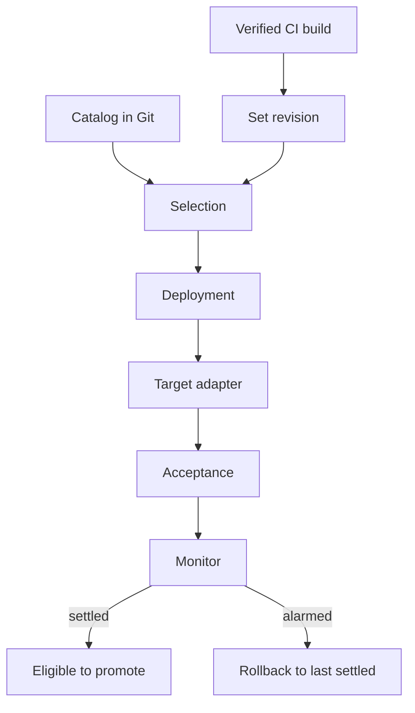

A release is a selection that one environment accepts on recorded evidence, so
every running thing has one owner, one history and one way back.

Git defines what may run. Delivery records what was built, what was selected,
where it runs and what proved it. Target adapters apply the selection and
report back. The [Delivery model](packages/delivery/docs/model.md) defines every
term on this page; the [Delivery model reference](/reference/delivery-model/)
lists the kinds, roles and routes.

## Why Git holds definitions and nothing that runs

Git holds the catalog: services, components, environments, recipes,
configurations and prerequisite edges. It holds no digest, chart revision or
set revision that names what an environment runs
([C2](packages/delivery/docs/model.md#41-catalog)).

A version written into Git is a second source of truth. The homelab used to
keep one: pinned image values, chart revisions injected at publication, and an
app-of-apps that synced whatever the repository said. Any of those could
disagree with what had actually been accepted. Delivery's record is now the
only answer to "what runs here" ([section 3](packages/delivery/docs/model.md#3-ownership-boundary)).

Registering a definition changes nothing that runs
([C3](packages/delivery/docs/model.md#41-catalog)). A merged recipe is a
candidate until a deployment selects it. That keeps review of a definition
separate from the decision to release it.

One catalog replaces the five files that once described the same services
from different angles ([X9](packages/delivery/docs/model.md#9-decisions)). Its
[shape](packages/ops-model/src/catalog-document-shape.ts) is language-neutral,
and Delivery types each recipe body against its
[recipe contract](packages/delivery/src/shared/model/recipe-contract.ts).

Renaming a component or moving it to another owner is a catalog edit, not a
rebuild. Reconcile carries each accepted selection onto the new identity with
the same bytes and records the artifact each one stands for
([section 7](packages/delivery/docs/model.md#7-fit-to-the-inventory)). The
carry refuses the whole reconcile when a mapping is ambiguous, because a guess there would
rewrite what an environment is recorded as running.

## Why a release is a selection, not a version

A selection is three coordinates: a set revision, a recipe revision and a
configuration revision ([4.9](packages/delivery/docs/model.md#49-selection)).
Approval, acceptance and rollback all act on that triple.

The reason is rollback. Restoring only the image of a past release can pair
it with today's chart parameters or sync options. That combination never ran
and was never proven. Restoring the whole selection replays exactly what was
accepted ([P2](packages/delivery/docs/model.md#47-recipe)).

The same rule makes a configuration change a release of its own. Changing a
recipe or configuration without new artifacts is a `rebind` deployment, with
its own approval where policy requires one
([L2](packages/delivery/docs/model.md#49-selection)). Nothing reaches a running
system by editing a file and waiting for a sync.

"Version" is deliberately not a noun in the model
([X2](packages/delivery/docs/model.md#9-decisions)). Bytes are identified by
digest. A build whose digests match the previous set revision composes nothing
([R2](packages/delivery/docs/model.md#46-set-revision)), so an unchanged merge
queues no deployment.

The same comparison runs against builds that are still pending. A producer
retains an unchanged artifact from the newest pending or verified build rather
than republishing it, so two quick merges do not rebuild the same image. The
retaining build then verifies only after the build it borrowed from, and fails
if that one fails ([B2](packages/delivery/docs/model.md#44-build)). An
artifact never qualifies on the strength of a build that did not.

## Why an approval binds what will change

An approval is one decision per deployment, bound to its frozen selection
([4.13](packages/delivery/docs/model.md#413-approval)). If the binding
generation moves before the decision, the approval expires. A person approves
exactly what will run, not whatever is current when the executor gets there.

OpenTofu takes that one step further. A stack's selection says which archive
and desired state to use, but not what the provider will change. So a `tofu`
recipe with an approve step takes its approval on the saved plan, bound to the
plan digest and the state serial it was computed against
([H6](packages/delivery/docs/model.md#413-approval)). Rejecting the plan
discards it and fails the deployment; nothing applies a plan nobody approved.

Two approvals are deliberately different. An `override` approval is required
to deploy a set revision that is not eligible, so skipping a gate is a
recorded human act ([H4](packages/delivery/docs/model.md#413-approval)). A
`restoration` approval lets a monitor's automatic rollback restore a selection
that was already approved, without waking anyone
([H5](packages/delivery/docs/model.md#413-approval)).

## Why acceptance, not health, moves the pointer

Each environment keeps three pointers: desired, observed and accepted
([E3](packages/delivery/docs/model.md#410-environment)). Only acceptance moves
the accepted pointer, and only an accepted selection can be rolled back to.

A green sync is not acceptance ([V4](packages/delivery/docs/model.md#414-acceptance)).
ArgoCD can report Synced and Healthy while a probe fails, a worker still
serves old code, or a site serves stale HTML. The recipe's oracle names what
must be proven: probes, readbacks, drainage proofs, admission canaries or
data-preservation checks. Every proof is appended as evidence and never edited
([V3](packages/delivery/docs/model.md#414-acceptance)).

An ambiguous effect keeps the environment locked
([D5](packages/delivery/docs/model.md#412-deployment)). A lost executor, an
expired lease, or a sub-step with intent but no result all end in
`recovery-required`. Only a recovery intent, settled by a reader with a
credential the executor does not hold, releases the lock
([4.15](packages/delivery/docs/model.md#415-recovery-intent)). A missing record
is never treated as proof that nothing happened. Settlement releases ownership
but never accepts the failed deployment.

## Why a monitor watches after acceptance

Acceptance proves the release started correctly. It cannot prove the release
then served traffic correctly. A monitor covers that gap
([4.19](packages/delivery/docs/model.md#419-monitor)).

A monitor reads the alarms an operator would be paged on and counts evidence,
such as Scout's processed matches. It settles when every count reaches its
threshold with no counted alarm. There is no elapsed-time threshold
([W4](packages/delivery/docs/model.md#419-monitor)). A bake period would
delay a healthy release and still pass a release that saw no traffic.

Only an alarm that became active at or after the deployment's claim counts
against it ([W2](packages/delivery/docs/model.md#419-monitor)). An alarm that
was already firing is recorded as pre-existing evidence. It neither rolls back
nor blocks settlement, because the new selection did not cause it.

A counted alarm while watching suppresses that set revision for automatic
selection.
Under `automatic` policy it also queues a rollback to the last settled
selection ([W2](packages/delivery/docs/model.md#419-monitor)). That rollback
carries a `restoration` approval recorded from the selection it restores, so
a required-approval environment can recover without waking anyone
([H5](packages/delivery/docs/model.md#413-approval)). Under `hold` policy the
environment waits for an operator instead.

Promotion reads the monitor too. A set revision promotes out of an environment
only once its selection there has settled
([W3](packages/delivery/docs/model.md#419-monitor)). Scout is the first
consumer: beta uses `hold`, and prod uses `automatic` and promotes only from a
settled beta ([section 6](packages/delivery/docs/model.md#6-flows)). The
monitor's shape is in the
[monitor contract](packages/delivery/src/shared/model/monitor-contract.ts).

## Why edges replace sync waves

The root Application ordered everything by sync-wave numbers. A wave says
"before" without saying why, and it couples every child to one sync. One
unhealthy child held every later wave.

A prerequisite edge states one real contract: this environment deploys only
after that one has accepted a qualifying selection
([4.18](packages/delivery/docs/model.md#418-prerequisite-edge)). Admission
evaluates edges and freezes each prerequisite's accepted selection into the
deployment ([Z1](packages/delivery/docs/model.md#418-prerequisite-edge)).
Composition ignores them, so ordering never couples one service's digests to
another's.

Edges are reserved for cluster plumbing. An application that must tolerate an
old producer or a new consumer gets a compatibility test, not an edge
([Z3](packages/delivery/docs/model.md#418-prerequisite-edge)). Without a
declared edge, one service's release never waits on another
([G3](packages/delivery/docs/model.md#2-guarantees)).

## Why stateful rollbacks are restricted

Some changes cannot be undone by redeploying old bytes. A PostgreSQL major
upgrade, a XenForo migration or a world conversion moves data forward.

The record encodes that instead of relying on memory. A configuration key can
be `forwardOnly`, and a recipe sub-step can be a `pointOfNoReturn`. Rollback
candidates that would cross either are excluded, each with its reason
([D9](packages/delivery/docs/model.md#412-deployment)). The operator rolls
forward instead of reading recipe JSON during an incident.

## Why qualification lives in an environment

Minecraft's extended suites are too heavy for every CI run, so the repository
keeps them out of CI. They used to be a committer's note. A qualification
environment, `minecraft/sandbox`, makes them the oracle that gates promotion to
`minecraft/tsmc` ([X16](packages/delivery/docs/model.md#9-decisions)).

Its tests run as deployment stages on the CI worker node and record their
results as evidence ([V5](packages/delivery/docs/model.md#414-acceptance)).
Minecraft is the only consumer, by repository policy
([E7](packages/delivery/docs/model.md#410-environment)).

## Why some deployments are run by an operator

Some effects cannot run from inside the cluster that Delivery lives in.
Bootstrap must happen before Delivery exists. A Talos upgrade reboots the only
production node ([X13](packages/delivery/docs/model.md#9-decisions)). A bad
admission policy would block the executor that rolls it back
([X14](packages/delivery/docs/model.md#9-decisions)).

The data layers of Delivery and Temporal are separate services for the same
reason. An ordinary image or chart deployment can never alter the database
cluster that records it ([section 6](packages/delivery/docs/model.md#6-flows)).

These are `operator-run` deployments. Delivery records intent before the
effect, and the operator attaches attested evidence before acceptance
([section 5](packages/delivery/docs/model.md#5-target-kinds)). The work is
manual, but it still leaves a deployment, an acceptance and a history
([G4](packages/delivery/docs/model.md#2-guarantees)).

The attestation comes from its own identity, with an `attest` scope the
executor never holds. Delivery refuses an attestation from any `execute`
credential, or from the identity that claimed or renewed the deployment
([X13](packages/delivery/docs/model.md#9-decisions)).
An executor that could attest its own stages would be vouching for itself.

## Why a self-hosted upgrade hands off

Delivery, its control plane, Temporal and ArgoCD run the deployments that
replace them. An executor that upgrades itself cannot also prove the result,
because the upgrade stops it partway.

A deployment of one of these services first takes a global dispatch barrier:
new claims stop and queues drain
([D8](packages/delivery/docs/model.md#412-deployment)). The outgoing executor
applies the change and leaves the deployment owned, with a handoff marker and
a lease that cannot expire. One successor Workflow claims that marker, reads
the frozen record and verifies acceptance. No ordinary claim or lease renewal
can take the marker, so a deployment never changes executor any other way
([D7](packages/delivery/docs/model.md#412-deployment)). If the successor
cannot finish, the deployment ends `recovery-required` with the barrier still
held. An upgrade that may have broken the executor stops the system rather
than letting it guess.

## Why public releases are channel deployments

Uploading to a private store is part of a build, because only Delivery reads
it. Publishing to npm, a public image tag or a plugin listing has an audience,
so it is a deployment to a `channel`
([X12](packages/delivery/docs/model.md#9-decisions)).

A published version is permanent. What rolls back is the channel's pointer: a
dist-tag, a latest release or a feed. A store without a mutable pointer is a
`forwardOnly` channel, and rollback offers nothing there
([section 5](packages/delivery/docs/model.md#5-target-kinds)).

## Why ArgoCD stays, and where it stops

GitOps and ArgoCD are separable. The model replaces Git as the source of
desired state and keeps ArgoCD as the reconciler
([section 8](packages/delivery/docs/model.md#8-position-on-argocd)).

ArgoCD keeps what is expensive to rebuild: sync operation identity, health
assessment for operator resources, resource tracking and pruning. Every
recovery path depends on that operation identity.

What leaves is everything that let Git choose what runs: the root
Application's authority over its children, floating chart sources, delegation
annotations and their ignore rules
([X6](packages/delivery/docs/model.md#9-decisions)). Delivery creates, updates
and deletes every Application from its recipe's full body. The operator-run
data layers are the exception, so an ordinary deployment can never rewrite the
database that records it.

Three conditions keep that safe:

- Human ArgoCD accounts are read-only on Applications; only Delivery syncs.
  The [break-glass](/how-to/regain-write-access-to-argocd/) is a
  procedure, not a standing grant.
- Delivery's recovery reader reads Application objects through the Kubernetes
  API, so recovery works while ArgoCD is down or upgrading.
- After acceptance, self-heal runs on the frozen exact source with pruning
  disabled, so drift is reverted and recorded without a floating source
  ([T4](packages/delivery/docs/model.md#411-target)).

The decision is revisited if ArgoCD's health model stops covering a workload.
That change replaces one adapter and no primitive.

## Why apply safety is a preflight

Every `kubernetes-application` recipe runs an `apply-safety` step before its
single `sync` step; the
[recipe contract](packages/delivery/src/shared/model/recipe-contract.ts)
refuses any other order.

Immutable selector, Service, volume-claim-template and PVC changes, and
probe-handler swaps, are visible from live and target state before a sync
starts. The [preflight](packages/homelab/scripts/argocd/argocd-apply-safety.ts)
reports the exact resource and field. A partially applied sync would report
only a failed operation. The preflight never replaces a resource on its own;
remediation stays a source or operator decision.

Some changes pass the API server and still destroy data. The preflight refuses
a Zalando PostgreSQL cluster change that switches its major version or volume
storage class, shrinks its volume, scales it to zero, or drops its TLS, roles,
or databases. It also refuses any claim whose storage request shrinks. Each is
a human-run procedure, never a side effect of a release. The rules live in
`packages/homelab/scripts/argocd/argocd-destructive-changes.ts`.

A target resource may make that decision explicit with both `Force=true` and
`Replace=true` in its `argocd.argoproj.io/sync-options` annotation. Argo deletes
and recreates that one resource instead of patching it, so immutable-field and
probe-handler update checks do not apply to it. The preflight still checks
repository image downgrades and destructive data changes, because recreating a
database or claim loses exactly what those checks protect. Either option by
itself remains insufficient. This exception is deliberately resource-scoped;
Application-wide replacement does not bypass the check.

## Related

- [Cut a homelab release](/how-to/cut-a-homelab-release/)
- [Delivery model reference](/reference/delivery-model/)
- [How the Delivery hub follows a change](/explanation/homelab/delivery-hub/)
- [About the homelab](/explanation/homelab/overview/)
