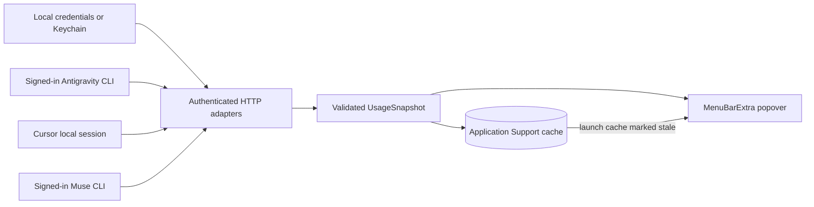
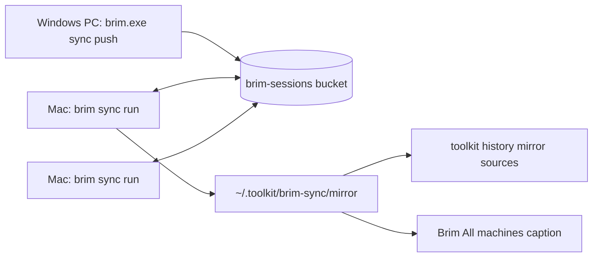

Brim keeps subscription usage visible without turning provider-specific web
usage pages into a dashboard. Claude Code, Codex, Google Antigravity, Cursor,
Grok, Kimi Code, and Meta Muse are its standard providers.
The authenticated HTTP providers use
[typed credential discovery](https://github.com/shepherdjerred/monorepo/blob/231bac375d228b685e12308a1d02d243cb3d1481/packages/macos-ai-subscription-tracker/Sources/QuotaBarCore/Credentials.swift).
Its [provider-independent model](https://github.com/shepherdjerred/monorepo/blob/231bac375d228b685e12308a1d02d243cb3d1481/packages/macos-ai-subscription-tracker/Sources/QuotaBarCore/Domain.swift)
marks cached or failed data stale instead of current.

## Boundaries

The subscription side tracks quota. Claude Code and Codex also show today's
tokens and an API list-price estimate from local CLI logs. That caption is a
separate ledger from the quota percentage and from monthly API spend. Brim
keeps it out of the snapshot cache, so a stale quota can still show today's
logs. The app does not show provider API rate cards, notifications, or a full
usage dashboard. Local quota samples still power the History graph.
The popover includes a personal subscription-spend reminder: $200/month each
for Claude Code and Codex, $20/month each for Google AI Pro and Cursor Pro,
$30/month for Grok, $40/month for Kimi Code, and $15/month for Meta Muse
($525/month total). These
figures are reminders, not provider billing data.
Plan names are different: each provider row names the plan its account reports.
Only Cursor reports a price, so its price replaces the reminder value and the
rest stay configured. A plan comes from a side request or field, so a failed plan
lookup adds a note and never stales the quota.
The reminder values live in the
[subscription plan model](https://github.com/shepherdjerred/monorepo/blob/231bac375d228b685e12308a1d02d243cb3d1481/packages/macos-ai-subscription-tracker/Sources/QuotaBarCore/Domain.swift).

The subscription view surfaces the tightest actionable quota first and sorts
provider sections by current remaining usage. Quota windows and Claude, Codex,
and Grok reset expirations use compact rows; healthy values stay neutral while orange and red
are reserved for pressure. Policy-only Fable data, stale snapshots, unknown
percentages, and provider errors remain explicit without invented progress.
These choices are derived by the
[quota overview model](https://github.com/shepherdjerred/monorepo/blob/231bac375d228b685e12308a1d02d243cb3d1481/packages/macos-ai-subscription-tracker/Sources/QuotaBarCore/QuotaOverview.swift)
and rendered by the
[menu-bar view](https://github.com/shepherdjerred/monorepo/blob/231bac375d228b685e12308a1d02d243cb3d1481/packages/macos-ai-subscription-tracker/Sources/QuotaBar/MenuBarView.swift).

The `API & routers` segment is separate from these subscription quotas.
It reports billed API spend, not remaining subscription windows.
OpenAI and Anthropic each use a privileged admin key.
Brim uses those keys only for read-only billing requests.
Those keys never replace Claude, Codex, or ChatGPT subscription sign-ins.
Purchased credits and subscription grants are a third wallet.
Brim shows them only when the Admin API returns a remaining amount and the
expiry on that payload. It does not invent an expiration or scrape the billing
page. Those Admin APIs currently return spend, not credit balances, so the
card says the balances were not returned while monthly spend still appears.
Prices for the subscription caption come from a checked-in
[models.dev](https://models.dev) snapshot, so the menu does not shell out to
another CLI or price an unknown model at zero. The menu renders that caption
from the
[menu-bar view](https://github.com/shepherdjerred/monorepo/blob/231bac375d228b685e12308a1d02d243cb3d1481/packages/macos-ai-subscription-tracker/Sources/QuotaBar/MenuBarView.swift),
and the credit rows live beside the spend metrics in the
[API platform model](https://github.com/shepherdjerred/monorepo/blob/0f2406136198b98bae3d79d2be1fe9254cf55101/packages/macos-ai-subscription-tracker/Sources/QuotaBarCore/APIPlatform.swift).

Claude and Codex use private authenticated subscription usage surfaces. Claude
preserves additive model-scoped windows when the account returns them and drops
codename meters such as Nimbus Quill and Iguana Necktie, which are not the
session or weekly allowance. Fable is shown as a policy-only row when no
independent counter is exposed. The same usage request asks for saved
usage-limit resets. Brim shows each unused reset's expiration and never
redeems one. Claude answers `no_grant` when the account holds no resets, so that
shows as No resets. A missing inventory, or any other ineligible reason, stays an
explicit unavailable reset state rather than a displayed zero. Codex labels
windows from returned duration and reset metadata, so a missing five-hour
window is not invented. It also reads the reset-credit surface read-only and
shows each available banked reset with its expiration; Brim never redeems a
reset.
The provider-specific behavior is isolated in the
[Claude adapter](https://github.com/shepherdjerred/monorepo/blob/231bac375d228b685e12308a1d02d243cb3d1481/packages/macos-ai-subscription-tracker/Sources/QuotaBarCore/ClaudeCodeProvider.swift)
and [Codex adapter](https://github.com/shepherdjerred/monorepo/blob/231bac375d228b685e12308a1d02d243cb3d1481/packages/macos-ai-subscription-tracker/Sources/QuotaBarCore/CodexProvider.swift).

Claude Code owns its credential item and rewrites it with
`security add-generic-password -U` on every token refresh, which resets that
item's access-control list to the creating tool. A grant Brim earns from the
system's "Always Allow" dialog therefore survives only until the next refresh,
so reading the item with the Security framework turns a five-minute poll into a
recurring password prompt. Brim reads it through `/usr/bin/security` instead:
that tool is the trusted application each rewrite re-establishes, which keeps
credential discovery silent without Brim ever writing another tool's
credentials. That boundary is implemented by the
[Keychain reader](https://github.com/shepherdjerred/monorepo/blob/8974ae3e5b14fbffebb67dea8c6d68be11f027d8/packages/macos-ai-subscription-tracker/Sources/QuotaBarCore/Keychain.swift),
which the
[credential store](https://github.com/shepherdjerred/monorepo/blob/8974ae3e5b14fbffebb67dea8c6d68be11f027d8/packages/macos-ai-subscription-tracker/Sources/QuotaBarCore/Credentials.swift)
uses for Claude discovery.

Google means Antigravity under the user's Google AI Pro subscription. Brim
asks the already signed-in `agy` CLI for its zero-turn `/usage` result and
displays the Gemini and Claude/GPT five-hour and weekly pools. The CLI remains
the token owner for usage. The plan name is the one exception, because only
Google's Code Assist `loadCodeAssist` call reports the paid tier. For that call
Brim renews an access token from agy's saved refresh token in memory, using the
OAuth client inside the installed `agy` binary. It never writes agy's files or
the access token. Google keeps the refresh token unchanged, so agy's session is
unaffected. Gemini CLI and Code Assist quotas stay outside this boundary. The contract is documented by the
[Antigravity usage command](https://antigravity.google/docs/cli/commands/usage).

Cursor means the active local Cursor Pro session. Brim reads only the local
`cursorAuth/accessToken` value and requests the current billing period's Cursor
Models and Other Models pools. Cursor's documented
[Admin API](https://cursor.com/docs/account/teams/admin-api) is designed for
teams and does not provide this personal subscription view, so this adapter is
explicitly an unsupported private client contract. Authentication failures,
timeouts, and changed schemas become unavailable or stale data rather than
fabricated zero usage. Cursor team analytics and on-demand spend reporting stay
out of scope; the two subscription pools are described in Cursor's
[usage-limit guide](https://prod.cursor.com/help/models-and-usage/usage-limits).

Grok means the SuperGrok subscription, not xAI developer API rate limits. Brim
reads grok CLI `auth.json` or an optional Keychain override. It then requests Grok's identity, monthly billing, and
credit surfaces, plus remaining unused reset tokens. SuperGrok unified-credit
accounts have no included monthly dollar limit; Brim shows the weekly credit
window instead of inventing one.
Product rows inherit that weekly reset. A product row that repeats the shared
window's percentage and reset is omitted, because it is the same meter. A
product with its own percentage or reset stays, and extra credits stay even
when the percentage matches.
Banked extra resets are a separate list from that weekly countdown. Brim
shows remaining unused packs with their expirations and never redeems one.
Those responses are a private contract: malformed or changed
shapes become unavailable or partial data rather than a fabricated zero. Brim
never refreshes grok CLI credentials; `grok login` owns that session. xAI API
keys and developer rate cards stay out of scope. The contract is implemented by
the
[Grok adapter](https://github.com/shepherdjerred/monorepo/blob/231bac375d228b685e12308a1d02d243cb3d1481/packages/macos-ai-subscription-tracker/Sources/QuotaBarCore/GrokProvider.swift)
and read-only [credential store](https://github.com/shepherdjerred/monorepo/blob/231bac375d228b685e12308a1d02d243cb3d1481/packages/macos-ai-subscription-tracker/Sources/QuotaBarCore/Credentials.swift).

Kimi Code is a first-class subscription, kept separate from Moonshot Open
Platform API keys. It reads its local OAuth credential directory, including a
relocated `KIMI_CODE_HOME`. Brim never refreshes or rewrites Kimi Code's
credentials; expired credentials must be renewed by signing in again through
Kimi Code. Kimi responses are a private
contract. Brim shows every quota window that payload names: each `limits`
duration and each `usages` pool, including five-hour, monthly total, and
monthly code when those keys are present. Monthly code is part of the monthly
total, so it is shown only once its usage differs from the total's. A daily or weekly row appears only
when the payload includes that duration. Brim does not invent a window the
account does not return. Malformed or changed responses become unavailable or
stale states and are covered by local fixtures.
Those boundaries are implemented by the
[Kimi adapter](https://github.com/shepherdjerred/monorepo/blob/231bac375d228b685e12308a1d02d243cb3d1481/packages/macos-ai-subscription-tracker/Sources/QuotaBarCore/KimiProvider.swift)
and read-only [credential store](https://github.com/shepherdjerred/monorepo/blob/231bac375d228b685e12308a1d02d243cb3d1481/packages/macos-ai-subscription-tracker/Sources/QuotaBarCore/Credentials.swift).

Meta Muse means the Muse Code subscription, not Meta Model API token spend.
Brim asks the signed-in `muse` CLI for its allowance (`muse usage --json`)
and keeps only the returned rolling 5-hour and weekly windows. The CLI is the
credential owner in the strongest sense: Brim never reads the Meta token at
all. That boundary exists because `muse` rewrites its Keychain item on every
token refresh and each rewrite resets the item's access-control list, so Brim
reading the item directly turned every poll during an active Muse session
into a recurring Keychain prompt. A signed-out CLI — or an API-key login,
which carries no subscription — returns no allowance and surfaces as a
sign-in state. Over-quota percentages above 100 are shown as fully used with
a note. Those boundaries are implemented by the
[Muse adapter](https://github.com/shepherdjerred/monorepo/blob/029db3520e63631d4c17457072a2fffe1e524b3a/packages/macos-ai-subscription-tracker/Sources/QuotaBarCore/Providers/MuseProvider.swift).

## Runtime behavior

All enabled providers refresh in parallel every five minutes by default, with
bounded request and provider timeouts. A 401 reloads local credentials once. A
429 or network error retains the last successful windows and marks them stale.
Independent Codex/Grok surfaces may preserve valid partial data with a warning.
The latest snapshot per provider is stored as JSON under the user's Brim
Application Support directory, including that stale marker: the cache is the
status feed other readers consume, so a provider whose fetcher is failing must
not keep its frozen numbers labeled current there. Corrupt and failed writes
are visible, and loading the cache always marks it stale until a fresh
response arrives.
See the [polling coordinator](https://github.com/shepherdjerred/monorepo/blob/231bac375d228b685e12308a1d02d243cb3d1481/packages/macos-ai-subscription-tracker/Sources/QuotaBarCore/QuotaBarModel.swift),
[HTTP client](https://github.com/shepherdjerred/monorepo/blob/231bac375d228b685e12308a1d02d243cb3d1481/packages/macos-ai-subscription-tracker/Sources/QuotaBarCore/Networking.swift),
and [snapshot store](https://github.com/shepherdjerred/monorepo/blob/231bac375d228b685e12308a1d02d243cb3d1481/packages/macos-ai-subscription-tracker/Sources/QuotaBarCore/Persistence.swift).

That snapshot cache also feeds `toolkit brim`, which picks a provider for a
new session instead of displaying quotas. It withholds providers whose 5-hour
window is nearly spent, then orders the rest by budget consumption with pacing
taken into account. Multi-pool providers rank by their tightest pool, and
snapshots with no usable quota evidence stay unavailable. Weekly and monthly
budgets rank together, each labeled with its own kind. Brim runs the
winner's agent wrapper from `~/.local/share/agent-bin` (`claude`, `codex`,
`agy`, `cursor-agent`, `grok`, `kimi`, or `muse`). The wrappers own credential
scrubbing, the agent git identity, and bypass flags, so a spawned session
matches a hand-typed command. Brim looks there by fixed path rather than
`PATH`, because Herdr's long-lived core can start it with a `PATH` captured
before the wrappers were installed; a missing wrapper is an error. The ranking and
launch map live in the
[brim toolkit library](https://github.com/shepherdjerred/monorepo/tree/main/packages/toolkit/src/lib/brim).

The menu-bar symbol and text status use the lowest remaining quota: healthy
above 20%, warning from 5% through 20%, critical below 5%, and unavailable for
stale or unauthenticated data. Settings controls provider enablement, polling,
launch at login, optional credentials for supported providers, and links to the
provider usage pages. Optional overrides are stored in the macOS Keychain and
are not included in the snapshot cache. Antigravity, Cursor, and Muse cannot be
overridden because their respective local applications own those sign-ins;
Grok fields are for grok CLI subscription credentials, not xAI developer API
keys. Kimi Code fields are for subscription credentials, not Moonshot developer
API keys. API platform keys use a separate Keychain service and report billed
spend, not subscription quota. Launch at login reflects the
installed app's real `SMAppService` state and reports approval or registration
failures instead of storing a hopeful boolean.
The controls are defined by [SettingsView](https://github.com/shepherdjerred/monorepo/blob/231bac375d228b685e12308a1d02d243cb3d1481/packages/macos-ai-subscription-tracker/Sources/QuotaBar/SettingsView.swift)
and the [launch-at-login controller](https://github.com/shepherdjerred/monorepo/blob/231bac375d228b685e12308a1d02d243cb3d1481/packages/macos-ai-subscription-tracker/Sources/QuotaBarCore/LaunchAtLogin.swift).

Brim's app icon is a committed Icon Composer document with separate background,
ring, and quota-wave layers. Xcode uses the document for native macOS icon
rendering across appearance modes; the manual SwiftPM bundle renders its
Default appearance into `Brim.icns` with Icon Composer's `ictool` for older
macOS compatibility. The menu-bar status glyphs remain separate template
assets because they communicate live quota state rather than app identity.

## Cross-machine sync

Brim sync is a push-only, encrypted archive. Each machine's Claude Code and
Codex transcripts go to one SeaweedFS bucket, and each Mac mirrors the others
read-only. The two Macs and the Windows PC can then search each other's sessions
and count today's usage together. Native CLIs never see the mirror, so it is not
a way to resume a session elsewhere. That would need project paths rewritten
between `/Users/…` and `C:\Users\…`, plus conflict handling inside stores the
CLIs own.

The engine lives in toolkit's standalone `brim` binary, not in the Swift app.
Brim only runs on macOS, while Bun compiles the same code for Windows. Brim
reads the mirror's [index contract](packages/toolkit/schemas/brim-sync-mirror-index.schema.json)
from disk and never holds S3 credentials. The
[push engine](packages/toolkit/src/lib/brim/sync/push.ts) relies on transcripts
only growing. Each run uploads just the new complete lines as one segment. A
file that shrinks or whose tail changes starts a new generation instead of
being patched. This keeps tens of gigabytes of Codex rollouts from being
re-uploaded every five minutes.

Each machine writes only its own prefix, and its manifest is the commit point.
Segments upload first and become visible only when a manifest names them.
Concurrent writers never conflict, and a crash resumes from the last commit. A
transcript deleted locally keeps its archive entry, because the archive is the
backup.

Every object is age-encrypted on the client. Object keys are hashes, so even
project names stay private. This matters because SeaweedFS copies the bucket
off-site, and transcripts routinely contain tool output and secrets. Pushing
needs only the public recipient. The Windows PC, which only pushes, never holds
the decryption identity. Pulling resolves it from 1Password through the
toolkit credential broker.

Scheduling is one-shot. launchd and a Windows Scheduled Task re-run the command
every five minutes, and a pid lock lets a run skip while a long backfill
continues. There is no resident daemon to crash or leak.

The mirror is an input to the index, not to the metrics push. `toolkit history`
indexes it as separate `claude-mirror` and `codex-mirror` sources, labelled by
machine. Their tokens are excluded from the usage-export ledger, because each
machine already exports its own. Codex mirror documents come from the rollout
JSONL itself: Codex keeps message text in a local database that is not synced.
Brim's `All machines` caption counts mirrored logs for this Mac's calendar day
with the same parsers as the local caption.

## Sessions

The Sessions window browses past agent sessions: their conversations, token
usage, and estimated cost by day, model, agent, project, and machine. It is a
reader for the toolkit history index, not a second index. Every request goes
to the history daemon's read-only
[`/v1` API](packages/toolkit/src/lib/history/api/handler.ts) over
`~/.toolkit/history/daemon.sock`, which the
[daemon serves](packages/toolkit/src/lib/history/serve.ts). Brim never opens
`index.sqlite` or a transcript itself.

The index is toolkit's private storage. Its tables, its rebuild policy, and
how each source's transcripts are parsed change with toolkit, and a second
reader of the SQLite file would have to track all of it. The API is the
contract instead: a versioned JSON shape defined by
[zod schemas](packages/toolkit/src/lib/history/api/schema.ts) and checked in
as JSON Schemas such as
[`history-api-sessions.schema.json`](packages/toolkit/schemas/history-api-sessions.schema.json).
Their shared fixtures test both the toolkit server and Brim's
[Swift decoders](packages/macos-ai-subscription-tracker/Sources/QuotaBarCore/History/HistoryModels.swift).
A response with another `apiVersion`, an unknown source, or a missing field
is a visible
[contract error](packages/macos-ai-subscription-tracker/Sources/QuotaBarCore/History/HistoryAPIError.swift),
never an approximate read. The daemon also re-reads full transcripts for a
conversation, so Brim inherits toolkit's parsers for every agent, mirrored
machines included.

That choice makes the daemon a dependency. When it is not running, the window
says so and shows the fix, `toolkit history daemon install`. It never falls
back to the files. The socket is the one `toolkit history` already uses and
only its owner can open it, so the window needs no credentials.

Costs come from the same index ledger as `toolkit history usage`, through
[the API's usage queries](packages/toolkit/src/lib/history/api/queries.ts). A
session that used an unpriced model
[shows its cost as a lower bound](packages/macos-ai-subscription-tracker/Sources/QuotaBarCore/History/HistoryFormat.swift),
never as a complete figure. URLSession cannot reach a Unix socket, so the
[history client](packages/macos-ai-subscription-tracker/Sources/QuotaBarCore/History/UnixSocketHistoryTransport.swift)
speaks a [small HTTP/1.1 subset](packages/macos-ai-subscription-tracker/Sources/QuotaBarCore/History/HistoryHTTP.swift)
over a POSIX socket. It accepts one JSON response with a `Content-Length` body
per connection and rejects anything else.

A session's Requests tab shows what the agent actually sent, captured by the
[request capture proxy](/explanation/agent-request-capture/). The transcript
records what the agent chose to log; the capture records the system prompt,
tool definitions, and history that reached the API, and what each request cost
in context. The timeline puts each request's context composition side by side,
so growth in system, tools, or history is visible at a glance. The inspector
shows the "New in this request" diff because a long session resends almost
everything each turn. The tab reads the same daemon API as the rest of the
window, and loads one capture's rebuilt request only when it is selected.

## Release boundary

The root Linux verification graph runs strict SwiftLint. Native build, test,
80% core coverage, Xcode-project compilation, app bundling, signing, and smoke
checks run locally through
`cd packages/macos-ai-subscription-tracker && bun run verify:macos`; no macOS
CI lane exists yet.
The ordinary local bundle is ad-hoc signed. A generated Xcode application
target links the same core package and enables automatic signing plus hardened
runtime; direct distribution goes through Xcode Organizer's Developer ID and
notarization workflow or equivalent explicit package commands. A release is
installable only after its Developer ID authority, secure timestamp, stapled
ticket, strict signature, and Gatekeeper acceptance all pass. Apple credentials
and private signing keys remain outside the repository. Passing fixtures
validates known response shapes but does not replace comparing every enabled
provider with its own live usage view before release.
The native release gate is defined by the
[package scripts](https://github.com/shepherdjerred/monorepo/blob/231bac375d228b685e12308a1d02d243cb3d1481/packages/macos-ai-subscription-tracker/package.json)
and [Xcode project specification](https://github.com/shepherdjerred/monorepo/blob/231bac375d228b685e12308a1d02d243cb3d1481/packages/macos-ai-subscription-tracker/project.yml).

## Related

- [Sync agent history across machines](/how-to/sync-agent-history-across-machines/)
  — connect a machine to the archive
- [Operations overview](/explanation/homelab/operations-overview/) — where
  pushed quota and usage metrics are shown
- [Monorepo source](https://github.com/shepherdjerred/monorepo) —
  `packages/macos-ai-subscription-tracker`
