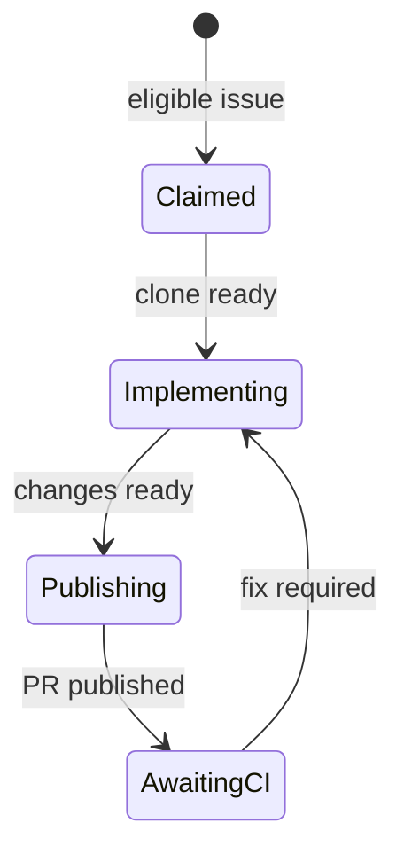
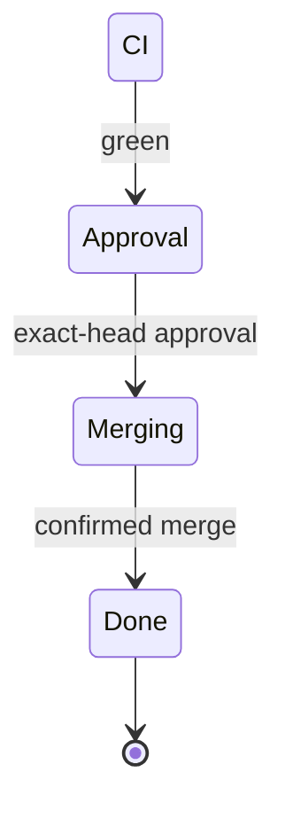

The local Tracker agent queue separates coding from delivery authority. Justin
can keep taking work while the owner reviews earlier pull requests.

Tracker holds the intake queue. The Mac owns durable task state, Docker
owns each bounded coding turn, and GitHub owns review and merge evidence.

## Waiting PRs leave the coding slot free

[The launchd reconciler](https://github.com/shepherdjerred/monorepo/blob/main/packages/justin-principal-engineer/src/host/launchd.ts)
starts one reconcile process every 60 seconds. [The reconciler state
machine](https://github.com/shepherdjerred/monorepo/blob/main/packages/justin-principal-engineer/src/reconcile.ts)
claims the local lock, observes waiting PRs, advances work, and exits. It runs
one coding turn at a time and keeps up to three pull requests open.

No model process or container remains alive while CI runs or approval is
pending. A fresh SDK turn starts only for initial implementation, owner
feedback, or a failing delivery gate.

This makes a Mac restart ordinary recovery. The next invocation reads the task
state and continues. The operating system owns the advisory lock, so it is
released atomically when the reconcile process exits or crashes.

## Authority is split at the container boundary

The [Docker runner](https://github.com/shepherdjerred/monorepo/blob/main/packages/justin-principal-engineer/src/host/docker.ts)
mounts one writable task clone, overlays its `.git` directory read-only, and
supplies one provider credential. The coding agent has shell and network access
because useful repository work needs both.

The container does not receive the host home directory, Docker socket, GitHub
App identity or CI credential. The host handles Tracker queue reads and writes.
The coding turn receives issue context and cannot publish its
own changes.

The host computes changed paths, verifies the affected workspaces, stages them explicitly, and uses Git-Spice in
the [workspace publisher](https://github.com/shepherdjerred/monorepo/blob/main/packages/justin-principal-engineer/src/host/git-workspace.ts)
to publish. It also gathers provider-specific findings and CI logs before asking
for a repair turn.

## Curation limits DevEx changes

Scoped DevEx work needs an explicit ticket label and host-resolved authorization.
The host checks the full branch before publication and merge, including edits
from earlier turns. That prevents a repair from expanding a small task into
infrastructure, dependency, credential, or delivery-policy changes.

Manifest filenames cannot distinguish test registration from dependency upgrades.
The host compares dependency declarations and resolution fields while permitting
package metadata and test registration. Required checks and review assess the
complete change.

The coding container cannot authorize its own merge. Git-Spice runs the host
readiness check, and the merge request names the validated head. GitHub merge
readback and base-branch ancestry are required before Tracker completion.
The finish line is confirmed merge; deployment requires separate evidence.

## Approval is bound to the current commit

Green CI includes the repository's automated Codex review gate. The
[GitHub integration](https://github.com/shepherdjerred/monorepo/blob/main/packages/justin-principal-engineer/src/integrations/github.ts)
waits for an `APPROVED` review from Jerred's pinned account ID and login
whose `commit_id` equals the current PR head.

A push invalidates that authorization in the reconciler even if GitHub still
displays an older approval. Merge performs the same gate and approval checks
again, closing the race between observation and mutation.

## A pass frees the slot for another issue

An implementation, checkout, or publishing failure gets one automatic retry.
Repeated failure adds `agent:needs-human` and parks the task. Observation
failures get five attempts to tolerate transient GitHub or CI outages;
the [reconciler](https://github.com/shepherdjerred/monorepo/blob/main/packages/justin-principal-engineer/src/reconcile.ts)
owns those transitions.

Automated repairs have a bounded budget that survives restarts. Justin records
a pass when it lacks a verifiable path forward. Closing a passed PR frees the
slot while preserving the branch. A material Tracker edit can restart that
issue, using the same PR and a fresh review.

Base drift is restacked with Git-Spice. If that stops on conflicts, a fresh
agent turn resolves them and the host explicitly continues the interrupted
rebase before it republishes the branch.

Parked state does not hold the single active slot. A later eligible issue can
run. Requeuing the parked Tracker issue restores its recorded phase and reuses
the existing checkout.

## Related

- [Run the Tracker agent queue](/how-to/run-the-tracker-agent-queue/)
- [The agent task security boundary](/explanation/temporal/agent-task-boundary/)
- [Run the PR fleet](/how-to/run-the-pr-fleet/)
