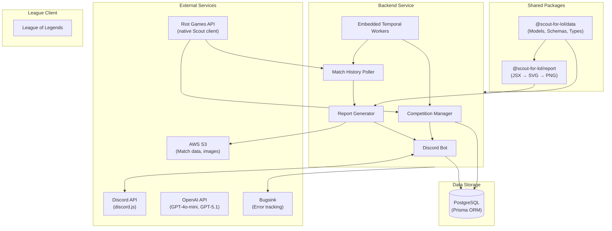
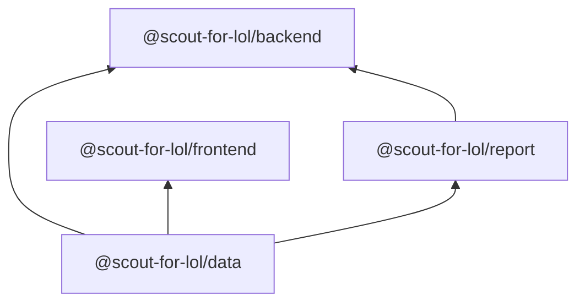
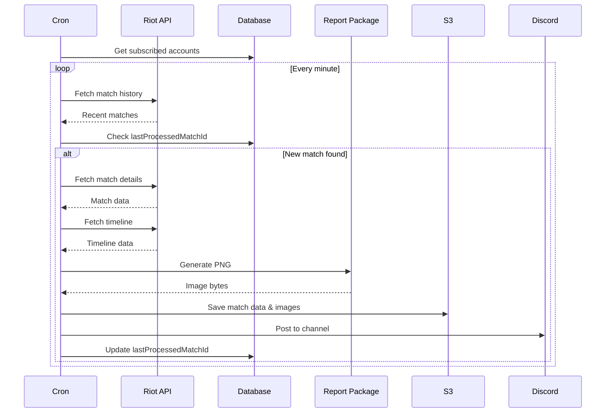
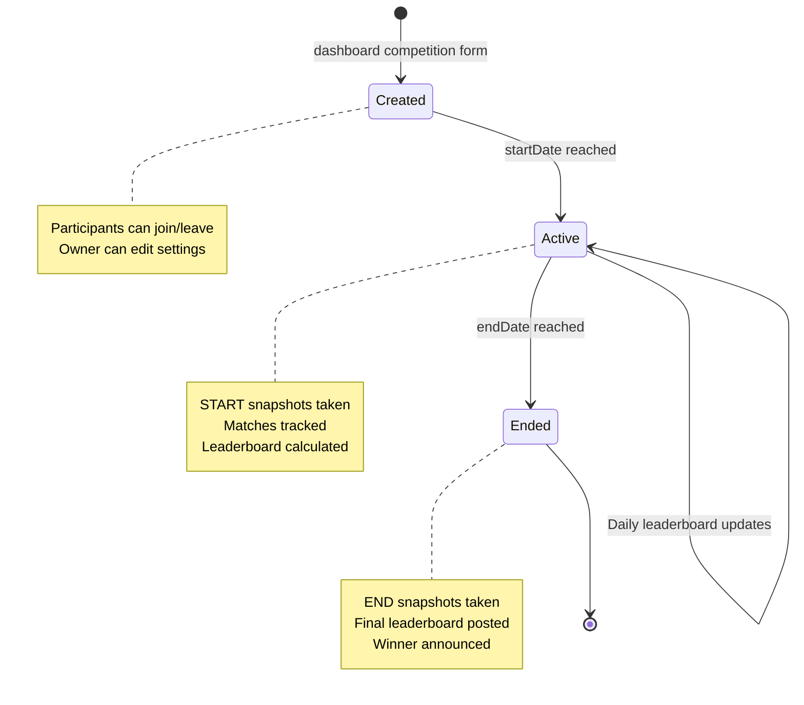
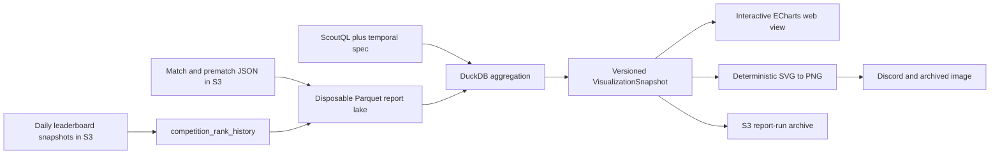
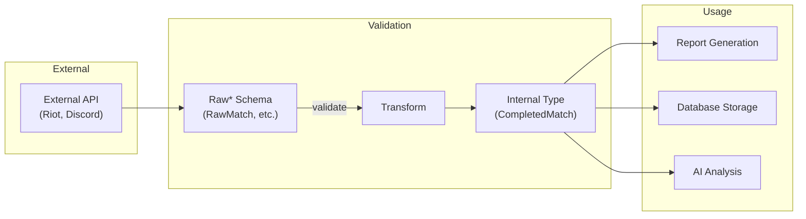
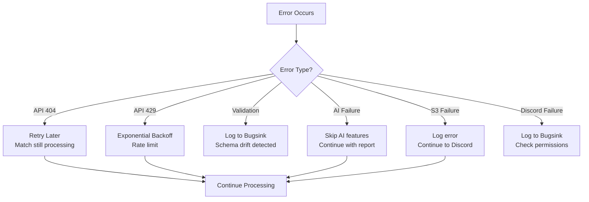
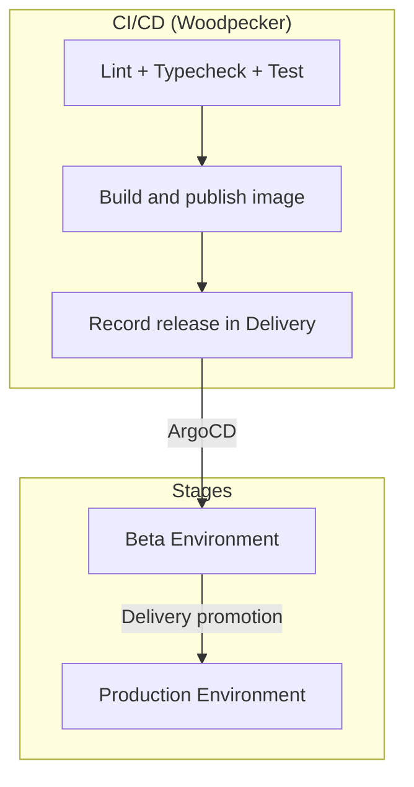

# Architecture Overview

Scout for LoL is a full-stack application built as a Bun monorepo with TypeScript. This document describes the high-level architecture and how components interact.

## System Architecture

## Package Dependency Graph

## Core Data Flow

### Match Report Generation

The primary flow from match detection to Discord notification:

### Competition Lifecycle

### Temporal Reports and Competition Analysis

ScoutQL owns reproducible report time windows. Canonical `ANALYZE`, `BUCKET BY`,
`COMPARE TO`, and `IN TIME ZONE` clauses compile to timezone-aware DuckDB
aggregations over the report lake. Report windows are capped at 365 days;
competition exploration is clamped to the competition lifespan instead.

The database stores report definitions, run metadata, permissions, and the
competition analysis timezone. S3 remains authoritative for raw match facts,
leaderboard history, and archived visualization artifacts; every Parquet lake
source can be rebuilt. Official competition standings remain competition-to-date.
Selected-period analysis recomputes the criterion without mutating that cache.

### Relational Dare contracts

New Dares compile one read-only standard-SQL statement against a
closed report-lake catalog. `T1` through `T5` are ordinary participant relations
bound to the contract's frozen accounts; team-relative conditions join them to
`match_teams` by `match_id` and `team_id`. Historical preview and post-match
settlement use the same canonical SQL and immutable AST. Evidence records retain
the result, game-set projections, target dependencies, timeline coverage,
source match IDs, and query hash. Only structurally monotone counts can settle
early; rates, averages, equality, and upper bounds wait for the deadline or game
cap. Existing v1 and v2 contracts continue through their frozen evaluators.

Evaluator 3 also supplies explicit competition and activation envelopes. Race
lanes settle only after the evidence watermark passes the earliest qualifying
`game_end_at`, which admits exact-timestamp ties from separately ingested
matches. Rank and historical-improvement contracts first persist an activation
job and enter `activating`; a frozen rank or report-lake baseline starts their
eligibility window and deadline. Ranked post-match capture precedes Dare
settlement and is reused by report generation, so a required Riot failure cannot
advance either evidence or the match cursor.

## Component Responsibilities

### Backend Service

| Component           | Responsibility                                          |
| ------------------- | ------------------------------------------------------- |
| Discord Bot         | Command handling, message posting, embed creation       |
| Match Poller        | Periodic match history checking for subscribed accounts |
| Report Generator    | Orchestrates match data → PNG report pipeline           |
| Competition Manager | Leaderboard calculation, snapshot management            |
| Temporal Workers    | Run durable polling, cleanup, reports, and LLM work     |

### Data Package

| Export      | Purpose                                                 |
| ----------- | ------------------------------------------------------- |
| Zod Schemas | Validate external API responses (RawMatch, RawTimeline) |
| Model Types | Shared TypeScript types (Player, Match, Competition)    |
| Constants   | Art styles, themes, lane contexts                       |

### Report Package

| Export                    | Purpose                             |
| ------------------------- | ----------------------------------- |
| `matchToSvg()`            | Render CompletedMatch to SVG string |
| `matchToImage()`          | Render CompletedMatch to PNG bytes  |
| `arenaMatchToSvg/Image()` | Arena mode variants                 |
| `svgToPng()`              | Convert SVG string to PNG           |

## Validation Architecture

All external data flows through Zod validation:

## Error Handling Strategy

## Deployment Architecture

## Environment Configuration

Required environment variables by component:

| Variable         | Component | Required               |
| ---------------- | --------- | ---------------------- |
| `DISCORD_TOKEN`  | Backend   | Yes                    |
| `APPLICATION_ID` | Backend   | Yes                    |
| `RIOT_API_KEY`   | Backend   | Yes                    |
| `DATABASE_URL`   | Backend   | Yes                    |
| `OPENAI_API_KEY` | Backend   | No (disables AI)       |
| `GEMINI_API_KEY` | Backend   | No (images fail)       |
| `S3_BUCKET_NAME` | Backend   | No (disables storage)  |
| `BUGSINK_DSN`    | Backend   | No (disables tracking) |

## Next Steps

- [Backend Service](./backend.md) - Detailed backend architecture
- [Database Schema](./database.md) - Data model documentation
