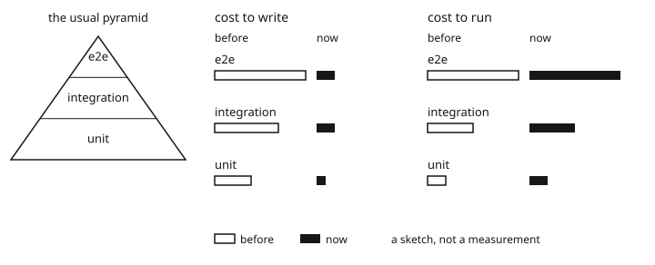
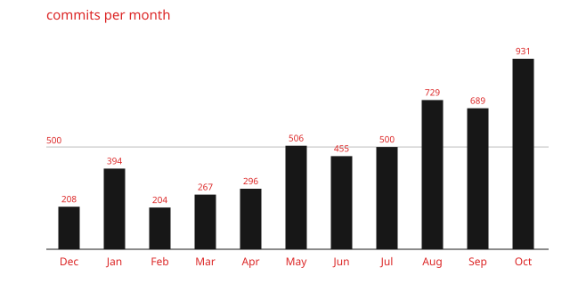

Like many I've been using coding agents quite a lot. Ideas can become code very quickly. Unfortunately code has a cost. Not even some metaphysical "all code is expensive" argument that you may/may not buy into.

Every bit of code you write has to exist somewhere, probably in a Git repository. A Git repository where you have to deal with merge conflicts, file/worktree size, etc.

Your code also has to be built. If you're building code you are likely also doing formatting, linting and other static analysis. Traditionally you'll do this a few times:

- While developing
- As a pre-commit or pre-push hook
- In CI for each PR push
- In CI for each push to main

Every bit of code you write pays this cost. Some languages don't have much of this. Others, like Rust, are quite compute intensive and benefit from caching.

So, now your code has to live somewhere. It has to be statically analyzed and built and turned into artifacts.

---

It's common knowledge that agents work best when they have effective loops. Loops being something like calling real APIs, being able to view their work in a real browser, and writing high fidelity tests.

High fidelity tests (end-to-end and integration tests) have always been expensive. There's a reason that they're at the top of the testing pyramid. They are very useful but also not easy to run or write (though, the writing cost is not important these days).

Similar to static analysis, you want these tests to run in many places. Typically I would want this to be:

- While developing
- In CI for each PR push
- In CI for each push to main
- Possibly some against a live beta environment (e.g. very high fidelity e2e tests)
- Possibly some against a live prod environment (e.g. canaries)

These tests take time to run. They take CPU and memory and... disk writes. A challenge I have discovered due to the scarcity/price increase of SSDs.

Again -- every bit of code has this cost. Every side project, every small service or product you want to spin up.

---

Of course, you also have to actually release and maintain each individual project, but that is not really the focus of this article.

---

Now, maybe I brought this upon myself. I don't use GitHub Actions anymore. I moved all of my projects into a monorepo so that agents could make cross-cutting changes more easily and with less release coordination.

At the beginning of this year I had a single-node Kubernetes cluster running Talos. BuildKite connected to GitHub and ran CI via Dagger which ran on my cluster.

Constant pain! A single Dagger engine pod running CI for 20+ agents at a time. Naturally this was unbearably slow and ate through my SSD lifetime.

My next thought was: why not do this all in Bazel? I had never used Bazel before but it reminded me of Brazil and Never Build Twice from Amazon which I have very fond memories of.

I [threw Opus at the problem](https://github.com/shepherdjerred/monorepo/commit/69e388bbd479d5b124ab1ca1f99f01b07bfa936d) but unfortunately the result was not really usable -- for many reasons, the biggest being my heavy usage of Bun and Bazel not really having [rules for Bun](https://github.com/shepherdjerred/monorepo/commit/a074297de071b01ee976d6f129adecd6e0cd2ce5).

So, [back to Dagger](https://github.com/shepherdjerred/monorepo/commit/5ed022430d8f4e9782b54c807d0c4fe484e31646). I was able to tune things for a while but it eventually became untenable. The cache filled up too quickly and the engine was too unstable.

I thought running Dagger via a single pod isn't really viable, but I also didn't really want to split my CI workload arbitrarily to reduce cache size and shard.

So, I thought why not rely more on native tooling and [embrace Turbo](https://github.com/shepherdjerred/monorepo/pull/1518). I mostly write TypeScript so it's a good fit!

And it does actually work quite well but unfortunately I am just still doing _too_ much work. So many projects. Some in TypeScript, some in Java, some in Rust. Turbo helped but it didn't fix the core issue: I was trying to build too much with too little.

---

I did what anyone would do. I did the math, saw that any cloud compute provider would be hellishly expensive, and bought a second CI node. An investment, I told myself. I spend $XXX on AI subscriptions each month; what's the point if I can't build my software? I make $YYY per year from my work, this is a sound investment in my learning (and, well, my favorite hobby which apparently is software engineering)

<table>
  <caption>hardware comparison</caption>
  <thead>
    <tr>
      <th></th>
      <th>cost</th>
    </tr>
  </thead>
  <tbody>
    <tr>
      <td>The server, over 3 years</td>
      <td>~$70 a month</td>
    </tr>
    <tr>
      <td>Hetzner, same kind of box</td>
      <td>~$300 a month</td>
    </tr>
    <tr>
      <td>AWS m7i.2xlarge (8 vCPU, 32 GB) per CI run, October</td>
      <td>~$580</td>
    </tr>
  </tbody>
</table>

I [priced the server](https://pcpartpicker.com/user/RiotShielder/saved/xnrjNG), knowing that I would be gouged on the SSD and memory. I bought used RAM on ebay for the first time and spent hours in MemTest86 to validate it.

This helped a lot! It was essentially the same specs as my primary Kubernetes node (but with less storage). It gave me a lot of headroom.

Unfortunately, I got better at using agents, so I have more PRs at a given time. I also came up with more projects which meant more software to build.

---

In the end it helped quite a bit but it didn't solve the problem. I am still plagued by slow CI. I am still having to make compromises about what I am building and when.

More recently I have entirely [gutted out all deployment related steps from CI](https://github.com/shepherdjerred/monorepo/pull/3872). So, now CI is responsible for creating Docker images, S3 archives of static sites, etc. and a separate custom application (modeled after Pipelines, Brazil, Version Sets, etc. at Amazon) handles the deployment aspect. This separation of responsibilities was quite helpful and in hindsight obvious.

My immediate next thought is that I need to remove 'heavy' tests from CI entirely. No more CI for e2e and integration tests past some particular time/compute threshold. Tell agents to run the relevant checks locally, and maybe also run them on a nightly schedule on main.

My feeling is that there are two ways to improve the situation:

- Add more CI capacity (unacceptable for me at this point)

- Reduce the amount of work being done:

  - Cache better

  - Better change detection so only relevant steps are run

  - Or, as I said before, literally remove what is done on CI

Other possible next steps:

- Maybe just try going back to Dagger? They did 1.0 recently and I feel like they do have a killer model for building software

- Maybe I am building too much or doing work unnecessarily, but I have reviewed this countless times...

- Maybe I need some agent working in the background to keep main CI green which would at least help with some issues

- Maybe I have created a system beyond my understanding and I need to resist my desire to work on new things and spend a few weeks purely on workflows, CI, and reliability

---

## Making Myself Feel Better

If it wasn't clear, this isn't my dayjob. I spend a pretty significant amount of time programming for fun.

To make myself feel better, I tell myself that if I truly could dedicate my time to this problem then I could solve it rather quickly.

I do think, though, that agents are creating systems that are growing more quickly than I can understand and reason about them.

On one hand I think I don't need to understand every detail and that this is a good thing. On the other hand I would really like to be able to just focus on writing features/products and not my CI.
