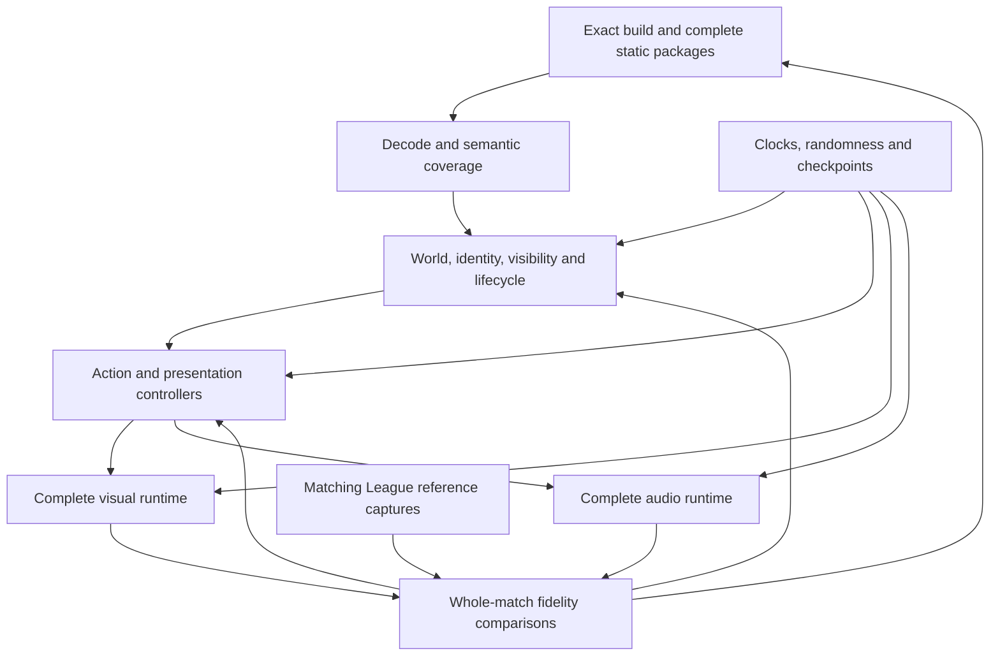

# Replay spectator: master fidelity map

This is the master explanation of what remains between the browser replay spike
and a faithful League spectator. It owns the destination, capability gaps,
dependencies, and completion evidence. The [README](README.md) owns commands,
implementation details, and individual research results. Execution tasks belong
in Tracker or the relevant PR; this document is not a session log.

**Baseline reviewed: November 7, 2026.** Each result below belongs to a named
verification snapshot. Later edits do not automatically inherit its results.

Jump to [remaining capabilities](#remaining-capability-requirements),
[acceptance gates](#acceptance-gates),
[near-term priorities](#near-term-priorities-and-why), or
[implementation and evidence](#implementation-and-evidence-entry-points).

## The destination

A user supplies a ROFL and watches an interactive browser reconstruction of an
arbitrary standard Summoner's Rift 5v5 match, including any legal champion lineup,
skin, and interaction within an explicitly supported build. The user does not
install or run League. Match decoding and simulation run in the browser; offline
tooling prepares static executable/content-derived build packages.

The current research build is **16.21.829.8620**, protocol
`20e09df23c66b85e`. This is a pinned compatibility target, not a claim about the
current live patch. Additional builds require independent admission.

| Achievement              | Required evidence                                                                                                         |
| ------------------------ | ------------------------------------------------------------------------------------------------------------------------- |
| Functional coverage      | Every presentation-relevant behavior has an implementation and established inputs across the supported content inventory. |
| Perceptual equivalence   | Synchronized League/browser comparisons expose no meaningful visual or audible differences under declared settings.       |
| Exact output equivalence | Pixels and pre-device audio samples match under controlled input, clock, camera, graphics, and audio conditions.          |

The requested endpoint is full fidelity. A perceptual result must retain that
label if exact equivalence is unproven. Missing inputs and behaviors cannot be
hidden by averaging scores or lowering quality. Finite tests establish evidence
for their cases, not a mathematical proof over every possible match.

## Where we are

On the Shire-to-Mordor analogy, **Bree**: a working spectator foundation, with
major engine behavior and validation work ahead. There is no defensible overall
fidelity percentage or completion date yet.

| Area                      | Established evidence                                                                                                                    | What remains unproven                                                                                                                                                          |
| ------------------------- | --------------------------------------------------------------------------------------------------------------------------------------- | ------------------------------------------------------------------------------------------------------------------------------------------------------------------------------ |
| Browser playback          | Navigable scene, champions, partial animation and combat effects during ordinary Play.                                                  | Arbitrary-match spectator equivalence.                                                                                                                                         |
| Maps and breadth          | Two same-build Map12 replays with different champion lineups have been exercised.                                                       | Scene preparation admits Map12/base. Map11/Summoner's Rift and arbitrary modes/variants are unsupported.                                                                       |
| Direct effects            | Retained JavaScript/typed-array worker simulation and translated shaders; camera geometry separate from camera-independent simulation.  | Only admitted component, material, motion, world-input and lifecycle subsets execute.                                                                                          |
| Primary offscreen effects | V38: 169 prefix-contributing instances, 28 definitions and 646 components across 181 sampled frames; five decoded champion creators.    | Effects-only, per-submission framebuffer contributions do **not** establish final unoccluded pixels in the world scene or five-champion coverage in ordinary browser playback. |
| Second-lineup regression  | 29 prefix-contributing instances, six definitions and 45 components.                                                                    | No established champion creator attribution for those contributions; not arbitrary-match proof.                                                                                |
| Seeking                   | V39-r2 browser images match byte-for-byte for 82.35 → 74 → 82.35 and 50.2 → 79.85 → 50.2 with the same camera.                          | Arbitrary-time, full-state, audio and whole-match restoration.                                                                                                                 |
| Performance               | V39-r2 completes 01:09–01:39 at 1080p/DPR1, 1× and 4×, without console/GPU errors, clock discontinuities or observed tasks over 100 ms. | About **47.1/46.2 observed new-state updates per second**, below 60. World-only is about 54.3 FPS.                                                                             |
| Worker budget             | V39-r2 simulation plus geometry preparation p95: **3.4 ms at 1× / 6.6 ms at 4×**.                                                       | Meets 4/8 ms worker budgets; whole-scene frame rate and delivery latency remain open.                                                                                          |
| Local checks              | V39-r2: 675 tests pass; three browser bundles build; both simulation workers exclude emulation dependencies.                            | Local evidence is not CI, deployment or reference-client fidelity.                                                                                                             |
| Audio                     | Declarations and legacy audio experiments exist.                                                                                        | No integrated audio runtime in the latest viewer. Legacy clip playback is not latest-build audio fidelity.                                                                     |
| League comparison         | Native component observations and limited Replay API movement comparisons exist.                                                        | A synchronized matching-client whole-match image/audio fidelity suite.                                                                                                         |

The five primary offscreen creators are Akshan, Hecarim, Jinx, Maokai and Vladimir.
Creator identity comes from decoded ownership, never an asset directory name.
Submitted components, prefix-contributing components and final visible components
are separate measurements.

The primary comparison window has **105 hero attacks, 135 casts, 162 missile
records and 1,110 effect creation requests**. These categories overlap. Locally
generated presentation events retain distinct origins and identities. Dividing
rendered instances by creation requests does not produce a fidelity score.

V39-r2 is the last complete test/performance baseline. A later capture-ownership
fix has 52 focused passing tests and a separate successful browser flow: ordinary
Play, orbit/pan/zoom, changing follow target, 4×, pause, capture and repeated seeks,
with no reported errors. That selected flow does not prove every interaction or
inherit the earlier performance result. The complete benchmark itself had no
camera changes or followed entities.

## Dependencies

Reference acquisition, content inventory and shared runtime development proceed
together. Performance, browser interaction and unseen-match testing apply
throughout; reference acquisition cannot wait until rendering appears finished.

The shared contracts must carry the recovered behavior without per-champion
rendering branches:

- **Compiled effect definition:** exact build/content identity, normalized emitter
  programs, resource references and explicit unsupported capabilities.
- **World presentation view:** time-addressable identity, resources, lifecycle,
  transforms, bones, attachments and projectile source/target queries.
- **Effect runtime:** ordered event application, advancement to replay time,
  camera-specific draws, simulation checkpoint/restore and coverage reporting.

Source event, definition and emitter identities must survive through rendering.
The main viewer and diagnostic renderer consume the same draw packets. Native
or emulated functions remain correctness oracles, not the per-frame effects path.

## Remaining capability requirements

Every requirement below remains open at its full stated scope. **Partial** means
an implemented, tested slice exists. **Research** means an original input or rule
still needs to be established. IDs are stable references for follow-up work, not
equal-sized tasks or an estimate of percentage complete.

### F01 — Matching reference and comparison profiles

**State: open.** Isolated native function agreement cannot establish that the
spectator chooses the same inputs or presents the same result as League.

Remaining work:

- Establish playable matching executable/content/replay pairs and repeatable
  video/audio capture. Reference acquisition belongs to development; the end-user
  browser must not require League to be installed.
- Fix replay time, camera/projection, viewport, graphics/effect quality, color
  settings, HUD, perspective, language, listener and audio settings.
- Measure reference run-to-run variation and retain synchronized event traces.

**Closes when:** reference and browser cases can be aligned reproducibly, and
unexplained differences are attributed to inputs, rules, assets, rendering or
audio. Exact claims require exact output, not a plausible-looking clip.

### F02 — Complete build packages and dependency discovery

**State: partial.** Exact-build admission, selected static catalogs, native image
pins and owned resource packages exist. A selected catalog is not a build-wide
content implementation.

Remaining work:

- Discover complete match dependencies, including dynamically introduced forms,
  copies, summons, equipment, submeshes, skins, animation, effects and audio.
- Compile normalized programs with exact build/content identities and explicit
  unsupported capabilities. Verify host/worker package and program identity.
- Validate mesh/texture conversion, formats, mips, samplers and dependency
  ownership. Reject stale or incompatible packages rather than substitute assets.
- Preserve the trusted static-root boundary and keep guest instructions out of
  per-frame effects simulation.

**Closes when:** supported dependencies prepare reproducibly and resolve from
decoded identities without per-match patches. Unsupported authored properties
remain identifiable until their behavior is implemented and verified.

### F03 — Transport and presentation semantics

**State: partial.** Many packet/field comparisons pass, and participant identities
are decoded rather than assigned using a fixed champion ID range.

Remaining work:

- Classify every unhandled presentation-relevant packet family and object class,
  including initial state, replication and non-packet presentation producers.
- Establish field meanings through original consumers; byte parity does not give
  an opaque field a verified gameplay meaning.
- Preserve same-time packet/entry order, repetition, generations and ID reuse.
  Recover later native keyframe replacement and deduplication semantics.
- Keep network, missile, animation and spell origins distinct. Establish causal
  ownership before deduplicating presentations.

**Closes when:** full-match traces explain all presentation-driving events and
state transitions, including held-out variants, without silent decoding loss or
ambiguous ordering.

### F04 — Summoner's Rift and complete world lifecycle

**State: partial world reconstruction; Summoner's Rift unsupported.** Current
preparation is Map12/base. Selected champion, lane-minion and turret support does
not establish the standard 5v5 world.

Remaining work:

- Admit Map11 with its geometry, navigation, height, collision, materials,
  environment and actual recorded mode/variant rules; geometry alone is insufficient.
- Reconstruct monsters, wards, plants, pets, traps, clones, summons, temporary
  helpers, other structures and environment objects.
- Complete ownership, generations, creation/removal, death, corpse/fade and respawn
  for every supported class, including invisible effect-driving helpers.
- Reproduce camps, objectives, inhibitors, nexus destruction, terrain changes and
  match start/end sequences.

**Closes when:** time-addressable full-match state and presentation agree through
farming, jungle, combat, objectives and base destruction.

### F05 — Movement, facing, appearance and forms

**State: partial; native world inputs remain unresolved.** A known position does
not establish orientation, skeleton pose, visibility or resource context.

Remaining work:

- Recover displayed interpolation/path timing, stationary facing, terrain/root
  offsets, collision, corrections, teleports, dashes, jumps and displacement.
- Complete model/rig/skin changes, transformations, copied abilities, possession,
  clones, proxies, equipment and submesh/resource inheritance.
- Supply causal native root/bone transforms and provider lifecycles consistently
  to weapons, effects, projectiles and attached/animated meshes.
- Complete model readiness, bound aggregation, scaling and root offsets beyond
  the current single-model bound-size projection.

**Closes when:** identity, resource context, movement, model, pose, bones and effect
placement remain reference-correct across all supported transitions and seeks.
Retained-movement-facing and authored-bind previews remain display-only; they do
not resolve unknown effect or projectile orientation. Missing bones never become
root attachments by substitution.

### F06 — Action lifecycles and animation controllers

**State: partial.** Recorded actions and selected graph node families drive real
clips. Complete native graph decisions, timing and triggers remain open.

Remaining work:

- Reproduce preparation, cast, launch, contact, persistent state, interruption,
  cancellation and cleanup for attacks, critical hits, abilities and passives.
- Include items, summoner spells, recalls, emotes, transformations, copied actions,
  skin-specific behavior and actions from spawned entities.
- Complete graph conditions, rates, blends, additive layers, masks/remapping,
  interruption, procedural posing and secondary motion.
- Establish animation/spell effect and audio triggers with original clocks,
  ownership, dynamic parameters and attachments.

**Closes when:** every action in the comparison inventory has a traced causal
lifecycle, with matching poses, transitions, triggers and attachments through
overlapping and interrupted actions.

### F07 — Complete effects simulation and geometry

**State: partial shared runtime.** The direct worker retains particle state and
uses float32 translations for admitted programs. Unsupported programs stay excluded.

Remaining work:

- Complete parent activation, emitter clocks, burst/continuous emission, random
  controllers, spawn distributions, forces, movement and authored curves.
- Cover every observed quad, trail/ribbon, beam/ray, mesh and other primitive or
  simple-emitter family, including animated/bone/billboard mesh branches.
- Complete child dispatch, ancestry, attachment inheritance, emission stopping,
  tails, removal flags, reset/restart and parent/descendant retirement.
- Preserve original float32 operation order and state. A moving-parent comparison
  still differs by one ULP. Retained bound-translation rounding is a localized
  hypothesis; full native update order, state and checkpoint semantics still need
  verification before changing admission.

**Closes when:** identical native inputs, seeds and clocks produce matching
particle state and packed geometry across bursts, movement, attachments, children,
stopping, retirement, camera changes, speeds and checkpoint restoration. Empty
local storage alone does not prove native system completion.

### F08 — Placement, resource context and projectiles

**State: partial, with strict eligibility.** Selected fixed-speed and fixed-time
families exist. Missing inputs must not become detached effects or guessed paths.

Remaining work:

- Resolve all four effect entity-reference roles, live resource-stack mutations,
  appearance precedence, provider handles, attachment lifetime and parent inputs.
- Complete observed movement families independently: tracking/nontracking,
  fixed-speed/time, turning, acceleration, arcs/heights and other controllers.
- Preserve source/target identity, repeated replication, retargeting, stop/removal,
  target-bone/override options and same-time packet order.
- Recover native target/visibility acceptance, collision/contact, impact, downstream
  completion casts/spawns and ownership links between presentation origins.

**Closes when:** every admitted instance has established causal placement and
motion, and full launch-to-impact/cleanup sequences match reference behavior.
One verified family does not approve the remaining families.

### F09 — Effect materials and scene resources

**State: partial.** Selected original shader permutations, textures, samplers,
uniform blocks, palettes, UV programs, depth bias and navigation passes work.
Preparation or successful compilation alone does not establish rendering.

Remaining work:

- Complete observed shader/material permutations and blend, depth, stencil, cull,
  sorting and color-space behavior for each primitive and pass.
- Supply live erosion, scrolling/animated/random UVs, soft-particle depth,
  distortion, team remap and other dynamic inputs instead of baked substitutes.
- Recover dynamic navigation updates and native scene publication/configuration;
  initial navigation data and an explicit all-vision policy are partial inputs.
- Close coupled simulation/material dependencies before admission. For example,
  the no-alpha multiply variant has native selector/reflection and controlled GPU
  evidence, but its affected components remain omitted while moving-parent
  float32 state parity is incomplete.

**Closes when:** every supported permutation has the correct original resources,
dynamic inputs and pipeline state, verified first in controlled GPU cases and
then in full-scene compositing. Depth-disabled test images do not prove occlusion.

### F10 — World rendering and environment presentation

**State: partial.** Real map/model assets are present, but world rendering still
uses diffuse approximations; original particle shaders do not establish world
material equivalence. Some object controllers remain bind-pose previews.

Remaining work:

- Reproduce map, champion, skin, object and environment material permutations,
  lighting/baked lighting, shadows, water, terrain, decals and animated objects.
- Complete fog, outlines, distortion, post-processing, transparency, color handling,
  sorting, authored mesh visibility and graphics-quality/LOD behavior.
- Match camera projection, zoom scaling, occlusion treatment and scene controllers
  under the declared comparison settings.

**Closes when:** controlled scenes and synchronized League captures explain the
complete render pipeline, with no unexplained material, lighting or compositing
differences for the supported profile.

### F11 — Visibility and spectator perspectives

**State: partial native operations and explicit presentation policies.** Current
all-vision policies do not implement native spectator visibility or team views.

Remaining work:

- Recover registration, initialization/restoration, team filtering and view state.
- Implement fog of war, brush, stealth, detection, reveal, silhouettes and
  perspective-dependent entities, effects and sounds.
- Connect actual visibility producers to materials, target acceptance, world
  presentation and audio without distance-based guesses.

**Closes when:** omniscient, blue-team and red-team perspectives reproduce the
matching spectator through visibility transitions and seeking.

### F12 — HUD, overheads and spectator interaction

**State: partial.** Selected health, level, resources, gold, XP, inventory and
combat-stat observations are displayed. Shields remain unavailable in the latest
state view; normalized XP progress is not bound to its required curve.

Remaining work:

- Complete shields, all resource types/pips, cooldowns, buffs/debuffs, status and
  stack displays, overhead layout, names, targeting and floating text.
- Reproduce scoreboard/KDA/CS, minimap and team vision, objective timers,
  announcements, selection and enabled HUD settings.
- Verify follow, orbit, pan, zoom, picking, pause and rate changes during combat,
  including pre-spawn/dead/removed targets and asynchronous diagnostic capture.

**Closes when:** enabled overlays and interaction behavior agree with the
reference profile and remain coherent with the presented world/effect timestamp.

### F13 — Audio runtime and complete sound presentation

**State: missing integration in the latest viewer.** Root audio declarations are
retained, but the latest spectator does not run an audio engine. Older prepared
clip experiments do not close this requirement. Audio is outside the near-term
combat-effects milestone, but inside the full-fidelity endpoint.

Remaining work:

- Recover triggers and exact-build banks/languages for combat, movement, objects,
  ambience, objectives, announcements, music and voice.
- Implement event graphs, switches/states, random/sequence containers, real-time
  parameters, variation, delays/layers, attenuation, spatialization and listener rules.
- Complete buses, filters/DSP, ducking, voice limits, fades, loop start/stop and
  perspective/camera/selection-dependent sound decisions.
- Restore active voices, loop phases and applicable processing state across seeks;
  establish the client's pause/speed/pitch policy rather than assume one.

**Closes when:** causal event traces and synchronized pre-device audio output
match the reference profile. Matching a variation distribution is weaker than
reproducing the original selected sequence.

### F14 — Original clocks, randomness and complete restoration

**State: deterministic supplied-input behavior; original inputs partly research.**
Current reproducibility does not establish the original match's randomness or
frame cadence. Network and generated missile paths explicitly use supplied zero
seeds, and the canonical 60 Hz schedule is not recovered client scheduling.

Remaining work:

- Recover original seeds, RNG creation/sharing/call order, clock epochs, frame
  cadence, display interpolation and simulation/presentation/audio conversions.
- Checkpoint every recovered world, attachment, animation, particle, child,
  lifecycle, RNG and audio state needed to resume equivalently.
- Restore application simulation checkpoints and ordered events, not complete
  emulated process images. Keep camera-dependent geometry independent.
- Verify cold loads, uninterrupted play, pause, rate changes, backward/repeated
  seeks, lifecycle boundaries and browser suspension over full matches.

**Closes when:** restoration and uninterrupted playback agree in logical state and
output, and native clock/random inputs have provenance. Unsupported state missing
from a checkpoint remains an open capability, not proof of correct restoration.

### F15 — Performance and browser reliability

**State: worker budgets pass; whole-scene performance gate open.** There is also a
world-only bottleneck, so optimizing particles alone is insufficient.

Required gates on a documented development machine/browser/GPU:

- 1920×1080, device pixel ratio 1; target 60 FPS through the complete 01:09–01:39
  comparison at 1× and 4×.
- Effects simulation plus geometry preparation p95 ≤4 ms at 1× and ≤8 ms at 4×.
- No effects-induced main-thread stall over 100 ms; preserve measured stalls and
  establish attribution rather than infer their cause.
- Report actual draws, RAF observations, new world/particle states, repeats,
  camera-only draws, unobserved submissions, presentation lag and request latency.
- Profile world work, simulation, geometry, transfers, commit, navigation and GPU
  submission separately. Whole-scene GPU elapsed queries can include gaps between
  submissions; offset cross-realm timestamps are not physical delivery timings.
- Meet the budgets without silent dropping, shorter lifetimes, hidden quality
  reductions, stale-frame inflation or a slower replay clock. Ordinary playback
  must require no effect-specific preparation window.

**Closes when:** repeated complete-window browser measurements and normal camera,
follow, pause and seek flows meet those gates with all supported effects active.
Measure cold initialization, memory, asset loading and seek latency separately;
selected warm-playback results do not certify them.

### F16 — Content breadth and whole-match fidelity closure

**State: open.** Two prepared ARAM lineups establish selected reusable behavior,
not all champions, skins, interactions or standard matches.

Remaining work:

- Maintain a supported-build inventory of authored feature types, content
  dependencies, implemented semantics, runtime admission and reference validation.
- Test held-out lineups/skins and interactions without per-match preparation
  changes, including transformations, summons, copied abilities and overlapping effects.
- Exercise complete Summoner's Rift matches: lane/jungle, teamfights, objectives,
  death/respawn, base destruction, perspectives, graphics profiles and audio.
- Reconcile every missing presentation with a concrete dependency. Test declared
  browser/GPU combinations; one backend does not establish cross-GPU exact output.
- Resolve all measured image/audio differences and unvalidated combinations.
  Admit additional patches separately after their packages and evidence pass.

**Closes when:** the declared supported inventory has no known missing behavior or
unexplained reference difference. Uncertain, indirectly tested or unvalidated
requirements stay open even when the test suite is green. Additional patches are
future compatibility targets, not substitutes for closing the pinned-build work.

## Acceptance gates

| Gate                            | Evidence needed                                                                                                                                                                                                                                         | Current disposition                                                                                                                 |
| ------------------------------- | ------------------------------------------------------------------------------------------------------------------------------------------------------------------------------------------------------------------------------------------------------- | ----------------------------------------------------------------------------------------------------------------------------------- |
| Comparison foundation           | Reproducible League/browser profiles and aligned traces, video and audio, including reference run-to-run variability.                                                                                                                                   | Limited movement reference exists; full A/V suite open.                                                                             |
| Broad ordinary-play effects     | At least five decoded champion creators and 20 definitions visible in the **final spectator image**; attacks, targeted projectiles, impacts, cast and ground effects together; 1×/4×, camera/follow, pause and seeking; no effect-specific preparation. | Offscreen numerical subset established; final-world attribution/visibility and complete browser/performance acceptance remain open. |
| Complete representative actions | Traced full action lifecycles across structurally different targeted, projectile, persistent-area, interrupted and transformation/summon cases, including required audio.                                                                               | Partial components and selected motion families; full reference-checked actions open.                                               |
| Reusable standard-match support | Correct Map11/mode/variant, complete world classes and unseen legal lineups/skins without fixture-specific branches.                                                                                                                                    | Open.                                                                                                                               |
| Whole-match presentation        | World, animation, effects, visibility, overlays, audio and seeking agree across full-match episodes and perspectives.                                                                                                                                   | Open.                                                                                                                               |
| Coverage closure                | Every supported feature has implementation, real inputs and appropriate native/runtime/reference evidence; no known omissions.                                                                                                                          | Open.                                                                                                                               |
| Output equivalence              | No unexplained perceptual differences; exact claims additionally match controlled pixels and audio samples.                                                                                                                                             | Open; original input recoverability and platform differences remain research questions.                                             |

The original broad-effects milestone is an intermediate gate, not the definition
of 100% fidelity. Preserve its separate attack/cast/missile/creation denominators.
Do not reinterpret component preparation, submission or prefix contribution as
final spectator visibility.

## Near-term priorities and why

1. **Establish reference and inventory coverage continuously.** Without matching
   image/audio references and defined denominators, progress cannot be translated
   into a fidelity percentage.
2. **Close shared combat dependencies.** Prioritize by recorded requests unlocked,
   while checking placement and lifecycle prerequisites. Current examples include
   native moving-parent float32 state, material permutations, world providers and
   missing projectile completion/impact behavior; avoid champion-specific branches.
3. **Prove the complete ordinary-play gate.** Quantify final-world contribution,
   finish camera/pause/capture interaction checks and localize delivery/world costs
   before claiming 60 FPS. Keep the measured 47/46 result as an open gate.
4. **Expand to the actual target world.** Map11 preparation, complete entity
   classes and held-out full standard matches are necessary; more ARAM snapshots
   alone cannot establish arbitrary Summoner's Rift support.
5. **Complete the remaining engine and presentation systems.** Animation, forms,
   visibility, world rendering, HUD and audio feed whole-match comparisons and
   final coverage/output closure.

These priorities can proceed in parallel along the dependency graph. They are
not a fixed schedule or a promise that the exact endpoint is achievable.

## Research questions that can block exact 100%

| Question                                                               | Investigation                                                                                      | Consequence if unresolved                                                                    |
| ---------------------------------------------------------------------- | -------------------------------------------------------------------------------------------------- | -------------------------------------------------------------------------------------------- |
| Is every presentation-driving input recorded or derivable?             | Trace matching-client consumers and correlate replay fields, derived state and reference behavior. | The affected behavior cannot receive an exact-reconstruction claim.                          |
| Can original random choices and clock/call order be recovered?         | Establish seed sources, sharing, serialization, scheduling and view-dependent consumers.           | Deterministic supplied inputs or matching distributions remain weaker claims.                |
| Can matching reference playback be reproduced?                         | Verify executable, content, replay loading and capture together.                                   | Component work can continue; whole-match fidelity certification remains open.                |
| Can the browser reproduce the required numerical and audio processing? | Compare minimal scenes/sounds, then isolate float/GPU/color/DSP differences.                       | Record residual differences; do not relabel perceptual agreement as exact output.            |
| Can complete behavior fit the performance budget?                      | Profile expensive representative cases with all required behavior enabled.                         | Rework the implementation; a reduced-quality mode does not close the original fidelity gate. |

If an original input proves irrecoverable, record exactly which behavior and
comparison profile it affects. Do not silently replace it with a preview or
downgrade the requested endpoint.

## How evidence closes a gap

For each requirement or feature, retain:

1. The concrete behavior and comparison profile.
2. Exact build/content identities, source event IDs, generations and ordered inputs.
3. Native observations or reference cases establishing both the rule and its inputs.
4. Current implementation and explicit unsupported/omitted components.
5. Native state/geometry/material controls and actual combined browser evidence.
6. Forward, speed, camera and restoration regressions appropriate to that feature.
7. Performance scope, remaining differences and the condition that would close them.

Every integrated increment must retain a short browser visual capture and a
before/after coverage delta with the comparison window, camera and source
identities. Unchanged coverage, regressions and incomplete attribution remain
explicit; asset preparation alone is not a positive delta.

Coverage stages remain separate: **decoded → resource resolved → world inputs
resolved → runtime activated → components rendered → complete**. Geometry
generation and submission should also be reported. Complete means all authored
components and required lifecycle behavior are established; a partial effect keeps
an explicit omission list. Final visible-pixel and reference-agreement evidence
must be distinguished from effects-only prefix framebuffer contributions.

## Implementation and evidence entry points

| Concern                                  | Starting points                                                                                                                                                              |
| ---------------------------------------- | ---------------------------------------------------------------------------------------------------------------------------------------------------------------------------- |
| Build packages and compatibility         | [Effect package loader](latest-direct-effect-package.mjs), [startup admission](latest-replay-startup.mjs), [scene preparation](tools/prepare-latest-scene.mjs)               |
| Decoding and world state                 | [Reconstruction](latest-reconstruction.mjs), [world adapter](latest-world-presentation.mjs), [replay state](latest-replay-state.mjs)                                         |
| Actions, poses and forms                 | [Combat binding](latest-combat.mjs), [animation](latest-animation.mjs), [pose service](latest-viewer-pose-service.mjs)                                                       |
| Effects and projectiles                  | [Definition compiler](latest-direct-effect-definition.mjs), [runtime](latest-direct-effect-runtime.mjs), [targeted projectiles](latest-targeted-missile-presentation.mjs)    |
| Materials, visibility and audio boundary | [Multiply-UV admission](latest-direct-mult-uv-materials.mjs), [visibility policy](latest-target-visibility-policy.mjs), [audio declarations](latest-direct-effect-audio.mjs) |
| Browser interaction and measurements     | [Latest viewer](latest-viewer.mjs), [display/draw joins](latest-spectator-display-ticks.mjs), [recording analysis](latest-spectator-recording-analysis.mjs)                  |
| Commands and detailed comparisons        | [README](README.md), [bundle checks](tools/check-direct-effect-bundles.mjs), [browser recording analyzer](tools/analyze-spectator-recording.mjs)                             |

Local evidence is under `.cache/replay-spike/research/` and the corresponding
second-lineup cache. It is not published/deployed documentation or a portable
checked-in test-data bundle. Useful immutable/report identifiers include:

- `direct-effects-v39-r2-archive.json`: source, browser bodies and evidence index.
  Its manifest explicitly lists unavailable historical input versions; do not
  claim complete historical reproducibility beyond the retained input closure.
- `v39-r2-tests-bundles-final-control.json`: full local tests, bundles and source
  stability for the named snapshot.
- `browser-cdp-v39-primary-r2-{controls,recording,analysis}.json`: complete-window
  browser observations, exact source bodies and recomputed measurements.
- `browser-cdp-v39-r3-active-interaction-controls.json` and its captures: the
  separate post-fix Play/camera/follow/rate/pause/capture/seek flow, not clean FPS
  measurements or full reference-client interaction equivalence.
- `shared-direct-playback-offscreen-v38-primary.json` and
  `lineup-runtime-regression-v38.json`: scoped primary and second-lineup GPU evidence.
- `no-alpha-mult-stream-raster-v40.json` and
  `no-alpha-mult-bound-retained-delta-v40-r2.json`: controlled material evidence and
  the still-open moving-parent numerical gap, not new admitted match coverage.

Update this document when a capability or its acceptance evidence changes. Keep
historical runs in their evidence artifacts and execution work in Tracker/PRs.
