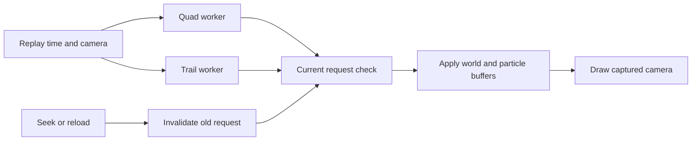

# Browser replay spike

A standalone technical spike for browser-native ROFL playback. The browser
decodes the original replay in a worker and renders a navigable scene with League
map geometry, champion meshes, selected world objects, skeletons and animation
clips. Recorded actions drive partial animation and effects. Latest-build
overheads use admitted health/resource observations; unsupported state stays
explicit. Legacy viewer experiments also include neutral monsters, shields,
buffs and prepared Web Audio clips for their own fixture; those do not establish
support in the latest-build viewer, which has no integrated audio runtime.
The local Bun process serves files; it does not decode matches. League does not
run during preparation or playback.

This is research code, outside Scout's application and deployment path.

The exact-build `latest.html` viewer routes ordinary Play through the shared
typed-array effect worker and translated game shaders. Static resources load
while the replay is initialized. Playback advances retained simulation, commits
its draw packets and presents world state at the same replay time. One worker
request stays in flight. A completed packet is claimed before the next request
can overlap its synchronous world/effects presentation. An independent display
heartbeat and wall-anchored replay clock measure repeated versus new states;
worker completion never resets the clock. Simulation consumes ordered events and
intermediate ticks even when a display frame is skipped.

Ordinary Play creates no camera lookahead buffers and requires no smooth-preview
preparation. Camera draws reuse simulation state, while seeking restores runtime
checkpoints and replays ordered events. Unsupported components and unresolved
instances remain explicit omissions. Browser playback and selected visual captures
have been verified for limited fixtures. Full combat coverage, reference-client
parity and performance acceptance remain open; routing the viewer through this
partial implementation does not establish those gates.

The original emulated parent timelines remain correctness oracles. Their
Vladimir E regression fixture contains eight quad layers and three trails;
admission to the direct runtime is checked separately for each component.
`tools/profile-parent-playback.mjs <cache> <label>` and
`tools/inspect-parent-viewer.mjs <cache>` retain the earlier buffered-path CLI
controls. Those measurements exclude browser execution, GPU submission and full
world rendering. Earlier component diagnostics below retain their original scope.

The [master fidelity map](AV-FIDELITY-MAP.md) is the entry point for remaining work
toward arbitrary standard 5v5 matches and 100% audio/visual fidelity. It separates
current evidence, missing capabilities, research uncertainties and completion
criteria. The detailed research sections below retain their individual scopes;
component results do not establish whole-match equivalence.

## Supported input

Ordinary reconstruction requires the pinned startup configuration package and
decodes exactly one stream-3 opcode728 packet before scene-bound readers run.
The report retains its recorded map, mode and packet provenance. A selected scene
with a different map ID is rejected before world or effect placement. Startup
decoding has separate stream-local identities and preserves gameplay transport
ordinals. The same extractor can inspect startup without a scene; this does not
establish mode/variant compatibility or add rendering support for another map.

### Selected static content

`latest-static-catalog/bootstrap.json` is the trusted same-origin static root.
It selects exact, separately hashed profile and catalog bytes. The catalog binds
the scene, effects, resource contexts and viewer poses to a closed file inventory.
Ordinary viewer initialization loads this bootstrap before the scene; a missing
or incompatible root fails initialization. Viewer-owned asset reads and selected
material reads use that inventory. Original complete-material providers retain
their separate fixed build/hash-approved fetch contracts.
`loadLatestStaticCatalogSelection({load})` verifies that closure and returns a
private owned selection; callers cannot supply an expected digest. Worker
restoration captures the same root bytes and compares the complete derived
inventory. This checks integrity under the trusted static-root assumption; it
does not approve new native algorithms, materials or live world state.

Selected authored resolver maps require their original typed-reader observations,
lookup results and complete selected actor/row inventory. Unit precedence and
the initial resource prefix retain their exact approved build programs while
their owned context/resolver dependencies come from the selection. The negative
form policy projects only originally approved matching actor/source capabilities;
absent actors remain explicit unsupported capabilities and invalidate resources
under the existing rules.

`selection.verifyNativeImageBlocks(blocks)` checks the fixed original image and
instruction hashes using a private cached byte store. It does not return the
image or approve another algorithm. The owned worker producer captures one image
span, reports its synchronous copy bytes/time separately, and reuses its root
buffers through `selection.bindWorkerInitialization(packages)`. The worker
rebuilds the selection and verifies the complete inventory and instructions.
When compiler and pose initialization use the same static path, the compiler
producer may reuse the exact pose-owned span after comparing its bytes. The
transfer requires both private producer capabilities and sends that buffer once;
the compiler inventory retains the path and the worker still verifies its bytes.
Initialization diagnostics distinguish synchronous copy CPU from asynchronous
load/hash elapsed intervals; no image loading or guest execution enters effects
frame updates.

Selected context observations retain fixed original image, producer and native
instruction approvals. The selected world-state reader permits only a scene
parent rebinding against the fixed original schema proof: classes, defaults,
world assets and original instruction blocks must remain exact. A different map
or world asset catalog requires its own verified capability. The optional
`staticCatalog` consumer parameter preserves the existing pinned contract when
explicitly null; the ordinary viewer migration must select a bootstrap uniformly,
without treating a missing file as feature detection.

Selected corpse policies can rebind their scene parent only when the world and
authored character catalogs remain byte-identical to the approved reference.
Selected submesh visibility data requires original observations for the complete
actor, range and event inventory, with the same approved scheduler, layouts and
native instruction blocks. These checks retain the supplied replay-clock and
graphics omissions; selecting another lineup does not approve new behavior.

Selected effect packet readers may change only the scene parent of the fixed
original descriptor and placement proofs. Placement also requires the exact map
quantization domain, including signed numeric values. Packet codecs, original
instruction blocks and descriptor algorithms remain unchanged. The catalog owns
both the selected packages and their byte-identical original references; a
caller-supplied digest cannot authorize rebinding. The packet control compares
real replay packets through both original readers, including descriptor bytes.
Its supplied zero entity pointers do not establish live attachment or placement
acceptance.

The selected material registry declares its rendering mode. `fixed-original-complete`
keeps the existing pinned material and texture loaders; `native-quad-partial`
uses original approved quad observations and lists unprepared families explicitly.
Native material outputs are static artifacts from trusted preparation. Their
approval requires original native observations, complete source/graph and
environment inventories, fixed build/program evidence, and shader/resource
closure. Offline comparisons verify producer correctness for that prepared
corpus. The browser checks exact content/build identities and inventory closure
and consumes the prepared outputs. Replacing artifacts together with their
trusted bootstrap selects a different trusted static artifact set; content
integrity alone cannot establish native output correctness. Existing runtime
source, material and world
input gates still apply, and unavailable families remain explicit omissions.
`prepare-selected-material-textures.mjs <cache>` prepares only PNGs referenced by
that quad package. The selected renderer loads textures referenced by its bound
native materials, verifies their PNG and raw RGBA bytes, and preserves stored
channels, row order and sampler state. Only noninterlaced RGBA8 PNG is supported;
unsupported formats fail without conversion. Static texture closure and shader
readiness do not establish submitted draws or match coverage.

Prepare a catalog after its static producers, using the original approved world
schema package as a separate input. These controls exercise real context/pose
consumers, module-worker restoration and world-schema instruction checks; they
do not establish ordinary-session or rendered coverage.
The catalog producer consumes the material producer's explicit file closure and
its declared texture leaves. It also copies the fixed build-wide item package
and its hash-verified icons from the approved static root; lineup selection does
not change that package's approval.

The isolated cache bootstrap copies both `public/vendor` and `public/utils`:
the installed GLTF loader has relative utility imports outside `vendor`.
`prepare-isolated-browser-modules.mjs <approved-cache> <isolated-cache>` repairs
only those exact utility dependencies in an already prepared isolated cache,
without rewriting its profile, scene, or catalog. Before browser playback, run
`inspect-browser-module-closure.mjs <cache> <loopback-origin>` to verify every
static viewer/worker import against HTTP 200 bytes. Computed dynamic imports and
runtime resource fetches are separate checks. Selected public factory byte
inputs accept fetch `ArrayBuffer` and CLI `Uint8Array` through the same owned
byte normalization; `inspect-selected-browser-byte-inputs.mjs <cache>` compares
both shapes against the actual corpse, submesh, context, and resolver factories.

```powershell
bun sandbox/poc/league-spectator/replay/tools/prepare-selected-build-programs.mjs <approved-cache> <selected-cache>
bun sandbox/poc/league-spectator/replay/tools/prepare-selected-static-catalog.mjs <cache> <approved-world-state-package>
bun sandbox/poc/league-spectator/replay/tools/inspect-selected-static-catalog.mjs <cache> <decoded-report>
bun sandbox/poc/league-spectator/replay/tools/inspect-selected-resource-catalog.mjs <cache> <decoded-report>
bun sandbox/poc/league-spectator/replay/tools/inspect-selected-world-state.mjs <cache>
bun sandbox/poc/league-spectator/replay/tools/prepare-selected-effect-packets.mjs <approved-cache> <selected-cache>
bun sandbox/poc/league-spectator/replay/tools/inspect-selected-effect-packets.mjs <approved-cache> <selected-cache> <replay.rofl>
bun sandbox/poc/league-spectator/replay/tools/inspect-selected-reconstruction.mjs <cache> <replay.rofl> 99
bun sandbox/poc/league-spectator/replay/tools/inspect-direct-session.mjs <cache> <loopback-origin> --selected-static --selected-reconstruction
```

The selected reconstruction control captures the root and required bytes into a
real module worker. Its report identifies actual consumed package hashes. The
session control verifies the report hash, source closure and complete selected
inventory before consuming that report; stale reports require reconstruction
again. These CLI controls use the ordinary reconstruction and session factories,
but do not execute the browser or submit GPU draws. Reconstruction elapsed time
starts after root restoration and imports, and includes decoder initialization;
it is not total viewer startup time.

Add `--capture-playback` to the session control to advance its initialized worker
over the complete comparison window at 1x and 4x. This separately checks matching
retained state, camera-only redraws and repeated backward seeks, and writes
`direct-session-selected-control-playback.json`. The capture uses a declared
fixed diagnostic camera through the session's worker client; it bypasses the
viewer's request wrapper and supplies no wall-clock pacing. Its worker timings
do not measure browser FPS or a world-rendering baseline. The offscreen renderer
accepts that file explicitly with `--session-capture <capture.json>` and checks
each material against the captured selected quad package before submission.
That capture route currently supports quads; other primitives require their own
verified export path.

Legacy ANM3 sources can carry an authored integer sample FPS whose original
resource getter returns a float32 reciprocal clock. Unequal clocks require the
explicit `legacy-anm3-native-time-to-toolkit-sample-grid-v1` declaration, bound to
the original header. Native atomic time remains distinct from the Toolkit sample
grid; converting native pose time to that grid is a presentation policy, not a
claim of native pose interpolation parity. Other unequal formats fail explicitly.

### Direct effect runtime

`latest-direct-effect-runtime.mjs` owns persistent typed-array particle state,
ordered event application, supplied-seed RNG state and bounded replay
checkpoints. Camera redraws generate draw packets without advancing simulation.
The worker transfers independent geometry buffers; transferring a draw cannot
detach simulation or checkpoint storage. These checkpoints contain runtime
state, rather than emulated process memory.
Worker initialization reconstructs the complete compiled inventory from ordered
event definition references and independent copies of the static asset inputs.
It runs the same content-pinned loader, capability owners and compiler, then
compares every source, derived field, omission and blocker before accepting the
serialized definitions. Own-data validation preserves signed zero and typed
buffer lanes, rejecting accessors, custom prototypes and serialization hooks
before structured transfer. The ordinary viewer always uses this full comparison;
CLI numeric component projections require an explicit diagnostic initialization
mode. Compilation runs only during initialization. Diagnostics report captured
asset bytes, distinct initialization buffer bytes, synchronous message posting,
round trip and worker recompilation separately; these are not an isolated
memory-copy or browser-playback measurement.
The shared session serializes accepted simulation advances and keeps camera
draws separate. Session initialization converts browser `ArrayBuffer` inputs
and typed byte views into independent `Uint8Array` snapshots before the strict
content-pinned asset factories run. The ordinary-session CLI control exercises
the browser's buffer input type as well as real worker and renderer loading.
The bounded presentation coordinator never coalesces accepted
advances or seeks. It replaces only adjacent unstarted camera draws, reports
superseded views explicitly and rejects excess advances before accepting them.
Paused camera redraws leave simulation checkpoints and RNG unchanged. Capture
commits only a current packet whose replay time, session and camera still match.
Ordinary Play and diagnostics consume this same handoff. Actual world/resource
coverage and browser performance remain separate acceptance gates.
Draw responses report buffer bytes and worker receive, processing and reply-ready
timestamps. The client records round-trip, request delivery, worker queue and
reply delivery durations on the shared epoch clock. Delivery includes message
serialization, thread scheduling and dispatch; it does not isolate a memory copy
or GPU upload. Cross-thread estimates retain raw clock-quantization differences.
Simulation and geometry durations remain separate worker samples.

The compiler admits bounded point camera/arbitrary quads, camera trails, continuous
Rays and an ordinary static-mesh slice, retaining emitter and system dependencies
explicitly. Rays require the verified bound point-controller subset, an owned
native post-distortion material selection, a four-frame atlas and a prepared
particle palette. They use the original 28-byte vertex layout, preserving packed
color and all six half-float UV lanes. A separate renderer consumes these packets
with the same owned shader, texture, sampler and uniform bindings as diagnostics.
Camera position is an explicit geometry input; paused camera changes regenerate
geometry without advancing particle state or RNG. Single-particle Ray clocks,
other controller families, original scene visibility, stopping and retirement
remain explicit omissions. The all-vision/remap-omitted Ray scene policy uses
the original constructor's white and transparent resource bytes.
Bound camera quads with constant nonzero point offsets also support explicit
particle-local orientation. Their offsets use the current system basis when
enabled and the retained birth basis when disabled; interpolated birth origins
remain in world space. Motion and force consumers of the native derived streams
remain excluded. Explicit zero mesh-render flags retain their own camera-quad
policy, separately from the original absent-field default of one; the authored
value and prepared material binding remain intact.
Constant multiply-texture transforms use the original centered rotation/scale
matrix arithmetic and packed half-float corner coordinates. A branded material
owner admits the exact native pass-zero `MULT_PASS` shader selection, installed
base and multiply textures, and authored repeat/mirror/clamp sampler descriptors.
Constant transforms share one sixteen-byte corner stream per emitter draw.
Verified non-random multiply-scale curves sample normalized particle age;
overlapping particles retain separate sixteen-byte corner streams. Independent
native birth-age, absolute-age, lifetime and normalized-age controls establish
that clock. Complete typed schedules also cover delayed and continuous births,
different lifetimes and retained tails. The actual compiler, owned material and
module-worker control compares unchanged source geometry, checkpoints, paused
redraws, repeated seeks and 1×/4× advances. Camera movement adds no simulation or
RNG state. Materials without a multiply texture retain the original particle-age
palette-coordinate fallback. Scrolling, animated rotation/offset, randomized
scale curves, multiply atlases and palette combinations remain explicit omissions.
Navigation-masked arbitrary ground quads use a separate owned native pass-five
material selection, including its masked multiply variant. A separate camera-quad
extension preserves its original pass-five eligibility, masked shader pair and
camera-facing geometry; it shares the same-time navigation output provider.
Authored camera raster bias must match the original pipeline and requires normal
renderer depth. The original arbitrary-quad package remains independently pinned.
Each static package
retains the complete original activation pipeline, shader pair, parameter bytes,
authored textures, palette and sampler state. Source identity is checked against
the original definition bytes before compilation. After transfer, the worker
replays the shared loader and compiler over independent exact asset bytes and
compares the complete compiled definitions. Normal definition inventory comes
from the ordered replay events. Isolated component controls require an explicit
diagnostic mode and unchanged admitted source components. This validation runs
once during initialization; per-frame work does not recompile definitions.
The selected installed scene supplies original initial navigation cells and their
own grid transform under an explicit partial presentation policy. Its decoded
variant, dynamic cell mutations, original scene publication and clock epoch remain
visible omissions; this does not establish recovered match navigation state.
Session initialization loads resources and compiles the producer and ground
shaders. A frame first validates every combat component and owns its camera and
packet snapshot. Inside the whole-scene GPU timer, the renderer submits the five
navigation passes and publishes their actual output texture before committing the
combat scene. Failed or stale output cannot be reused after seeking. Ordinary
playback and diagnostic captures share this submission path. Initial staging,
navigation CPU submission and deferred combat commit have separate timings;
the render-submission measurement includes those latter stages and world render.
The CLI session control explicitly loads and stages navigation materials without
a WebGL backend, and does not count their draws as submitted or pixel coverage.
The prepared THREE renderer retains a GPU buffer for each uniform group while
reusing binding slots by the active shader program's block indices. Every draw
validates the complete active block inventory and reflected storage sizes, uploads
current native block bytes and binds each block to its own buffer. Storage lifetime
does not consume the finite global binding-slot inventory. The deterministic
adapter accepts only the pinned upstream source, preserves that source separately,
and records derived bytes in `vendor/three-uniform-bindings.json`. Session and
uniform-block initialization reject an unprepared renderer policy. To update an
already prepared local cache, run:

```bash
bun sandbox/poc/league-spectator/replay/tools/prepare-three-uniform-bindings.mjs .cache/replay-spike
```

Native texture semantics bind the exact GLSL sampler names from translated
sidecars. The renderer validates active raw-shader sampler keys before filtering
its uniform list, then validates current texture targets and integer formats at
each uniform upload. Shader preparation permits a declared pending navigation
texture; a draw requires its current owned output. Errors identify the material,
program and sampler instead of accepting a default texture unit or empty texture.

Absent emitter fields use defaults observed after the original math globals and
registered constructor are initialized. In particular, absent birth scale is a
unit vector; an authored zero scale remains zero. The constructor and typed-loader
controls are separate from the particle and packed-geometry comparisons.
Legacy point offsets with verified non-random vector curves are sampled once at
particle birth using normalized emitter age. Other Legacy rotation and random
fields remain excluded. Older prepared JSON loses some signed-zero curve lanes;
that source limitation remains explicit even when rendered geometry agrees. The
static asset writer now preserves negative zero, but existing packages require
regeneration before they can claim that serialization policy.
Definitions with observed child sources can render verified child-free quad
siblings under an owned, content-addressed capability package. Original paired
controls establish sibling independence for those exact source structures. The
worker restores that capability from original hash-checked definition bytes;
creation still requires the selected base resolver's exact context and handle.
Omitted child declarations retain parent event, generation, emitter, key and
ancestry. Their request clocks, global activation, rendering and complete parent
retirement remain unresolved. This slice does not admit other child sources or
infer their runtime creation.
Static meshes require both an owned SCB resource program and an owned original
individual material selection. Their worker packets carry 176-byte particle
records; the viewer loads mesh geometry once and updates per-particle uniform
blocks. This uses the original noninstanced shader branch. Its inactive integer
sampler receives an API-completeness texture whose contents are proven irrelevant
in that branch; the separate 208-byte instanced layout remains unresolved.
`latest-native-raster-conventions.mjs` preserves captured Metal state separately
from the GLES state. For unchanged clip-space Y and a lower-left GLES viewport,
it reverses front winding once and preserves culling. The renderer compensates
THREE's model-matrix reflection separately. Native selector/viewport controls and
the [ANGLE Metal winding conversion](https://raw.githubusercontent.com/google/angle/main/src/libANGLE/renderer/metal/mtl_utils.mm)
support this boundary; copying enum labels across the two viewport conventions
would cull the ring from the comparison camera.
The mesh scene uses original white/transparent texture bytes under an explicit
all-vision presentation policy. Actual spectator visibility and team remapping
remain omissions, alongside untranslated mesh stopping and retirement behavior.
Definitions bind to exact build/content
hashes. The world presentation adapter exposes absolute-time entities,
appearance candidates, resource-stack observations and attachment observations.
Optional world-query cursors retain packet and entry order at an identical
timestamp. Creation and immediate particle birth use their creating packet;
updates before another event exclude that event. Movement, lifecycle, resources,
attachments and entity activation share this cutoff. Ordinary frame samples
still observe the final state at their timestamp. Missing required ordinals fail
explicitly, and known identities outside their active interval remain inactive.
An entity position does not establish its resource stack, bone pose or effect
placement. Every nonzero effect entity reference remains identifiable.
The viewer models and `world.viewerRoot` share the causal decoded position under
the explicit `decoded-replay-clock-visible-actor-root-v1` presentation policy,
including the viewer's death-position freeze. `latest-viewer-root-attachment.mjs`
admits only source-root key zero and the verified source-matrix-skip branch.
Its shared component adapter admits ordinary quads and the verified mesh/Ray
programs with their owned material selections. The packet's horizontal direction uses
`latest-packet-direction-basis.mjs`; bones, tilted directions, target/additional
providers, terrain alignment and unsupported primitives retain explicit blockers.
Placement retains the decoded source IDs and cursor, with unknown native
acceptance and placement parity. This selected presentation policy never replaces
a failed native-provider lookup or establishes effect resource selection.
Decoded network removals retain their causal creation generation and all four
entity references. A bounded quad controller now applies
the translated stop and particle-tail branches to linked presentation instances.
Its owned wrapper starts from the observed activated-factory defaults; native
world acceptance, subsequent wrapper/provider flag writes, parent draw selection
and collection remain unknown. Singles with absent or exactly empty material
override vectors use the original zero-controller branch and resource lifetime
rewrite. Their authored lifetime, effective clock and pre-rewrite link timers
remain separate. Lifetime resource maxima support inline constants and verified
single-key curves. The original cached maximum excludes probability composition;
births still sample their authored random lifetimes independently. Nonempty
override ownership, other resource maxima and other primitives remain explicit
omissions. Empty
compiled presentation storage may retire locally, without claiming completion
of unsupported original siblings. Checkpoints retain controller flags, local
birth clocks and the first stop clock alongside particles and RNG state.
`latest-viewer-pose-attachment.mjs` uses the shared pose service for the explicit
`same-viewer-installed-pose-attachment-partial-v1` placement policy. Visible
champions and CPU attachment queries use one absolute-time animation sampler
with separate owned hierarchies. Its static package pins the consumed GLB,
installed rig keys, graph, clocks, clips and Three.js math. Bone positions retain
authored hierarchy scale; attachment bases use unit quaternions. Unknown facing,
untranslated appearance/form requests, missing installed keys and unsupported
provider lifecycles block the affected presentation. The policy preserves all
four entity references and never substitutes a root for an unknown bone.
Root-only queries reuse the same causal layers and yaw while skipping unused
joint evaluation. Cache keys retain absolute time, packet/entry cutoff and source
state, independently of the camera. Native pose parity and engine acceptance
remain unknown; supplied viewer poses do not establish original live providers.
When current facing is unknown, visible champion models use a separate display
policy: the last accepted nondegenerate movement path is sampled at its first
causal interruption, with creation/respawn resets and death-time freezing. Before
any such path, the model uses its captured authored bind rotation with an
explicit unresolved-facing omission. Neither choice reads previous displayed
transforms or future events. This makes model facing independent of seek order
without resolving an unknown effect attachment or projectile orientation.
Effects sharing an immutable pose observation reuse one runtime-owned evidence
snapshot. Mutable inputs retain independent copies, and public coverage and
checkpoint results retain independent ownership.
The direct session loads the pinned static context, resolver and unit-precedence
packages. Optional serializable `presentationInputs` contains entity, resource
and attachment tracks; one cloned snapshot feeds both event resource selection
and the worker's world queries. `selectLatestWorldEffectResource` applies the
observed two-unit/auxiliary lookup order at each creation's packet cursor.
Unknown stacks stop selection; an equipped skin never substitutes for a failed
native lookup.
An auxiliary definition retained for compiler inventory is labeled as a candidate
and does not establish successful resource resolution. Run
`inspect-world-resource-bindings.mjs <cache>` to compare supplied native stack
cases through this time-addressable bridge, including identical-time changes,
inactive identities and selected null references. Supplied-stack comparisons do
not recover the fixture's live resource tracks or establish placement.
Ordinary reconstruction retains appearance push/pop/clear/copy and form-selection
requests in `resourceRequests`, using pinned field readers and original packet
ordinals. Gameplay and snapshot streams remain distinct; causal queries preserve
repeated values and same-time ordering across seeks. Decoded requests retain null
acceptance and resource identity. Copy requests expose an unresolved producer
reason, and incompatible package bytes fail normally. These observations never
supply live resource stacks.
`latest-initial-resource-prefix.mjs` provides a separately declared
`native-initial-resource-presentation-prefix-v1` policy. The original initial
hero-creation argument bridge, default appearance storage and base callback
establish its inputs and constructor-empty overlays. Decoded initial creations
select exact-build static authored contexts and resolvers; browser package
readiness remains distinct from unknown native cache readiness and acceptance.
The first unsupported later appearance/form request invalidates this conditional
state. `latest-negative-form-prefix.mjs` preserves only exact index-255/false
observations whose pinned installed skin/gear program has a verified resource
and rig identity-preserving lazy-constructor path. The supported gear program
contains submesh visibility changes and empty resolvers; those visual side
effects and event-47 registration remain explicit omissions. Stream-2 requests
are labeled snapshot observations consistent with the conditional initial
prefix: native snapshot acceptance and restoration remain unknown. No later
observation renews an already invalidated state. World queries, event resource
selection and the worker share this policy; ledger rows retain its source event
IDs, causal cursor and explicit omissions separately from accepted observations.
Run `inspect-initial-resource-playback.mjs <cache>` for ordered real-worker clock,
camera and seek controls on decoded requests. `render-initial-resource-playback.py`
renders their actual draw packets offscreen; it does not establish browser
playback or native accepted resource state.
The build-pinned `latest-unit-resource-mutations.mjs` kernel applies explicit
verified initial states and accepted mutations with stable resolver handles.
Context changes preserve overlays; null context preserves the prior base,
while a nonnull context with a null resolver clears it. Push removes the first
identical handle before appending; removal affects only the first identical
handle, including null. Immutable causal tracks and checkpoints support seeks.
Raw appearance/form requests never become accepted mutations automatically.
`inspect-resource-requests.mjs <cache>` and
`inspect-unit-resource-mutations.mjs <cache>` verify these separate boundaries.
Ordinary reconstruction also preserves each cast/missile's ordered
`requestedTargets`, decoded by `latest-missile-targets.mjs` from the original
16-byte target records. These unsigned network identities remain requests:
accepted world targets stay null, the record tail remains opaque, and this
does not admit targeted motion. `prepare-missile-targets.py <cache> <client>`
prepares static build tables; `observe-missile-targets.py <cache> <client>` and
`inspect-missile-targets.mjs <cache>` compare the original conversion with the
browser-compatible decoder on packet fixtures and unsigned boundary controls.
The pinned `latest-target-visibility.mjs` reader retains opcode822's two raw
serialized owner payloads in ordered `visibilityRequests`. Snapshot and gameplay
provenance, original packet ordinals and unknown live acceptance remain explicit;
these requests do not change world visibility. `prepare-target-visibility.py
<cache> <matching-client>` prepares static layout evidence, and
`inspect-target-visibility.mjs <cache>` compares the browser-compatible decoder
against complete native packet objects and heap vectors.
`world.visibility(entityId, time, cursor)` exposes a separate declared presentation
policy from `latest-target-visibility-policy.mjs`: original ROFL launch mode 3
with the original selected-view filter disabled. Gameplay primary requests set
the component initialization flag; encoded per-view masks and reset requests
retain their separate semantics. The selected initial restore policy translates
only the original primary component prefix for a matching initial snapshot hero:
its decoded AI-client creation must precede that request at time zero in the same
snapshot chunk. The browser derives these states from decoded packets and its
causal registry. Static `latest-initial-visibility-prefix.mjs` evidence contains
no match state. Later snapshots remain listed without changing component state.
Optional `visibilitySeedObservations` must identify a separately
verified component observation, causal cursor and generated presentation generation;
raw snapshot packets never become seeds automatically. The first class binding
requires an active decoded champion AI-client registration. Generated presentation
handles remain distinct from unknown native accepted IDs. Concrete owner payload
callbacks, actual client view settings and target acceptance remain explicit
omissions; `entity.visibility` stays unknown and motion admission is unchanged.
Run `probe-target-visibility-lifecycle.py <cache> <matching-client>` and
`compare-target-visibility-policy.mjs <cache>` for original set/reset/mask/query
comparisons and the supplied ROFL launch/view-producer controls.
`probe-initial-visibility-prefix.py <cache> <matching-client>` compares the
registered-component prefix on original initial packets; its output is an offline
comparison fixture, never a browser state input. Only the write before the owner
callback is implemented by this partial restore policy.
`createLatestMissileTracking` in `latest-missile-tracking.mjs` provides a separate
fixed-speed target-query and retention kernel. Its caller supplies an accepted
internal generation handle, target position, aim offset, radius, native visibility
predicate and mode value. Initial target selection permits a supplied hidden
target; subsequent queries honor the authored hidden-target setting. Rejected,
missing or generation-mismatched targets preserve the previous endpoint. Nonzero
bone queries remain unsupported. Run `probe-missile-tracking.py <cache> <client>`
then `compare-missile-tracking.mjs <cache>` for original AI construction, target
query and controller-step comparisons. These supplied-world controls do not admit
actual match targets, infer network-to-internal acceptance, implement packet
retargeting or recover the recorded visibility and frame cadence.
`world.presentationTarget(entityId, time, cursor)` adds a declared no-local-player,
constructor-provider view over that partial visibility policy and causal decoded
group4/index0 base flags. Its generated presentation handle remains distinct from
unknown native engine acceptance. Constructor assumptions, missing owner/provider
producers, ignored snapshot mutations and unavailable poses remain explicit.
`buildTargetedMissilePresentation` in `latest-targeted-missile-presentation.mjs`
uses this view for a separate diagnostic fixed-speed family: one initial gameplay
replication, one requested target, no target bone, initialized packet motion,
verified height/facing and admitted ordered behavior components. Retained targets
follow actual known world poses without re-running the initial targetability gate.
`latest-match-velocity-facing.mjs` translates the post-height displacement callback;
`latest-presentation-missile-actors.mjs` preserves completion phases, resets and
component ordering while emitting identifiable requests for the unimplemented
downstream cast/spawn dispatcher. Neither module changes legacy motion eligibility.
`latest-fixed-time-movement.mjs` adds a separate fixed-time controller and the
default constant-gravity solver. Its strict presentation family requires the
decoded empty indexed-override list, a proven zero-age constructor/packet origin
bridge, one retained target, no target bone and the same verified ordered behavior
components. Nonempty overrides and unresolved constructor poses remain blocked.
`latest-zero-reference-fixed-time-presentation.mjs` admits a separate bounded
family when the original empty cast selector returns zero. Authored tracking
remains enabled, but no target holder or target query is created: the original
terrain-derived endpoint remains fixed. Its caster start uses the causal shared
world root, terrain height plus the original clearance, and a source-pinned rig
whose empty bone key is absent. Admission requires the observed zero-age first
packet, ground-height endpoint, empty bones and overrides, zero start delay, and
verified height, facing and ordered behavior components. Local event-split deltas
retain a separate supplied global frame delta. All three family schedulers pass
the declared global frame delta separately from local integration intervals;
the original MatchVelocity callback consumes that global clock. The source root remains a replay
presentation policy; native live-model readiness, native match acceptance,
collision and downstream cast/spawn side effects remain explicit omissions.
`createOwnedNamedBoneMissileCasterStarts` in `latest-missile-caster-context.mjs`
provides a separate, currently unadmitted named-bone start query. It binds the
decoded caster appearance to raw installed rig/catalog bytes and selects the
bone and settings from its spell source. The type-three translation preserves
the separate root-clearance and bone-ground height offsets, using the exact
creation cursor's supplied viewer pose. Missing poses remain unresolved. Native
controls establish the start math, name hashing and installed-rig key lookup;
the live render-model query is a controlled supplied-pose boundary. This provider
does not establish native live-model readiness or admit a projectile family.
The distinct `createOwnedNamedBoneTypeOneMissileCasterStarts` provider supports
zero-offset, single-target FixedSpeed source starts under cast type one. The
original selector preserves the installed named bone's XYZ without a terrain
rebase; its separate attachment height subtracts root terrain plus clearance.
The targeted preparation worker loads the owned pose and initial resource inputs
only when this source family occurs. It preserves creation-cursor ordering and
leaves missing orientation or bone poses unresolved. A resolved source start does
not resolve an unsupported minion target. Source preparation elapsed
time and newly read static bytes are reported separately from frame costs.
Verified source starts remain subject to every target, movement, compiler,
material and component-world-input gate before contributing rendered coverage.
`latest-missile-presentation-families.mjs` combines the independently admitted
fixed-speed, retained-target fixed-time and zero-reference fixed-time traces
without changing their per-instance policy or source identities. The direct
session prepares these families in
`latest-targeted-missile-worker.mjs` (`family: "all"`)
through the shared static loader. Its serializable generated-presentation contract
feeds both the main event ledger and direct worker's world adapter.
`world.projectilePresentation(entityId, time, cursor)`, `world.projectile(sequence,
time, cursor)` and `world.entity` expose the same admitted positions. Resources,
final retirement and unimplemented root bases remain explicit. Same-time phase samples retain
packet/entry identity, and backward queries preserve the causal creation boundary.
This supplies a pose query to future attachment providers; it does not make an
unimplemented missile transform provider or particle binding eligible.
In direct playback, `latest-direct-missile-family-adapter.mjs` can bind these
strict families to the declared static spell effect. It supplies positions,
admitted effect bases and an explicit unknown bound-object size. Only components whose
compiled world-input requirements are satisfied can activate. Native camera
writer controls establish basis independence for bounded camera quads with
zero local spawn position, emitter position and velocity; native particle and
matrix orientation streams remain explicit omissions. Nonzero offsets, motion
and arbitrary quads still require their original basis.
`latest-missile-effect-basis.mjs` translates the original missile velocity
callback and VFX direction setter for fixed-time spells and the owned named
type1 tracking fixed-speed source branch with zero direction turn speed and
maximum angle. Other source options retain an unresolved basis. The static
catalog builder checks those authored fields and retains its catalog digest.
The targeted fixed-speed producer initializes actor velocity from the current
creation position, causal retained target and packet speed through the original
XYZ normalization/XZ speed-scaling helper at zero integration delta. It does
not query a future movement sample. The retained target uses the declared viewer
world projection; native registry/query acceptance remains unresolved. The
version2 targeted policy and runtime program version distinguish this constructor
state from older pre-initializer zero-velocity diagnostic rows.
Nonzero constructor velocity is required for basis admission;
the unresolved controller fallback never becomes a guessed direction. Updates
use applied actor velocity, including vertical motion, and preserve the last
basis after stopping. Serialized traces must reproduce every basis lane from
their velocity and stopping history. This numerical validation retains the source
digest without independently binding it to catalog bytes at the projectile
adapter boundary; it shares the existing generated-presentation trust boundary.
The original typed spell reader, creation callback, live callback and stopped
branch remain separate native controls. Native frame scheduling and complete
missile actor acceptance are not established by those controls.
The new adapter retains decoded owner/target identities and source packet order;
it never supplies an identity as a recovered missile transform. Its movement
stop is an explicitly generated emission-stop policy. Static spell binding,
original engine registration, collision and particle retirement remain partial.
Legacy and targeted-family adapters must have disjoint source packets and
missile identities. Ambiguous ownership fails before activation; network effect
requests remain independent and are never deduplicated by this partition.
`latest-direct-missile-presentation.mjs` separately rebuilds the unchanged legacy
missile admission from decoded records and pinned static movement, actor and
spell data in the preparation worker. Its generic adapter emits identifiable
create/stop events and retains the original preview flight basis and decoded
owner. Network requests retain their separate identities, even for the same
entity and definition. This visual slice uses the direct runtime's absolute
clock and per-emitter seed policy; it does not claim agreement with the legacy
birth-relative parent timeline. Tail, stop-boundary, wrapper and audio omissions
remain attached to the generated requests. Unsupported quads or other components
stay omitted independently of admitted trail geometry.
`inspect-resource-reconstruction.mjs <cache> 99` composes the ordinary decoding
worker with these kernels at an explicitly supplied 60 Hz diagnostic clock,
compares the targeted module worker with the shared synchronous builder and checks
world-query/lifecycle agreement. An optional asset-base URL also exercises the
worker's HTTP static loader; this remains CLI worker evidence, not browser playback.
Native acceptance, effects resources, collision, emitted child presentation and
ordinary Play/browser acceptance remain separate gates; numeric traces are not
rendered coverage. Run `probe-missile-target-gates.py`,
`probe-fixed-time-movement.py`, `probe-cast-indexed-overrides.py`,
`probe-target-baseflag-varuint.py`, `probe-cast-on-movement-complete.py` and
`probe-match-velocity-facing.py` with `<cache> <matching-client>`, followed by
`compare-presentation-targets.mjs`, `compare-completion-cast-requests.mjs` and
`compare-match-velocity-facing.mjs`, `compare-fixed-time-movement.mjs` and
`compare-cast-indexed-overrides.mjs` with `<cache>` for the independent native
predicate, varuint, phase/action and facing comparisons.
The session and worker share the pinned descriptor-factory placement policy.
Its verified branch uses the original packet positions and constructor basis
or the translated horizontal authored direction. Full original factory controls
compare the direction matrix before activation and after parent synchronization.
Source and target providers, tilted directions and terrain alignment remain
blocked in this native factory branch. The separately declared shared-viewer
pose policy supplies only its own verified presentation inputs.
A distinct registered champion in the A8 slot can use the explicit partial
`packet-position-with-auxiliary-audio-anchor-omitted-v1` policy: original setter
and visual scheduler controls establish that this provider does not change
particle placement. Audio-anchor getters and shared/weak ownership remain
omissions; this does not recover that entity's pose or native acceptance.
Resource-context identity remains attached
to the request; a missing reference still blocks placement. Secondary position,
native parent flags and basis provenance remain diagnostic inputs. Ordinary
quad controls establish flag-independent birth/draw behavior for this branch;
wrapper visibility/culling and network stop, reset and tail semantics remain
explicit omissions. `inspect-direct-packet-placement.mjs <cache>` checks the
original provider-selection fragments and complete-factory controls;
`inspect-direct-parent-flags.mjs <cache>` checks ordinary parent frames and
separate stop/reset decisions. No per-frame guest execution enters the worker.
Resource-context and attachment entities remain distinct from unresolved network
creator ownership. Coverage and submissions retain this ownership status rather
than attributing an effect to the first nonzero entity reference.
Randomized single-key lifetime, birth-scale and birth-rotation values use the
shared birth sampler's verified call order. The retained particle chance and RNG
stream belong to checkpoints. Random color, animated random birth clocks and
particle-age random controllers remain explicit omissions. Checkpoint runtime
version 23 includes retained chance, camera/delay and pool ordering semantics,
explicit ownership provenance, constant angular motion and the previous update
clock needed to distribute burst births, plus ordered world queries at event
boundaries, retained local particle motion, birth origins and bases, plus
CameraTrail UV, odometer and retained-point state, and authored system audio
metadata. It rejects earlier checkpoints.
Compiled definitions also carry `programVersion` from the same runtime contract.
The runtime rejects missing or older compiled programs even when their build,
protocol and asset hashes match. An unchanged asset package cannot establish
compatibility with a changed compiler program format.
When a world adapter supplies shared viewer poses, the runtime also binds its
exact static presentation-content hash to every checkpoint. A different pose
asset closure or a changed world hash rejects restoration and advancement.
Creation evidence remains separate from the most recently resolved pose evidence;
both survive checkpoints with explicit unknown native acceptance and pose parity.
Automatic checkpoints reuse private, detached snapshots of unchanged historical
ledger rows. Active updates and later removal requests invalidate those snapshots;
the checkpoint interval and retained history stay the same. Public checkpoint
queries return complete independent copies, and restoration copies cached state
before making it live.
Worker timing also reports placement/resource/pose queries as a subset of total
simulation time. Camera-only geometry performs no such queries; its query metrics
are zero rather than reused from the preceding simulation update.
Coverage stages describe creation-time eligibility. `placementResolved` means
the instance has a known base placement; `worldInputsResolved` additionally
requires at least one compiled component with all required inputs. The separate
`allCompiledComponentInputsResolved` stage requires a nonempty compiled set and
every component's inputs. Neither stage claims omitted source components are
implemented. Rows retain compiled/eligible counts and immutable initial input
evidence; current input-loss evidence is reported separately. These stages never
count an empty compiled definition as having resolved component inputs.
Camera quads can also use a verified flat, two-key integrated rotation controller.
Its exact float32 integral table and lifetime multiplier follow native controls;
other curve shapes and randomized integrals remain identifiable unsupported
components. Arbitrary quads can separately retain an authored typed
`isRotationEnabled` flag when `rotation0` is absent. Their explicit
`absentRotationControllerProgram` preserves the original constructor's zero
constant and null curve, including enabled signed-zero addition and the maximum
particle-lifetime bypass. Authored arbitrary-quad rotation controllers remain
unsupported. The worker restores this capability by recompiling the exact source;
material and world-basis admission remain independent requirements.
Quad draw packets retain the original half-float atlas-frame and palette lookup
coordinates as three values per live particle. The renderer repeats those values
at every corner and uses the same packed attributes in offscreen diagnostics.
Four-frame arbitrary quads reuse the retained birth chance with the original
default frame clocks; they consume no additional random samples. Palette lookup
uses the verified default normalized-age and constant-one selectors. Compiler and
material checks reject unverified frame clocks, UV transforms, palette selectors
and texture bindings. These draw coordinates are regenerated independently of
the camera and do not add checkpoint state.
An additional partial material policy admits the exact native depth-disabled
graphics branch for verified soft-particle parameters. The compiler preserves
the authored parameters, and material admission checks the original graphics
environment, shader identities and depth-independent bindings. Depth intersection
fading and the original match graphics setting remain explicit omissions. This
does not implement active soft particles or supply a synthetic scene depth.
Compiled `systemIdentity` preserves the authored unsigned `objectPath` HASH and
its presence. Authored identity and record IDs must agree with the requested
definition; an absent HASH retains the original constructor's zero rather than
substituting the asset ID. Child-free parent controls establish this field's
identity role without changing geometry, RNG or lifecycle. Child factories do
consume the HASH, so any child declaration retains an explicit ancestry
dependency. Compiled `systemFlags` preserves the exact unsigned 16-bit root word
and its presence; an absent field retains the native default 212. Native controls
admit ordinary component scheduling for values 212, 196, 197, 198, 213 and 214.
Other values remain blocked. Every admitted definition, including default 212,
retains explicit `systemOmissions` for view-dependent wrapper simulation,
provider lifecycle and audio. Ledger rows and checkpoints preserve these values;
component rendering does not establish completion of those system behaviors.
Full original empty-view controls demonstrate that some of these flags change
wrapper scheduling even when direct-parent geometry agrees.
Compiled `systemAudio` retains the exact authored presence and String values of
`soundOnCreateDefault` and `soundPersistentDefault`. Original enqueue/parent
comparisons establish unchanged particle bytes, RNG, clocks and geometry for
these two declarations. Their visual components can therefore render while
wrapper audio admission, enqueue behavior, queue consumption, device playback
and handle lifecycle remain explicit omissions. The runtime performs no audio
playback. Other audio properties and unsupported root dependencies remain blocked.
Compiled programs require valid audio metadata. Instance
ledger rows and checkpoints retain it; missing or malformed compiled fields do
not silently become empty sounds.
`probe-direct-root-object-path.py <cache> <matching-client>` checks prepared root
identity and typed-reader/default controls; `probe-direct-root-identity-activation.py
<cache> <matching-client> <ANGLE-directory>` compares the original child-free
parent at several supplied HASH values. These controls do not establish child
resource acquisition or match activation.
The compiler also recognizes an exact singleton-zero `EmitterPosition` curve:
one positive-zero key, a positive-zero vector, empty probability tables and no
constant override. Original authored/default/constant controls establish the
same particle state and geometry; other animated offsets remain unsupported.
Raw source metadata remains intact, and only the executable position program
is normalized. Ground components still require their own exact pass5 material.
An unimplemented material binding omits its component with a material-stage
reason; a ground component never borrows an ordinary pass binding. Invalid or
incompatible prepared package contents still fail initialization.
Each compiled component declares its required root basis and bound-object size.
Unknown required inputs omit that component with a ledger reason; they never
become identity transforms or unit scales. A missing instance position still
blocks the whole instance. Loss of a required input stops further presentation;
later data cannot reconstruct skipped births. Checkpoints retain these decisions,
and restoring an earlier checkpoint replays the original ordered inputs.
The exact typed Flex shape containing only `scaleBirthScaleByBoundObjectSize`
at float32 0.005 requires a verified finite nonnegative size for quads.
Provider-free packet placement supplies its original zero. Attached quads can
consume `same-viewer-single-model-resource-bound-size-partial-v1`: the selected
installed SKN4.1 header and skin properties produce the original resource
bounds/radius, then the causal viewer model, scale and root feed the original
single-model cached AABB calculation. The attachment entity selects this input;
resource context does not establish bound ownership or creator identity.
An absent sphere-radius override follows the original negative sentinel and
AABB path. No collision radius or absent-model zero is substituted. Missing
appearance, placement or resource inputs and unsupported SKN versions remain
explicit omissions. Native live model readiness, extra-display aggregation,
gameplay scaling and root-offset state remain unproved under this partial
viewer policy. The parent setter maps sizes200–500 to200–250 with float32
operations before calculating the Flex factor. Current particle scale applies
that factor after birth scale and authored scale, without changing birth RNG or
rebirthing particles. Checkpoints retain the current factor. Other Flex shapes
and nonzero inputs for other primitives remain unsupported.
Constant finite `EmitterPosition` values are world-space offsets when local
orientation is explicitly disabled. Absent `isLocalOrientation` retains the
observed constructor flag that inherits the system basis; this transforms the
local emitter position, spawn offset and initial velocity at birth. Authored
true, animated and randomized orientation/offset cases remain excluded.
Constant `birthVelocity` is admitted for verified single-particle components.
Their local float32 positions accumulate each canonical update; replacing that
integration with an age-times-velocity expression changes native rounding.
Integrated world acceleration and continuous velocity births remain explicit
dependencies. Optional `placement.basis` supplies a finite nine-lane
column-major system basis; arbitrary particles retain their basis at birth as
the source rotates. Checkpoints and swap-last retirement retain that basis with
the particle. Identity basis without a supplied pose remains an isolated-control
convention, not a recovered match orientation.
Arbitrary quads admit constant `birthRotationalVelocity0`: the original branch
derives rotation from particle age and birth rotation without additional RNG
draws. Random or curved angular values and camera-quad angular motion remain
explicit omissions.
An authored zero `alphaRef` consumes the unchanged native material binding with
alpha testing disabled. Package loading checks that native define; nonzero alpha
thresholds remain excluded.
Camera quads admit finite constant `depthBiasFactors` through the original
Vector2-to-raster-state mapping. The first factor is slope bias and the second
is constant bias; the renderer checks both against the exact prepared native
material descriptor before enabling polygon offset. An all-zero pair disables
the state, and an unbiased draw disables it after a biased draw. Reversed-depth
renderers are rejected for these components until that mapping has separate
parity evidence. The GLES depth-buffer fixture checks state and occlusion with
test shaders; it does not establish League scene compositing or browser parity.
An absent `blendMode` retains the native UInt8 default zero. Modes zero, one and
four use their exact prepared GPU bindings; mode zero uses additive ONE/ONE
factors. Missing `alphaRef` retains the original material's alpha-test define and
threshold rather than implying that alpha testing is disabled. Unknown blend
modes and explicitly unsupported alpha thresholds remain excluded.
Mode zero also follows the original vertex writer: RGB is multiplied by the
final float32 alpha, then packed alpha becomes 255. The same operation applies
to camera and arbitrary quads before native color packing; additive blending
alone does not establish this behavior.
`probe-direct-blend-default.py <cache> <matching-client>` checks the typed default
and complete post-loaded graphs. `compare-direct-blend-schedule.mjs <cache>`
compares unchanged default-blend components against the original parent scheduler;
offscreen raster evidence still excludes whole-scene compositing and browser
acceptance.
Ground components use exact native pass5 materials through
`latest-direct-ground-policy.mjs`. Its explicit all-vision diagnostic policy uses
the original texture constructor's white resource, verified by GPU readback.
The native FoW parameter vector controls only sampling coordinates; the white
one-pixel resource gives identical output across the verified extent/filter
controls. The extent remains a supplied diagnostic input. Actual spectator
flags and dynamic team visibility remain explicit component omissions. Missing
ground bindings fail rather than selecting a nonground pass. Static preparation
is isolated in `prepare-direct-ground-gpu.mjs`; older pinned material packages
remain unchanged.
Multi-particle births distribute their clocks and origins across the previous
simulation step. Bound particles retain that spacing relative to the current
anchor as it moves; a burst does not collapse to its final birth position.
Absent numeric rate, lifetime, particle-lifetime, bind-weight and birth-scale
fields use observed defaults from the complete exact-build emitter constructor.
Authored invalid values remain invalid. Complete native post-load graphs verify
the absent primitive's camera-quad default. The original constructor leaves an
absent spawn shape null; its birth branch retains the initialized zero offset
and skips shape sampling. Explicit null or unknown authored shapes remain
invalid. Material and placement defaults remain dependencies. Quad pools retain
particles at exact lifetime,
remove expired particles with the original swap-last policy and draw in original
reverse pool order. Death traversal moves forwards and revisits swapped-in
particles. `observe-direct-pool-deaths.py <cache> <matching-client>` and
`compare-direct-pool-deaths.mjs <cache>` compare adjacent simultaneous expirations
using explicitly supplied lifetime lanes; these cases distinguish forward and
backward traversal. Ordered primitives require a separate removal policy.

`latest-direct-effect-camera.mjs` translates the original 360-entry camera cache
with explicit float32 arithmetic and build-pinned integer-degree trig data. Its
axes are right cross up; native signed angle truncation, wrap and overflow are
preserved. The cache depends only on the current camera, while rotation belongs
to retained particle state. Delayed emitters gate birth and offset normalized
authoring age without resetting the elapsed emission accumulator or extending
the emitter lifetime. An unchanged camera reuses its derived cache, including
after a simulation checkpoint restore. Cache rebuild counts accompany draw
timings and never enter particle checkpoints.

Normal Play advances the shared typed-array runtime in its browser worker and
submits its draw packets in the spectator scene. Coverage and browser performance
acceptance remain separate gates. In the loaded latest viewer,
`await replayEffectDiagnostics.inspect()` returns direct admission, per-event
omissions and submission diagnostics. With playback paused,
`await replayEffectDiagnostics.captureCurrent()` consumes the direct worker's
draw packets in the spectator's scene and returns a PNG data URL plus diagnostics.
It samples the same runtime and renderer used by ordinary Play. GPU submission
and changed pixels in isolated offscreen samples are
reported separately from visible match instances. A paused explicit capture owns
presentation until its draw and diagnostic snapshot finish, so ordinary paused
camera refreshes cannot supersede it. It explicitly synchronizes world and HUD
state before snapshotting the follow camera; no preceding RAF update is required.
Play, seek, replay replacement and camera changes retain their stale-result
guards; concurrent captures are rejected.

For each ordinary direct frame, following selects the causal actor or minion
position at the requested replay time before snapshotting the camera. The worker
request starts before full world and HUD updates, allowing that CPU work to overlap
worker delivery. The same result, replay time and camera are required at commitment;
this does not queue future frames or slow the replay clock. Main-clock round-trip
latency and worker operation time are separate measurements. Directional delivery
estimates across main/worker clocks do not establish physical transfer latency.

Session initialization transfers only independently copied compilation inputs
and viewer pose packages through one-use producer capabilities. Renderer and
factory resource buffers remain owned by their producers. Diagnostic client
initializations clone by default. The worker reports alias-aware byte accounting;
client timings include validation, capability consumption and synchronous posting.
Session summaries also report producer copy/mint CPU and their sum with client
preparation. Loading, shader preparation, worker round trips and total session
initialization are separately labeled elapsed intervals. These measurements do
not establish a complete main-thread CPU or browser stall budget.

The direct renderer loads only admitted emitter material keys. Complete-parent
rendering keeps its full material selection. Both use the same translated
shaders and attribute adapter. `prepare-component-textures.py <cache>` prepares
RGBA8 for all textures referenced by the existing native component material
packages; it contains no replay events or frame windows. The direct renderer
pins this catalog's hash and validates its build, effect manifest and material
packages. Repreparing changed static inputs requires updating that pin.
`inspect-direct-renderer-loading.mjs <cache> [asset-origin]` exercises the actual
THREE loader, checks exact admitted material selection and the complete-parent
path, and rejects missing, duplicate or foreign material keys. With a running
local asset server, supply its origin to also verify HTTP 200 and identical
resource bytes. It does not execute a browser or submit GL draws.

`await replayEffectDiagnostics.startPerformanceRecording()` starts passive
browser instrumentation; `replayEffectDiagnostics.stopPerformanceRecording()`
returns its JSON-compatible report. It records frame intervals, replay and
presented clocks, speed, pause, buffering, camera/follow state, framebuffer size,
pixel ratio, world/HUD update time, effect-buffer commits, CPU render submission
time and browser long tasks where supported. Where WebGL2 disjoint timer queries
are available, a bounded asynchronous queue also records whole-scene GPU time.
Unavailable results are never waited for. Disjoint intervals discard pending
durations; query pressure, another active timer, context loss and stop-time
pending results remain explicit. GPU samples join cohorts by their original
frame timestamp and do not isolate effects cost from the rest of the scene.
Summaries separate ordinary
world-only playback, effects at 1x/4x and paused frames in 69–99 seconds. World-only
samples require effects to be disabled, hidden and without active preparation.
The recorder never changes playback or resolution. It stops with an explicit
boundary at 10,000 frames/tasks or a changed replay. GPU timing support and
completed sample counts are reported separately from CPU submission. A committed
shared-runtime frame also retains its worker request ID, operation, simulation,
geometry, world-query and bookkeeping timings, transferred byte count and
request/reply delivery timings. These samples join the exact submitted response;
paused camera redraws never inherit a prior advance's simulation cost. World
queries are included in simulation time, and delivery includes serialization and
thread scheduling. GPU uploads are included in CPU submission rather than
isolated as transfer timings. Effects-specific attribution of long tasks remains
unmeasured; an exported recording does not establish acceptance automatically.

Normal shared playback uses `reply-driven-owned-presentations-v1`: one worker
request may run while the last claimed result is synchronously committed. The
next request starts on reply, independently of RAF. A wall-anchored desired clock
continues at the selected speed; world, effects and the captured camera commit at
the packet's replay time. Seek, replay, follow and external camera changes reject
obsolete display tickets while already accepted simulation operations finish in
order. Explicit paused captures retain exclusive presentation ownership.

Schema 2 recordings distinguish actual GPU submissions from independent RAF
observations. They retain desired and presented clocks, simulation steps advanced,
request-to-submission latency, retained-draw age, repeated observations and
camera-only draws. An observed draw ID joins the exact raw submission or the
explicit initial recording boundary. World-state rates count distinct observed replay times; particle-state rates
count simulation step revisions separately, so repeated RAF ticks cannot establish
a higher effect update rate. Ordinary in-flight simulation is not an effect preparation window. Legacy
schema 1 recordings remain readable; schema 2 does not establish a 60 FPS or
latency acceptance gate merely by changing scheduling.

Current recordings include the runtime program version and exact scene/effect
manifest hashes. Start before the comparison window, play through it, and stop
after it; the analyzer requires a continuous run bracketing 69–99 seconds at
1920×1080 and pixel ratio 1 for each measured world-only, 1× and 4× cohort. It
never changes those settings. Use
`replayEffectDiagnostics.downloadPerformanceRecording()` to stop and save the
raw JSON, then inspect it locally:

```powershell
bun sandbox/poc/league-spectator/replay/tools/analyze-spectator-recording.mjs C:/path/to/spectator-performance.json .cache/replay-spike/research/browser-performance-analysis.json
```

The analyzer recomputes summaries and intervals from raw frames, rejects stale
identities or rewritten summaries, and reports incomplete/non-reference runs
without awarding a timing gate. Replay-clock discontinuities remain visible
because they can include manual seeks; long display intervals with matching
replay clocks remain in the measurements. Worker budgets use simulation advances
from complete reference runs. Camera changes, followed entity IDs and browser
long tasks are observations; they do not establish each camera gesture, effects
causation, rendered coverage or native visual parity. This is a local evidence
reader and does not operate the browser.

Run the focused checks from the repository root:

```powershell
bun test sandbox/poc/league-spectator/replay/latest-direct-effect-runtime.test.mjs sandbox/poc/league-spectator/replay/transport.test.mjs
bun sandbox/poc/league-spectator/replay/tools/check-direct-effect-bundles.mjs
bun sandbox/poc/league-spectator/replay/tools/inspect-direct-effect-kernels.mjs .cache/replay-spike
bun sandbox/poc/league-spectator/replay/tools/inspect-direct-worker-checkpoints.mjs .cache/replay-spike
bun sandbox/poc/league-spectator/replay/tools/inspect-world-resource-bindings.mjs .cache/replay-spike
bun sandbox/poc/league-spectator/replay/tools/inspect-direct-birth.mjs .cache/replay-spike
python sandbox/poc/league-spectator/replay/tools/observe-direct-effect-defaults.py .cache/replay-spike "<matching-client>"
bun sandbox/poc/league-spectator/replay/tools/compare-direct-effect-defaults.mjs .cache/replay-spike
bun sandbox/poc/league-spectator/replay/tools/profile-direct-effects.mjs .cache/replay-spike
bun sandbox/poc/league-spectator/replay/tools/inspect-direct-effects.mjs .cache/replay-spike "<original same-build ROFL>"
python sandbox/poc/league-spectator/replay/tools/render-direct-effects.py .cache/replay-spike "<ANGLE DLL directory>"
```

The fixture inspector checks the original replay hash before refreshing missing
transport ordinals in older cached semantics. It preserves decoded values and
does not substitute semantic sequence numbers for transport order. New browser
decodes retain transport ordinals directly. The refresh also covers initial hero
provenance, movement, lifecycle and world records used by ordered world queries.
The generated reports are under
`.cache/replay-spike/research/direct-effect*.json`; the component contact sheet
is `.cache/replay-spike/visuals/direct-effect-components.png`.

The birth inspector compares lifetime, color, scale, rotation, retained chance
and final RNG state for every origin-clock birth in the native point cohort.
The active-worker inspector compares actual transferred draw packets and
checkpoints against the synchronous runtime, tests independent received buffers,
camera-only redraws, backward/repeated seeks and explicit restore. This verifies
worker integration; independent native comparisons establish kernel behavior.
The load control reuses the geometry-verified components in 1,110 evenly spaced
synthetic creations over 30 seconds. It runs a real module worker at 1x/4x,
checks identical final simulation state and reports simulation, geometry, worker
bookkeeping, transferred buffer bytes and round-trip time separately. Camera-only
worker requests report zero simulation cost. These timings exclude world/GPU
rendering, browser scheduling and the unresolved full-definition/world admission.
`profile-direct-effects.mjs <cache> --inventory` combines every admitted component
with current native comparison evidence into one workload, rejects duplicate
component identities and retains zero-area components. It cycles synthetic
creation requests through isolated definition groups; this is a joint load
control, not the replay's request distribution. The report retains all source
omissions and records concurrent host workload. `--verify-inventory` checks the
selection and fingerprints without running workers or recording new timings.

These CLI tools exercise real module workers and offscreen rendering without
computer use. They do not establish browser FPS, world-only rendering cost,
League image parity or the five-champion/twenty-definition acceptance target.

For component lifecycle/motion comparison, run
`observe-direct-point-schedule.py <cache> <matching-client>` after refreshing the
fixture inspector, then `compare-direct-point-schedule.mjs <cache>`. These tools
compare compiled point components with native 60 Hz updates using identical
supplied seeds and moving origins. Root activation and unresolved system fields
are isolated explicitly; the comparison covers particle count, positions,
packed colors, indices and active RNG states. It retains source/input hashes
and rejects stale admission. Native UV binding and match activation remain
outside this control. `observe-direct-point-schedule.py <cache> <matching-client>
--loaded`, followed by `compare-direct-point-schedule.mjs <cache> --loaded`, checks
the compiled arbitrary quads against complete post-loaded native emitter graphs,
including absent spawn shapes.

`observe-direct-angular-schedule.py <cache> <matching-client>` observes unchanged
loaded emitters with constant authored angular velocity at two supplied seeds.
`compare-direct-point-schedule.mjs <cache> --angular` checks the admitted subset
against those native frames and lists components excluded by other dependencies.
`render-direct-effects.py <cache> <ANGLE-directory> --angular` consumes its verified
draw packets for an offscreen component sheet; `profile-direct-effects.mjs <cache>
--angular` measures the same isolated cohort in a real module worker. These
controls retain the same supplied-world and match-activation limits.
`observe-direct-position-schedule.py <cache> <matching-client>` and
`compare-direct-position-schedule.mjs <cache>` compare constant emitter offsets
and retained arbitrary-quad birth bases with complete native post-loaded graphs
at two seeds and identity, yawed and changing supplied system poses. This control
checks positions, colors, indices, clocks and RNG without claiming match poses.
The same comparison command with `--motion` checks unchanged native velocity
and orientation controls prepared by `observe-direct-motion-schedule.py <cache>
<matching-client>`. Pose schedules include a pitch so vertical emitter offsets
distinguish inherited and world-space coordinates.
The same `--loaded` option on `render-direct-effects.py` and
`profile-direct-effects.mjs` selects that cohort for offscreen shader rendering
and the module-worker load control. The rendered sheet is
`visuals/direct-loaded-components.png`.

`prepare-direct-camera-table.py <cache>` regenerates the static camera trig
module from the checked exact-build image. `observe-direct-camera-cache.py
<cache> <matching-client>` and `compare-direct-camera-cache.mjs <cache>` compare
every cache lane against the original builder. For persistent camera particles,
run `observe-direct-camera-schedule.py <cache> <matching-client>`, then
`compare-direct-point-schedule.mjs <cache> --camera`. Selected native simulation
ticks are rendered with three supplied orthogonal camera views without another
update; the remaining ticks use the fixed primary view.
The comparison checks that draw generation never mutates a simulation checkpoint.
It requires exact equality of the original graph cohort and fresh compiler
admission; the native observation retains its original admission hash separately.
Before its first draw the original RNG stream holds a pending seed; comparisons
normalize this to the direct checkpoint's eagerly stored effective seed.

`render-direct-effects.py <cache> <ANGLE-directory> --camera` renders the three
views at a sampled peak vertex alpha through prepared game shaders. Its contact
sheet is `visuals/direct-camera-components.png`, with the three-pose offscreen
flow in `visuals/direct-camera-views.gif`; degenerate native geometry is
listed explicitly and changed-pixel counts remain separate from geometry counts.
`profile-direct-effects.mjs <cache> --camera` runs the same isolated camera cohort
through the real module-worker load control with a supplied continuous camera
orbit. Neither control establishes actual
spectator playback, event placement or browser performance acceptance.

### Original fixture contract

| Contract                  | Value                                                                         |
| ------------------------- | ----------------------------------------------------------------------------- |
| Executable build          | `16.14.794.5912`                                                              |
| Transport protocol digest | `509c49fd988fca11`                                                            |
| Executable SHA-256        | `34de26710352fcf4360b27691cecf77843a0ea338cd455be4fabb63fb467984f`            |
| Fixture                   | `KR_8305643709.rofl`                                                          |
| Fixture SHA-256           | `c4b19a56c2451601591815febb3513d53e7b38f95ab8937e4b417293aead6d85`            |
| Lineup                    | KSante, Belveth, Katarina, DrMundo, Shen; Vayne, Talon, Ryze, Sylas, Nautilus |
| Default activity window   | 08:00–08:30; highest 30-second spell-packet count after 02:00                 |

Build and protocol are checked before packet decoding. The viewer also rejects any
other fixture hash: entity identity uses this fixture's confirmed metadata order
and IDs `0x400000ae` through `0x400000b7`. Scout's `16.18.817.5716` replays are
unsupported. No decoder compatibility is inferred from a nearby patch number.

## Latest installed build research

The active next target is **16.21.829.8620** (patch 26.21), verified as the latest
published KR/NA1 build on 2026-10-24 against Riot's release metadata.
The installed executable and a local replay match exactly. The original viewer
still supports only its original fixture. A separate `latest.html` research viewer
now connects browser-decoded hero identity, equipped-skin candidates and movement
to the installed Howling Abyss geometry and skinned models. Its semantics and
presentation remain incomplete; it does not establish arbitrary SR 5v5 support.

| Research input     | Verified value                                                     |
| ------------------ | ------------------------------------------------------------------ |
| Executable SHA-256 | `6f8712cf8ff062d1a914796fe0ad057dae86064d4b651e0ff91d0f3885749d1a` |
| Content manifest   | `B499FB04B1158CF6`                                                 |
| Transport protocol | `20e09df23c66b85e`                                                 |
| Local replay       | `NA1-5665845207.rofl`                                              |
| Replay SHA-256     | `724ef1ad0cc626078db572cf35459e6aa42099efce8fd40ff8890445927f0570` |
| Transport evidence | 154 chunks; 2,321,855 gameplay blocks; 473,109 snapshot blocks     |

`transport.mjs` handles framing separately from build-specific gameplay semantics.
This exact 16.21 build uses an 18-byte chunk header, including an extra tag with
observed value 4, while the original 16.14 fixture uses 17 bytes. Both layouts are
explicitly gated by build and protocol. Other tags and unvalidated builds fail;
no heuristic header detection or older gameplay tables are applied.

The matching game's framing prefix at RVA `0x776420..0x776594` reads compressed
context deltas as **signed i8** (`movsx` at `0x776574`) and accumulates compressed
timestamps using **float32** multiplication and addition. The prior unsigned
delta interpretation inflated some network IDs by 256; the prior JS double
accumulation also disagreed with the client. These rules are now explicit for
16.21. The legacy 16.14 transport interpretation is unchanged and has not had
this native-header validation.

`sample-native-framing.mjs` retains original header bytes and JS results.
`verify-native-framing.py` executes the original framing prefix, stopping before
packet construction, with native state retained between headers. Every one of
the local replay's **2,794,964 stream-1/stream-2 headers across 152 chunks** matches
in time, opcode, context, payload length and header consumption. Native engines
are bounded to one chunk; the Windows Unicorn build crashed after over a million
prefix calls in one engine. No mismatches are skipped.

SHA-256 of `u8 stream || f64LE timestamp || u16LE opcode || u32LE param || u32LE
payloadLength || payload`, in file order, is now
`74f6074708e283991bbaab448e7a1e13b60b8b203c415cb76c89c877fe8ee1e0`.
The earlier parity with pinned RoflLens used the same unsigned/double assumptions
and is superseded by this native comparison. `verify-transport.py` retains that
historical diagnostic and reports its disagreement. Header parity does not prove
packet meanings, replay-signature validity or A/V fidelity. Streams 3 and 4
decompress but remain opaque.

Across this replay the correction changes 282,687 packet context values; float32
timestamp accumulation differs from the old double calculation by up to 45.38ms.
Body-decoder corpora and the browser's published comparison data were rebuilt
from the corrected framing.

```powershell
bun sandbox/poc/league-spectator/replay/tools/sample-native-framing.mjs $latestReplay .cache/replay-spike/public/vendor/fzstd.mjs .cache/replay-spike/research/native-framing-full-input.json
python sandbox/poc/league-spectator/replay/tools/verify-native-framing.py .cache/replay-spike/public/decoder-16.21-macos .cache/replay-spike/research/native-framing-full-input.json .cache/replay-spike/research/native-framing-full-comparison.json
```

The installed executable has `.riot*` sections and approximately 8 bits/byte entropy
in `.text`/`.rdata`; the prior constructor signatures and packet RTTI names are
absent from its on-disk image. Windows static discovery has not recovered usable
gameplay entry points. The matching macOS release provides a separate research
route: its readable x86-64 packet factory and body readers can be isolated without
launching the macOS game.

### Matching macOS packet functions

Riot's release manifest `B0DE7A4FF23DB6B4` contains the same release revision,
`16.21.8298620`, for macOS. The universal executable SHA-256 is
`0414ccc2ddfd3ba209c75d9c8f6ee6611ff1de11426afdf54007df12df219fab`;
its x86-64 slice SHA-256 is
`6c2295282e20e2e65b62c0a28095d330233d2e8e16c246d8601aaa6ee3f6d64b`.
`tools/macho.py` maps file-backed segments at their virtual addresses and leaves
BSS zeroed. File offsets and virtual offsets are not interchangeable.

`tools/prepare-macos-decoder.py` prepares 946 constructor snapshots from the
1,266-entry factory. The other 320 entries remain explicitly unavailable.
`structural-decoder.mjs` executes body readers with the SysV x86-64 ABI. It resets
registers, stack, allocation arena and modified image pages between packets.
The ROFL framing parameter supplies the already-extracted object context.
Allocation, free, memory operations, static guards and the stack-canary import
have explicit sandbox models; the full game and its operating system do not run.
Module initializers have not been executed, and decoded defaults are unverified.

For the first gameplay sample of each observed opcode in the local replay,
**211/211** readers accept and consume the complete payload. Native and WASM
execution produce identical object and allocation-arena bytes for all 211.
The broader deterministic corpus selects 16 reservoir entries plus payload-size
extrema per stream/opcode group: **4,927 samples, 253 distinct opcodes**, across
211 gameplay types and 110 snapshot types (321 stream/opcode groups). Every
sample consumes its complete payload and produces identical native/WASM object
and arena bytes. This passes in Bun and in a real Chrome worker, with no page
errors. It is sampled coverage, not full-match coverage, semantic validation,
cross-platform equivalence, or support for arbitrary matches.

The published Unicorn.js 2.1.4 runtime crashes on long blocks in these readers.
A synthetic repeated-SIMD program reproduces the failure independently of League.
The pinned source build plus `tools/unicorn-adapter-temporaries.patch` releases
temporary values leaked by its helper adapter. Rebuilt WASM passes the repeated
programs and the 211 packet comparisons. The old viewer retains its original
runtime; its 77 native/WASM regression comparisons still pass.

Preparation uses Python `unicorn==2.1.4` and `keystone-engine==0.9.2`:

```powershell
# rman.js comes from shyunku-libraries/lol-exe-downloader revision
# 29cc02033e9710b281ddaf85c240dfb63da1026b with its pinned dependencies installed.
python -m pip install unicorn==2.1.4 keystone-engine==0.9.2
bun sandbox/poc/league-spectator/replay/tools/fetch-macos-decoder.mjs .cache/replay-spike/research/lol-exe-downloader/src/rman.js .cache/replay-spike/public/vendor/fzstd.mjs .cache/replay-spike/research
python sandbox/poc/league-spectator/replay/tools/prepare-macos-decoder.py .cache/replay-spike/research/LeagueofLegends-macos .cache/replay-spike/public/decoder-16.21-macos
python sandbox/poc/league-spectator/replay/tools/observe-structural.py .cache/replay-spike/public/decoder-16.21-macos .cache/replay-spike/latest-installation.json .cache/replay-spike/research/structural-native.json
```

Build Unicorn.js revision `1220477c7fb0f8fe4b500f4bd211de52f6dfe638`, including
its pinned Unicorn submodule, in a separate research checkout. With Emscripten
4.0.22, CMake, Ninja, Git Bash, pkgconf and strings available on PATH:

```powershell
python sandbox/poc/league-spectator/replay/tools/build-structural-runtime.py .cache/replay-spike/research/unicorn-js .cache/replay-spike/public/vendor/unicorn_x86_candidate.mjs
bun sandbox/poc/league-spectator/replay/tools/verify-structural.mjs .cache/replay-spike/public/decoder-16.21-macos .cache/replay-spike/public/vendor/unicorn_x86_candidate.mjs .cache/replay-spike/latest-installation.json .cache/replay-spike/research/structural-native.json .cache/replay-spike/research/structural-comparison.json
bun sandbox/poc/league-spectator/replay/tools/prepare-structural-comparison.mjs .cache/replay-spike/public/decoder-16.21-macos .cache/replay-spike/latest-installation.json .cache/replay-spike/research/structural-native.json
```

The CLI returns 1 for unexpected disagreement and 2 for unresolved native cases;
neither is counted as successful coverage. The optional `/structural-check.html`
research page runs the same comparisons in a browser worker, verifies package
hashes and displays each opcode result. Its rendered Chrome result was inspected
and captured. Tiles aggregate all samples for an opcode, retaining the worst
observed result rather than overwriting a failure with a later success.

Prepare the wider corpus and its native comparison data:

```powershell
$latestReplay = 'C:/path/to/NA1-5665845207.rofl'
bun sandbox/poc/league-spectator/replay/tools/sample-structural.mjs $latestReplay .cache/replay-spike/public/decoder-16.21-macos/profile.json .cache/replay-spike/public/vendor/fzstd.mjs .cache/replay-spike/research/structural-corpus.json
python sandbox/poc/league-spectator/replay/tools/observe-structural.py .cache/replay-spike/public/decoder-16.21-macos .cache/replay-spike/research/structural-corpus.json .cache/replay-spike/research/structural-corpus-native.json
bun sandbox/poc/league-spectator/replay/tools/verify-structural.mjs .cache/replay-spike/public/decoder-16.21-macos .cache/replay-spike/public/vendor/unicorn_x86_candidate.mjs .cache/replay-spike/research/structural-corpus.json .cache/replay-spike/research/structural-corpus-native.json .cache/replay-spike/research/structural-corpus-comparison.json
bun sandbox/poc/league-spectator/replay/tools/prepare-structural-comparison.mjs .cache/replay-spike/public/decoder-16.21-macos .cache/replay-spike/research/structural-corpus.json .cache/replay-spike/research/structural-corpus-native.json
```

### Latest-build identity and movement research

`tools/prepare-field-codecs.py` executes forty-nine exact field-storage/getter blocks on known
inputs. Each byte permutation is bijective; 256 mixed-byte probes per codec check
that adjacent bytes do not affect each other. The resulting tables retain their
source code addresses, executable slice hash and decoder-image hash. The profile
pins the generated table file's SHA-256.

`latest-fields.mjs` reads opcode 1049's champion identifier, one-based player slot,
network ID, creation-position candidate and skin-ID candidate. All ten startup champions bind to
metadata by their decoded slots and matching names; no network-ID range or replay
hash is hardcoded. Unknown slots, conflicting identities or metadata disagreement
fail explicitly. Creation positions repeat in later snapshots and are **not**
treated as current snapshot positions. The four-byte scalar at hero-object offset
104 resolves to a valid equipped-skin definition for every startup champion in the
local replay. This is asset validation, not reference confirmation of its meaning.
The additional roster scalar remains uninterpreted.

`latest-reconstruction.mjs` reads the original ROFL and decodes initial hero
identities plus opcode 657 waypoint vectors and opcode 649 motion vectors. For
the first 120 seconds it produces ten champion bindings and 16,063 movement
records, including **2,343 champion records covering all ten champions**.
Opcode 649 adds 89 records, including 78 for heroes. Its 56-byte motion block
carries a separate speed and additional controller parameters; using the outer
record's zero speed would incorrectly freeze many of these paths. Native/WASM
comparison passes for the original 2,847-packet identity/657 selection and a
separate 84-packet initial-state/649 selection. Chrome reconstructs the same
current counts directly from the ROFL; the Bun server only serves bytes.

Movement records retain their flags, extra byte, synchronization ID, conditional
fields, motion bytes and relative waypoints. Their count must equal the decoded
packet header count. The native waypoint reader at RVA `0x550a10` uses signed
8-bit deltas. `latest-movement.mjs` also implements the native synchronization
check at `0x1a2140`; no older updates are rejected in this window. It preserves
the raw report and builds absolute-time paths, including initial hero positions.
The origin follows the native navgrid initializer's float32 bounds sum, integer
truncation and signed16 division, producing **[6581, 6241]** for this package.
An isolated execution of the original initializer block produces the same pair.
**Summoner's Rift's origin is never substituted**.
The report uses relative grid coordinates and enumerates 138 other gameplay
opcode types encountered but unhandled in this window. Combat,
state transitions and A/V reference fidelity are not established by these fields.

The independent two-minute selection and signed/unsigned continuity comparison
can be reproduced separately from the browser pipeline:

```powershell
bun sandbox/poc/league-spectator/replay/tools/sample-structural.mjs $latestReplay .cache/replay-spike/public/decoder-16.21-macos/profile.json .cache/replay-spike/public/vendor/fzstd.mjs .cache/replay-spike/research/semantic-input.json 120
python sandbox/poc/league-spectator/replay/tools/observe-structural.py .cache/replay-spike/public/decoder-16.21-macos .cache/replay-spike/research/semantic-input.json .cache/replay-spike/research/semantic-native.json
bun sandbox/poc/league-spectator/replay/tools/measure-movement-deltas.mjs .cache/replay-spike/public/decoder-16.21-macos/profile.json .cache/replay-spike/public/decoder-16.21-macos/field-codecs.json .cache/replay-spike/research/semantic-input.json .cache/replay-spike/research/semantic-native.json .cache/replay-spike/research/delta-continuity.json
```

Across 1,854 discriminating adjacent path pairs within 0.5 seconds, median
next-anchor residual is 15.71 units with signed deltas and 40.30 with unsigned
deltas. This supports the candidate interpretation; it does not establish
collision, dash, teleport or reference-playback equivalence.

```powershell
python sandbox/poc/league-spectator/replay/tools/prepare-field-codecs.py .cache/replay-spike/public/decoder-16.21-macos
bun sandbox/poc/league-spectator/replay/tools/inspect-latest-semantics.mjs $latestReplay .cache/replay-spike/public/decoder-16.21-macos .cache/replay-spike/public/vendor/unicorn_x86_candidate.mjs .cache/replay-spike/public/vendor/fzstd.mjs .cache/replay-spike/research/latest-semantics.json 120
# Optional diagnostic image; requires matplotlib. This plots path anchors, not a 3D spectator.
python sandbox/poc/league-spectator/replay/tools/plot-latest-motion.py .cache/replay-spike/research/latest-semantics.json .cache/replay-spike/visuals/latest-movement.png
# Third path retains the legacy viewer fixture; the fourth exposes only the selected research replay.
bun sandbox/poc/league-spectator/replay/serve.ts .cache/replay-spike/public C:/path/to/KR_8305643709.rofl $latestReplay
```

Open `http://127.0.0.1:4180/structural-check.html` and use **Run browser comparison**
and **Decode original ROFL**. The latter decodes the first 120 seconds; it does not
load a prepared per-match trace. The browser-compatible reconstruction module
accepts an explicit window and admits inputs by exact build/protocol, without a
fixture-hash gate. Generalization beyond this replay remains unverified.

`tools/browser-structural-check.mjs` repeats the observed Chrome flow through
PinchTab 0.15.2 on Windows and saves a screenshot. Its expected counts are for the
documented local corpus and fixture. It uses an isolated headless profile,
loopback browsing by default, enabled IDPI, disabled sensitive endpoint families, an
ephemeral API token held only in process memory, and cleanup of its owned process
tree. It changes no existing browser profile or installed game files.

```powershell
bun sandbox/poc/league-spectator/replay/tools/browser-structural-check.mjs C:/path/to/pinchtab.exe .cache/replay-spike/research/pinchtab .cache/replay-spike/visuals/structural-browser.png
```

The primary reference fixture is **ARAM: Mayhem**. It can exercise shared decoder
and presentation systems; it cannot establish standard
Summoner's Rift match coverage. Synchronized camera/time A/V equivalence and audio
comparisons have not been established.

Inspect additional exact-build replays before choosing their static asset package:

```powershell
bun sandbox/poc/league-spectator/replay/tools/inspect-replay-startups.mjs .cache/replay-spike .cache/replay-spike/research/replay-startups.json C:/path/to/another.rofl
```

This command uses the shared transport, original packet decoder and startup field
reader to report the recorded map, mode, roster, replay hashes and packet locations.
It rejects a mismatched build/protocol and incomplete startup decoding. It prepares
no assets and establishes neither gameplay decoding nor rendered coverage. A second
lineup also requires its exact champion/skin assets and the matching map package;
successful startup decoding alone does not establish spectator support.

`tools/compare-reference-movement.mjs` compares reconstruction XZ positions with
the installed game's Replay API camera attachment, subtracting an explicit camera
offset. Enable the documented Replay API in `game.cfg` before launching the
matching replay. The tool verifies its replay/report/asset inputs, runs forward
from zero at 1x, pauses at sampled times, and observes all ten champions. Camera
selection uses the recorded `RIOT_ID_GAME_NAME` and requires exact readback;
ambiguous recorded names fail rather than selecting a champion-name proxy. It also
evaluates a 657-only baseline against those same native positions. Seeking into
an active motion can restart its native controller at the snapshot clock; a
paused seek can expose stale snapshot positions even after `seeking` is false.
Neither behavior is treated as a golden reference. The tool restores render
settings and leaves playback paused. The API exposes no replay-file digest, so
the operator must load the matching replay. Reference observations never become
browser runtime input.

The continuous first-two-minute comparison contains 120 paired XZ observations:
median error **3.11**, P90 **35.66**, maximum **512.38** game units in the current
run. The 657-only baseline on those same observations has median **6.52**, P90
**63.64**, maximum **5201.57**. These are sampled trajectory errors in one ARAM match, not an A/V
fidelity percentage. Acceleration, collision, vertical arcs, visibility/lifecycle
position changes and whole-match movement still need reconstruction.

```powershell
bun sandbox/poc/league-spectator/replay/tools/compare-reference-movement.mjs $latestReplay .cache/replay-spike/research/latest-semantics.json .cache/replay-spike/public/latest-scene/manifest.json .cache/replay-spike/research/latest-reference-movement.json
python sandbox/poc/league-spectator/replay/tools/plot-reference-movement.py .cache/replay-spike/research/latest-reference-movement.json .cache/replay-spike/visuals/latest-motion-comparison.png
```

The local asset reader shares WAD decoding with the CDN reader. Archives without
type-4 entries need no subchunk table; chunked archives still require one.
Exact-build root character BINs and the ten candidate equipped-skin definitions
have been extracted successfully. The scene compiler described below follows their
mesh, skeleton, material and animation dependencies. Complete presentation
dependency closure remains unresolved.

### World object identity candidates

The browser worker now emits `worldEvents` for three additional exact-build
families. Their 167-packet initial-state/gameplay selection matches native/WASM
object and arena bytes. Typed fields also admit all 90 corresponding broad-corpus
samples; this is sampled decoding evidence, not lifecycle or visual validation.

- **1005:** Ten initial static-building identities. The recorded name supplies a
  map-object name hash; every one matches exactly one object in the matching
  Map12 placeable data, with a transform and skin reference. No entity ID is
  hardcoded. This binding does not reconstruct building state or attacks.
- **1084:** Thirty-eight lane-minion creations, with decoded entity IDs, parent
  barracks IDs and unit types 4–7. The matching client obtains models from the
  barracks configuration. A candidate map registry now binds all 38 to their
  static minion skins; its admission rule and limitations are described below.
  No minion model is guessed from a fixed network-ID range.
- **849:** 109 other NPC spawn/recreation candidates, including initial pets,
  poros, hexgates and hidden objects. Entity IDs, names, character identifiers and
  creation positions and candidate skin IDs are decoded. The skin argument uses
  the original getter at `0x6edeaa..0x6edf16`, passed to the AI-unit factory at
  `0x6ee3d3`. The first 109 records yield 27 character/skin combinations, including
  equipped-skin saplings, barrels, mines and companion variants. Creation records
  alone do not establish later visibility, removal or corpse semantics.

These records appear under **World object decoding** in the research viewer.
`latest-world.mjs` binds the ten tower identities to static Map12 objects and
three installed turret skins. It also binds 38 minion candidates to installed
melee, ranged and siege models with decoded movement and death pose previews.
Other NPCs remain unrendered; their unresolved state remains explicit.

```powershell
bun sandbox/poc/league-spectator/replay/tools/sample-structural.mjs $latestReplay .cache/replay-spike/public/decoder-16.21-macos/profile.json .cache/replay-spike/public/vendor/fzstd.mjs .cache/replay-spike/research/entity-input.json 120 849,1084 849,1005,1049,1084
python sandbox/poc/league-spectator/replay/tools/observe-structural.py .cache/replay-spike/public/decoder-16.21-macos .cache/replay-spike/research/entity-input.json .cache/replay-spike/research/entity-native.json
bun sandbox/poc/league-spectator/replay/tools/verify-structural.mjs .cache/replay-spike/public/decoder-16.21-macos .cache/replay-spike/public/vendor/unicorn_x86_candidate.mjs .cache/replay-spike/research/entity-input.json .cache/replay-spike/research/entity-native.json .cache/replay-spike/research/entity-comparison.json
```

### Latest-build 3D scene

Open `http://127.0.0.1:4180/latest.html` and click **Decode local replay**. After
decoding and model loading, use **Play**, the timeline, playback speed, or a roster
button to follow a champion. Drag to orbit, right-drag to pan and scroll to zoom.
**Open matching replay** uses the same browser worker and build/protocol checks;
the static package must contain every requested champion/skin. Neither a fixture
hash nor fixed network-ID range admits the match.

`tools/prepare-latest-scene.mjs` prepares static assets from the local installation;
it never reads a ROFL. Its explicit request contains `build`, `mapId: 12`,
`variant: "base"`, and a `champions` array of `{ champion, skinId }` entries.
`omittedMapMaterials` maps explicitly excluded material names to explanations;
any other missing material fails preparation. Seven Mayhem_Set003 material
dependencies are currently excluded from this research package because the base
materials BIN does not define them. They are counted in the viewer.

### Latest-build health state and overhead UI

The latest viewer's health path is independent of the older build's replication
tables. `latest-replication.mjs` requires a pinned build/image/package and reads
opcode 26's owned byte vector. The original handler `0x1db760` establishes its
record/group grammar and encoded record count. All advertised groups retain
their raw masks and bounded bodies; only entities identified as champions by
recorded creation packets receive the champion health interpretation.

Native registration fragments in `0xe5bb0` establish the first six float fields
and storage offsets. Current health at entity `+0x918` and maximum health at
`+0x940` connect to original getters `0x1faa60` / `0x1fab20` and the matching
Live Client API's `currentHealth` / `maxHealth` consumer. The adjacent four fields
retain raw ABI identities: shield semantics are not yet established. The native
prefix reader `0x1db4e0` proves the zero/default escape and float32 byte grammar.
NPC replication layouts remain separate.

The reconstruction worker emits `replicationRecords` and sparse `healthUpdates`
without changing earlier event sequences. Each update retains replay time,
transport sequence, within-packet index and source location. `createLatestReplayState`
merges current/max-health observations independently and exposes `sampleEntity`
and `sampleReplay` at absolute replay time. Missing values stay null; a backward
seek does not depend on previous queries. The existing lifecycle stream controls
the returned death state. The initial core comparison covers two health fields;
the shared interface now extends through the champion schema below. Full world
state and checkpoints for stateful presentation remain required.

`latest-overhead.mjs` produces drawing commands shared by Canvas2D textures in the
viewer and offscreen SVG evidence. Champion bars show recorded health fractions;
the complete overhead, including the name, hides on recorded death and restores
on respawn. Sprite dimensions use screen-space projection. The champion-schema
extension below supplies levels, primary resources and participant names. Fonts,
segmentation, geometry, special-resource behavior and visibility remain
approximate. Exact HUD assets, shields and the remaining entity classes are unresolved.

The current 120-second window contains **789 replication packets / 5,370 entity
records / 8,177 groups**, including **3,231 champion health groups**. Native/WASM
packet bytes and all six prefix fields agree; **1,259 health updates** feed the
viewer. The state inspector checks **6,590 entity snapshots / 659 reverse seeks**,
eight deaths and eight respawns. All 28 earlier report fields, prior summary
values and unrelated opcode counts remain unchanged. These are decoding/state
and offscreen UI results, not actual browser or League A/V acceptance.

```powershell
bun sandbox/poc/league-spectator/replay/tools/sample-structural.mjs "C:/Users/Jerred/Documents/League of Legends/Replays/NA1-5665845207.rofl" .cache/replay-spike/public/decoder-16.21-macos/profile.json .cache/replay-spike/public/vendor/fzstd.mjs .cache/replay-spike/research/latest-replication-input.json 120 26 26
python sandbox/poc/league-spectator/replay/tools/observe-structural.py .cache/replay-spike/public/decoder-16.21-macos .cache/replay-spike/research/latest-replication-input.json .cache/replay-spike/research/latest-replication-objects-native.json
python sandbox/poc/league-spectator/replay/tools/prepare-latest-replication.py .cache/replay-spike .cache/replay-spike/research/LeagueofLegends-macos
# latest-semantics-health.json is a retained historical baseline. Current reconstruction uses the world-state command below.
bun sandbox/poc/league-spectator/replay/tools/inspect-latest-health.mjs .cache/replay-spike
bun sandbox/poc/league-spectator/replay/tools/render-latest-health.mjs .cache/replay-spike
bun sandbox/poc/league-spectator/replay/tools/publish-latest-health.mjs .cache/replay-spike
```

### Complete champion replication schema and additional state

`latest-champion-state.mjs` composes the bounded replication reader with an
independently pinned schema package. Offline preparation executes original
registration routine `0x13e690`, the descriptor initializer, field registrars and
replicator descriptor binding. It uses an owned zero entity with the original
vtable and explicitly cached-false optional replication-observer settings. The
complete entity constructor, world registry and game loop do not run. Seven
descriptors contain **137 fields across six populated groups**, including each
field's native offset, float/varuint type and opaque symbol identity.

The complete group reader reproduces native float defaults/escapes and varuint
storage, including up to eight consumed bytes. It preserves raw bits for every
registered field. Six fields have consumer-backed meanings: current/max health,
primary resource current/max, level and current gold. Resource getters
`0xe49d0` / `0xe4a00`, level getter `0x16b2c0` and gold getter `0x1fa250` connect
their registered storage to the matching Live Client API consumers. Unassigned
fields, including potential shields, total gold and other stats, retain their
opaque identities. Their names are not borrowed from older builds.

The worker emits `championStateUpdates` alongside the unchanged health/event
streams. `createLatestReplayState` merges all six fields independently, retaining
per-field source observations and null before first observation. `sampleEntity`
and `sampleReplay` return level, resources and current gold as well as health and
lifecycle. These are sparse observed values; native smoothing and client-side
extrapolation remain unrecovered.

ROFL footer `RIOT_ID_GAME_NAME` / `RIOT_ID_TAG_LINE` pairs bind through the already
validated participant slots to recorded champion network IDs. They are separate
from end-of-game stats: footer final gold, XP, levels and items do not populate
timeline state. Metadata without identity fields remains explicitly unavailable;
malformed identity metadata rejects. The overhead displays game names, sampled
levels and primary-resource gauges while retaining death/respawn visibility.

Primary resource settings come from prepared character records. Matching native
`AbilityResourceSlotInfo` registration/constructor supplies observed defaults:
type 2, shown true, pips false, zero increments and zero maximum segments.
Authored hidden resources stay hidden even with positive capacity; zero-capacity
resources produce no gauge. Current gauges use an approximate palette and
segmentation. Pip layouts, secondary resources, dynamic form selection and exact
resource presentation remain unimplemented. Current gold is exposed in state
and diagnostic evidence; the full spectator inspection panel is not yet built.

Native/JS comparisons cover **3,812 champion records / 5,930 groups / 42,370
body bytes**, **3,665 actual getter checks**, 294 diagnostic float/varuint probes
and four malformed/unknown-field rejections. **2,096 state updates** produce
**7,440 snapshot checks / 744 reverse seeks**. All ten name bindings and eight
death/respawn pairs agree. All 34 prior health-report fields remain unchanged.
The inspected `assets/evidence/latest-champion-state.png` renders the viewer's
actual drawing commands. Source integration, browser-target builds and local/
Tailscale HTTP delivery remain separate from browser execution and League A/V
reference acceptance. This extension supersedes the initial health-only
composition above; its historical native prefix evidence remains unchanged.

```powershell
python sandbox/poc/league-spectator/replay/tools/prepare-champion-state.py .cache/replay-spike .cache/replay-spike/research/LeagueofLegends-macos
# latest-semantics-champion-state.json is a retained historical baseline. Do not overwrite it with the extended report.
bun sandbox/poc/league-spectator/replay/tools/inspect-champion-state.mjs .cache/replay-spike
bun sandbox/poc/league-spectator/replay/tools/render-champion-state.mjs .cache/replay-spike
bun sandbox/poc/league-spectator/replay/tools/publish-champion-state.mjs .cache/replay-spike
```

### Class-specific minion and turret health

`latest-world-state.mjs` admits lane minions through their recorded creation and
existing barracks/asset binding, and turrets through recorded building identity
plus the static map catalog. Other NPC/building classes are not assigned either
layout. The worker loads an independently pinned static world-state package and
emits `worldEntities` and `worldStateUpdates`; the shared state sampler combines
these observations with champion state and recorded lifecycles.

Offline registration executes original minion routine `0x187190` and turret
routine `0x1b50a0` over owned entities with their original vtables. The minion
variant selector reads **`minionFlags` at CharacterRecord `+0x64`, bit 8**;
the separate `flags` property at `+0x60` is not this selector. Matching native
registration and constructor establish `minionFlags: 0` and
`healthBarHeight: 100` defaults. Prepared character records override these values.
All eight prepared minion appearances select the default variant. Both variants
execute during schema preparation, but the bit-8 variant has no recorded fixture.

Current/max health are group **8**, fields 0/1 for minions and group **32**,
fields 0/1 for turrets. Both connect to the same verified health storage/getters;
their other group layouts differ. `latest-state-fields.mjs` implements the shared
native float/varuint grammar without assigning meanings to unknown fields.
The matching packet-to-class routes and source instructions accompany the package.
Complete entity/world initialization and a League process do not execute.

The first 120 seconds contain **633 admitted world records / 844 groups / 8,772
body bytes** and **622 native health-getter comparisons**, all matching JavaScript.
**545 HP updates** cover **38 minions and ten turrets**. The inspector checks
**16,464 snapshots and reverse seeks**, 38 pre-spawn states, 23 deaths, six invalid
inputs and unchanged champion sampling. All 38 prior report fields are preserved.
The original champion comparison still covers all 5,930 groups and 294 wire probes.

The viewer draws bars from sampled state and hides them before creation, on death,
at observed nonpositive health, or until both HP values are known. It does not
backfill spawn HP using future packets. Minion allegiance remains unknown and
uses a neutral preview palette. Minion height uses the authored definition;
turret placement uses model bounds. Exact geometry, height/scale behavior,
occlusion, shields, destruction/rubble, corpse fading and other NPCs remain gaps.
Minion retention is supplied by the separate corpse policy below.
The inspected `assets/evidence/latest-world-state.png` is an offscreen render of
the viewer's drawing commands; it does not prove browser scene or League parity.

Static package compilation does not require a replay. Supplying the final
bindings argument additionally produces native observations for a decoded replay.
The current report has its own filename, preserving earlier regression inputs:

```powershell
python sandbox/poc/league-spectator/replay/tools/prepare-world-state.py .cache/replay-spike .cache/replay-spike/research/LeagueofLegends-macos
# latest-semantics-world-state.json is a retained baseline. Current reconstruction uses the corpse-policy command below.
bun sandbox/poc/league-spectator/replay/tools/sample-world-state.mjs .cache/replay-spike
python sandbox/poc/league-spectator/replay/tools/prepare-world-state.py .cache/replay-spike .cache/replay-spike/research/LeagueofLegends-macos .cache/replay-spike/research/world-state-bindings.json
bun sandbox/poc/league-spectator/replay/tools/inspect-world-state.mjs .cache/replay-spike
bun sandbox/poc/league-spectator/replay/tools/render-world-state.mjs .cache/replay-spike
bun sandbox/poc/league-spectator/replay/tools/publish-world-state.mjs .cache/replay-spike
```

### Selected-unit inspection and accumulated experience

`latest-inspection.mjs` separates selection from camera following. The viewer's
roster buttons select and follow a champion; actor picking selects a visible
champion, minion or turret without changing the camera. A short primary-pointer
click admits picking; orbit drags do not. Empty-space clicks clear selection.
World inspection shortcuts also select their subject. The panel samples the same
absolute-time state used by overhead bars, retaining selection through seeking,
death and pre-spawn queries. Resource visibility follows the prepared champion
definition. Inventory is supplied by the separately pinned extension below;
missing combat statistics remain explicitly unavailable.

`latest-experience.mjs` adds accumulated XP through an independently pinned static
package. Original champion registration binds group 32, field 11 to `+0x3fa0`.
Native component getter `0x140480` returns that component; `0x1f9a60` reads its
accumulated float, while `0x1f9aa0` reads the independently established level at
component `+0x28`. Native fractional-level, within-level and threshold consumers
connect these fields to `ExperienceCurveData.mExperienceRequiredPerLevel`.
Mode-specific curve selection remains unresolved, so no XP progress gauge or
inferred level is admitted. XP and level retain their own recorded observations.

The worker emits **2,493 experience updates**. Every native getter bit and all
**17,505 relevant group bytes** match JavaScript. Inspection checks include
**4,550 snapshots and reverse seeks**, all 48 world selections, eight champion
death states, 30 Canvas command sequences, five real Three.js raycast visibility
cases and six invalid-input rejections. All 41 prior world-report fields remain
unchanged. Earlier champion/world inspectors remain separate regression evidence.

The panel draws observed HP, level, resources, current gold and XP at replay time.
An explicit death can precede another HP replication observation; dead-unit HP
is labeled **last observed**, rather than implying the native death-state update
has been reconstructed. Client-side stat calculation, smoothing and lifecycle
mutations still need recovery. KDA, CS, combat stats, shields and complete
spectator HUD behavior remain gaps. The panel layout/fonts are approximate.
`assets/evidence/latest-experience.png` renders its actual drawing commands
offscreen. CLI raycasting and source integration do not establish browser gesture
acceptance or matching League A/V fidelity.

```powershell
python sandbox/poc/league-spectator/replay/tools/prepare-experience.py .cache/replay-spike .cache/replay-spike/research/LeagueofLegends-macos
# latest-semantics-experience.json is a retained baseline. Use the inventory reconstruction command below for the current report.
python sandbox/poc/league-spectator/replay/tools/prepare-experience.py .cache/replay-spike .cache/replay-spike/research/LeagueofLegends-macos --observe
bun sandbox/poc/league-spectator/replay/tools/inspect-experience.mjs .cache/replay-spike
bun sandbox/poc/league-spectator/replay/tools/render-experience.mjs .cache/replay-spike
bun sandbox/poc/league-spectator/replay/tools/publish-experience.mjs .cache/replay-spike
```

### Recorded inventory and installed item icons

`latest-inventory.mjs` consumes seven exact-build slot-state packet families:
initial/full snapshots (390/437), assignments (502), count updates/removals (803),
swaps (951), stack/counter updates (1008), and opaque native counter updates (590).
Offline compilation executes original field converters and produces a static,
independently pinned package; per-match packet decoding and inventory sampling
remain in the browser. Other registered inventory/shop packet families are not
claimed as implemented.

The native inventory has 39 slots. Full snapshots explicitly clear slots 0–9;
unobserved auxiliary slots remain unknown. The original item assignment returns
without changing storage for a zero count. Stack/counter packets targeting an
empty slot do not create a future item or backfill its state. Equal-time changes
retain transport order. Slot observations are sampled absolutely, including a
transport cursor for packet-boundary comparisons, without accumulating render
frames. The selected-unit panel shows standard slots 0–6 and nonempty auxiliary
slots, with item names, icons and stack counts. Native slot ordinals are displayed
as one-based labels. Item tooltips use the sampled item name and count.

Matching Live Client API consumers establish item identity (definition `+0xb4`)
and stack count (slot byte `+0`). The owned-storage observer executes original
slot getters, component initialization, assignment, destruction/clear, count
updates and pointer swaps, then reads identity/count with the original API
fragments. This verifies those storage components, not complete packet callbacks:
resource lookup, spell/UI side effects and opaque scalar accumulation remain
outside the observation. `counterB2`, `scalarBits` and `flagB0` retain native member
identities; counters are not presented as verified charges or cooldowns.

The current 120-second fixture has **113 slot-state packets, 238 projected entries
and 26 item IDs**. Native/WASM structural comparison passes all **3,888 sampled
inventory/shop packets**; only the seven named families have slot-state semantics.
All **768 mixed-field probes**, **1,130 native slot observations**, and **1,100
panel snapshots/reverse seeks** agree. Four ordering/empty-slot cases and 48 world
selections preserve known/unknown state. All 43 baseline report fields remain
unchanged except the explicitly extended summary and packet accounting.

`prepare-item-assets.py` reads the installed `rcp-be-lol-game-data` plugin WADs,
including `global/default/v1/items.json`, using pinned CDTB. The offline catalog
contains **863 item records and 610 distinct PNG icons**, covering all 26 observed
IDs. Both source archives, extraction inputs and outputs are hashed. Authored empty
names remain unavailable. The browser verifies the package and requests only the
icons used by decoded assignments. Native icon-selection rules, localization
variants and reference HUD appearance remain unverified.

`assets/evidence/latest-inventory.png` renders the shared panel commands with
real installed icons, including a recorded stack and before/after swap. The
publisher builds browser targets and checks exact served bytes over localhost and
Tailscale. Offscreen images, Canvas command execution and HTTP delivery do not
establish actual browser interaction, whole-match inventory coverage or League
A/V parity. The first 120 seconds remain the admitted research window.

```powershell
python sandbox/poc/league-spectator/replay/tools/prepare-inventory.py .cache/replay-spike .cache/replay-spike/research/LeagueofLegends-macos
python sandbox/poc/league-spectator/replay/tools/prepare-item-assets.py "C:/Riot Games/League of Legends" .cache/replay-spike
# latest-semantics-inventory.json is retained as a baseline. Current reconstruction uses the combat-stat command below.
# Recorded native proof requires inventory-input.json and inventory-objects-native.json from sample-structural/observe-structural.
python sandbox/poc/league-spectator/replay/tools/prepare-inventory.py .cache/replay-spike .cache/replay-spike/research/LeagueofLegends-macos --observe
python sandbox/poc/league-spectator/replay/tools/observe-inventory-state.py .cache/replay-spike .cache/replay-spike/research/LeagueofLegends-macos
bun sandbox/poc/league-spectator/replay/tools/verify-structural.mjs .cache/replay-spike/public/decoder-16.21-macos .cache/replay-spike/public/vendor/unicorn_x86_candidate.mjs .cache/replay-spike/research/inventory-input.json .cache/replay-spike/research/inventory-objects-native.json .cache/replay-spike/research/inventory-objects-comparison.json
bun sandbox/poc/league-spectator/replay/tools/inspect-inventory.mjs .cache/replay-spike
bun sandbox/poc/league-spectator/replay/tools/render-inventory.mjs .cache/replay-spike
bun sandbox/poc/league-spectator/replay/tools/publish-inventory.mjs .cache/replay-spike
```

### Replay-time combat stats

`latest-combat-stats.mjs` projects 24 named native API scalars from 31 registered
replication inputs. The offline compiler executes original champion registration,
raw-stat initialization, bounded cache initialization, raw-to-cache projection and
named scalar consumers on owned storage. All fields bind to the independently
pinned champion schema. AD, AP and haste preserve the original float32 arithmetic
order; armor, MR, movement speed, attack range and other direct scalars use their
registered inputs. The full API object, optional attribute observers, unrelated
game-configuration initialization tail and native frame scheduling do not execute.

Per-match decoding and projection run in the browser worker. Sparse updates retain
packet provenance and only emit a stat after all its inputs have been observed.
The state sampler carries each field independently through seeking and death.
World units do not inherit champion stats. The selected-unit panel shows AD, AP,
armor, MR, movement speed, attack range, crit chance and haste. Its additional
details expose the remaining native scalars. Crit chance is converted to percent;
crit damage is already a native API percent. Penetration and vamp fields retain
native scalar units until their HUD conversions are established: a recorded
penetration scalar of one is not labeled 100% penetration. Attack speed and tenacity
remain unavailable, with no substitution of a raw attack-delay field.

All **2,304 diagnostic and 91,488 recorded native scalar results** agree, across
**3,812 records / 5,930 groups / 42,370 bytes**. The worker produces **419 sparse
updates**. Shared state and panel inspection cover **4,520 snapshots and reverse
seeks**, 48 world selections, partial initialization and malformed-input rejection.
The 47 baseline report fields remain unchanged except the explicit summary
extension. `assets/evidence/latest-combat-stats.png` renders actual panel commands
and installed item icons. This is an offscreen component image, not a browser or
League capture. Native scalar parity does not establish native frame scheduling,
reference HUD rounding, arbitrary-match coverage or A/V parity; the admitted
fixture window remains the first 120 seconds of this exact build.

```powershell
python sandbox/poc/league-spectator/replay/tools/prepare-combat-stats.py .cache/replay-spike .cache/replay-spike/research/LeagueofLegends-macos --observe
# Preserve latest-semantics-corpse-policy.json and the older reports as baselines.
bun sandbox/poc/league-spectator/replay/tools/inspect-latest-semantics.mjs $latestReplay .cache/replay-spike/public/decoder-16.21-macos .cache/replay-spike/public/vendor/unicorn_x86_candidate.mjs .cache/replay-spike/public/vendor/fzstd.mjs .cache/replay-spike/research/latest-semantics-combat-stats.json 120
bun sandbox/poc/league-spectator/replay/tools/inspect-combat-stats.mjs .cache/replay-spike
bun sandbox/poc/league-spectator/replay/tools/render-combat-stats.mjs .cache/replay-spike
bun sandbox/poc/league-spectator/replay/tools/publish-combat-stats.mjs .cache/replay-spike
```

### Death animation submesh visibility

`latest-submesh-visibility.mjs` implements the exact-build submesh-event scheduler
and mask writes. Static preparation supplies SKN range names in their original
order to the complete original resource constructor, which builds the balanced
name-to-bit tree. Original event constructors, forward/resync dispatch and the
actual context mask setters execute on owned storage; no game callback is replaced
with a request sink. The raw SKN loader and complete actor/animation graph do not
execute. Named SKN ranges independently agree with exported GLB primitives.

The package covers **18 appearances, 71 ranges, 48 event groups and 123 authored
events**. Translation agrees on **2,258 native frame observations**, including
timed/open/inverted intervals, conflicting events, absent names, duplicate names,
avatar-only masks, late initial frames and the highest of 32 mask bits. Every
observation also passes checkpoint restoration and reset replay. Native resync
does not restore context masks, and event completion does not undo a hide/show
write. Checkpoints retain masks alongside scheduler phase.

The main viewer now applies the non-avatar-only events of its admitted single
atomic death poses. It resets to the prepared skin mask for living/respawned
actors, samples each death from that baseline and visits event boundaries before
the selected animation frame. This boundary clock, initial skin mask, death-name
selection and final-pose holding remain declared preview inputs, not recovered
native frame cadence or complete graph transitions. Other animations, avatar-only
graphics composition, joint-snap/particle/audio events, forms, resurrection and
champion corpse retirement remain incomplete. Recorded post-death casts retain
the existing explicit unresolved path rather than receiving ordinary death rules.

Inspection covers **48 death-time and reverse-seek samples, eight respawns and
34,740 actual Three.js node-visibility checks**. Seven Karthus samples retain the
post-death limitation. Viego's equipped Death clip hides its skin body and later
its sword; the separate authored death VFX is not yet rendered. The evidence
image projects that mesh with real textures and the shared pose sampler. It uses
approximate per-triangle texture sampling, not WebGL or League reference output.
Full corpse presentation is not established by native mask correctness.
The prepared super-minion Death roots use an unresolved selector in both teams'
graphs. They are explicitly listed in the comparison evidence and are not admitted
as single atomic death poses; this fixture window contains no super-minion deaths.

```powershell
python sandbox/poc/league-spectator/replay/tools/prepare-submesh-visibility.py .cache/replay-spike .cache/replay-spike/research/LeagueofLegends-macos
bun sandbox/poc/league-spectator/replay/tools/inspect-submesh-visibility.mjs .cache/replay-spike
bun sandbox/poc/league-spectator/replay/tools/render-submesh-visibility.mjs .cache/replay-spike
bun sandbox/poc/league-spectator/replay/tools/publish-submesh-visibility.mjs .cache/replay-spike
```

### Attached effect mesh selection

`latest-attached-mesh.mjs` translates the native attached-mesh mask cache and
draw-mask composition. Its static package reads all **181 prepared attached-mesh
emitters** from unchanged complete post-loaded asset states. The original SKN
resource constructor builds name-to-bit maps; original cache and draw fragments
resolve `mSubmeshesToDraw`, `mSubmeshesToDrawAlways`, resource identity changes and
the `UseAvatarSpecificSubmeshMask` branch. Metadata also retains
`mLockMeshToAttachment`; its pose-binding behavior is not implemented here.

The draw mask is `(ownerVisibility & selectedMask) | alwaysMask`. The native cache
keeps `selectedMask = 0xffffffff` if the OR of its named lookups is zero, including
an authored list with no matching names. The translation preserves that observed
behavior while retaining unresolved hashes explicitly. Resource handles are opaque
and owned by their binding factory; asset equality does not invent pointer
identity. Checkpoints restore the resource identity and both cached masks.

All **1,448 native cache states, 13,032 mask results in each of two draw paths,
362 mask-channel branches, 1,448 checkpoint restores and reloads** agree. Native
selection leaves every authored asset unchanged. The ten prepared champion
appearances bind through their hashed model/graph bytes. In the recorded Viego
example, attached body/hair layers force their parts to draw despite the skin's
death mask. `assets/evidence/latest-attached-mesh.png` is a software geometry
selection diagnostic with a supplied shared death pose and owner textures for
identification. It does not apply effect materials or simulate particle timing.

Original owner resolution, complete particle simulation, mesh pose binding,
materials/shaders, graphics submission and main-viewer integration remain ahead.
This component does not yet restore the missing death effect in the preview.

```powershell
python sandbox/poc/league-spectator/replay/tools/prepare-attached-mesh.py .cache/replay-spike .cache/replay-spike/research/LeagueofLegends-macos
bun sandbox/poc/league-spectator/replay/tools/inspect-attached-mesh.mjs .cache/replay-spike
bun sandbox/poc/league-spectator/replay/tools/render-attached-mesh.mjs .cache/replay-spike
bun sandbox/poc/league-spectator/replay/tools/publish-attached-mesh.mjs .cache/replay-spike
```

### Attached mesh material components

`latest-attached-materials.mjs` exposes native shader, material and sampler
observations for all **181 prepared attached emitters**. The original primitive
remains type 11 throughout. The new native helper reads the complete post-loaded
root/heap and reuses the existing original material functions; the frozen quad
helper and package are unchanged. **9,231 shader selections and render states,
38,703 float32 vectors, 4,719 direct field calculations and 21,777 sampler
descriptions** agree through the browser-compatible adapter. Returned data is
independent; mutations do not change later descriptions. Invalid builds,
unobserved environments and invalid input types are rejected.

Original selection has an additional mesh-resource boundary. A supplied absent
resource chooses `SkinnedMesh/PARTICLE`; a supplied resolved resource chooses
`ParticleSystem/MESH`. Its raw byte `+0x95` controls `USE_VERTEX_COLORS` in the
observed cases. The producer and runtime meaning of this byte have not been traced.
These are explicit controlled predicates in the broad material probes. The initial
resource component below derives absence for the 179 emitters with no authored
mesh file; subsequent resource changes and the raw byte's producer remain open.
Asset bytes remain unchanged after each emitter; mesh acquisition, owner lookup,
the material factory and full draw submission are not executed.

The new installed shadow supplement prepares both selected mesh shadow families:
four stage translations and four linked permutations. Across the base and new
supplement, **149 distinct stages compile and all 138 resolved selected programs
link** in offscreen ANGLE. One selection remains unresolved: the skinned particle
family with `SOFT_PARTICLES`, in two controlled observations. It is retained as a
gap; no nearby permutation is substituted. This is compiler/linker evidence, not
verified runtime resource binding or reference pixels.

`assets/evidence/latest-attached-materials.png` renders Viego skin 43's body and
hair layers through the real translated skinned-particle shaders with prepared
textures and native material/erosion/sampler/blend values. The body/crown/skirt
draw contains 19,769 triangles; the hair draw contains 2,553. This diagnostic
supplies the shared preview death pose, palette layout, camera, white color
factor, zero Fresnel, non-instanced draw, white fog texture
and linear RGBA8 target. Erosion drive is the observed supplied value **0.5**;
dynamic drive and particle color are not reconstructed here. Depth/culling and
the original palette binding remain unverified. Display RGB is sRGB-encoded from
the linear readback; League postprocessing is not implemented by the diagnostic.
It runs with an offscreen ANGLE/D3D11 WARP context and launches no browser or game.
**The component is not yet integrated into main-viewer death playback.**

`latest-attached-resources.mjs` now binds the **initial** mesh-resource branch to
the asset. Original link initialization and the mesh-resource routing prefix run
unchanged for all 181 prepared emitters, with 362 initializations/prefix calls and
181 repeated-load comparisons. In **179 cases**, the original code retains an
absent mesh pointer and invalid mesh/SKN/skeleton handles; original material
selection then agrees with the existing skinned-particle selection. The diagnostic
uses this result, rather than supplying resource absence. The remaining two
emitters name `ASSETS/Shared/Particles/arrow01.scb` and
`ASSETS/Particles/arrow01.scb`. They reach the original external mesh factory call
and remain explicit boundaries: neither resource acquisition nor byte `+0x95` is
invented. This proves an initial asset-driven decision, not later resource
mutation, complete owner/pose binding or effect lifecycle behavior.

```powershell
python sandbox/poc/league-spectator/replay/tools/prepare-attached-materials.py .cache/replay-spike .cache/replay-spike/research/LeagueofLegends-macos .cache/replay-spike/research/attached-materials-native.json
bun sandbox/poc/league-spectator/replay/tools/prepare-attached-shadow-shaders.mjs "C:/Riot Games/League of Legends" .cache/replay-spike .cache/hs
bun sandbox/poc/league-spectator/replay/tools/prepare-shader-pairs.mjs .cache/replay-spike/public/latest-attached-shadow-shaders .cache/replay-spike/research/latest-attached-shadow-shaders/pairs.json
bun sandbox/poc/league-spectator/replay/tools/inspect-attached-materials.mjs .cache/replay-spike
python sandbox/poc/league-spectator/replay/tools/observe-attached-material-programs.py .cache/replay-spike C:/Users/Jerred/AppData/Local/Programs/cursor
python sandbox/poc/league-spectator/replay/tools/prepare-attached-resources.py .cache/replay-spike .cache/replay-spike/research/LeagueofLegends-macos
bun sandbox/poc/league-spectator/replay/tools/inspect-attached-resources.mjs .cache/replay-spike
bun sandbox/poc/league-spectator/replay/tools/export-attached-material-geometry.mjs .cache/replay-spike
python sandbox/poc/league-spectator/replay/tools/render-attached-materials.py .cache/replay-spike C:/Users/Jerred/AppData/Local/Programs/cursor
bun sandbox/poc/league-spectator/replay/tools/publish-attached-materials.mjs .cache/replay-spike
```

### Attached mesh particle pools and draw inputs

`latest-attached-particles.mjs` executes the original emitter update in WASM over
complete type-11 post-loaded assets. The static package admits **179 of 181
prepared attached emitters**; two require the original terrain-height context and
remain rejected. This admission is independent of the initial mesh-resource
admission above: particle-pool support does not establish external SCB rendering.
The profile and existing quad packages remain unchanged.

The native observation covers **187 cases, 2,992 frames, 255 births and 177 emitters
with births during the sampled window**. WASM agrees on complete pool state,
**1,496 checkpoint frames and 2,992 reset frames**. The conditional native-host math
comparison checks exact function names/arguments before returning recorded standard
library results. A separate pass using the JavaScript preview math also shows zero
differences in all 2,992 sampled frames; this is not a universal claim about math
library equivalence. Inputs include the seed, frame clock, quality, basis and unit
scene scales/colors. The absent owner takes the original identity fallback; no
owner callback is replaced. The constructor stops before material/owner-pose
acquisition. Parent effect activation, original frame cadence and the recorded
random seed remain unresolved.

The original draw caller reads erosion from the particle's attribute record and
passes its RGBA through the original color-factor/premultiply computation. The
browser implementation agrees on **7,419 live particle draw-input comparisons**.
`latest-attached-particle-material.mjs` joins these values to the prepared material
parameters without modifying the static description. Its sequence samples agree
with the original dynamic erosion-parameter computation. Camera, Fresnel, palette,
owner transform and draw scheduling remain separate inputs.

`assets/evidence/latest-attached-particle-sequence.png` shows body and hair samples
at particle ages 0.1, 1, 2, 3, 4 and 5 seconds. Original pool color/erosion and
native per-draw values drive the translated game shaders. The character pose is
held at a declared preview pose to expose particle changes. It is an offscreen
ANGLE/D3D11 WARP diagnostic, not matching League footage or main-viewer playback.
The main viewer does not yet render these attached particle layers.

```powershell
python sandbox/poc/league-spectator/replay/tools/prepare-attached-particles.py .cache/replay-spike .cache/replay-spike/research/LeagueofLegends-macos
python sandbox/poc/league-spectator/replay/tools/observe-attached-particles.py .cache/replay-spike .cache/replay-spike/research/LeagueofLegends-macos
bun sandbox/poc/league-spectator/replay/tools/inspect-attached-particles.mjs .cache/replay-spike
python sandbox/poc/league-spectator/replay/tools/render-attached-particle-sequence.py .cache/replay-spike .cache/replay-spike/research/LeagueofLegends-macos C:/Users/Jerred/AppData/Local/Programs/cursor
bun sandbox/poc/league-spectator/replay/tools/publish-attached-particles.mjs .cache/replay-spike
```

### Installed scene asset preparation

The compiler pins the installed executable and LeagueToolkit revision, builds an
isolated .NET exporter, and verifies that each CommunityDragon metadata source's
raw BIN SHA-256 equals the installed BIN. Meshes, skeletons, animations and texture
bytes come from installed WADs. Textures are decoded locally, including per-submesh
overrides. Source hashes and exporter identity accompany the generated manifest.
WAD subchunk checksums remain mandatory; the reader honors decompressor view
offsets when reading the subchunk table.

For the current local replay, preparation yields ten skin models, 83 textures and
596 atomic animation clips. Startup GLBs contain two heuristic preview clips per
skin; these idle/run choices remain heuristic. Independent animation catalogs
expose all 596 names through 520 deduplicated binary clip assets, loaded as needed
by the browser. The exporter samples LeagueToolkit's pose evaluation at source
FPS and collapses constant channels. Native curve and interpolation equivalence
remain unverified. Initial submesh hiding is applied, but skin
gear, forms, dynamic materials, shader behavior and animation visibility events
are unresolved.

The same compiler prepares `world.json`: a static turret catalog keyed by map
name hash, with installed skin, source transform and character record. It contains
no match network IDs or prepared match state. After browser decoding,
`latest-world.mjs` requires each recorded building identity to match exactly one
catalog object; unknown hashes, duplicate identities and explicit team conflicts
fail. The viewer loads three installed turret skin models for the ten decoded
towers, applies the map transforms and exposes **Inspect a tower**. Comma/space
separated initial submesh hiding excludes damaged variants and rubble. Models use
the skeleton bind pose; building animations, destruction, attacks, health and
visibility are not reconstructed. This increment has CLI binding, GLB-structure
and HTTP evidence only; browser rendering has not been inspected.

The static catalog also retains buildings and barracks in ascending placeable-key
order. The current replay's ten tower IDs all imply the same registration offset,
which also maps both recorded barracks IDs. This remains an inferred rule for the
current map, not a native-initializer or unseen-match proof. The browser requires
every prepared tower anchor to be present and to imply exactly the same offset;
unknown parents, inconsistent anchors, duplicate creations and missing unit types
fail. It contains no replay-specific ID table. Barracks configurations and mode
overrides come from the hash-verified installed Map12 BIN. All referenced variants
must agree on the selected model/skin for each minion type; differing models
require explicit mode support instead of a guessed mode. Character-record variants
remain in the catalog and their gameplay stats are not substituted for replication.

Eight static minion skin packages expose 102 animation names through 57 independent
clips. The current 120-second replay uses six of these skins for 38 minions.
**Inspect minion wave** focuses the first recorded wave. Minions follow decoded
paths and freeze at their sampled death positions. Idle/run phases and the default
`Death` clip are preview choices; attack timing, damage-selected death variants, health,
corpse fading, complete retirement side effects and visibility are unresolved.
Minion lifetime retention is supplied by the separate policy below. In particular, the latest view
keeps corpse previews until explicit respawn or the end of the decoded window;
it does not claim that these are the native corpse lifetimes.

The MapContainer BIN identifies
`ASSETS/Maps/NavGrid/Map12/AIPath_ARAM_TowerRubbleUpdate.aimesh_ngrid`.
Its bounds are `[403.4114, -189.3691, 318.9911]` through
`[12759.6543, -124.2672, 12163.1855]`. The research viewer applies the native
integer origin derivation to these bounds and samples the extracted
497×475 height grid. It renders 388 map meshes with 50 diffuse material bindings
and 47 map textures; seven unsupported materials omit 52 submeshes. Lighting,
shader translation, map controllers, live building state, other NPCs, damage,
visibility and audio are absent from this new viewer. An experimental missile
particle subset is described below; complete effects remain unresolved.

```powershell
# Requires the pinned LeagueToolkit clone under <cache>/research/LeagueToolkit,
# installed .NET 10, and the already prepared browser decoder/vendor packages.
python sandbox/poc/league-spectator/replay/tools/prepare-attack-names.py .cache/replay-spike/public/decoder-16.21-macos
python sandbox/poc/league-spectator/replay/tools/prepare-missile-motion.py .cache/replay-spike/public/decoder-16.21-macos
python sandbox/poc/league-spectator/replay/tools/prepare-missile-controllers.py .cache/replay-spike/public/decoder-16.21-macos .cache/replay-spike/research/LeagueofLegends-macos
python sandbox/poc/league-spectator/replay/tools/prepare-missile-actors.py .cache/replay-spike/public/decoder-16.21-macos .cache/replay-spike/research/LeagueofLegends-macos
python sandbox/poc/league-spectator/replay/tools/prepare-vfx-values.py .cache/replay-spike/public/decoder-16.21-macos .cache/replay-spike/research/LeagueofLegends-macos
python sandbox/poc/league-spectator/replay/tools/prepare-vfx-emission.py .cache/replay-spike/public/decoder-16.21-macos .cache/replay-spike/research/LeagueofLegends-macos
python sandbox/poc/league-spectator/replay/tools/prepare-vfx-birth.py .cache/replay-spike/public/decoder-16.21-macos .cache/replay-spike/research/LeagueofLegends-macos
python sandbox/poc/league-spectator/replay/tools/prepare-vfx-trails.py .cache/replay-spike/public/decoder-16.21-macos .cache/replay-spike/research/LeagueofLegends-macos .cache/replay-spike/public/vendor/unicorn_x86_candidate.json
bun sandbox/poc/league-spectator/replay/tools/prepare-latest-scene.mjs $leagueInstall .cache/replay-spike/research/requested-latest-scene.json .cache/replay-spike
bun sandbox/poc/league-spectator/replay/tools/prepare-latest-effects.mjs $leagueInstall .cache/replay-spike/public/latest-scene .cache/replay-spike
bun sandbox/poc/league-spectator/replay/tools/inspect-latest-world.mjs .cache/replay-spike/research/latest-semantics.json .cache/replay-spike/public/latest-scene .cache/replay-spike/research/latest-world-evidence.json
bun sandbox/poc/league-spectator/replay/tools/browser-structural-check.mjs C:/path/to/pinchtab.exe .cache/replay-spike/research/pinchtab .cache/replay-spike/visuals/latest-browser.png latest
```

For static world-asset iteration, a final `--reuse-champions` argument after the
explicit .NET path reuses champion packages only when the exact build, preparer
source hash, exporter, native attack-name defaults, LeagueToolkit revision and
requested skin keys match the existing manifest.
Normal preparation rebuilds every requested skin.

Before the world-object rendering increment, the observed Chrome flow decoded
the original replay, dynamically bound ten champions and 2,343 hero path records,
jumped to recorded forced movement, advanced playback, paused, sought to both ends
of the 120-second window, and followed Ornn with zero page errors. That flow also
passed through the private Tailscale HTTPS preview. Rendered overview, motion and
follow-camera screenshots were inspected. This is browser evidence for the prior
increment, not synchronized League A/V comparison or unseen-match acceptance.

### Latest-build death and respawn candidates

The worker decodes four additional families from the original gameplay stream:
**514** unit death, **1018** champion death, **201** respawn-timer updates and
**683** respawn positions. These meanings are candidates traced through the matching
native dispatch and unit handlers. A 142-packet selection, including ten initial
hero identities, matches native/WASM object and arena bytes with no unresolved
samples or mismatches. Typed getters admit all 71 corresponding broad-corpus
samples. Six new field codecs execute the original killer-ID, timer and position
getters; x/z respawn coordinates are taken from separate native SIMD outputs.

The first 120 seconds contain 115 death records, including eight champion deaths
and 23 of the 38 minion candidates, plus eight champion respawns and nine timer
updates. `latest-lifecycle.mjs` pairs explicit deaths and respawns; timers do not
manufacture state transitions. All eight current hero pairs have explicit respawn
positions. Katarina's recorded interval is 6.456 seconds despite an initial
13-second timer, so deriving respawn solely from that timer would be wrong.
Neither kill effects nor the cause of that early respawn are yet reconstructed.

The viewer offers **Jump to recorded death**. Ordinary hero death candidates use
the installed graph's `Death` pose, hold the final sample and stop path advancement
at the death event. An explicit respawn point owns placement until a later path
update arrives. This is a deterministic preview convention, not native controller
equivalence. Karthus has five recorded casts after his death event; the diagnostic
withholds the corpse pose for that entire interval and retains the existing action
preview. It does not claim to implement his zombie state or infer its end from the
last observed cast. Animation submesh, particle and sound events remain unused.

```powershell
bun sandbox/poc/league-spectator/replay/tools/sample-structural.mjs $latestReplay .cache/replay-spike/public/decoder-16.21-macos/profile.json .cache/replay-spike/public/vendor/fzstd.mjs .cache/replay-spike/research/lifecycle-input.json 120 201,514,683,1018 1049
python sandbox/poc/league-spectator/replay/tools/observe-structural.py .cache/replay-spike/public/decoder-16.21-macos .cache/replay-spike/research/lifecycle-input.json .cache/replay-spike/research/lifecycle-native.json
bun sandbox/poc/league-spectator/replay/tools/verify-structural.mjs .cache/replay-spike/public/decoder-16.21-macos .cache/replay-spike/public/vendor/unicorn_x86_candidate.mjs .cache/replay-spike/research/lifecycle-input.json .cache/replay-spike/research/lifecycle-native.json .cache/replay-spike/research/lifecycle-comparison.json
```

### Native minion corpse retention

`latest-corpse.mjs` separates render retention from historical unit state. The
viewer now hides an ordinary dead minion after the matching native frame predicate
expires, while its HP/lifecycle history and selected-unit inspection remain
available. Seeking backward restores the model; a retired model cannot be picked.
Names/HP bars remain governed by the existing dead-state rules. Champion death,
zombie states and resurrection do not inherit the minion timeout.

The offline compiler runs the original `CharacterRecord` constructor and minion
manager constructor. `CharacterRecord.deathTime` registers at `+0x474`, defaults
to `-1`, and is consumed by `0x1897d0`; negative values select the minion manager's
native four-second default. All 14 prepared records across eight minion assets
agree in this fixture. Native minion vtable `0x23013b8` binds the death handler
`0x189040`, its timer reset, and frame function `0x18d7e0`. The frame returns false
only when the unit is dead and float32 stopwatch age is **strictly greater** than
the selected lifetime. Equality retains the corpse.

The unit-death mode also matters. Original conversion `0xc63d8..0xc641e` stores
the mode and `0xc3d23..0xc3d30` selects the dead-flag branch. All 256 input bytes
are observed. The worker carries the decoded predicate, original byte and packet
provenance in `corpseDeathStates`; all 107 current unit-death packets select the
ordinary dead branch. Missing/special minion death modes reject this retention
policy rather than silently applying ordinary cleanup. Other death-mode meanings
remain unresolved. Existing lifecycle records are preserved.

Original update-manager code handles a false frame result by marking the entity
inactive and queuing it through `0x548940`. Owned queue selection, append and
deduplication execute for three cases. This is a retirement queue, not proof that
the whole object registry, scene callback or destruction pipeline has executed.

The stopwatch conversion is initialized at runtime from host clock frequency;
its uninitialized image contains zero, not a usable seconds constant. Preparation
executes the original frequency conversion with a **declared caller-owned 1 GHz
clock**, then uses the original paused stopwatch reader on supplied elapsed ticks.
The browser projects replay seconds onto that nanosecond clock. Actual League
clock/frame scheduling and the delay between queuing and scene removal remain
unverified. The installed Death graph still uses the explicit final-pose-hold
preview convention, now shared with the offscreen renderer; native death-animation
timing and fading have not been established.

Evidence covers **142 native/WASM lifecycle packet matches, 172 native timing
probes, 147 recorded death-boundary inputs, 23 minion deaths, and 25,042 snapshots
and reverse seeks** over the existing 120-second window. All 45 prior inventory
report fields are unchanged except the explicitly extended summary. The evidence
image uses the installed minion mesh and shared Death pose with a fixed camera
and approximate software texture sampling. It is not a browser/WebGL capture or
matching League A/V comparison.

```powershell
python sandbox/poc/league-spectator/replay/tools/prepare-corpse-policy.py .cache/replay-spike .cache/replay-spike/research/LeagueofLegends-macos
# latest-semantics-corpse-policy.json is a frozen comparison baseline; use the combat-stat command for current reconstruction.
# --observe also requires the lifecycle-input.json / lifecycle-native.json fixture from the preceding section.
python sandbox/poc/league-spectator/replay/tools/prepare-corpse-policy.py .cache/replay-spike .cache/replay-spike/research/LeagueofLegends-macos --observe
bun sandbox/poc/league-spectator/replay/tools/inspect-corpse-policy.mjs .cache/replay-spike
bun sandbox/poc/league-spectator/replay/tools/render-corpse-policy.mjs .cache/replay-spike
bun sandbox/poc/league-spectator/replay/tools/publish-corpse-policy.mjs .cache/replay-spike
```

### Recorded animation graph subset

Opcode **1177** carries an entity context, animation name, flags and scalar
candidates. All 335 packets in a separate initial-state/animation selection match
native/WASM whole-object and heap observations. The first two minutes contain
324 animation records, including **136 for the ten heroes**. The two additional
field codecs invert scalar storage at object offsets 20 and 52. Offset 20 behaves
like a playback rate; both meanings remain candidates, and zero-rate semantics
are unresolved. Original flags and remaining bytes are retained in the report.

`latest-animation.mjs` resolves readable and hashed graph names using the matching
FNV-1a lower-case hash. The subset supports atomic clips, finite sequences,
parallel nodes and boolean/discrete parametric branches driven by movement.
Per-bone mask weights and normal track blend weights are applied over preview
locomotion; track priority and latest event ownership determine layering.
An absolute-time pose evaluation resets joints before each sample so seeking does
not inherit an earlier action's pose. These are candidate presentation rules.
Looping, full interruption/blend rules, additive tracks, selector randomness,
target-angle updaters, skin gear, IK and animation-triggered effects/audio remain
unimplemented. Unknown nodes and zero-rate events are listed under **Animation
coverage gaps**, not assigned an invented action.

**Jump to recorded action** seeks to the first resolvable non-channel action and
follows its hero. Chrome rendering was inspected on Hecarim's recorded
`Spell2_Upperbody` and subsequent `Spell1_Upperbody` with different visible poses.
Playback, pause, seek endpoints, camera follow and this action jump pass with zero
page errors. No League A/V synchronization or basic-attack family coverage is
claimed by these animation-name events.

The diffuse approximation uses `Main_Texture` when a material declares it;
Hecarim's `Diffuse_Texture` is a shader mask, not the base color. League vertex
attributes are retained but excluded from glTF color multiplication, which made
Karthus and Viego black. Correct shader-mask use still requires translating the
actual materials. Skin definitions remain available in the static package.

In this window, 96 of 136 hero events resolve to a finite pose with a positive
candidate rate. The remaining 40 comprise six zero-rate events, twenty-one target-angle
parametric events, five additive-track events and eight missing graph names.
This is graph-subset coverage for one fixture, not a fidelity percentage. All 520
prepared binary assets parse with their catalog's joint identities (239,664 tracks).

```powershell
bun sandbox/poc/league-spectator/replay/tools/sample-structural.mjs $latestReplay .cache/replay-spike/public/decoder-16.21-macos/profile.json .cache/replay-spike/public/vendor/fzstd.mjs .cache/replay-spike/research/action-input.json 120 1177
python sandbox/poc/league-spectator/replay/tools/observe-structural.py .cache/replay-spike/public/decoder-16.21-macos .cache/replay-spike/research/action-input.json .cache/replay-spike/research/action-native.json
bun sandbox/poc/league-spectator/replay/tools/verify-structural.mjs .cache/replay-spike/public/decoder-16.21-macos .cache/replay-spike/public/vendor/unicorn_x86_candidate.mjs .cache/replay-spike/research/action-input.json .cache/replay-spike/research/action-native.json .cache/replay-spike/research/action-comparison.json
```

### Attack and cast candidates

The browser also decodes opcodes **209**, **487**, **495** and **1027**. In the first
120 seconds, 487 contributes 139 attack-family records (137 with a startup hero as
source); 209 adds 188 attacks from the decoded minion candidates. Opcode 1027
contributes 199 casts, all with a startup hero as source. Opcode
495 shares the attack context without the additional source XZ fields; it occurs
later in this replay and is covered by the broad structural corpus. All 349
initial-state/combat samples in a separate selection match native/WASM object and
arena bytes. Decoder execution parity does not establish complete field semantics.

Attack fields include a sequence candidate, target ID and position, an attack
slot, timing byte, an unresolved network ID and an optional embedded cast count.
The matching client handler reads these slots and indexes the 18-slot attack
range beginning at 64; its alternate critical range begins at 73. The installed
character records provide the corresponding attack spell names. Cast fields
include a spell ELF hash, source name, owner ID, sequence, level and speed-modifier
candidates plus an unresolved network ID. The hash decoder is extracted from the
matching client's conversion code and resolves to actual installed spell objects,
including HecarimRapidSlash. Unknown network-ID roles remain neutral in the report.
Opcode 209 contains a two-float source-position vector and the same embedded
`BasicAttackData` at offset 32. The original handler `0x116170` reads that vector
and calls `0x114ae0` with packet+32. Source positions are preserved but have not
been substituted into movement interpolation without reference comparison.

The static scene compiler verifies each character BIN against the corresponding
CommunityDragon raw BIN, then prepares `spells.json`. It retains complete spell
data and explicit animation names; an omitted animation name uses the
LeagueToolkit `SpellDataResource` default `Attack1`. An explicitly empty name is
preserved. `prepare-attack-names.py` executes the original default-name selection
prefix at `0x2b6fbf`, stopping before `snprintf` at `0x142cb30`. All 18 slots yield
the native basic, secondary and critical attack-name formats and numeric suffixes.
The table is executable-specific and SHA-256-pinned. Record-provided attack names
override these defaults; generated names are admitted only when an actual spell
object exists. No unknown slot is assigned a guessed animation.

Spell catalogs use schema 2 with a character identity and distinct character-record
paths. Metadata links resolve by their numeric FNV hash, including hashed JSON
keys for KIWI records. Heroes explicitly request their Root record. Minion model
variants retain every referenced record; the runtime binds an attack only when
all candidate records agree on spell name, ELF hash and animation name. Differing
timing/stat data remains separate. The original formatter receives the record's
`mCharacterName`; a mode or network-ID range never supplies a replacement name.
When that record names another character, preparation follows that explicit
spell namespace and hash-verifies its BIN dependency. It does not reuse the owning
model's name to force a spell match.

`latest-combat.mjs` binds those definitions to recorded attacks and casts.
Explicit animation-name packets at the same timestamp take precedence. Clones
and possessed forms are not collapsed into their owner's hero. Embedded cast
contexts, missing spell definitions, changed forms and unsupported graph nodes
are listed under **Combat binding gaps** or **Animation coverage gaps**. A mask
with a different joint count is an unsupported remapping case; its action is not
rendered with invented weights.

In this local window, 116 hero attack-derived actions and 56 hero cast-derived actions
resolve to a finite graph pose at 0.1 seconds; ten other bindings reach an
unsupported graph node. Fifty-two bindings defer to explicit name packets.
These are fixture-specific binding observations, not fidelity percentages.
Actions currently use the packet timestamp and a unit clip rate. Attack-speed
state, windup, cancellation, turning and impact timing remain unverified. The
attack's recorded target position supplies approximate facing. Projectile flight,
damage, health changes and hit effects are not inferred from these records.

Of 188 parsed minion attacks, 184 resolve to agreeing static spell/animation
identities and 182 reach supported finite poses. Four blue cannon attacks have
different spell identities across Root and KIWI records: the latter names the
red cannon's character namespace. Both actual definitions are prepared; the mode
is not guessed. Two other cannon attacks require a weighted random selector whose
chosen branch is unresolved. Their source clips are prepared, but no arbitrary
selector outcome is presented as recorded behavior. The viewer
adds **Inspect minion attack**, target-facing previews and minion graph gaps.
These additions have static dependency and CLI evidence, with no new browser
visual verification.

**Jump to recorded attack** seeks to the first resolvable hero attack and follows
its source. Earlier Chrome runs exercised hero attack/name jumps, play/pause,
seeking endpoints and follow camera with zero page errors, and screenshots were
inspected. That browser evidence predates the minion-attack/missile increment.
Synchronized League comparison remains outstanding.

The native observation tool's optional `--trace-scalars` records host-order
values at the exact byte-swap return. `--normalize-casts` is a research probe for
conversion writes into owned scratch, not initialized game state: conversion
reaches a required game-object registry and reports an error with partial writes.
The browser uses only isolated pure getter/storage blocks; no game registry is
fabricated to make the converter appear complete.

```powershell
bun sandbox/poc/league-spectator/replay/tools/sample-structural.mjs $latestReplay .cache/replay-spike/public/decoder-16.21-macos/profile.json .cache/replay-spike/public/vendor/fzstd.mjs .cache/replay-spike/research/combat-input.json 120 487,495,1027
python sandbox/poc/league-spectator/replay/tools/observe-structural.py .cache/replay-spike/public/decoder-16.21-macos .cache/replay-spike/research/combat-input.json .cache/replay-spike/research/combat-native.json
bun sandbox/poc/league-spectator/replay/tools/verify-structural.mjs .cache/replay-spike/public/decoder-16.21-macos .cache/replay-spike/public/vendor/unicorn_x86_candidate.mjs .cache/replay-spike/research/combat-input.json .cache/replay-spike/research/combat-native.json .cache/replay-spike/research/combat-comparison.json
```

### Latest-build missile replication candidates

Opcode **28** has a 632-byte decoded object with embedded CastInfo at offset 168.
The original dispatch at `0x6d5cf1` converts that CastInfo, then calls the missile
manager at `0x866890` → `0x8668e0` → `0x8665c0` → `0x865840`. The manager also
contains the native missile-limit diagnostic. The browser reads source names,
spell hashes, owner IDs, sequences, levels and speed-modifier candidates using the
same exact-build CastInfo getters as 1027. CastInfo offset `0xdc` decodes through
`0x82a509..0x82a5a7` to normalized offset `0xa4`. The creator passes this value
through `0x863fc5..0x863fcf` to `0x549580`, which writes entity offset `0x78`
and registers the network ID. This is the missile's `entityId`; `contextId`
remains separately recorded. All 325 window records agree on the two IDs.
CastInfo offset 72 (`netId48`) is a different identifier, not the missile ID.

The first two minutes contain 325 such records, all with decoded hero owners.
Static owner catalogs resolve spells for 171 records; source characters and missing
shared spells remain explicit. Some resolved names are VFX controllers such as
HecarimWVFX, so a missile record does not imply a flying mesh. Creation XYZ at
object offset 32 comes from the original controller block `0x874ec9..0x874f3a`.
Replication XYZ at offset 540 and elapsed seconds at offset 552 come from
`0x8796dc..0x879996` and `0x8795fd..0x8796a3`. The original controller applies
replication XYZ to position only when elapsed time is positive; all 325 records
in this gameplay window have zero elapsed time. The decoded values are retained
without treating a creation position as a later flight path.
The embedded cast endpoint uses the original converter block
`0x82a5ad..0x82a72f` (CastInfo offset 48, also decoded for opcode 1027).
Packet offset 84 supplies movement speed through `0x88b172..0x88b241`, writing
runtime offset `0xa0`; the current packet value replaces the static spell speed.

CastInfo offset 32 supplies source XYZ through `0x82b619..0x82b825`.
Offset 216 supplies source flags through `0x82b319..0x82b323`; the converter
sets normalized byte `0x150` when flag bit 3 is clear (`0x82b395..0x82b3a0`).
Start initializer `0x874d50` uses recorded source XYZ when that byte is set.
Otherwise it may use caster position, terrain and attachment bone `0x118a20`,
with recorded XYZ as the fallback when no caster is available. Of 325 window
missile records, 274 force recorded source XYZ (all equal their creation XYZ);
51 use the caster/attachment policy. All 199 window cast records use the latter
policy. Start offsets in `0x874b60` and later trajectory initialization remain
separate requirements; this flag does not admit complete flight.

`inspect-missile-fields.py` independently executes those original getter blocks
on native decoded objects. `inspect-missile-fields.mjs` compares their values to
the browser-compatible typed reader. All 325 window records and 36 full-match
reservoir opcode-28 samples agree, including 18 later-keyframe records with
positive elapsed time. These are two overlapping corpora, not 361 unique records.

Two additional scalar getters decode packet offset `0x1f4` into controller
`0xb0` (`0x88b2e6..0x88b3c3`) and packet offset `0x2c` into controller `0xb4`
(`0x88b247..0x88b2e6`). Native and typed getter comparisons include both scalars.
CastInfo's plaintext target count at raw offset 128 is retained along with
uninterpreted 16-byte target entries. The native converter allocates the
normalized target vector; `0x829cd0` returns zero for an empty vector. Nonempty
entries have not been promoted to decoded target identities.

Three more getters retain the replication phase target (packet `0x25c`, block
`0x878e28..0x878e50`), pending-child count (packet `0x210`, block
`0x878dc1..0x878ddf`) and initial presentation byte (packet `0x9c`, block
`0x87a8f2..0x87a90c`). Getter/typed comparisons agree on the 325 window and 514
expanded samples. Four expanded samples contain nonzero phase targets and three
contain nonzero initial presentation values. Their bit meanings and behavior
coverage stay explicit; a phase target does not establish particle visibility.
The getter comparison includes creation/replication positions, cast endpoint,
elapsed time, current speed, the registered network ID, source XYZ and source
flags. The derived source-position choice also agrees with the original
converter's boolean write on all 325 window missiles and 199 casts.
These getters alone do not establish trajectories, attachment, visible effects,
impacts or removal. The controller and experimental particle sections below
describe the separately admitted rendering subset; unsupported records remain
explicit omissions.
Opcode 18 is not used as a missile event; its gameplay meaning remains unestablished.

The missile initializer at `0x8779a0` subscribes to three more packet families
through `0x6b7310`. Their handlers establish separate operations:

| Opcode | Subscription / callback | Established operation                                                                                                                                                            |
| ------ | ----------------------- | -------------------------------------------------------------------------------------------------------------------------------------------------------------------------------- |
| 56     | `0x8782d2` / `0x87b6e0` | Decode a target byte; advance phase counter `0x368` through `0x864a60`, invoking component callbacks. A phase is not an unconditional delete.                                    |
| 99     | `0x87865a` / `0x87b8b0` | Decode a byte; virtual `0x8657c0` writes entity byte `0x90` through `0x549480` and forwards to presentation. Bit meanings remain unresolved.                                     |
| 497    | `0x877b62` / `0x87a930` | Virtual `0x865150` zeros velocity, signals the presentation interface, sets flag `0x3c8` and propagates to child missiles. Particle linger and entity removal remain unresolved. |

The first 120 seconds contain 445 phase targets, 495 presentation-byte records
and 62 stop notifications. A separate 1,012-object selection (including ten
startup heroes) matches native/WASM execution. Original getter execution and
typed decoding agree on all 1,002 event objects; the broader getter corpus now
has 122 objects across opcodes 28/56/99/497/1027, including the same 36 missile
samples and 34 cast samples.

`indexLatestMissileEvents` preserves all 325 replication records across 315 IDs,
including ten repeated identity records. It joins 624 notifications: 275 phase,
315 presentation and 34 stop. Another 378 notifications across 94 IDs remain
unbound. Of the joined notifications, 305 presentation-byte records occur
immediately before their first opcode-28 record at the same timestamp. The join
preserves ordering; deferred dispatch, initialization and ID reuse need their own
native rules before these events can drive a lifecycle.

The static `DestroyOnMovementComplete` constructor `0x8704a0` writes delay 0
and `RenderParticlesAfterDestroy=true`. Its factory `0x869860` creates a delayed
phase component (`0x875870`, vtable `0x235c300`) and stop action (`0x876450`,
vtable `0x235c648`). Callback `0x8758a0` decrements positive delay per phase
notification, then invokes the stop action through `0x876470` → missile virtual
`+0x1e8` (`0x865150`). It also copies the render-after-destroy flag to missile
byte `0x350`, consulted by `0x87ba30`. These traced paths do not establish the
remaining particle lifetime, generic removal timing or a complete renderer.

A separate 523-packet selection includes all 188 opcode-209 attacks, all 325
opcode-28 records and ten initial hero identities. Every object/arena observation
matches native/WASM execution. Typed getters admit all 54 corresponding broad-corpus
samples. `inspect-latest-combat.mjs` additionally checks spell/record agreement and
all referenced atomic clip/skeleton bindings; these checks do not validate A/V.

```powershell
bun sandbox/poc/league-spectator/replay/tools/sample-structural.mjs $latestReplay .cache/replay-spike/public/decoder-16.21-macos/profile.json .cache/replay-spike/public/vendor/fzstd.mjs .cache/replay-spike/research/projectile-combat-input.json 120 28,209 1049
python sandbox/poc/league-spectator/replay/tools/observe-structural.py .cache/replay-spike/public/decoder-16.21-macos .cache/replay-spike/research/projectile-combat-input.json .cache/replay-spike/research/projectile-combat-native.json
bun sandbox/poc/league-spectator/replay/tools/verify-structural.mjs .cache/replay-spike/public/decoder-16.21-macos .cache/replay-spike/public/vendor/unicorn_x86_candidate.mjs .cache/replay-spike/research/projectile-combat-input.json .cache/replay-spike/research/projectile-combat-native.json .cache/replay-spike/research/projectile-combat-comparison.json
bun sandbox/poc/league-spectator/replay/tools/inspect-latest-combat.mjs .cache/replay-spike/research/latest-semantics.json .cache/replay-spike/public/latest-scene .cache/replay-spike/research/latest-combat-evidence.json
python sandbox/poc/league-spectator/replay/tools/inspect-missile-fields.py .cache/replay-spike/public/decoder-16.21-macos .cache/replay-spike/research/projectile-combat-native.json .cache/replay-spike/research/missile-fields-window-native.json
bun sandbox/poc/league-spectator/replay/tools/inspect-missile-fields.mjs .cache/replay-spike/public/decoder-16.21-macos .cache/replay-spike/research/projectile-combat-native.json .cache/replay-spike/research/missile-fields-window-native.json .cache/replay-spike/research/missile-fields-window-comparison.json
bun sandbox/poc/league-spectator/replay/tools/sample-structural.mjs $latestReplay .cache/replay-spike/public/decoder-16.21-macos/profile.json .cache/replay-spike/public/vendor/fzstd.mjs .cache/replay-spike/research/missile-events-input.json 120 56,99,497 1049
python sandbox/poc/league-spectator/replay/tools/observe-structural.py .cache/replay-spike/public/decoder-16.21-macos .cache/replay-spike/research/missile-events-input.json .cache/replay-spike/research/missile-events-native.json
bun sandbox/poc/league-spectator/replay/tools/verify-structural.mjs .cache/replay-spike/public/decoder-16.21-macos .cache/replay-spike/public/vendor/unicorn_x86_candidate.mjs .cache/replay-spike/research/missile-events-input.json .cache/replay-spike/research/missile-events-native.json .cache/replay-spike/research/missile-events-comparison.json
python sandbox/poc/league-spectator/replay/tools/inspect-missile-fields.py .cache/replay-spike/public/decoder-16.21-macos .cache/replay-spike/research/missile-events-native.json .cache/replay-spike/research/missile-event-fields-native.json
bun sandbox/poc/league-spectator/replay/tools/inspect-missile-fields.mjs .cache/replay-spike/public/decoder-16.21-macos .cache/replay-spike/research/missile-events-native.json .cache/replay-spike/research/missile-event-fields-native.json .cache/replay-spike/research/missile-event-fields-comparison.json
python sandbox/poc/league-spectator/replay/tools/inspect-missile-fields.py .cache/replay-spike/public/decoder-16.21-macos .cache/replay-spike/research/combat-native.json .cache/replay-spike/research/cast-fields-window-native.json
bun sandbox/poc/league-spectator/replay/tools/inspect-missile-fields.mjs .cache/replay-spike/public/decoder-16.21-macos .cache/replay-spike/research/combat-native.json .cache/replay-spike/research/cast-fields-window-native.json .cache/replay-spike/research/cast-fields-window-comparison.json
```

### Latest-build missile motion components

`prepare-missile-motion.py` binds `FixedSpeedMovement`'s native metadata
registrations to numeric defaults written by allocation-free constructor fragments.
In particular, omitted **`mTracksTarget` defaults to true**, unlike assuming a
missing JSON bool is false. This package is generated without reading a replay;
its SHA-256 is pinned in the decoder profile and checked by the research viewer.

The spec's native factory `0x8743d0` selects runtime vtable `0x235d018`.
Its step at `0x87f4e0`, with vector helper `0x148ddc0`, computes velocity and
displacement with float32 arithmetic: it normalizes XYZ, scales to XZ speed,
then multiplies by the step duration. `latest-missiles.mjs` preserves the native
operation order, epsilon, negative speed and degenerate-vector branches.
Original-code execution and the browser-compatible translation agree bit for bit
on **975 steps from 325 window packet inputs**, and **108 steps from 36 broader
inputs**, using three durations per input. The corpora overlap. These component
probes use recovered inputs irrespective of the actual missile type; they do not
admit those records as complete fixed-speed trajectories.

Static binding resolves 171 records to 25 distinct owner/spell identities. Of these
records, 130 use fixed-speed components: 84 track targets by the native default, and 46 explicitly do
not. Other resolved components are 24 fixed-time, 12 wall-follow and five circle
records. Target initialization and projection, target updates, bones, height
solvers, collision, lifetime, effects and impacts still require their own rules.
The terrain and initial-target increment below establishes part of initialization.
The latest viewer exposes this classification under **Missile decoding**.
Classification alone does not admit a flight path; the experimental particle
layer below additionally requires controller initialization and phase inputs.

```powershell
python sandbox/poc/league-spectator/replay/tools/prepare-missile-motion.py .cache/replay-spike/public/decoder-16.21-macos
python sandbox/poc/league-spectator/replay/tools/prepare-missile-controllers.py .cache/replay-spike/public/decoder-16.21-macos .cache/replay-spike/research/LeagueofLegends-macos
python sandbox/poc/league-spectator/replay/tools/prepare-missile-actors.py .cache/replay-spike/public/decoder-16.21-macos .cache/replay-spike/research/LeagueofLegends-macos
python sandbox/poc/league-spectator/replay/tools/observe-missile-motion.py .cache/replay-spike/public/decoder-16.21-macos .cache/replay-spike/research/missile-fields-window-native.json .cache/replay-spike/research/missile-motion-window-native.json
bun sandbox/poc/league-spectator/replay/tools/inspect-missile-motion.mjs .cache/replay-spike/public/decoder-16.21-macos .cache/replay-spike/research/missile-motion-window-native.json .cache/replay-spike/research/missile-motion-window-comparison.json
bun sandbox/poc/league-spectator/replay/tools/inspect-latest-missiles.mjs .cache/replay-spike/research/latest-semantics.json .cache/replay-spike/public/latest-scene .cache/replay-spike/public/decoder-16.21-macos .cache/replay-spike/research/latest-missile-evidence.json
```

### Native ground height and initial missile targets

`latest-terrain.mjs` implements the exact-build ground wrapper `0x16ba3b0` and
bilinear sampler `0x16bb220`. It preserves float32 subtraction/division,
interpolation order, inclusive map bounds and the last row/column rules.
The latest viewer now uses this sampler for ground placement. Ground height is
separate from collision, displacement, water surfaces and missile height solvers.

`observe-ground-height.py` runs the original navigation-grid loader
`0x16bd650..0x16bdcfd` through its height-array read. Owned stream, allocation and
memset adapters replace host services; the game and collision initializer do not
run. All **236,075 loaded height samples**, grid dimensions, steps and bounds
match the prepared scene. The original ground query and browser translation agree
bit for bit on **18,064 positions**, including decoded movement anchors, spell
source/target positions, fractional positions, grid nodes and map boundaries.
Forty-six probes lie outside the map and preserve the wrapper's false/no-write
result. The previous double-precision viewer differed in 4,569 rounded results
in this mixed corpus, with a maximum absolute height difference of about 0.006
game units; eleven valid edge probes were previously rejected. This is numeric
and boundary evidence, not a perceptual fidelity measurement.

The original movement-origin fragment `0x16b6f6c..0x16b6fc9` initializes the
quantization globals for `0x16b3570`. `sameMovementCell` agrees on **1,102**
recorded/boundary pairs, including signed-word saturation and invalid int32
conversion behavior. This matters when a target shares its source's quantized
cell: the native initializer then derives an endpoint from a facing vector.

For fixed-speed definitions without range projection and without that facing
case, `initializeLatestMissileTarget` follows `0x873e70` and the target-height
addition `0x88a155..0x88a16b`. All **113** corresponding window records agree
bit for bit with original-code execution. Another **17** fixed-speed records
remain explicit range-projection gaps. Facing-derived endpoints, projected range
and runtime caster/spell overrides still need their own inputs. Native
outside-map zero-height behavior is retained with an explicit status. These
initial targets do not establish target tracking, height-solvers, impacts,
projectile flight or visible VFX.

```powershell
bun sandbox/poc/league-spectator/replay/tools/inspect-latest-missiles.mjs .cache/replay-spike/research/latest-semantics.json .cache/replay-spike/public/latest-scene .cache/replay-spike/public/decoder-16.21-macos .cache/replay-spike/research/latest-missile-evidence.json
python sandbox/poc/league-spectator/replay/tools/observe-ground-height.py .cache/replay-spike/public/decoder-16.21-macos .cache/replay-spike/public/latest-scene .cache/replay-spike/research/latest-map12.aimesh_ngrid .cache/replay-spike/research/latest-semantics.json .cache/replay-spike/research/ground-height-native.json --missiles .cache/replay-spike/research/latest-missile-evidence.json
bun sandbox/poc/league-spectator/replay/tools/inspect-ground-height.mjs .cache/replay-spike/public/latest-scene .cache/replay-spike/research/ground-height-native.json .cache/replay-spike/research/ground-height-comparison.json .cache/replay-spike/research/latest-missile-evidence.json
```

### Native missile arrival, progress and height components

`prepare-missile-controllers.py` prepares a static package without reading a
replay. It checks the matching Mach-O slice and import metadata, requires the
controller instructions/constants to match the original slice, and extracts
terrain-following defaults from an allocation-free constructor fragment.
The decoder profile pins the package hash; the viewer checks it before use.

`latest-missile-controllers.mjs` translates these separate native components:

| Component                | Native path                    | Established behavior                                                                                                                                           |
| ------------------------ | ------------------------------ | -------------------------------------------------------------------------------------------------------------------------------------------------------------- |
| Arrival                  | `0x88be60`, helper `0x148e6f0` | XZ radius and endpoint-crossing checks; retains the one-time crossing flag transition. This is not collision or entity deletion.                               |
| Terminal displacement    | `0x88bc40`                     | Snap displacement to the exact endpoint when radius is zero.                                                                                                   |
| Progress                 | `0x88d240`                     | Float32 distance ratio with native terminal/degenerate branches, rather than a guessed elapsed-time fraction.                                                  |
| Terrain-following height | `0x882800`                     | Ground height plus offset, limited by planar travel times maximum slope; outside-map queries retain current height. Native defaults are offset 0 and slope 10. |
| Blended height           | `0x882770`                     | Interpolate start/target height using `powf(progress, 0.75)`; when terrain is strictly higher, use terrain height plus 4.                                      |

The independent component corpus contains **5,112** probes. Arrival state,
terminal displacement and progress each agree with original-code execution on
all probes; terrain-following height agrees on **720**. Probe inputs include
recorded vectors, partial-flight positions, alternative radii and both crossing
flag values. Some inputs use cast endpoints whose runtime initialization remains
unresolved, and some originate from other movement types. These are explicitly
component probes, not 5,112 admitted trajectories.

The matching Mach-O import table identifies `_powf` at `0x1feeb3a`. Its original
macOS library implementation is not captured. For **1,476** blended-height probes,
the original surrounding instructions execute with an identified, SHA-pinned
Windows CRT `powf` adapter and agree with the browser function. This does not
establish original macOS libm or rendered A/V equivalence; the report retains
`translated-external-powf-unverified` for that component.

Twenty recorded missile definitions bind terrain-following settings and 41 bind
blended height. The browser currently exposes those bindings as diagnostics.
Full controller initialization, packet-time target-height replacement, tracked
targets, collision, phase execution and particle lifetimes remain separate work.
Projectile geometry is still not rendered by the latest viewer.

```powershell
python sandbox/poc/league-spectator/replay/tools/prepare-missile-controllers.py .cache/replay-spike/public/decoder-16.21-macos .cache/replay-spike/research/LeagueofLegends-macos
bun sandbox/poc/league-spectator/replay/tools/inspect-latest-missiles.mjs .cache/replay-spike/research/latest-semantics.json .cache/replay-spike/public/latest-scene .cache/replay-spike/public/decoder-16.21-macos .cache/replay-spike/research/latest-missile-evidence.json
# Refresh the ground-height evidence above after changing its missile-analysis input.
python sandbox/poc/league-spectator/replay/tools/observe-missile-controllers.py .cache/replay-spike/public/decoder-16.21-macos .cache/replay-spike/public/latest-scene .cache/replay-spike/research/latest-missile-evidence.json .cache/replay-spike/research/ground-height-comparison.json .cache/replay-spike/research/missile-controllers-native.json
bun sandbox/poc/league-spectator/replay/tools/inspect-missile-controllers.mjs .cache/replay-spike/public/decoder-16.21-macos .cache/replay-spike/public/latest-scene .cache/replay-spike/research/missile-controllers-native.json .cache/replay-spike/research/missile-controllers-comparison.json
```

### Native missile start and packet-position initialization

`latest-missile-initialization.mjs` joins the decoded cast fields, admitted static
spell data and native terrain query into start descriptors and position/height
packet snapshots. This establishes initialization fields, while complete
controller playback, timing, target references and lifecycle remain unprepared.

Two neutral cast fields retain their normalized native offsets:
`overrideFlag14d` reads CastInfo offset 68 through `0x82c6f8..0x82c70e`, and
`overrideScalar134` reads offset 208 through `0x82c718..0x82c803`. The selector at
`0x8658e4..0x86596b` enables cast-plane placement for cast types 3/9, unless the
flag is nonzero and the scalar exceeds the original float threshold. Current
sampled missiles have flag 0 and scalar `FLT_MIN`; a separate 45-case native
selector matrix covers nonzero flags, equality/above-threshold values and other
cast types. General gameplay meanings beyond these uses remain unnamed.

Static package preparation now extracts `mCastType` default 0 and
`mParticleStartOffset` default `[0,0,0]` from original reset fragments and binds
them to native field registrations. Missing asset properties use these native
defaults. Nonzero local offsets and caster/terrain/bone source branches remain
explicit gaps. For a forced recorded source with zero local offset, the native
start helper also establishes the height offset from the source plane.

The fixed-speed packet initializer `0x88ae40` selects original creation position
versus current position according to replay age, can replace target height from
the start plane/terrain/height augment, and reads the current packet speed.
Its alternate scalar getter `0x88afce..0x88b0ed` agrees with the cast getter on
512 byte-probe inputs. The translation preserves the native terrain clamp and
keeps unknown timing/state fields outside the playback admission.

Native packet objects bind to decoded records by payload SHA-256 and transport
context. In the first 120 seconds, **130 recorded starts** and **89 fixed-speed
position/height snapshots** agree with original-code execution. Both values of
the unresolved attachment flag at runtime byte `0xc1` give the same admitted
results because these recorded-source starts have zero attachment-height delta.

The sampler also supports `--reservoir=256:28` without changing its default
16-entry corpus. The expanded, independently selected corpus has **514 missile
packets**, all matching native/WASM body execution; **246** have positive replay
age. Original getters and browser field readers agree on all 514. Its static
bindings admit **197 starts** and **112 fixed-speed position/height snapshots**,
including **23 real later-keyframe packet snapshots**. This corpus overlaps the
window and earlier corpus; counts must not be summed as distinct events.
Research extraction from native sample objects is separately labeled; browser
playback continues to decode the original ROFL through WASM. Startup appearances
do not establish runtime appearance/spell overrides or unseen-match support.

```powershell
bun sandbox/poc/league-spectator/replay/tools/sample-structural.mjs $latestReplay .cache/replay-spike/public/decoder-16.21-macos/profile.json .cache/replay-spike/public/vendor/fzstd.mjs .cache/replay-spike/research/missile-reservoir-input.json --reservoir=256:28
python sandbox/poc/league-spectator/replay/tools/observe-structural.py .cache/replay-spike/public/decoder-16.21-macos .cache/replay-spike/research/missile-reservoir-input.json .cache/replay-spike/research/missile-reservoir-native.json
bun sandbox/poc/league-spectator/replay/tools/verify-structural.mjs .cache/replay-spike/public/decoder-16.21-macos .cache/replay-spike/public/vendor/unicorn_x86_candidate.mjs .cache/replay-spike/research/missile-reservoir-input.json .cache/replay-spike/research/missile-reservoir-native.json .cache/replay-spike/research/missile-reservoir-comparison.json
bun sandbox/poc/league-spectator/replay/tools/inspect-sampled-missiles.mjs .cache/replay-spike/research/latest-semantics.json .cache/replay-spike/public/decoder-16.21-macos .cache/replay-spike/research/missile-reservoir-native.json .cache/replay-spike/research/missile-reservoir-input.json .cache/replay-spike/research/reservoir-missile-fields.json
bun sandbox/poc/league-spectator/replay/tools/inspect-latest-missiles.mjs .cache/replay-spike/research/reservoir-missile-fields.json .cache/replay-spike/public/latest-scene .cache/replay-spike/public/decoder-16.21-macos .cache/replay-spike/research/reservoir-missile-evidence.json
python sandbox/poc/league-spectator/replay/tools/observe-missile-initialization.py .cache/replay-spike/public/decoder-16.21-macos .cache/replay-spike/public/latest-scene .cache/replay-spike/research/reservoir-missile-evidence.json .cache/replay-spike/research/missile-reservoir-native.json .cache/replay-spike/research/ground-height-comparison.json .cache/replay-spike/research/missile-initialization-reservoir-native.json
bun sandbox/poc/league-spectator/replay/tools/inspect-missile-initialization.mjs .cache/replay-spike/public/decoder-16.21-macos .cache/replay-spike/public/latest-scene .cache/replay-spike/research/reservoir-missile-evidence.json .cache/replay-spike/research/missile-initialization-reservoir-native.json .cache/replay-spike/research/missile-initialization-reservoir-comparison.json
```

### Latest-build complete controller frames

`latest-missile-frame.mjs` composes initialization, motion, arrival/snap, height
and vertical facing for owned, no-target `FixedSpeedMovement` snapshots. Admission
requires an empty recorded target list, disabled tracking, initialized packet
positions, no pending packet correction, zero start delay, translated components
and no uninterpreted movement/height properties. It does not hardcode a champion,
spell name or entity ID. The latest viewer reports this admission separately from
complete projectile rendering.

The original frame `0x88b760` builds on constructor `0x88a020`, update builder
`0x88d350` and apply routine `0x88a590`. It records position before movement in a
60-position deque; then computes displacement, completion/snap and height. The
`VerticalFacingFaceTarget` factory `0x874950` installs callback `0x8908c0`, which
normalizes the vector from the predicted point to the target and adjusts vertical
velocity. That callback uses the predicted point **before** height adjustment.
The original position setter `0x548b00` writes the applied XYZ.

`observe-missile-frames.py` executes these complete original routines, the numeric
spec/default constructor fragments and full packet initializer on payload-bound
native objects. It explicitly adapts allocation/free/memmove, supplies float32
clock time/delta, and skips the bounds/child-registration notification after the
original position write. Native deque allocation/history code executes. Blended
height retains the declared Windows CRT `powf` adapter; original macOS library
equivalence is unverified. No League process or browser is launched.

At supplied 60 Hz, 30 Hz, 100 ms, 1 ms and 0.5 ms steps:

| Input cohort         | Admitted records | Clock sequences | Frames matched | Coverage                                                              |
| -------------------- | ---------------: | --------------: | -------------: | --------------------------------------------------------------------- |
| First 120 seconds    |               30 |             150 |         14,146 | Vladimir E missile                                                    |
| 514-object reservoir |               27 |             135 |         42,348 | Vladimir E and Hecarim ultimate missiles; nine positive-age snapshots |

Position, velocity, displacement, speed, arrival flags and the complete retained
position history agree bit for bit with the browser-compatible translation on
every frame. Every sequence reaches its controller endpoint. These cohorts
overlap; their records are not distinct-match coverage. The supplied clocks are
diagnostic inputs, not a discovered native frame schedule. Collision, actor phase
dispatch, stops, particle linger/removal, runtime spell/appearance changes and
rendered A/V remain unadmitted. This is a complete **controller-frame** proof on
owned snapshots, not a complete match projectile trajectory or visual claim.

The comparison emits representative native/browser position traces. The plotting
tool renders a standalone diagnostic PNG, explicitly labeled as a controller
comparison rather than a game render.

```powershell
python sandbox/poc/league-spectator/replay/tools/observe-missile-frames.py .cache/replay-spike/public/decoder-16.21-macos .cache/replay-spike/public/latest-scene .cache/replay-spike/research/latest-missile-evidence.json .cache/replay-spike/research/projectile-combat-native.json .cache/replay-spike/research/ground-height-comparison.json .cache/replay-spike/research/missile-initialization-window-comparison.json .cache/replay-spike/research/missile-frames-window-native.json
bun sandbox/poc/league-spectator/replay/tools/inspect-missile-frames.mjs .cache/replay-spike/public/decoder-16.21-macos .cache/replay-spike/public/latest-scene .cache/replay-spike/research/latest-missile-evidence.json .cache/replay-spike/research/missile-frames-window-native.json .cache/replay-spike/research/missile-frames-window-comparison.json
python sandbox/poc/league-spectator/replay/tools/render-missile-frames.py .cache/replay-spike/research/missile-frames-reservoir-comparison.json .cache/replay-spike/public/evidence/missile-controller-frames.png
```

For the reservoir, substitute `reservoir-missile-evidence.json`,
`missile-reservoir-native.json` and the matching reservoir initialization proof.
Regenerate upstream analyses and ground/initialization comparisons after changing
source or package hashes; the tools reject mismatched evidence.

### Latest-build actor phase and stop operations

`prepare-missile-actors.py` compiles a separately hashed static package, reading no
replay. It checks original Mach-O instructions and field registration identities,
executes allocation-free constructor tails and extracts phase/stop defaults.
`latest-missile-actors.mjs` translates phase/stop operations and the phase/frame
callbacks of two components: `DestroyOnMovementComplete` and `CastOnHit`.
The latter's phase/frame callbacks are native no-ops; its collision/cast action
is **not** translated or assumed unnecessary.

The traced operations retain these distinctions:

- Replication with pending children stores a deferred phase target. The child
  attachment tail decrements that gate and catches up when it reaches zero.
- Opcode 56 catches up phases directly; its handler does not wait for that gate.
- A movement endpoint advances a phase and dispatches component callbacks. The
  actor then updates its phase latch; a nonterminal frame clears that latch.
- The destroy component decrements positive `mDelay` per callback. When the delay
  is nonpositive, it invokes the stop action once, and records that it fired.
- Stop zeros velocity and signals presentation, even for repeated notifications.
  It does not prove that all particles have disappeared.
- The initial phase count is computed **after** packet phase callbacks, using
  remaining component delay. Using the original static delay would be incorrect.

The native probe executes original behavior factories, vector operations,
replication/notification handlers, the child-gate tail and the post-movement
phase/frame fragment. Memory uses bounded owned adapters; presentation-stop
notifications are counted, rather than invoking an unprepared renderer. Owned
actors have no registered children. The child-gate tail does not admit child
identity registration or cascading stop behavior on an actual actor graph.

| Input cohort             | Phase-component records | Recorded phase/stop operations | Initial states matched |
| ------------------------ | ----------------------: | -----------------------------: | ---------------------: |
| First 120 seconds        |                      48 |                             46 |                     48 |
| 514-object reservoir     |                      88 |                              0 |                     88 |
| Earlier 36-object corpus |                       5 |                              0 |                      5 |

Each cohort also runs the same 96 controlled branch cases and 1,056 operations:
deferred children, nonzero/negative delay, callback latching/reset, repeated
notifications, component ordering and byte-counter wrapping. Every state agrees
with the browser-compatible functions. These are overlapping inputs and repeated
diagnostics, not distinct-match coverage. Recorded notification probes omit
intervening movement phases and are not an authoritative reconstructed lifecycle.
The four nonzero-phase expanded samples have unprepared behavior sets, so they
remain outside phase-component admission; nonzero phase transitions are covered
by the controlled probes instead.

An optional `--actor-phases` mode of `observe-missile-frames.py` composes the
original controller/frame/apply routines with native component construction and
the actor's post-movement phase fragment. The 30 window records and 27 expanded
records match on the same 14,146 and 42,348 frames. All 150 window and 135 expanded
clock sequences issue the native stop notification at their controller endpoint.
The proof includes actor phase/latch, component delay/action flags, stop state and
post-stop velocity. These remain **owned, uninterrupted, no-child flight probes**
under supplied clocks. Owner/type prefilters, collision/hit/cast dispatch, recorded
phase timing, original math-library equivalence, particles and reference playback
are separate requirements. Full actor or rendered flight fidelity is not claimed.

```powershell
python sandbox/poc/league-spectator/replay/tools/prepare-missile-actors.py .cache/replay-spike/public/decoder-16.21-macos .cache/replay-spike/research/LeagueofLegends-macos
python sandbox/poc/league-spectator/replay/tools/observe-missile-actors.py .cache/replay-spike/public/decoder-16.21-macos .cache/replay-spike/research/latest-missile-evidence.json .cache/replay-spike/research/projectile-combat-native.json .cache/replay-spike/research/missile-actors-window-native.json --events .cache/replay-spike/research/missile-events-native.json .cache/replay-spike/research/missile-events-input.json
bun sandbox/poc/league-spectator/replay/tools/inspect-missile-actors.mjs .cache/replay-spike/public/decoder-16.21-macos .cache/replay-spike/research/latest-missile-evidence.json .cache/replay-spike/research/missile-actors-window-native.json .cache/replay-spike/research/missile-actors-window-comparison.json
python sandbox/poc/league-spectator/replay/tools/observe-missile-frames.py .cache/replay-spike/public/decoder-16.21-macos .cache/replay-spike/public/latest-scene .cache/replay-spike/research/latest-missile-evidence.json .cache/replay-spike/research/projectile-combat-native.json .cache/replay-spike/research/ground-height-comparison.json .cache/replay-spike/research/missile-initialization-window-comparison.json .cache/replay-spike/research/missile-flight-window-native.json --actor-phases
bun sandbox/poc/league-spectator/replay/tools/inspect-missile-frames.mjs .cache/replay-spike/public/decoder-16.21-macos .cache/replay-spike/public/latest-scene .cache/replay-spike/research/latest-missile-evidence.json .cache/replay-spike/research/missile-flight-window-native.json .cache/replay-spike/research/missile-flight-window-comparison.json
```

The latest viewer exposes phase-component and controller admission counts under
**Missile decoding**. Unprepared behaviors fail admission, including
`CastOnMovementComplete`, `DestroyOnHit`, `TriggerOnHit`, visibility trail
resimulation and delayed triggers. These numeric kernels do not themselves draw
geometry; the separately scoped particle layer below consumes them.

### Latest-build effect asset package

`prepare-latest-effects.mjs` prepares static effect dependencies from the installed
build and the scene's requested appearances. It never reads a ROFL. The compiler
verifies the installed executable and exporter identity, opens declared champion,
Map12, Global and DATA WADs, and requires duplicate archive entries to contain
identical bytes. Scene world assets now explicitly expose their skin-definition
paths, including minions and turrets.

`parse-latest-assets.py` uses the pinned CDTB revision from the setup section.
It validates field/type dictionary names against their FNV hashes, checks each
extracted BIN's SHA-256 and complete byte consumption, and retains unknown hashes
and complete emitter definitions. BIN override merging remains unsupported and
fails preparation. The 39 Ornn skin VFX definitions agree with the existing
CommunityDragon metadata after canonicalizing property IDs and removing the
display-only object path. This is parser evidence for those definitions, not
native particle-rendering equivalence across all assets.

Spell effect keys are BIN hashes. Their identifiers must agree with the prepared
spell catalog and resolve through the **equipped skin's explicit resource map**;
there is no filename or spell-slot guess. The dependency closure includes linked
BINs, referenced definitions, textures and meshes. Original texture containers
are retained alongside Mip0 PNG previews. Native SKN, SKL and ANM files are retained
for animated VFX whose renderer is still untranslated.

The current static request prepares 18 appearances from 145 BINs: **876 VFX
definitions, 1,394 distinct texture files and 263 static meshes**. There are 1,599
texture path references; some share identical prepared files. All 77 declared
missile-effect-key bindings resolve. Fourteen resource entries contain explicit
null object links. Two other resource definitions remain outside the prepared
closure, and 43 animated-mesh dependencies remain unrendered. They are enumerated
without substituting another effect or dropping the original fields.

The runtime `latest-effects/manifest.json` pins the source scene manifest and
points to separate hashed definition files for lazy loading. `package.json`
retains the full preparation/provenance data. `latest-effects.mjs` joins decoded
events to these static appearances in the browser. In the first 120 seconds,
160 of 325 missile records bind to 17 equipped-skin effect definitions; 134 lack
a prepared shared spell, 20 have an unprepared source appearance, and 11 have no
declared missile-effect key. The last category does not establish absence of an
effect. The research viewer reports all bindings. A stricter subset feeds the
experimental particle layer below. Static analysis and binding summaries retain
`renderedProjectiles: 0` / `renderedEffects: 0`: those inspectors do not execute a
renderer. Live draw counts belong to `LatestVfxRenderer.stats`.

The CLI inspector checks 4,233 definition, converted-asset and native-source files
against their declared hashes and checks every prepared dependency/reference.
Texture sampling, materials/shaders, emitter defaults, activation, animation,
attachment, randomness, visibility, audio and synchronized A/V remain unresolved.
The software particle artifact described below uses these textures. The updated
browser UI has not been inspected.

```powershell
bun sandbox/poc/league-spectator/replay/tools/prepare-latest-effects.mjs $leagueInstall .cache/replay-spike/public/latest-scene .cache/replay-spike
bun sandbox/poc/league-spectator/replay/tools/inspect-latest-effects.mjs .cache/replay-spike/research/latest-semantics.json .cache/replay-spike/public/latest-scene .cache/replay-spike/public/latest-effects .cache/replay-spike/research/latest-effects-evidence.json
```

### Latest-build particle emission kernels

`latest-vfx-emission.mjs` translates the matching emitter-count function at
`0x1758680`. Count depends on sampled rate, supplied quality scaling, time since
the last emission, period boundaries, a `0.33f` per-update cap and initial
single-particle/variable-start flags. Native float32 operation order, integer
conversion and low-16-bit comparisons are retained. The first update can request
a particle even when the rate rounds to zero. These rules cannot be replaced by
`floor(rate * age)` without changing the result.

`prepare-vfx-emission.py` verifies 16 original code blocks against the pristine
matching Mach-O, checks constants and the ArbitraryQuad capacity callback, and
publishes `vfx-emission.json` with a profile hash. `observe-vfx-emission.py` runs
the **whole original count function**, including that original capacity callback,
on owned objects with supplied time/normalized age/quality. It rejects modeled
services and native RNG. The rate corpus selects 512 emitter fields among 4,783
eligible fields in the prepared effects; 121 random-rate, 20 velocity-rate and
one flex-rate fields are excluded. Authored rates plus controlled boundary probes
produce **9,728 matching count comparisons**.

Forty supplied-clock sequences add **2,368 matching updates** using the original
birth-time and first-emission flag stores when a birth is assumed admitted.
These fragments do not execute the actual birth work or outer lifetime/period
gates. Counts differ across supplied cadences: numeric count parity alone does
not recover the game's original emitter schedule.

The same package translates the native birth-origin interpolation. It stages the
supplied previous/current system positions, caps a birth batch at 1,000 and places
births at fractions `1 / count` through `count / count` of the system's movement.
Native staging/setup/interpolation fragments and the browser-compatible helper
agree bit for bit on **73,008 origins across 192 controlled batches**, including
counts beyond the cap, signed zero, stationary and moving systems. This supplies
the origin-spacing rule needed by continuous trails. System attachment poses,
emitter offsets, random birth data, pool insertion, trail topology and shader
output remain separate. These isolated kernels do not establish replay rendering;
the complete quad-pool and CameraTrail compositors below own current integration.

```powershell
python sandbox/poc/league-spectator/replay/tools/prepare-vfx-emission.py .cache/replay-spike/public/decoder-16.21-macos .cache/replay-spike/research/LeagueofLegends-macos
python sandbox/poc/league-spectator/replay/tools/observe-vfx-emission.py .cache/replay-spike/public/decoder-16.21-macos .cache/replay-spike/public/latest-effects .cache/replay-spike/research/vfx-emission-native.json
bun sandbox/poc/league-spectator/replay/tools/inspect-vfx-emission.mjs .cache/replay-spike/public/decoder-16.21-macos .cache/replay-spike/research/vfx-emission-native.json .cache/replay-spike/research/vfx-emission-comparison.json
```

### Latest-build birth values and random stream

`latest-vfx-birth.mjs` implements the matching seeded random stream, randomized
unbaked scalar/vector/color sampling and the point-shape class whose prepared BIN
name remains `{ee39916f}`. Its package, `vfx-birth.json`, pins the matching slice,
decoder image, value package and original source blocks. These kernels do not
establish a complete emitter birth operation or enable continuous trails by
themselves.

The original float RNG at `0x1490eb0` resolves a thread-local generator, executes
the xorshift64-star word function at `0x2e7b70`, increments a uint32 draw counter
and converts the **low uint32** to float32 before multiplying by `2^-32`.
Precisely `UINT32_MAX` converts to zero; nearby high words can round to `1.0`.
The seed setter at `0x14910e0` maps seed zero to one and marks that thread's stream
for initialization. Browser code requires an **explicit uint64 seed** and exposes
validated state/counter checkpoints; it does not fabricate a replay seed.

The startup path at `0x665bf4..0x665bfc` takes its seed from `0x14db200`, which
tail-calls the original `_mach_absolute_time` import. This establishes one
host-clock seed path. It does not establish whether replay initialization later
restores cosmetic RNG state, nor prove that no equivalent state exists in the
recording. The original match's seed, thread selection and complete call order
remain unrecovered. Exact random output for a supplied seed is not evidence of
the original match's random selections.

`observe-vfx-birth.py` executes the **whole original seed and next-float
functions**, including their original generator vtable. Its sole OS adapter maps
three TLS descriptors to owned storage with an already initialized RNG object.
Other modeled services are rejected. Across 24 supplied seeds, **12,288 draws**
agree on float bits, uint64 internal state and draw counter. This includes zero
seed normalization and controlled counter wrap. Restoring saved checkpoints
reproduces another **768 draws**, and 13 direct conversion probes cover float32
rounding and the `UINT32_MAX` special case.

The class registration at `0x17b20a2` binds `{ee39916f}` to an object with a raw
`emitOffset` float3 at offset 8. Its callback at `0x170acb0` copies that offset
into the particle's birth-data offset fields; its post-load and secondary
callbacks are no-ops. **All 855 authored point shapes** in the prepared package
and three controlled/default cases agree, preserving other output bytes and RNG
state. This resolves that shape's operation without assigning an unverified
human-readable class name. Offset-to-world attachment transforms remain separate.

The same oracle constructs original unbaked dynamic value objects and probability
tables, runs their post-load functions and invokes their full scalar, float2,
float3 and color samplers. It selects 64 randomized and 64 nonrandom fields per
width from the prepared assets. **8,764 value samples across 512 fields** agree
bit for bit, together with the **2,637 native random draws** they consume.
Independent lane draws and supplied shared chances are both covered. This extends
the earlier scalar/color component evidence to the actual vector2/vector3/color
sampler wrappers and their RNG consumption on these owned inputs.

`sampleValue` rejects integrated/baked/unknown families and sparse probability
layouts. The oracle does not run the actual BIN loader or the full emitter birth
function. Original parameter call order, shared emitter random state, other
spawn shapes, complete particle initialization and texture frame selection still
need reconstruction. The separate CPU trail-buffer kernel below now runs on
owned input buffers; connecting it to match particle state remains unprepared.
The legacy projected preview admitted seven deterministic emitters. The complete
asset runtimes below execute original random consumption with a supplied seed;
the match's original seed and call order remain unrecovered.

```powershell
python sandbox/poc/league-spectator/replay/tools/prepare-vfx-birth.py .cache/replay-spike/public/decoder-16.21-macos .cache/replay-spike/research/LeagueofLegends-macos
python sandbox/poc/league-spectator/replay/tools/observe-vfx-birth.py .cache/replay-spike/public/decoder-16.21-macos .cache/replay-spike/public/latest-effects .cache/replay-spike/research/vfx-birth-native.json
bun sandbox/poc/league-spectator/replay/tools/inspect-vfx-birth.mjs .cache/replay-spike/public/decoder-16.21-macos .cache/replay-spike/research/vfx-birth-native.json .cache/replay-spike/research/vfx-birth-comparison.json
```

### Latest-build native trail buffers in WASM

The camera-trail primitive's original CPU writer at `0x1737570` produces packed
vertex and index buffers without invoking a graphics device. `latest-vfx-trails.mjs`
runs that **whole original function** through the same pinned x86-64 WASM runtime
used by the packet decoder. It reuses the hashed exact-build decoder image and
requires the hashed `vfx-trails.json` package. It does not emulate the game loop
or launch League. The owned context sets no attached mesh or multiply-UV layer.

`createLatestVfxTrails(uc, profile, image, definitionBytes, math)` creates an
isolated engine. `build(input)` accepts explicit raw particle, attribute, tiling
and odometer buffers with native strides 172, 44, 8 and 4 bytes, plus their count,
camera-forward vector, trail mode, smoothing settings, cutoff, material tint and
scale. It returns complete **28-byte vertices**, uint16 indices and draw counters.
Colors and UV half-floats are packed by original client instructions. These raw
inputs are not presented as a reconstructed match particle pool.

The original writer reads a small initialized static UV vector. The package
records its original initializer's values and ready flag. External `_modff`,
`_atan2f` and `_fmodf` calls require an explicit math adapter. The native oracle
uses Windows CRT float functions; the preview adapter uses JavaScript math with
float32 rounding, including signed-zero handling. **Original macOS libm
equivalence remains unverified.** The wrapper uses full 128-bit buffers for XMM
register access; scalar register helpers would allocate insufficient space.

The native oracle compares every executed CPU block to the pristine matching
client; **117 distinct blocks** execute in its controlled corpus. The actual
browser-compatible WASM module agrees on **all 293 complete packed buffer cases**:
5,350 vertices and 14,298 indices, with zero vertex/index/draw mismatches. Its
2,207 external math calls also agree with the declared Windows CRT adapter in
this corpus. Cases cover straight/curved/bent/repeated positions, three camera
directions, trail modes 0/1/2, smoothing modes 0/1, quality settings 0/2, cutoff
behavior and counts from zero through 1,024. Four repeated requests preserve
output after intervening cases.

The comparison records CLI execution timings. These establish neither browser
frame rate nor full-match performance. The standalone kernel is not yet wired
into the interactive viewer. Birth and retirement order, emitter/system poses,
attachments, shader/material behavior and synchronized A/V remain unresolved.
The main viewer uses the separate complete CameraTrail and quad-pool paths below.

`render-vfx-trail-evidence.py` plots the actual matched native vertex/index data
under smoothing and cutoff settings. This is a **controlled-input diagnostic
mesh**, not a League screenshot, browser screenshot or decoded replay trail.

```powershell
python sandbox/poc/league-spectator/replay/tools/prepare-vfx-trails.py .cache/replay-spike/public/decoder-16.21-macos .cache/replay-spike/research/LeagueofLegends-macos .cache/replay-spike/public/vendor/unicorn_x86_candidate.json
python sandbox/poc/league-spectator/replay/tools/observe-vfx-trails.py .cache/replay-spike/public/decoder-16.21-macos .cache/replay-spike/research/LeagueofLegends-macos .cache/replay-spike/research/vfx-trails-native.json
bun sandbox/poc/league-spectator/replay/tools/inspect-vfx-trails.mjs .cache/replay-spike/public/decoder-16.21-macos .cache/replay-spike/research/vfx-trails-native.json .cache/replay-spike/research/vfx-trails-comparison.json
python sandbox/poc/league-spectator/replay/tools/render-vfx-trail-evidence.py .cache/replay-spike/research/vfx-trails-native.json .cache/replay-spike/research/vfx-trails-comparison.json .cache/replay-spike/public/evidence/latest-trail-geometry.png
```

### Native particle birth and pool insertion

`latest-vfx-spawn.mjs` executes the complete original birth function
`0x1758a70` and pool insertion `0x175bac0` in the pinned WASM runtime. Static
graphs come from `prepare-vfx-spawn.py`, which reads authored assets, recovers
field offsets from native registrations, and executes the original definition,
shape, primitive, curve and probability constructors. Preparation takes no ROFL.
Unknown fields, other primitives/shapes and baked/sparse curves are rejected.
The current package admits three point/CameraTrail emitters out of 4,921 examined
emitters; all three belong to the same Vladimir skin effect. This is a narrow
component contract, not broader champion or arbitrary-match support.

Native startup block `0x14aa3bf..0x14aa516` initializes required identity matrices
and zero/unit vectors. The runtime constructor executes only through
`0x1756a26`, before material acquisition. Owned inputs specify unit scales/color,
identity orientation, no attachments/meshes, no system acceleration flag and an
explicit UV-presence flag. Material binding and its original UV predicate are
not executed. The bounded monotonic allocator, TLS resolver and supplied math
are declared adapters; original macOS libm remains unverified.

Native/WASM comparison agrees on all **123 updates, 4,680 births and 3,102,480
pool bytes**, across 33 controlled sequences, five explicit seeds and batches up
to 1,000 births. It includes birth records, all thirteen pool vectors, actor/pool
headers, RNG state/counter, service calls and math outputs. Twelve repeated
updates also agree after reset and unrelated sequences. The native oracle checks
337 executed CPU blocks against the pristine matching client. In these graphs,
initial UV sampling reuses the per-particle shared chance without another RNG
draw. This is distinct from calling a randomized vector sampler with no supplied
chance, which can consume independent draws per lane.

The instrumented CLI comparison has a median step duration of 2.79 ms; the
slowest 1,000-birth batch takes 430 ms. These measurements include output
capture and buffer serialization, and establish no browser frame-rate claim.
Runtime cost requires further profiling before integration.

`reset(seed)` restores the static graph and initializes a fresh native pool;
`step({count, previous, current, time, normalizedAge, dt})` runs births and returns
the resulting bytes. Count/clock/pose/seed are explicit caller inputs. This API
does not age/remove particles or recover replay scheduling and random call order.
This standalone birth API is not wired directly into the interactive viewer;
the complete pool compositors below couple birth with update/removal. The diagnostic image plots compared birth
placement, alpha samples and shared UV randomness; it is not match footage or a
browser screenshot.

```powershell
python sandbox/poc/league-spectator/replay/tools/prepare-vfx-spawn.py .cache/replay-spike/public/decoder-16.21-macos .cache/replay-spike/research/LeagueofLegends-macos .cache/replay-spike/public/latest-effects
python sandbox/poc/league-spectator/replay/tools/observe-vfx-spawn.py .cache/replay-spike/public/decoder-16.21-macos .cache/replay-spike/research/LeagueofLegends-macos .cache/replay-spike/research/vfx-spawn-native.json
bun sandbox/poc/league-spectator/replay/tools/inspect-vfx-spawn.mjs .cache/replay-spike/public/decoder-16.21-macos .cache/replay-spike/research/vfx-spawn-native.json .cache/replay-spike/research/vfx-spawn-comparison.json
python sandbox/poc/league-spectator/replay/tools/render-vfx-spawn-evidence.py .cache/replay-spike/research/vfx-spawn-native.json .cache/replay-spike/research/vfx-spawn-comparison.json .cache/replay-spike/public/evidence/latest-particle-birth.png
```

### Native emitter frames and trail geometry

`latest-vfx-emitter.mjs` composes the complete native emitter frame function
`0x1757f10` with the original CameraTrail writer in one WASM engine. The frame
function calls the original emission gates/count/birth logic, pool update
`0x175cac0` and expired-particle removal `0x175d030`. Position/orientation, lifetime
curves, color, scale, UV animation and ordered trail removal run on the resulting
native pool. The writer consumes that same pool, including its UV-enabled path;
no synthetic render points or separately sampled color/scale replace its output.
Only the three static graphs admitted by the spawn package are supported.

`reset(seed, smoothingQuality)` initializes the owned context. The system/root
matrices are identity, the system scale/color and six importance-quality
multipliers are one, and there are no attachments/meshes or material acquisition.
`frame({time, previous, current, viewForward})` accepts a monotonic **elapsed
emitter clock** and supplied positions/camera direction. Normalized age, emission
counts, lifetime updates and removal come from the original frame function.
Repeated clocks reach its original early-return path. Original match activation,
clock scheduling, system pose/binding and global/thread random order remain
unrecovered; these inputs do not establish replay fidelity.

The native/WASM oracle agrees on **894 frames in 18 sequences**, with 1,194 births,
43,088 vertices, 124,632 indices and 11,978,464 pool bytes. The corpus uses three
graphs, two seeds, 60 Hz and irregular/jump clocks, repeated timestamps, two camera
directions, smoothing qualities 0/2 and complete empty-pool expiry. Thirty repeated
frames also agree after reset and unrelated sequences. The native oracle checks
729 executed CPU blocks against the pristine client. State buffers, actor/pool
headers, RNG, external math and complete vertex/index/draw bytes are compared.
This adds native emitter lifecycle coverage to the separate birth and geometry
proofs; it is not a full particle-system or in-game A/V proof.

`checkpoint()` captures the owned 64 KiB context, used arena, allocation map,
clock and native seed storage. `restore(handle)` restores that state, including
pool order, curves, RNG readiness/state/counter and quality inputs. Handles are
opaque, immutable and local to their creating component instance; releasing a
handle or closing the component invalidates it. No raw checkpoint import is
accepted. Geometry scratch and CPU registers need no snapshot: every frame
rebuilds scratch and restores the entry register context.

The native write audit observes only the eight-byte seed field at RVA
`0x2516698` changing in executable-image memory across this corpus; other
simulation state stays in the declared owned context/arena. An undeclared native
global write fails observation. **72 checkpoints reproduce all 2,040 resumed
frames** byte for byte after resets with different seeds/quality settings and
nonchronological restores. This includes the pre-first-draw, active-emission,
ageing and empty-pool states. Raw capture sizes range from 67,464 to 226,008 bytes;
allocation-map overhead is additional. These are component checkpoints, not
complete match state or original replay clock/seed recovery.

One bounded import-stub hook replaces 608 individual hooks without broadening the
admitted imports. Every entered address still requires its declared service/math
handler. The comparison artifact records instrumented CLI frame/geometry and
checkpoint-restore timings. Frame timings include pool capture/serialization;
restore timings exclude replaying subsequent frames. They establish no browser
FPS, complete seek latency or arbitrary-match performance claim.

The diagnostic image shows one compared emitter's native mesh and pool size over
time. It averages packed colors per triangle and adds faint wire edges; original
textures and shaders are not rendered. This component is not integrated into the
interactive viewer. Match seeking still needs coordinated world/effect/audio
checkpoints and validated clock/pose bindings before this component can replace
preview particles.

```powershell
python sandbox/poc/league-spectator/replay/tools/prepare-vfx-emitter.py .cache/replay-spike/public/decoder-16.21-macos .cache/replay-spike/research/LeagueofLegends-macos
python sandbox/poc/league-spectator/replay/tools/observe-vfx-emitter.py .cache/replay-spike/public/decoder-16.21-macos .cache/replay-spike/research/LeagueofLegends-macos .cache/replay-spike/research/vfx-emitter-native.json
bun sandbox/poc/league-spectator/replay/tools/inspect-vfx-emitter.mjs .cache/replay-spike/public/decoder-16.21-macos .cache/replay-spike/research/vfx-emitter-native.json .cache/replay-spike/research/vfx-emitter-comparison.json
python sandbox/poc/league-spectator/replay/tools/render-vfx-emitter-evidence.py .cache/replay-spike/research/vfx-emitter-native.json .cache/replay-spike/research/vfx-emitter-comparison.json .cache/replay-spike/public/evidence/latest-emitter-lifecycle.png
```

### Native parent particle-system scheduling

`latest-vfx-system.mjs` executes the original inner system scheduler `0x1763220`
and lets it call the emitter frame function. Owned system numeric fields come
from original constructor fragments; root defaults come from the registered
`VfxSystemDefinitionData` constructor `0x1779b60`. Its default flags at `+0xc2`
are `0xd4`. The retained scheduler package supplies a nominal rate of 30 and quality
multipliers `[1,1,1,1,1,0]`; the system field at `+0x148` defaults to budget 20.
The original dispatcher reads that budget at `0x1744ea9` when its override is zero.
**The quality vector is a known preparation error, not a native default.**
`prepare-vfx-system.py` copied 24 adjacent bytes instead of repeating the
16-byte pattern at `0x20ca070`. The object-construction component below executes
the original call and obtains `[1,1,1,1,1,1]`. Existing scheduler/retirement
comparisons retain the older vector as a controlled input; they do not prove
native default quality behavior. Do not regenerate native-default packages with
that legacy preparer. Original client configuration and outer visibility/update
dispatch remain unimplemented.

`prepare-vfx-system.py` reads no ROFL. It checks native registration/constructor
identities and admits only prepared roots with presentation names and no authored
root numeric overrides. The three admitted graphs each run **one selected
emitter**, with ten complex siblings omitted for the current effect. Resource
initialization, material/audio registration and shared sibling/thread RNG order
are not reconstructed. This does not establish whole-effect parity.

`reset(seed, smoothingQuality, {createdAt, position})` accepts a resolved creation
clock and position. `tick({time, current, viewForward, maxSubsteps})` supplies
requests in the same clock domain, a current position and budget 1–20. The native
code owns previous positions, accumulators, intermediate emitter clocks and
position interpolation. Creation/default basis initialization uses original code;
binding those inputs to replay activation and actor pose remains separate work.
The current wrapper admits spans up to 30 seconds from creation for these short
effects.

Use `render(viewForward)` for camera-only redraws. Repeated `tick` requests can
consume pending scheduler work at an unchanged requested clock. Budgets and
request history affect native particle counts; the budget-one corpus preserves
the native no-progress behavior instead of forcing wall-clock expiry. Checkpoint,
restore and release APIs preserve system clocks as well as emitter state. Opaque
handles remain local to their owning instance.

Native/WASM comparison agrees on **1,668 host updates and 1,956 emitter steps**
across 30 sequences: three selected graphs, two seeds, creation clocks 0/90,
zero/map-like initial positions, regular/irregular/jump requests and budgets
1/4/20. It compares system/actor/pool data, 21,034,592 pool bytes, 1,470 birth
records, 75,664 vertices and 218,340 indices. Every update also compares hashes of
the complete owned context and used arena, allocation bookkeeping and seed
storage. The native oracle checks 788 executed CPU blocks against the pristine
client and rejects undeclared executable-global writes; only seed storage changes
there. Math policy retains the previously declared macOS libm limitation.

All **3,798 resumed updates from 120 checkpoints** agree after unrelated seed,
quality, creation-clock and position resets. Another 120 repeated render-only
calls reproduce the checked geometry and preserve all inspected simulation state.
The earlier emitter-only comparison remains current after factoring its geometry
entry point and preserving signed zero in numerical comparisons.

The scheduler diagnostic shows three controlled clock/budget/quality profiles at
the same requested age, their native dispatch clocks and pool counts. It uses
native CPU meshes with diagnostic colors; textures/shaders are not rendered.
This component remains separate from the interactive match preview. Original
activation/pose/clock binding, resource/material setup, siblings and match-level
world/effect/audio seeking remain incomplete.

```powershell
python sandbox/poc/league-spectator/replay/tools/prepare-vfx-system.py .cache/replay-spike/public/decoder-16.21-macos .cache/replay-spike/research/LeagueofLegends-macos .cache/replay-spike/public/latest-effects
python sandbox/poc/league-spectator/replay/tools/observe-vfx-system.py .cache/replay-spike/public/decoder-16.21-macos .cache/replay-spike/research/LeagueofLegends-macos .cache/replay-spike/research/vfx-system-native.json
bun sandbox/poc/league-spectator/replay/tools/inspect-vfx-system.mjs .cache/replay-spike/public/decoder-16.21-macos .cache/replay-spike/research/vfx-system-native.json .cache/replay-spike/research/vfx-system-comparison.json
python sandbox/poc/league-spectator/replay/tools/render-vfx-system-evidence.py .cache/replay-spike/research/vfx-system-native.json .cache/replay-spike/research/vfx-system-comparison.json .cache/replay-spike/public/evidence/latest-system-scheduling.png
```

### Native UV record requirements

`latest-vfx-uv.mjs` translates the complex-emitter link predicate at
`0x16e1d6d`, stopping at `0x16e1dbe`. It determines the two flags at link offsets
`0xe8` and `0xe9`: whether base and secondary texture-coordinate records are
required. Twenty-one field offsets and flag masks are recovered from original
registrations, with numeric defaults taken from original constructors. This
component is separate from the match preview and the existing three admitted
birth graphs. It does not load textures, evaluate UV transforms or bind shaders.

The rules account for constants, dynamic-pointer presence, rotation, scrolling,
scale, flips and flex values. Static BIN FLAG values retain CDTB's numeric `0/1`
representation; the classifier also accepts boolean values and rejects other
flag values. Constants are compared after float32 conversion. A present but
empty base flex object enables the base record. The secondary predicate instead
examines its flex object's nested value. A default-valued texture definition
alone does not enable the secondary record. Curve contents are not sampled:
an owned non-null marker represents their pointer presence in the native oracle.

All **4,921 complex emitters** in the prepared asset package and **517 controlled
cases** agree with the original predicate, whose executed blocks match pristine
client bytes. The asset corpus requires neither extra record in 3,164 cases,
base only in 960, secondary only in 400, and both in 397. Checking only for
`birthUVOffset` presence disagrees with native base admission in 814 cases.
These counts describe record requirements, not renderer support or fidelity.
The comparison also confirms that all three existing birth graphs carry the
same two flags as the native predicate; their binaries are unchanged.
The JavaScript comparison runs through Bun; browser execution remains unverified.

```powershell
python sandbox/poc/league-spectator/replay/tools/prepare-vfx-uv.py .cache/replay-spike/public/decoder-16.21-macos .cache/replay-spike/research/LeagueofLegends-macos
python sandbox/poc/league-spectator/replay/tools/observe-vfx-uv.py .cache/replay-spike/public/decoder-16.21-macos .cache/replay-spike/research/LeagueofLegends-macos .cache/replay-spike/public/latest-effects .cache/replay-spike/research/vfx-uv-native.json
bun sandbox/poc/league-spectator/replay/tools/inspect-vfx-uv.mjs .cache/replay-spike/public/decoder-16.21-macos .cache/replay-spike/research/vfx-uv-native.json .cache/replay-spike/research/vfx-uv-comparison.json
python sandbox/poc/league-spectator/replay/tools/render-vfx-uv-evidence.py .cache/replay-spike/research/vfx-uv-comparison.json .cache/replay-spike/public/evidence/latest-uv-records.png
```

### Native particle UV animation

`latest-vfx-uv-animation.mjs` runs the original UV birth fragment
`0x175abce..0x175affb` and complete base/secondary matrix functions at
`0x175fae0` and `0x175fec0` through the pinned WASM runtime. It returns the birth
records and six-float matrix buffers. Offsets, scrolling, rotation, pivots, scale,
flips and ordinary curves execute in the original code. All match-specific ages,
lifetimes and shared random chances are explicit inputs; no match seed is inferred.
The component also supplies the deterministic quad subset in the interactive
match preview through `latest-vfx-uv-playback.mjs`.

Integrated values also execute their original type post-load callbacks
`0x177f5b0` and `0x177f6e0`, which request preparation with 64 samples. Copying
authored curve values directly omits this runtime preparation. The compiler uses
the existing bounded allocator/memory adapters and admits `___bzero` only during
this preparation and within a recorded allocation. Runtime births and matrix
updates require no allocator, TLS or operating-system services. Their only
external calls are declared `modff` and `sincosf` adapters; original Darwin libm
remains unverified.

The static package admits UV projections from **4,918 of 4,921 emitters**,
with three flex-channel inputs explicitly rejected. This is UV input coverage,
not support for those complete emitters. Cached UV scale modifiers, flex
channels, atlas/frame selection, texture acquisition/sampling, GPU shader
behavior and replay activation remain separate. Unsupported authored inputs are
distinct from failed native execution: an unadmitted import or runtime failure
stops preparation rather than becoming an asset rejection.

Across 770 prepared graphs, **1,540 births, 9,240 samples and 11,628 matrices**
agree between native Unicorn and WASM, including raw bytes, math arguments/results
and signed zero. Ages include backward and repeated samples. Each evaluation
restores its static graph and uses retained birth records, without relying on a
prior frame's sampler cache. The native oracle checks 198 original CPU blocks
and records no executable-global writes during runtime evaluation. Another 196
matrices used by the motion diagnostic agree with WASM. The GIF plots controlled
matrices applied to a UV grid using an explicit 2x3 interpretation; it is a
software diagram, without texture sampling or game footage. Browser execution
and rendered-game fidelity have not been verified.

```powershell
python sandbox/poc/league-spectator/replay/tools/prepare-vfx-uv-animation.py .cache/replay-spike/public/decoder-16.21-macos .cache/replay-spike/research/LeagueofLegends-macos .cache/replay-spike/public/latest-effects
python sandbox/poc/league-spectator/replay/tools/observe-vfx-uv-animation.py .cache/replay-spike/public/decoder-16.21-macos .cache/replay-spike/research/LeagueofLegends-macos .cache/replay-spike/research/vfx-uv-animation-native.json
bun sandbox/poc/league-spectator/replay/tools/inspect-vfx-uv-animation.mjs .cache/replay-spike/public/decoder-16.21-macos .cache/replay-spike/research/vfx-uv-animation-native.json .cache/replay-spike/research/vfx-uv-animation-comparison.json
python sandbox/poc/league-spectator/replay/tools/render-vfx-uv-animation-evidence.py .cache/replay-spike/public/decoder-16.21-macos .cache/replay-spike/research/LeagueofLegends-macos .cache/replay-spike/research/vfx-uv-animation-comparison.json .cache/replay-spike/public/evidence/latest-uv-motion.gif
bun sandbox/poc/league-spectator/replay/tools/inspect-vfx-uv-animation.mjs .cache/replay-spike/public/decoder-16.21-macos .cache/replay-spike/research/vfx-uv-animation-native.json .cache/replay-spike/research/vfx-uv-animation-comparison.json .cache/replay-spike/public/evidence/latest-uv-motion.json
```

### Native particle texture addressing

`prepare-vfx-samplers.py` executes the original sampler-setup prefix
`0x16e3910..0x16e3a53` for base and secondary roles. It also executes the material
binding copy and Metal address lookup, stopping before graphics/Objective-C
calls. All **64 controlled cases** agree with `latest-vfx-samplers.mjs` in address
and min/mag selector bytes; executed blocks match the pristine matching client.

| Authored byte | Engine byte | Metal argument | Addressing |
| ------------- | ----------- | -------------- | ---------- |
| 0             | 0           | 2              | Repeat     |
| 1             | 2           | 3              | Mirror     |
| 2             | 1           | 0              | Clamp      |
| 3             | 3           | 5              | Border     |

Metal numeric names are checked against
[Apple's pinned sampler header](https://github.com/apple/metal-cpp/blob/8cdde68ae36a636c84cbb48ebcbc8f3b60251ea0/Metal/MTLSampler.hpp).
The native mapping comes from this exact League build, rather than treating
authored and engine enum values as interchangeable. The preview implements
repeat, mirror and clamp for both layers. Border and unknown enums are rejected
explicitly. Mip/LOD/anisotropy, pixelated preview textures, texture filtering and
GPU equivalence remain outside this proof.

Texture cache keys include address/pixelation state as well as image identity.
The current effect uses one image under repeat and clamp, producing five GPU
texture states from four image files. This prevents one material's sampler
setting from changing another material that shares the image. The software
diagnostic uses matching repeat/mirror/clamp texel addressing with its declared
bilinear sampler; it is not a GPU filtering comparison.

```powershell
bun sandbox/poc/league-spectator/replay/tools/fetch-sampler-reference.mjs .cache/replay-spike/research
python sandbox/poc/league-spectator/replay/tools/prepare-vfx-samplers.py .cache/replay-spike/public/decoder-16.21-macos .cache/replay-spike/research/LeagueofLegends-macos .cache/replay-spike/research/metal-sampler-primary.json
bun sandbox/poc/league-spectator/replay/tools/inspect-vfx-samplers.mjs .cache/replay-spike/public/decoder-16.21-macos .cache/replay-spike/research/vfx-samplers-comparison.json
```

### Native arbitrary-quad vertex writer

`latest-vfx-quad-vertices.mjs` runs the complete original arbitrary-quad callback
`0x1730410`, identified through its primitive vtable. The package is pinned to
the matching executable/image/runtime and preserves the original default
definition and shared UV globals. It accepts explicit owned particle bases,
positions, sizes, colors and UV matrices; it does not reconstruct their birth
or replay binding. Other imports/services fail explicitly.

Across **94 controlled cases**, the WASM callback matches native execution for
**9,112 vertices and 13,668 indices**, including both 28-byte and 40-byte formats,
multiple particle counts, reversed particle traversal, uniform size, modulation,
UV presence, direction scaling and projection scrolling. All 86 executed code
blocks match pristine source, with no executable-global writes. Color is packed
ARGB by the original code; UVs are transformed and converted to half floats at
vertices. Extra fields in the 40-byte layout remain uninterpreted raw bytes.

The main preview uses the 28-byte format. Another **2,520 replay-driven inputs**
match original native buffers exactly; all 105 quads in the software diagnostic
also match independently decoded positions, colors, UVs and indices. The shader
now interpolates those native vertex UVs for each layer. Applying the matrix again
in the fragment shader would be incorrect. The software diagnostic interpolates
each indexed triangle, preserving half-float rounding at all four corners.
These checks establish vertex assembly on supplied preview inputs, rather than
original actor/birth/clock correctness or GPU appearance.

```powershell
python sandbox/poc/league-spectator/replay/tools/prepare-vfx-quad-vertices.py .cache/replay-spike/public/decoder-16.21-macos .cache/replay-spike/research/LeagueofLegends-macos
python sandbox/poc/league-spectator/replay/tools/observe-vfx-quad-vertices.py .cache/replay-spike/public/decoder-16.21-macos .cache/replay-spike/research/LeagueofLegends-macos .cache/replay-spike/research/vfx-quad-vertices-native.json
bun sandbox/poc/league-spectator/replay/tools/inspect-vfx-quad-vertices.mjs .cache/replay-spike/public/decoder-16.21-macos .cache/replay-spike/research/vfx-quad-vertices-native.json .cache/replay-spike/research/vfx-quad-vertices-comparison.json
```

### Native legacy-shape quad lifecycle component

`latest-vfx-legacy-quads.mjs` executes the original legacy-shape birth, complete
emitter frame and arbitrary-quad writer together. Static preparation uses the
original `VfxShapeLegacy` and `VfxPrimitiveArbitraryQuad` constructors. It prepares
geometry/lifecycle projections from seven authored emitters; 4,914 other emitters
are rejected explicitly. Texture, secondary-texture and render metadata are
identified as excluded presentation fields. UV records are disabled in this
component, while the existing UV component remains separate.

This removes hand-authored Euler, shape, scale/color and removal rules from the
component's execution. The original frame performs rotation conversion and matrix
composition, shape sampling, binding, attribute updates and removal. Its system
basis, current/previous positions, elapsed time, seed and quality remain explicit
caller inputs. Actor construction still stops before material acquisition. It
does not recover replay activation or the original clock/random call order.

Across **42 controlled sequences / 588 frames**, all pool/birth state and geometry
match native execution: 42 births, 1,512 vertices and 2,268 indices. Another
**98 frames after reset** reproduce identically. Another 2,352 render-only UV
compositions preserve persistent state; 1,134 frames resumed from checkpoints
and 91 frames restored across different emitter graphs agree as well. The
native oracle checks 505
original code blocks and observes only the admitted seed-storage global during
frames. Cases include repeated timestamps, different seeds, moving/turning
supplied bases and positions, large coordinates and lifetime removal. They use
the authored seven projections; broader rotations/fields and unseen matches
remain unvalidated. The default math boundary is float32-rounded JavaScript
transcendentals compared with UCRT, rather than recovered Darwin libm.

The low-level spawn executor is shared between independent package admission
factories; this component does not alter the earlier point/CameraTrail graph
package or admit these graphs through its gate. Source, graph, executable image
and runtime hashes remain explicit. The earlier birth/emitter/system numeric
comparisons are repeated when the shared executor changes.

`latest-vfx-lifecycle-playback.mjs` retains the projected-asset playback diagnostic
using one shared engine and opaque graph/checkpoint handles. The main preview
now uses the complete-asset adapter described below.
Each admitted missile/emitter owns birth and tick checkpoints. Seeking restores
a checkpoint and replays supplied fixed ticks; fractional display updates are
temporary. UV matrices enter the original writer through temporary owned records,
with all pointers, flags and scratch bytes restored before simulation resumes.
This replaces the main layer's manual shape/scale/color/Euler calculations.

**Replay activation, actor basis and scheduling remain preview conventions.**
The adapter supplies activation at missile start, 60 Hz ticks plus fractional
updates, seed zero, quality zero and unit root/system inputs. It verifies native
removal and the original single-particle emission guard before caching the
earliest observed empty time. Later requests reuse that terminal result;
earlier seeks reconstruct state. Expired/future checkpoints are released.
Delayed UV birth binding and particle lifetimes
of 29 seconds or more are rejected explicitly. Seven admitted emitters have
zero delay. This does not establish arbitrary emitter support or original match
RNG, actor orientation and scheduling.

The actual replay-driven adapter agrees with original CPU execution on **2,730
persistent states / 28,035 supplied frames**, including 2,520 live and 210 empty
states. All 34 forward/reverse draw queries remain identical. The independent
quad and UV oracles also agree on the composed output. The software diagnostic
plots measured native geometry, binding, scale and packed color; it contains no
game textures, original shader, browser rendering or League reference capture.

Runtime cost remains a gap. Three CLI passes over the same 25 draw times record
live-sample medians of approximately **71.7, 61.4 and 61.2 ms**, with peak
checkpoints of **13.51 MiB** for 105 quads. The first pass includes native
code/instance preparation and reaches about 160 ms; later passes reuse warm
code/static-graph/UV caches. The dedicated `--profile-only` mode disables
diagnostic state capture and records all 75 samples, exact package/source hashes,
Bun version and CPU model. It writes a distinct profile artifact, which is not
native fidelity evidence. Browser, GPU, transfer and package-load time are
excluded, so these measurements do not establish browser frame rate. Faster
execution is still required for full-match scale.

Native advancement skips unused intermediate snapshots and geometry, pool
headers are read once per snapshot, and identical deterministic UV inputs share
cached results. Prepared static graph bytes are decoded once and kept private;
admitted graph objects are frozen. Proven removal timestamps avoid repeated
resimulation after an emitter has emptied.

The execution bound now charges each translated block's instruction count before
it runs, using Unicorn's cache API. The five-million-instruction limit remains;
whole-block charging can stop earlier than an instruction-by-instruction counter.
Text/stub pages for this pinned build reject emulated writes, making their count
cache immutable. Mutable owned code is queried each time. Controlled evidence
counts same-size code mutations with explicit cache invalidation, stops a loop
at 4,999,920 instructions without executing the first denied block, resumes
through an original client function, and verifies executable write protection.
The birth/emitter/system/quad and replay-state comparisons also remain unchanged.

The native component remains a numerical oracle for faster compiled or translated
presentation kernels. Moving work to a worker can improve control responsiveness;
it does not establish that the runtime meets the full frame budget. Optimizations
must preserve admitted particles, clocks, state and output comparisons.

```powershell
python sandbox/poc/league-spectator/replay/tools/prepare-vfx-legacy-quads.py .cache/replay-spike/public/decoder-16.21-macos .cache/replay-spike/research/LeagueofLegends-macos .cache/replay-spike/public/latest-effects
python sandbox/poc/league-spectator/replay/tools/observe-vfx-legacy-quads.py .cache/replay-spike/public/decoder-16.21-macos .cache/replay-spike/research/LeagueofLegends-macos .cache/replay-spike/research/vfx-legacy-quads-native.json
bun sandbox/poc/league-spectator/replay/tools/inspect-vfx-legacy-quads.mjs .cache/replay-spike/public/decoder-16.21-macos .cache/replay-spike/research/vfx-legacy-quads-native.json .cache/replay-spike/research/vfx-legacy-quads-comparison.json
python sandbox/poc/league-spectator/replay/tools/render-vfx-legacy-quads.py .cache/replay-spike/research/vfx-legacy-quads-native.json .cache/replay-spike/research/vfx-legacy-quads-comparison.json .cache/replay-spike/public/evidence/latest-quad-lifecycle.png
bun sandbox/poc/league-spectator/replay/tools/inspect-vfx-execution-budget.mjs .cache/replay-spike/public/decoder-16.21-macos .cache/replay-spike/research/vfx-execution-budget.json
bun sandbox/poc/league-spectator/replay/tools/inspect-latest-vfx-playback.mjs .cache/replay-spike/research/latest-semantics.json .cache/replay-spike/research/latest-missile-evidence.json .cache/replay-spike/public/decoder-16.21-macos .cache/replay-spike/public/latest-scene .cache/replay-spike/public/latest-effects .cache/replay-spike/research/vfx-runtime-profile.json --profile-only
python sandbox/poc/league-spectator/replay/tools/render-vfx-runtime-profile.py .cache/replay-spike/public/decoder-16.21-macos .cache/replay-spike/research/vfx-runtime-profile.json .cache/replay-spike/public/evidence/latest-vfx-runtime.png
```

### Native atomic animation clock and pose coverage

`latest-animation-clock.mjs` translates original loaded-resource frame/FPS getters,
atomic interval/duration calculations, event-frame conversion, and pose-time
conversion for this exact build. The two conversion paths preserve their own
float32 operation order. Event-frame normalization and the pose path's direct
division can round differently; one result is not substituted for the other.
The native observer executes header projections for uncompressed ANM versions
3/4/5 and compressed ANM versions 1/2/3. The installed assets exercise all three
uncompressed versions and compressed version 1. Full payload conversion and
native pose evaluation are outside this component.

The original compressed getter uses rounded `duration * FPS`, then adds one;
the uncompressed getter reads the stored frame count. The atomic controller
applies its original default end calculation, authored trim fields and
`mTickDuration`. Its constructor supplies a float32 tick duration of 1/30.
The translation agrees bit-for-bit on **10,012 native observations** across
**698 atomic names in 18 animated appearances**, with 28 executed original blocks
audited against the pristine client. Of the ten champion graphs' 596 atomic nodes,
126 declare their own tick duration; twelve have explicit start/end trims.

The main viewer now requires hashed clock and pose bindings for animation graphs.
It uses native duration and pose-time conversion for recorded actions, death
poses, and the existing looping idle/run preview. The elapsed-time source remains
the preview's absolute clock and candidate recorded playback rate. Original
per-frame accumulation history, graph transitions, interruption and loop/reset
policy are still unverified.

`latest-animation-poses.mjs` binds a separately prepared static pose package so
the original scene/effect compiler identities remain intact. The new exporter
uses each native resource frame count, including endpoint samples omitted by
the previous `int(FPS * duration)` export. It covers **698 names / 571 independent
pose files** (174,683,123 bytes), adds 279 frames across independent assets, and
repairs endpoint coverage for 354 names. All **37,574,557 compared existing pose
values remain exactly equal**. This is preservation of the Toolkit sampler's
output, not proof of native pose interpolation. CLI graph binding produces
2,067 sampled leaves and retains 24 unresolved samples explicitly: nine require
mask remapping and fifteen use unimplemented track blend modes.
The software chart `assets/evidence/latest-animation-clock.png` illustrates a
trimmed Viego interval and Karthus's authored run tick. Browser/GPU rendering and
comparison against League playback have not been performed.

Preparation requires the repository-pinned .NET SDK 10.0.303 and the pinned
LeagueToolkit checkout. The final pose-preparation argument can select that
SDK's executable; the default is the system Windows installation.

```powershell
python sandbox/poc/league-spectator/replay/tools/prepare-animation-clock.py .cache/replay-spike/public/decoder-16.21-macos .cache/replay-spike/research/LeagueofLegends-macos .cache/replay-spike/public/latest-scene .cache/replay-spike/research/animation-clock-native.json
bun sandbox/poc/league-spectator/replay/tools/inspect-animation-clock.mjs .cache/replay-spike/public/decoder-16.21-macos .cache/replay-spike/public/latest-scene .cache/replay-spike/research/animation-clock-native.json .cache/replay-spike/research/animation-clock-comparison.json
bun sandbox/poc/league-spectator/replay/tools/prepare-animation-poses.mjs .cache/replay-spike/public/decoder-16.21-macos .cache/replay-spike/public/latest-scene .cache/replay-spike/research/LeagueToolkit .cache/replay-spike/research/animation-exporter-build .cache/replay-spike/public/latest-animation-poses .cache/replay-spike/research/dotnet-10.0.303/dotnet.exe
bun sandbox/poc/league-spectator/replay/tools/inspect-animation-poses.mjs .cache/replay-spike/public/decoder-16.21-macos .cache/replay-spike/public/latest-scene .cache/replay-spike/public/latest-animation-poses .cache/replay-spike/research/animation-poses-evidence.json
python sandbox/poc/league-spectator/replay/tools/render-animation-clock.py .cache/replay-spike/public/decoder-16.21-macos .cache/replay-spike/research/animation-clock-comparison.json .cache/replay-spike/research/animation-poses-evidence.json .cache/replay-spike/public/evidence/latest-animation-clock.png
```

### Native animation particle-event scheduling component

`latest-animation-events.mjs` executes the exact-build data constructor
`0x15dc290`, event factory `0x15c1750`, forward dispatcher `0x1589270` and
explicit resynchronization path `0x158cff0` in browser-compatible WASM. The
constructor establishes start frame 0, end frame -1, and loop/kill flags true.
The original factory classifies one-shot events; zero-length intervals and
end-before-start intervals have distinct original behavior. The dispatcher
handles start/end crossing, skipped intervals, pending/active flags and
resynchronization without a handwritten replacement for those decisions.

This component exposes **requests**, not rendered effects. Its three explicit
external boundaries are particle activation, release, and speed requests. The
original effect creation and bone/owner attachment code is not executed. The
collection has no clip-speed context, so resynchronization does not exercise
that context's speed conversion. Inputs use the native scheduler's frame domain;
replay seconds, recorded animation rates, interruption and loop/reset policy are
not yet bound. The main viewer does not consume these requests yet.

The static preparation joins all **624 particle events in 187 event-bearing
nodes** from the ten equipped champion skins to their own skin resource maps:
**602 prepared definitions, 21 explicit null links and one event with no declared
effect key**. This is an asset binding inventory, not 602 rendered effects. Viego's
graph accounts for most entries, including transformation content. The package
also counts other event classes without claiming support: 193 sound events,
123 submesh visibility events and additional path/joint/target events.

The browser-compatible component agrees with **7,738 native observations across
411 authored/controlled sequences**, plus **3,925 checkpoint-restored frames**
and **7,738 reset frames**, with zero mismatches. The native observer audits
87 executed blocks against the pristine matching client. Checkpoints are opaque,
owned by one scheduler and invalidated when a new event collection is loaded.
Backward input requires explicit resynchronization. Source, image, runtime,
definition and graph hashes bind the evidence; incompatible packages fail.
The software chart `assets/evidence/latest-animation-events.png` shows static
asset resolution and Ornn W's original requests at input frames 13 and 22. It
is not a screenshot of the game or evidence of browser/GPU execution.

```powershell
python sandbox/poc/league-spectator/replay/tools/prepare-animation-events.py .cache/replay-spike/public/decoder-16.21-macos .cache/replay-spike/research/LeagueofLegends-macos .cache/replay-spike/public/latest-scene .cache/replay-spike/public/latest-effects .cache/replay-spike/research/animation-events-native.json
bun sandbox/poc/league-spectator/replay/tools/inspect-animation-events.mjs .cache/replay-spike/public/decoder-16.21-macos .cache/replay-spike/research/animation-events-native.json .cache/replay-spike/research/animation-events-comparison.json
python sandbox/poc/league-spectator/replay/tools/render-animation-events.py .cache/replay-spike/public/decoder-16.21-macos .cache/replay-spike/research/animation-events-native.json .cache/replay-spike/research/animation-events-comparison.json .cache/replay-spike/public/evidence/latest-animation-events.png
```

### Native rig construction and bone keys

`prepare-animation-rigs.py` executes the original complete modern SKL constructor
`0x15b3cc0`, joint conversion `0x15b4130`, and both hash-map builders in
`0x15b4330`. The joint conversion copies the SKL's stored ELF hash into the key
returned by the effect lookup; a separately constructed FNV map indexes the joint
by its name. No bone ID is inferred from array order or a neighboring field.
The original FNV and ELF transform getters are then exercised on supplied pose
buffers. World-pose production remains outside this component.

The prepared package covers **18 rigs / 1,763 joints / 1,762 name bindings**.
The browser's static binding API agrees on **3,524 numeric/name key lookups** and
**3,524 pose selections**, with 200 original blocks audited against the pristine
matching client. Native selection is retained when names repeat: the Chaos ranged
minion rig has `Buffbone_Glb_Weapon_1` at joints 36 and 46; both native maps select 46. This is explicit alias handling, not a guess based on the first matching name.

Construction uses the existing bounded allocation/copy services and one added
standard-library boundary: libc++ `__next_prime`, with admitted inputs 0–65,536.
Its contract is checked against the cached LLVM libc++ source. All 36 observed
constructor calls have inputs at most 252. The original joint copying, strings,
name hashing, bucket/node construction and lookup code execute unchanged.
`latest-animation-rigs.mjs` binds the resulting package to exact rig and catalog
hashes; unknown static names stay unresolved. It can assemble attachment inputs
from transforms supplied in catalog order, preserving the native alias selection.

The 617 authored attachment projections now use these recovered ELF keys. The
96 controlled boundary cases may still use synthetic keys. The activation oracle
continues to supply poses and one-bucket maps; its request outputs agree with the
same key bindings produced by the complete native rig constructor. A separate
world-pose component is described below. Dynamic bones, cross-form remapping and
actual attached particle rendering remain unverified. The software diagram
`assets/evidence/latest-animation-rigs.png` records this distinction.

```powershell
python sandbox/poc/league-spectator/replay/tools/prepare-animation-rigs.py .cache/replay-spike/public/decoder-16.21-macos .cache/replay-spike/research/LeagueofLegends-macos .cache/replay-spike/public/latest-scene .cache/replay-spike/research/emsdk/upstream/emscripten/system/lib/libcxx/src/hash.cpp .cache/replay-spike/research/animation-rigs-native.json
bun sandbox/poc/league-spectator/replay/tools/inspect-animation-rigs.mjs .cache/replay-spike/public/decoder-16.21-macos .cache/replay-spike/public/latest-scene .cache/replay-spike/research/animation-rigs-native.json .cache/replay-spike/research/animation-rigs-comparison.json
```

### Native skeletal world-pose component

`prepare-animation-world-poses.py` executes the original pose constructor
`0x15bc970`, including its parent-table construction, and the complete world-pose
pass `0x15852a0`. Recursive traversal `0x15bdea0` uses the rig's joint IDs and a
visited bitset; composition `0x1499680` operates on 40-byte transforms containing
translation XYZ, scale XYZ, and quaternion XYZW. Root joints compose against the
supplied actor transform. Descendant scale inheritance follows the supplied flag;
root composition always includes scale. The original valid-pose guard prevents a
second composition of the already-world-space buffer.

`latest-animation-world-poses.mjs` admits the hashed, native-constructed static
hierarchy and runs that complete original pass through the pinned WASM executor.
Its exact-build gate also binds the rig, catalog, pose package, image and native
source blocks. It accepts local transforms in catalog order, a root transform,
and the scale-inheritance flag. Parent cycles, non-finite transforms and unsupported
joint layouts fail explicitly. The current admission is at most 256 joints with
native joint IDs equal to catalog indices. Shared actor switching is stateless;
a failed native call poisons the component until it is recreated.

Across **18 rigs / 345 supplied cases**, browser-compatible execution matches all
**36,281 joint transforms / 362,810 float32 lanes** bit for bit, including identity
and turned/nonuniformly scaled roots, both inheritance branches, prepared
idle/run/attack/spell/death/dance samples where available, and the valid-pose guard.
All 345 cases also agree when revisited in reverse order. The 328 observed original
blocks include rig construction and pose preparation. Joining outputs through the
native rig bindings produces **36,265 attachment inputs**, preserving duplicate
name selection. This join assembles attachment inputs; it creates no effect objects.

The complete actor update `0x157f070`, native ANM interpolation, graph blending,
dynamic bones, original root placement, update scheduling and GPU skinning remain
outside this component. Local animation samples use the prepared LeagueToolkit
package, with missing tracks retaining SKL bind transforms. The main viewer does
not yet use this component. The software visualization
`assets/evidence/latest-animation-world-poses.png` shows observed skeletons and
Ornn's hand anchors under explicitly supplied movement.

```powershell
python sandbox/poc/league-spectator/replay/tools/prepare-animation-world-poses.py .cache/replay-spike/public/decoder-16.21-macos .cache/replay-spike/research/LeagueofLegends-macos .cache/replay-spike/public/latest-scene .cache/replay-spike/public/latest-animation-poses .cache/replay-spike/research/animation-world-poses-native.json
bun sandbox/poc/league-spectator/replay/tools/inspect-animation-world-poses.mjs .cache/replay-spike/public/decoder-16.21-macos .cache/replay-spike/public/latest-scene .cache/replay-spike/research/animation-world-poses-native.json .cache/replay-spike/research/animation-world-poses-comparison.json
python sandbox/poc/league-spectator/replay/tools/render-animation-world-poses.py .cache/replay-spike/public/decoder-16.21-macos .cache/replay-spike/research/animation-world-poses-native.json .cache/replay-spike/research/animation-world-poses-comparison.json .cache/replay-spike/public/evidence/latest-animation-world-poses.png
```

### Original serialized VFX asset reader

`prepare-vfx-assets.py` executes the matching client's complete VFX reflection
initializer `0x17ac9a0`: **318 native types / 995 declared properties**, including
all **135 emitter properties**. It then runs original property lookup
`0x14bc830`, type dispatch `0x14b57a0`, native constructors, container accessors
and nested object readers. Every input field is an unchanged byte slice from
the installed-matching raw BIN. Pinned CDTB locates the typed field spans; their
decoded JSON is checked against the existing prepared definitions. No list of
accepted emitter fields or replacement JSON-to-native value writer is used by
this path.

All **4,921 complex emitters / 103,439 fields** in the current effect package load
without native unknown-property skips, type mismatches or missing classes. Their
source definitions occupy 91 raw BINs. The loader consumes every serialized field
completely. A browser-compatible inventory binder validates the exact build,
image, complete definition bytes and native-state graph hashes. Independent
inspection agrees on **21,767 primitive values, 12,590 flags and 10,572 strings**
at root offsets derived from native metadata. Custom accessors retain their own
ABI and are not incorrectly treated as direct byte copies. All 796 complete
first-emitter reloads agree after reset. There are 3,686 audited original blocks.

`latest-vfx-assets.mjs` exposes `typeInfo`, `inspectEmitter` and `bindEmitter`.
The last returns object/heap bytes with the explicit phase
`serialized-fields-before-postload`. It does not admit those bytes to a renderer.
The 4,847 distinct state graphs total about 26.7 MB when counted through all
emitter references; native object heap payloads account for about 7.2 MB. The
prepared asset set still comes from the current ten champion appearances;
loading their fields does not establish arbitrary-match asset coverage.

The native reader uses an owned bounded read/tell/seek stream and the existing
allocation/copy services. Added boundaries are bounded `strlen`/`strcmp`, owned
zero-fill, the matching string-free allocator wrapper `0x1478f10`, single-thread
mutex ownership, an external stack-canary slot and one constrained stack-probe
call site. The probe model checks mapped owned pages for the observed 4,136-byte
request from `0x1499b00`; it is not a general Darwin runtime. Mutex attributes,
contention and thread execution are unadmitted. These explicit service models do
not replace property parsing, native constructors or container readers.

The inventory above deliberately remains the state before post-load. A separate
package below executes the original recursive callback walker. Resource binding,
material acquisition, all primitive/runtime paths and main-viewer integration
remain separate work. Existing lifecycle
components continue to use their own strict projection packages. The software
chart `assets/evidence/latest-vfx-assets.png` distinguishes field loading from the
remaining rendering pipeline.

```powershell
python sandbox/poc/league-spectator/replay/tools/prepare-vfx-assets.py .cache/replay-spike/public/decoder-16.21-macos .cache/replay-spike/research/LeagueofLegends-macos .cache/replay-spike/public/latest-effects .cache/replay-spike/research/latest-effects .cache/replay-spike/vfx .cache/replay-spike/research/vfx-assets-native.json
bun sandbox/poc/league-spectator/replay/tools/inspect-vfx-assets.mjs .cache/replay-spike/public/decoder-16.21-macos .cache/replay-spike/public/latest-effects .cache/replay-spike/research/latest-effects .cache/replay-spike/research/vfx-assets-native.json .cache/replay-spike/research/vfx-assets-comparison.json
python sandbox/poc/league-spectator/replay/tools/render-vfx-assets.py .cache/replay-spike/public/decoder-16.21-macos .cache/replay-spike/research/vfx-assets-comparison.json .cache/replay-spike/public/evidence/latest-vfx-assets.png
```

### Original recursive VFX post-load

`prepare-vfx-postload.py` first replays every unchanged raw field through the
complete asset reader and requires byte-for-byte agreement with the serialized
inventory. It then calls the original recursive metadata walker `0x14bc490`.
Nested objects, embedded values and containers are visited using the client's
registered descriptors; each non-null class callback executes unchanged.

All **4,921 emitters** complete the pass: **221,617 typed object visits / 80,254
class-callback visits**, spanning 51 types and 389 audited original blocks for
the post-load phase. All 796 complete first-emitter reloads agree. There are no
host math calls or pending BIN link fixups in these observations. Zero pending
fixups does not prove texture, material or other engine resource acquisition.

The compiler branches from each serialized state and restores its owned arena
after capturing the result. This preserves the serialized loader's allocation
and padding history; it is an offline preparation transaction, not a general
runtime checkpoint. Post-load changes 1,906,783 bytes across the emitter
references. The output phase is `native-postload-callbacks-executed`.

`latest-vfx-postload.mjs` exposes `inspectEmitter` and `bindEmitter`. Binding
requires the exact post-load metadata, serialized metadata, original definition
bytes and both state graphs. It checks typed object ownership, visit counts,
original callback address bounds and mutation counts. The inspector additionally
checks all native before/after hashes, compiler hashes, code blocks and complete
coverage. This is a browser-compatible static package binder; it does not claim
WASM execution of the post-load walker or GPU resource acquisition. Existing
strict lifecycle packages and main-preview rendering remain unchanged.

The evidence chart `assets/evidence/latest-vfx-postload.png` shows callback
coverage and separates this stage from resource binding, runtime admission,
rendering and reference A/V comparison.

```powershell
python sandbox/poc/league-spectator/replay/tools/prepare-vfx-postload.py .cache/replay-spike/public/decoder-16.21-macos .cache/replay-spike/research/LeagueofLegends-macos .cache/replay-spike/public/latest-effects .cache/replay-spike/research/latest-effects .cache/replay-spike/research/vfx-postload-native.json
bun sandbox/poc/league-spectator/replay/tools/inspect-vfx-postload.mjs .cache/replay-spike/public/decoder-16.21-macos .cache/replay-spike/public/latest-effects .cache/replay-spike/research/vfx-postload-native.json .cache/replay-spike/research/vfx-postload-comparison.json
python sandbox/poc/league-spectator/replay/tools/render-vfx-postload.py .cache/replay-spike/public/decoder-16.21-macos .cache/replay-spike/research/vfx-postload-comparison.json .cache/replay-spike/public/evidence/latest-vfx-postload.png
```

### Quad simulation from complete loaded asset objects

`prepare-vfx-loaded-quads.py` connects the complete post-loaded emitter root and
heap to the existing explicit native scene environment. Every authored property
remains in the original object bytes, including motion, shape, forces, flex and
presentation data. The environment supplies unit root/system scales and colors,
absent flex input channels, pose/basis, clock, quality and seed. The original
runtime constructor still stops before material acquisition. Link UV flags remain
unbound; this component does not establish UV or material presentation.

The native arbitrary-quad primitive is read from the loaded definition rather
than replaced by a constructed projection. The original birth, update, removal
and quad writer functions execute. Preparation scans all 4,921 complex emitters:
**948** enter this component, **3,916** use other primitives, **46** need terrain
height queries and **11** need child-effect creation. Both missing contexts are
rejected before simulation, even when a delayed start would avoid the dependency
in a short observation. Their fields are not removed or turned off.

Native observations cover 968 cases / **11,616 frames**, with moving/turning
variants and additional seeds across all ten champion appearances. **930 of 948
graphs** produce particles in the supplied window; 18 do not. The observations
contain **9,299 births / 123,316 vertices / 184,974 indices** and 1,133 audited
original blocks. All 2,238,208 bytes of the included native roots and heaps agree
with the post-load package. The prepared graph omits the unused registry heap;
the simulation allocator starts beyond the complete asset payload.

`latest-vfx-loaded-quads.mjs` exposes the shared quad runtime API: graph handles,
reset, frame/advance, state/geometry access and opaque checkpoints. It validates
the exact image, build, protocol, runtime and source package hashes. Its writer
uses the actual loaded primitive pointer. UV overrides are explicitly unadmitted.
Existing strict point/legacy projection APIs and the main viewer are unchanged.

**Math boundary:** the default preview uses JavaScript transcendental functions
rounded to float32. In this larger set, that policy differs in **47 forward
frames**. There are no observed geometry-length differences, and the maximum
observed vertex-position difference is **0.000030517578125 world units**. These
observations do not bound errors for other inputs or establish visual fidelity.
The native observer itself uses Windows UCRT math, not verified original Darwin
libm. The original game's math implementation remains unresolved.

A separate conditional comparison supplies each recorded native-host library
result while checking the exact function name and every scalar argument,
including binary-function second arguments and signed zero. With that explicit
boundary, the original instruction/data output agrees across all 11,616 frames,
140 cross-graph checkpoint continuations and 240 reset frames, with **167,041
library calls** checked. This isolates the original game-code execution; it does
not fix preview math or claim original-library fidelity. Both the conditional
comparison and the preview differences remain in the public evidence.

`assets/evidence/latest-vfx-loaded-quads.png` draws native geometry and vertex
colors for three newly covered motion paths. It uses a software projection,
without textures or game shaders. It is not a League reference frame. Material
binding, all remaining primitives, terrain/child contexts, synchronized world
state, original shaders, audio and main-preview integration remain ahead.

```powershell
python sandbox/poc/league-spectator/replay/tools/prepare-vfx-loaded-quads.py .cache/replay-spike/public/decoder-16.21-macos .cache/replay-spike/research/LeagueofLegends-macos
python sandbox/poc/league-spectator/replay/tools/observe-vfx-loaded-quads.py .cache/replay-spike/public/decoder-16.21-macos .cache/replay-spike/research/LeagueofLegends-macos .cache/replay-spike/research/vfx-loaded-quads-native.json
bun sandbox/poc/league-spectator/replay/tools/inspect-vfx-loaded-quads.mjs .cache/replay-spike/public/decoder-16.21-macos .cache/replay-spike/research/vfx-loaded-quads-native.json .cache/replay-spike/research/vfx-loaded-quads-comparison.json
python sandbox/poc/league-spectator/replay/tools/render-vfx-loaded-quads.py .cache/replay-spike/public/decoder-16.21-macos .cache/replay-spike/public/latest-effects .cache/replay-spike/research/vfx-loaded-quads-native.json .cache/replay-spike/research/vfx-loaded-quads-comparison.json .cache/replay-spike/public/evidence/latest-vfx-loaded-quads.png
```

### Complete camera-facing quad assets and native orientation cache

`prepare-vfx-camera-quads.py` admits **1,946 camera-quad emitter objects** from
the same complete post-loaded inventory. The original emitter constructor creates
`VfxPrimitiveCameraQuad` when no primitive is authored; that native object is
retained, including its actual pointer and vtable. No JSON shape or primitive
substitute is installed. Among all 4,921 emitters, 2,866 use another primitive,
25 camera quads require terrain following and 84 require child-effect factories.
Those missing contexts are rejected before simulation. Together with the
arbitrary-quad component, this covers 2,894 complete loaded quad emitters in the
supplied environment, not 2,894 fully reproduced effects or arbitrary matches.

The original camera-quad writer is `0x1733290`. It reads a manager cache keyed by
the view pointer and indexed by particle rotation. The original cache builder
`0x1746290` prepares **360 pairs of rotated axes**, using the client's embedded
3,600-entry degree-trig table through `0x1489360` / `0x14893d0` and rotation
`0x148e7d0`. The table bytes and all these code ranges are build-hashed. This path
does not replace the table with JavaScript trigonometry. The observed original
caller transposes its view matrix block and passes rows 1 and 0 to the builder;
the component supplies those basis inputs explicitly. It does not reproduce the
original camera controller.

`latest-vfx-camera-quads.mjs` exposes graph handles, reset, frame/advance,
state/geometry access and opaque checkpoints. `frame` requires `cameraRight`,
`cameraUp` and `viewAxis` in addition to the existing supplied scene inputs.
These must be finite unit orthogonal vectors. `renderGeometry` accepts a view
position and `{right, up, axis}`. The axis is the vector consumed at the native
view object's offset `0x24`; the original controller's convention remains
unverified. The owned geometry context selects the 28-byte vertex format, with
UV links unbound. Material passes, other vertex formats and shaders remain
separate work.

Camera-cache scratch is derived from the supplied axes. Its full 8,664-byte
header/table is checked against native output after each observed draw. A
checkpoint retains historical particle state; an intervening draw using another
camera may change derived cache scratch. The original builder refreshes that
scratch before the next draw when the restored frame's input axes differ.
Cross-graph continuation checks deliberately change the camera between capture
and restore.

Native observations cover **1,966 cases / 23,592 frames**. **1,904 graphs** emit
particles in the supplied two-second window; 42 do not. There are **24,638
births / 365,836 vertices / 548,754 indices**, with 1,250 audited original blocks.
All 6,630,368 included asset-root/heap bytes agree with the post-load package.
The browser instruction/data output agrees with recorded native-host library
results, with every scalar argument gated exactly, including **442,855 library
calls**, 280 cross-graph checkpoint continuation frames and 240 reset frames.
All **47,704 camera-cache checks** agree across three supplied camera bases.

The default preview math still differs in **244 forward frames**, with no
observed geometry-length differences and a maximum observed vertex-position
difference of **0.00006103515625 world units**. This is not a bound on unobserved
inputs. The conditional instruction comparison does not fix preview math or
establish original Darwin library fidelity. The embedded orientation lookup
itself is part of the original image and executes directly.

`assets/evidence/latest-vfx-camera-quads.png` shows one Ornn glow emitter's
world-space planes and a software additive composite of its actual prepared
texture, native positions, UVs and packed colors. The sampled plane normals align
with the supplied view axes. The image is not a game-shader render or reference
footage. Main-preview integration, texture/material/UV binding, remaining
primitives, terrain and child contexts, original camera policy, original math and
synchronized A/V comparison remain incomplete.

```powershell
python sandbox/poc/league-spectator/replay/tools/prepare-vfx-camera-quads.py .cache/replay-spike/public/decoder-16.21-macos .cache/replay-spike/research/LeagueofLegends-macos
python sandbox/poc/league-spectator/replay/tools/observe-vfx-camera-quads.py .cache/replay-spike/public/decoder-16.21-macos .cache/replay-spike/research/LeagueofLegends-macos .cache/replay-spike/research/vfx-camera-quads-native.json
bun sandbox/poc/league-spectator/replay/tools/inspect-vfx-camera-quads.mjs .cache/replay-spike/public/decoder-16.21-macos .cache/replay-spike/research/vfx-camera-quads-native.json .cache/replay-spike/research/vfx-camera-quads-comparison.json
python sandbox/poc/league-spectator/replay/tools/render-vfx-camera-quads.py .cache/replay-spike/public/decoder-16.21-macos .cache/replay-spike/public/latest-effects .cache/replay-spike/research/vfx-camera-quads-native.json .cache/replay-spike/research/vfx-camera-quads-comparison.json .cache/replay-spike/public/evidence/latest-vfx-camera-quads.png
```

### Coupled native UV birth, pool updates and quad writers

`prepare-vfx-bound-quads.py` runs the original complex-emitter UV predicate
`0x16e1d6d..0x16e1dbe` directly on all **2,894 complete loaded quad objects**.
It requests extra base-UV records for **219 emitters** and mult-UV records for
**340**. There are 392 authored mult definitions. No authored fields or curves
are projected out. The original lazy default-mult object is initialized and its
immutable object/guard bytes are packaged explicitly.

Those flags now participate in the **complete original particle birth and
update path**. UV birth records, probability inputs, integrated curves, updates,
pool removal and each primitive's vertex writer execute together. No separate
single-particle UV sampler or injected per-particle matrix is used by this
component. Initial records and updated matrices live in the native particle
pool, including emitters with multiple live particles. This preserves the
original sampling context and whole birth-function execution; it does not infer
new random draws merely from the presence of a UV field.

`latest-vfx-bound-quads.mjs` exposes the shared graph/reset/advance/frame/state/
geometry/checkpoint API for both quad types. Camera inputs remain explicit.
`multTexturePresent` is additionally required on `advance`/`frame` and in the
camera argument passed to `renderGeometry`. It represents the CPU writer's
texture-presence test. It **does not acquire a texture resource or GPU material**.
The non-null value is an opaque unmapped marker; any dereference fails. The
browser factory removes an unused first page of the inherited generic packet
stack reservation to keep that marker unmapped, matching the native observer.
This component uses its separate owned stack at `0x10010008`.

The native asset root and heap remain unchanged. Only the owned emitter link's
UV flags and supplied presence state change. The original full source and
build/protocol hashes are checked. The default-mult initialization and original
UV predicate code are included in preparation evidence. Unit scene scales,
absent flex input channels and absent cached UV scale providers remain supplied
context boundaries. Terrain following and child factories remain rejected.

Observations cover **3,306 cases / 39,672 frames**, including absent/present
mult-texture inputs for all 392 authored mult definitions, moving/turning
variants and additional seeds. **2,834 graphs** produce particles in the sampled
window. There are **38,241 births / 536,956 vertices / 805,434 indices**, with
**68,740 initial UV pool records / 68,740 updated matrix records** counted across
frames. All 8,868,576 included asset-root/heap bytes agree with the post-load
package. There are 1,603 audited original blocks.

Under the explicit recorded-native-host-math boundary, all frame outputs agree,
including **837,848 exact library name/argument checks**, 469 cross-graph
checkpoint continuation frames and 4,944 reset frames. All 84,757 complete
camera-cache checks agree. The normal preview math differs in **350 forward
frames**. There are no observed geometry-length differences; the maximum
observed position difference is 0.00006103515625 world units. That position
measurement does not bound UV-coordinate, shader or unobserved-input errors.
Original Darwin math-library fidelity remains unproved.

`assets/evidence/latest-vfx-bound-quads.png` follows one particle per row and
samples actual prepared texture layers through the original writers' half-float
vertex UVs. Native sampler bytes are checked for repeat addressing and bilinear
filtering. Layers are shown independently, before material combination, vertex
color, erosion and other game shading. This is a UV diagnostic, not reference
playback. Texture resource acquisition, full materials/shaders, remaining
primitives, original camera policy, match-wide A/V and main-preview integration
remain incomplete.

```powershell
python sandbox/poc/league-spectator/replay/tools/prepare-vfx-bound-quads.py .cache/replay-spike/public/decoder-16.21-macos .cache/replay-spike/research/LeagueofLegends-macos
python sandbox/poc/league-spectator/replay/tools/observe-vfx-bound-quads.py .cache/replay-spike/public/decoder-16.21-macos .cache/replay-spike/research/LeagueofLegends-macos .cache/replay-spike/research/vfx-bound-quads-native.json
bun sandbox/poc/league-spectator/replay/tools/inspect-vfx-bound-quads.mjs .cache/replay-spike/public/decoder-16.21-macos .cache/replay-spike/research/vfx-bound-quads-native.json .cache/replay-spike/research/vfx-bound-quads-comparison.json
python sandbox/poc/league-spectator/replay/tools/render-vfx-bound-quads.py .cache/replay-spike/public/decoder-16.21-macos .cache/replay-spike/public/latest-effects .cache/replay-spike/research/vfx-bound-quads-native.json .cache/replay-spike/research/vfx-bound-quads-comparison.json .cache/replay-spike/public/evidence/latest-vfx-bound-quads.png
```

### Installed particle shader translation

`prepare-hexshade.py` assembles an offline compiler from Hexshade revision
`a3e5ef85ca4cf50486f2dcd9024831432ec9921b`, with both compiler submodules pinned
and the upstream dependency lock retained. Its two upstream crates are copied
unchanged into an ignored standalone Cargo workspace. Hexshade is
AGPL-3.0-or-later; the preparation package retains its license. The compiler is
not shipped as part of Scout's browser runtime.

The first-party CLI preserves original RDEF sampler names in binding metadata.
The pinned upstream compiler normalizes them as GLSL identifiers, collapsing
underscores (`TEXTURE__SMP` becomes `TEXTURE_SMP`). The adapter independently
reflects the DXBC, requires exactly one matching sampler and restores its original
name. GLSL identifiers and shader code remain unchanged. Each translation records
adapter version 1; native D3D reflection independently checks the selected inputs.

`prepare-latest-shaders.mjs` checks the installed executable's exact SHA-256,
reads `DATA/FINAL/ShaderCache.dx11.wad.client`, and extracts **19 engine particle
stages across 11 shader families**. The installed tables contain 4,243 permutation
entries and 4,051 distinct records within their stages. These contain **4,043
distinct DXBC/stage inputs**, all translated to GLSL ES 3.00 with their RDEF
binding layouts. Original container bytes, bundle offsets, trailing bytes,
translation hashes, applied compiler patches, library source hashes, executable
hash and lockfile hash remain in the package. Missing stages or failed
translations reject preparation. No studio defines are added automatically.

`prepare-shader-pairs.mjs` reconstructs every declared boolean subset from the
installed table hashes and inventories 14,756 vertex/pixel combinations. It
does not establish that the engine selects all those combinations. The
offscreen `observe-shader-angle.py` loads explicitly named local ANGLE DLLs and
creates an ES3 context with WebGL compatibility enabled on D3D11 WARP. All
**4,043 stages compile**. All **420 quad and distortion combinations link**,
including fog-enabled variants. The 14,336 full mesh-family combinations remain
unobserved. This is direct EGL/GLES execution without a browser, window, desktop
interaction, or League process. Browser acceptance remains unverified. The
separate original-DXBC comparison below measures a small set of shader pixels.

`assets/evidence/latest-particle-shader.png` shows six offscreen renders of Ornn
quad emitters. Unmodified recorded native positions, packed colors, half-float
UVs and indices reach the translated vertex/pixel shaders with the prepared game
texture. The diagnostic explicitly supplies a fitted orthographic camera,
identity atlas, zero push/pull, linear RGBA8 target, `SRC_ALPHA + ONE` blending,
white particle-color lookup, transparent remap texture and `DISABLE_FOW=1`.
Those are diagnostic inputs, not recovered runtime resource bindings or a
claim about League's complete draw state. Every shader-used uniform and texture
must be provided. Unknown bindings fail instead of receiving a fallback.
The renderer records buffer/texture/source hashes and was visually inspected.

The binding inventory exposes fog, depth, navmesh, palettes, reflection,
back-buffer copies and dynamic per-particle buffers. The native material component
below recovers selected parameter/define decisions. Resource acquisition,
complete mesh linking, game render passes, browser integration and synchronized
reference playback remain incomplete. The complete-asset replay integration below
connects the original shader path for the current seven-emitter subset.

```powershell
python sandbox/poc/league-spectator/replay/tools/prepare-hexshade.py .cache/replay-spike/research/ltk-shader-source .cache/hs
cargo build --release --locked --manifest-path .cache/hs/Cargo.toml -p scout-shader-prepare
bun sandbox/poc/league-spectator/replay/tools/prepare-latest-shaders.mjs "C:/Riot Games/League of Legends" .cache/replay-spike .cache/hs
bun sandbox/poc/league-spectator/replay/tools/prepare-shader-pairs.mjs .cache/replay-spike/public/latest-shaders .cache/replay-spike/research/latest-shaders/pairs.json
python sandbox/poc/league-spectator/replay/tools/observe-shader-angle.py .cache/replay-spike/public/latest-shaders .cache/replay-spike/research/latest-shaders/pairs.json C:/Users/Jerred/AppData/Local/Programs/cursor .cache/replay-spike/research/latest-shaders/angle.json --families quad quadFixedAlphaUv quadScreenSpaceUv quadSlice distortion distortionMesh distortionAttachedMesh
python sandbox/poc/league-spectator/replay/tools/render-particle-shader.py .cache/replay-spike/public/latest-shaders .cache/replay-spike/research/latest-shaders/pairs.json .cache/replay-spike/research/latest-shaders/angle.json .cache/replay-spike/public/decoder-16.21-macos .cache/replay-spike/research/vfx-bound-quads-native.json .cache/replay-spike/research/vfx-bound-quads-comparison.json .cache/replay-spike/public/latest-effects C:/Users/Jerred/AppData/Local/Programs/cursor .cache/replay-spike/public/evidence/latest-particle-shader.png
```

The local ANGLE path is an explicit input; the observer hashes both DLLs and
records their version and renderer. It does not start the application containing
those libraries. The pinned source checkout must include the compiler submodules;
`git -c core.longpaths=true` is needed for this worktree's Windows path lengths.

### Native quad material selection and parameters

`vfx_material_native.py` now executes the original default-particle shader
selector `0x16dff20`, static atlas/push-pull/soft-particle parameter construction,
sampler descriptors, per-draw erosion computation and render-state construction.
Original string interning, define containers, vector setters and state copying
execute with the complete post-loaded asset bytes. The CPU parameter containers
are owned and unsubmitted. The material factory, texture/resource acquisition,
GPU cache and draw submission do not execute. Custom-material factories are
rejected; none of the current 2,894 quad graphs has a custom-material pointer.

Preparation records **49,198 controlled shader/state probes across all 2,894
loaded quad emitters**, 8,930 static vectors, 612 erosion definitions and 124
soft-particle definitions. Each emitter has eight resource-presence combinations
for pass 0, six other supplied passes and three feature/fog/graphics variants.
Resource presence uses unmapped opaque markers; any dereference fails. These
are explicit environment probes, not recorded resource acquisition or proof
that every probed combination is selected during a match.

The original render-state construction adds `ALPHA_TEST` after the initial shader
selector in **2,133 baseline emitter probes**. The native default alpha threshold
can be 5/255 even when the serialized definition omits it. Final shader defines
must therefore include render-state construction. Erosion uses original slice
width, reciprocal feather terms, the original zero-time mixer evaluation, and
the supplied drive. Sampler descriptors distinguish base, mult and erosion
address/filter modes; the Viego example uses mirrored erosion sampling.

`latest-vfx-materials.mjs` exposes the prepared native data as a separately gated
browser component. Its CLI inspection checks **49,198 descriptions / 206,746
vectors** against native bytes and independently checks 8,682 loaded atlas and
push/pull calculations. The original erosion computation and the adapter agree
for **160 drive samples across 20 graphs**, including signed zero, plus three
restorations after other graphs. Unknown emitters/environments fail explicitly.
The runtime caller must supply the erosion drive; no clock or replay policy is
inferred by this component. It builds for browsers and has CLI evidence, with no
browser execution or main-preview integration claim.

The native string pool mutates bucket links inside its baseline arena. The
compiler restores that complete arena along with image pages and allocator/
mutex state between graphs. A long Windows Unicorn instance faulted in host
code after 1,500 emitters; the exact input succeeds fresh. Preparation now uses
29 checked child processes, each bounded to at most 100 complete graphs. No
input is omitted, and a failed child rejects preparation.

`assets/evidence/latest-native-materials.png` shows Ornn and Viego using native
shader/define selection, atlas, alpha threshold, erosion, sampler descriptors and
blend factors with original vertex output and prepared game textures. The
camera, linear target, raw fog-mode input and remap remain supplied. The absent
Ornn color lookup explicitly uses white. The image encodes linear readback RGB
as sRGB for display; League's postprocess remains untraced. This offscreen ANGLE/
WARP visual was inspected and is separate from League reference pixels.

The native pass probes also select `SHADOW_QUAD_VS.vs` and `SHADOW_QUAD_PS.ps`.
Those two stages are absent from the earlier 19-stage shader package. The
base-only inspection preserves that gap. A separate supplement prepares both
stages, as described below; actual scene shadow rendering remains unsupported.
Full resource acquisition, original pass scheduling, remaining material/mesh
families, complete draw/depth/cull state, scene buffers and reference A/V remain
incomplete. The main viewer source now connects these values for the admitted
seven-emitter subset, as described below; browser acceptance remains unverified.

```powershell
python sandbox/poc/league-spectator/replay/tools/prepare-vfx-materials.py .cache/replay-spike/public/decoder-16.21-macos .cache/replay-spike/research/LeagueofLegends-macos .cache/replay-spike/research/vfx-materials-native.json
python sandbox/poc/league-spectator/replay/tools/observe-material-drives.py .cache/replay-spike/public/decoder-16.21-macos .cache/replay-spike/research/LeagueofLegends-macos .cache/replay-spike/research/material-drives-native.json
bun sandbox/poc/league-spectator/replay/tools/inspect-vfx-materials.mjs .cache/replay-spike/public/decoder-16.21-macos .cache/replay-spike/research/vfx-materials-native.json .cache/replay-spike/research/material-drives-native.json .cache/replay-spike/public/latest-shaders .cache/replay-spike/research/vfx-materials-comparison.json
python sandbox/poc/league-spectator/replay/tools/render-native-materials.py .cache/replay-spike/research/vfx-materials-native.json .cache/replay-spike/public/latest-shaders .cache/replay-spike/research/latest-shaders/pairs.json .cache/replay-spike/public/decoder-16.21-macos .cache/replay-spike/research/vfx-bound-quads-native.json .cache/replay-spike/research/vfx-bound-quads-comparison.json .cache/replay-spike/public/latest-effects C:/Users/Jerred/AppData/Local/Programs/cursor .cache/replay-spike/public/evidence/latest-native-materials.png
bun sandbox/poc/league-spectator/replay/tools/publish-vfx-materials.mjs .cache/replay-spike
```

### Shadow shader supplement and original DXBC pixel comparison

`prepare-shadow-shaders.mjs` reads the native material inspection's missing
shader names and extracts the matching installed programs. Its separate
`latest-shadow-shaders/package.json` pins the base package, compiler, executable,
archive and native inspection hashes. Both stages have two variants, controlled
by `ALPHA_EROSION`; all four original DXBC inputs translate and compile, and both
vertex/pixel pairs link in the offscreen ANGLE context. Together the base and
supplement resolve every shader name selected in the controlled material corpus.
This is name closure for that corpus, not complete League shader support.

`shader-oracle.cpp` runs the shipped DXBC directly on native D3D11 WARP, without
recompiling HLSL or starting League. It reflects original resource names and
constant-buffer layouts, rejecting disagreement with the translation metadata.
`observe-shader-pixels.py` supplies identical native vertices/indices, full
constant-buffer bytes, prepared textures, sampler descriptors, camera and draw
inputs to the original and translated programs. The observer retains readbacks,
request hashes, source/library hashes, all changed pixel coordinates and values,
and 870 independent native reflection member checks.

The current diagnostic covers Ornn's glow and Viego's swipe at three times each:

| Diagnostic pass         | Cases | Exact RGBA readbacks | Changed pixels | Maximum channel error |
| ----------------------- | ----: | -------------------: | -------------: | --------------------: |
| Native blend factors    |     6 |                    4 |              7 |                 1/255 |
| Unblended source output |     6 |                    2 |             14 |                 1/255 |
| Shadow shader coverage  |     6 |                    6 |              0 |                     0 |

Every pixel and RGBA channel is compared with zero tolerance, including edges
and alpha. The unblended discrepancies show that blending alone does not explain
the remaining differences; their source is unresolved. Both paths load the same
system D3D11, WARP and D3DCompiler libraries. No per-fixture corrections or
rounding allowances are applied. These results do not establish equivalence
outside these inputs or across hardware/backends.

`observe-shader-vertices.py` narrows the discrepancy before rasterization. Native
D3D11 stream output and ES3 transform feedback capture **104 vertices / 1,376
defined float components across 12 color/shadow cases**. All match bit-for-bit
after the explicit float32 clip-depth conversion `GL.z = 2 * D3D.z - D3D.w`.
The native signature distinguishes packed register lanes from components of each
named semantic; undefined padding components are not compared. Both programs
retain their original source/bytecode. Relinking for capture reproduces all
previous raster readbacks. For these inputs the observed differences begin
after the vertex stage; interpolation, sampling, pixel arithmetic and target
conversion still require investigation. This does not identify their cause or
prove vertex equivalence for other shaders/inputs.

`assets/evidence/latest-shader-pixels.png` shows the worst differing color sample
for each actor and exact shadow silhouettes. The shadow shader's alpha cutoff
produces white coverage; this is not a scene shadow map. Native light-camera
inputs, depth/cull state, pass scheduling, postprocess and League reference pixels
remain unverified. This isolated pixel comparison does not establish main-viewer
acceptance; the source integration below has separate evidence.

`publish-shader-pixels.mjs` independently recomputes the metrics from all retained
raw readbacks, checks provenance and combined shader-name closure, and verifies
HTTP 200 plus exact bytes locally and through the existing Tailscale preview.
Its `assets/evidence/shader-pixel-inspection.json` links both raw RGBA files for
each sample and the raw float captures. The vertex observation is available as
`assets/evidence/latest-shader-vertices.json`. Publication is not browser execution
or production deployment.

```powershell
bun sandbox/poc/league-spectator/replay/tools/prepare-shadow-shaders.mjs "C:/Riot Games/League of Legends" .cache/replay-spike .cache/hs
bun sandbox/poc/league-spectator/replay/tools/prepare-shader-pairs.mjs .cache/replay-spike/public/latest-shadow-shaders .cache/replay-spike/research/latest-shadow-shaders/pairs.json
python sandbox/poc/league-spectator/replay/tools/observe-shader-angle.py .cache/replay-spike/public/latest-shadow-shaders .cache/replay-spike/research/latest-shadow-shaders/pairs.json C:/Users/Jerred/AppData/Local/Programs/cursor .cache/replay-spike/research/latest-shadow-shaders/angle.json --families shadowQuad
& sandbox/poc/league-spectator/replay/tools/build-shader-oracle.ps1
python sandbox/poc/league-spectator/replay/tools/observe-shader-pixels.py .cache/replay-spike C:/Users/Jerred/AppData/Local/Programs/cursor .cache/replay-spike/public/evidence/latest-shader-pixels.png
python sandbox/poc/league-spectator/replay/tools/observe-shader-vertices.py .cache/replay-spike C:/Users/Jerred/AppData/Local/Programs/cursor .cache/replay-spike/research/shader-vertices.json
bun sandbox/poc/league-spectator/replay/tools/publish-shader-pixels.mjs .cache/replay-spike
```

### Complete-asset replay particle integration

The latest viewer imports `LatestBoundVfxRenderer`. Its
`latest-vfx-bound-playback.mjs` adapter uses the complete post-loaded counterparts
of the seven admitted single-particle emitters. Geometry and native material
preparation share full graph hashes. Original coupled birth, update, removal,
UV evolution and vertex writing execute together; the retained projected-asset
adapters remain standalone diagnostics.

Thirty decoded missile tracks drive **1,050 samples / 8,610 input frames** with
zero native persistent pool/actor/RNG state or geometry disagreements. This
includes **840 live geometry samples and 210 empty samples**. All 18 snapshots
reproduce in reverse seek order. Default browser preview math is compared against
the native host boundary without tolerance; original Darwin libm remains
unverified. Activation at missile start, 60 Hz plus fractional updates, seed/
quality zero, unit scene inputs and local-Y flight orientation remain supplied.

`analyzeLatestMissiles` returns the validated report's build and protocol with
its records, event index and summary. The viewer passes that result directly to
`buildLatestMissilePlayback`; export-only provenance must not supply required
runtime metadata. The composition inspector exercises that same direct analysis
path with the prepared owner catalogs and compares it to the exported evidence
before initializing playback.

The inspected forward snapshot queries have a median CPU time of 47.3ms and a
maximum of 590.6ms, including large time jumps; this is not a browser playback
frame-rate measurement. The renderer reuses an unchanged paused frame until time
or camera inputs change. Real-time performance across complete matches remains
unproven.

`prepare-replay-particles.mjs` joins those graphs to inspected native shader
decisions, final defines, static vectors, alpha reference, samplers and blend
factors. The pinned package contains seven bindings and four translated stages.
Missing resources, unknown uniforms and unprepared permutations reject
preparation. Omniscient fog mode, linear target flags, white particle-color lookup
and transparent remap remain explicit diagnostic inputs. Full scene-resource
acquisition, pass/depth/cull/sorting and postprocess are unrecovered.

The renderer deinterleaves native 28-byte output while preserving position,
packed BGRA, half-float UV/frame/erosion and index bits. Its actual helper checks
**840 buffers / 104,160 bytes**. THREE uniform groups retain the prepared std140
bytes with supplied camera/projection writes; **741,600 bytes** are checked in
the six-frame diagnostic. Frame groups are shared between materials. THREE
supplies the GLSL version directive and material-name defines; the shader body
is unchanged. Camera inputs account for THREE's clip depth and mirrored world.

`assets/evidence/latest-replay-particles.png` shows six offscreen replay-backed
frames, **630 draws / 2,520 uniform-buffer comparisons**, with prepared textures
and translated game shaders. The birth sample has zero native vertex alpha and
zero visible pixels; it stays in the sequence. Camera fitting, no map/depth
occlusion and explicit sRGB display encoding are recorded. The visual was
rendered and inspected without computer interaction. It is not a browser
screenshot or League reference.

The main viewer source uses this path and builds for browsers. Actual THREE/
WebGL submission and interactive appearance remain unobserved while computer use
is disabled. Other emitters, full event/animation controllers, visibility,
synchronized audio and arbitrary 5v5 support remain incomplete.

```powershell
bun sandbox/poc/league-spectator/replay/tools/inspect-bound-vfx-playback.mjs .cache/replay-spike
python sandbox/poc/league-spectator/replay/tools/observe-bound-vfx-playback.py .cache/replay-spike/public/decoder-16.21-macos .cache/replay-spike/research/LeagueofLegends-macos .cache/replay-spike/research/bound-vfx-playback.json .cache/replay-spike/research/bound-vfx-playback-native.json
bun sandbox/poc/league-spectator/replay/tools/prepare-replay-particles.mjs .cache/replay-spike
bun sandbox/poc/league-spectator/replay/tools/inspect-replay-particle-gpu.mjs .cache/replay-spike
python sandbox/poc/league-spectator/replay/tools/render-replay-particles.py .cache/replay-spike C:/Users/Jerred/AppData/Local/Programs/cursor .cache/replay-spike/public/evidence/latest-replay-particles.png
bun sandbox/poc/league-spectator/replay/tools/publish-replay-particles.mjs .cache/replay-spike
```

The renderer pins the GPU package's SHA-256; changed preparation requires
inspection before updating that pin. Publication checks native comparisons,
source hashes, browser-target build, DOM references and exact local/Tailscale HTTP
bytes. It does not establish browser execution or production deployment.

### Complete CameraTrail playback

`latest-trail-particles.mjs` admits 146 complete post-loaded CameraTrail assets
without projecting their emitter fields. Five terrain-following trails remain
unsupported. The original pool update, UV classification and CameraTrail writer
execute on supplied actor/camera inputs. The package is separate from the frozen
decoder profile. Its 4,864 supplied moving-path frames match native execution,
along with 3,648 interleaved checkpoint continuations and 4,864 reset frames.
Default JavaScript math preserves every observed persistent-state and geometry
byte in this corpus; one Hecarim writer `atan2f` observation differs by one float32
ULP without changing the emitted bytes. That library difference remains explicit.
The corpus samples the first half-second, not every emitter's full lifetime.

`prepare-trail-gpu.mjs` binds native shader/material observations for 126 trails,
including authored color textures through the shared binding package below.
The other 20 require unbound resources, live erosion inputs or engine-default
textures. They are inventoried without replacement textures. Atlas values, alpha
thresholds, samplers and blend factors come from original code; camera, linear
target, neutral lookup/remap textures and depth/cull/sorting remain supplied.

`latest-trail-playback.mjs` composes the native component with existing decoded
missile trajectories. It preserves canonical 60 Hz state across fractional
display samples and reverse seeks. The original reversible emission setter
suppresses new births at the supplied missile stop; existing points drain through
native updates. This stop mapping is a preview policy, not recovered parent
activation/retirement. Two recorded missiles exercise 36 samples and 36 reverse
seeks. Independent native resimulation covers 1,008 input frames, 30 live geometry
comparisons and six empty pools. These samples do not establish all missile types.

The main viewer now uses `LatestTrailVfxRenderer` alongside the quad renderer.
For the admitted Vladimir E tracks, three trailing layers originally joined seven
quad layers. The complete quad-pool compositor below also admits the Glass
camera-facing emitter. Actual THREE attribute
adapters preserve 31,512 bytes across 60 forward/reverse observations and 11
geometry resizes. Browser bundling passes. The inspected offscreen artifact at
`assets/evidence/latest-trail-playback.png` uses native vertices, actual textures
and translated game shaders with explicit sRGB display encoding. Interactive
browser submission, original activation/clock/random order, full scene resources,
postprocess, collision/impacts and reference A/V comparison remain unverified.

```powershell
python sandbox/poc/league-spectator/replay/tools/prepare-trail-particles.py .cache/replay-spike .cache/replay-spike/research/LeagueofLegends-macos
python sandbox/poc/league-spectator/replay/tools/observe-trail-particles.py .cache/replay-spike .cache/replay-spike/research/LeagueofLegends-macos
bun sandbox/poc/league-spectator/replay/tools/inspect-trail-particles.mjs .cache/replay-spike
python sandbox/poc/league-spectator/replay/tools/observe-trail-materials.py .cache/replay-spike .cache/replay-spike/research/LeagueofLegends-macos
bun sandbox/poc/league-spectator/replay/tools/prepare-trail-gpu.mjs .cache/replay-spike
bun sandbox/poc/league-spectator/replay/tools/inspect-trail-playback.mjs .cache/replay-spike
python sandbox/poc/league-spectator/replay/tools/observe-trail-playback.py .cache/replay-spike .cache/replay-spike/research/LeagueofLegends-macos
bun sandbox/poc/league-spectator/replay/tools/inspect-trail-renderer.mjs .cache/replay-spike
python sandbox/poc/league-spectator/replay/tools/render-trail-playback.py .cache/replay-spike C:/Users/Jerred/AppData/Local/Programs/cursor .cache/replay-spike/public/evidence/latest-trail-playback.png
bun sandbox/poc/league-spectator/replay/tools/publish-trail-particles.mjs .cache/replay-spike
```

### Shared replay effect request pipeline

`latest-effect-pipeline.mjs` indexes all decoded creation and removal requests
before presentation selection. Main reconstruction now retains the complete native
creation descriptor, including unresolved fields, alongside the existing creation
records. The worker and CLI require matching placement and descriptor packages;
build, protocol, asset and capability identities must agree.

`createLatestEffectPipeline({ report, effectsManifestBytes, quadGpuBytes,
trailGpuBytes })` exposes `seek(time)`, `snapshot(time)`,
`sampleEntity(entityId, time)`, `creation(sequence)`, and an immutable coverage
inventory. Events retain transport and entry ordering. Checkpoints restore request
history during reverse seeks; reused IDs start a new generation. Removal flags
accumulate without inferring immediate deletion. Removals without an observed
creation remain explicit. A creation request is not proof of native factory
success, and the registry does not yet activate or render its requested systems.

The admitted 120-second fixture contains 2,224 creations and 3,755 removals.
Context lookup resolves 1,107 creation requests to 177 prepared effects. Of those
requests, 766 have at least one prepared GPU emitter binding and 155 have bindings
for every authored emitter. Across resolved requests, 2,518 of 5,886 requested
emitter instances have bindings. These are static preparation counts, not working
spell counts. Remaining resource lookup results are 622 unresolved context
entities, 365 keys absent from the context catalog, 123 unresolved alternate-name
lookups and seven explicit null links.

`prepare-complete-quad-gpu.mjs` and `prepare-trail-gpu.mjs` share native material
binding preparation in `tools/particle-gpu-bindings.mjs`. The complete quad GPU
package contains 1,782 bindings; all seven selected unique programs compile and
link under offscreen ANGLE. This checks shader admission, not activation, draws,
complete scene resources or browser acceptance. The complete quad-pool playback
wrapper below now connects this package to the main renderer for admitted
missile tracks. Current fixture presentation has eight quads and three trails;
the 1,782 static bindings are not 1,782 replay-rendered effects.

The shared registry still requires native factory finalization, parent activation,
registry/attachment resolution, original clock/random inputs, and removal-to-
retirement execution. Resource and scene inputs are dependencies of original
parent activation. They must be supplied through a shared engine bridge rather
than replaced by successful callback stubs or spell-specific timing rules.
Additional emitter gaps include primitive families, palettes, erosion inputs,
navigation resources and child factories.

The comparison preserves 48 prior reconstruction fields, compares 91,184 native
descriptor fields, and checks 6,864 forward/reverse snapshots plus every event's
entity state. Controlled cases cover ID reuse, orphan removal and transport
ordering. The viewer exposes request-state and capability diagnostics.
`assets/evidence/latest-effect-pipeline.png` is a coverage chart, not gameplay
imagery. Publication checks browser-target builds and exact HTTP bytes; interactive
browser and League reference acceptance remain unverified.

```powershell
bun sandbox/poc/league-spectator/replay/tools/inspect-latest-semantics.mjs "C:/Users/Jerred/Documents/League of Legends/Replays/NA1-5665845207.rofl" .cache/replay-spike/public/decoder-16.21-macos .cache/replay-spike/public/vendor/unicorn_x86_candidate.mjs .cache/replay-spike/public/vendor/fzstd.mjs .cache/replay-spike/research/latest-semantics-effects.json 120
bun sandbox/poc/league-spectator/replay/tools/prepare-complete-quad-gpu.mjs .cache/replay-spike
python sandbox/poc/league-spectator/replay/tools/observe-complete-quad-gpu.py .cache/replay-spike C:/Users/Jerred/AppData/Local/Programs/cursor
bun sandbox/poc/league-spectator/replay/tools/inspect-effect-pipeline.mjs .cache/replay-spike
python sandbox/poc/league-spectator/replay/tools/render-effect-pipeline.py .cache/replay-spike .cache/replay-spike/public/evidence/latest-effect-pipeline.png
bun sandbox/poc/league-spectator/replay/tools/publish-effect-pipeline.mjs .cache/replay-spike
```

### Shared authored particle color textures

`prepare-particle-color-bindings.py` observes the original slot-1 sampler prefix
at `0x16e3910..0x16e3a53` on unchanged complete quad and CameraTrail graphs.
The original material call site binds the string at emitter offset `0xa8` to
`PARTICLE_COLOR_TEXTURE`; the producer checks that entire string against the
authored definition and verifies the native name table. It records 551 sampler
bindings (531 quads and 20 trails) using 72 distinct prepared textures. Clamp
addressing and the filter predicate come from original code. The producer stops
before texture acquisition; it does not replace the resource factory or execute
parent activation.

`tools/particle-color-bindings.mjs` validates the pinned package, source and input
hashes, native instruction blocks, graph identity, and exact texture identity.
The shared GPU preparer binds those assets to translated shader sampler slots.
For a separately prepared same-build static root,
`prepare-complete-quad-gpu.mjs <cache> --selected-color-reference <approved-color-package>`
keeps the original fixed color-package approval as its algorithm reference.
The selected record validator requires the same native source and code approvals,
then derives the complete sampler inventory from each unchanged graph's source
string pointer/length and `isTexturePixelated` byte at offset `0x12`. It checks
those observations against the selected definitions, textures and complete native
input inventory. Rehashing a catalog cannot approve altered color observations.
The primary preparation command retains its original whole-package pin.
The same preparer accepts `--selected-material-reference <approved-native-observations>`
for an owned material inventory derived from every selected bound-quad graph.
It retains the fixed original native algorithm approval, checks each graph's
serialized resource-pointer mask, and requires all seventeen original probe
environments per emitter. The primary material adapter retains its original
literal corpus contract. `inspect-vfx-materials.mjs` uses `--selected-inventory`
with that reference to compare the separately prepared observations.
`copy-build-shader-catalog.mjs <source-cache> <target-cache>` copies only matching
build shader stages, blobs and program pairs after checking their full published
inventory and copied bytes. Neither operation establishes effect activation.
Emitters with other unsupported dependencies remain omitted. This admits 385
additional quad and 19 additional trail bindings while preserving all 1,504
previous binding objects unchanged. It does not establish new replay activation.

The inspected artifact `assets/evidence/latest-particle-color.png` renders nine
native geometry samples from three champions with actual color textures and
prepared shader/material bindings. Selection uses authored texture variation and
available live geometry, without spell-specific rendering rules. Eight samples
change pixels when compared with a controlled white lookup; the first Akshan
sample does not. The fitted camera, clocks, seeds, target convention and neutral
remap remain explicit diagnostic inputs. This is offscreen ANGLE evidence, not a
browser capture or a League reference comparison. The publication command above
also validates and serves the color evidence and texture bytes.

```powershell
python sandbox/poc/league-spectator/replay/tools/prepare-particle-color-bindings.py .cache/replay-spike .cache/replay-spike/research/LeagueofLegends-macos
bun sandbox/poc/league-spectator/replay/tools/prepare-complete-quad-gpu.mjs .cache/replay-spike
bun sandbox/poc/league-spectator/replay/tools/prepare-trail-gpu.mjs .cache/replay-spike
bun sandbox/poc/league-spectator/replay/tools/inspect-particle-color-gpu.mjs .cache/replay-spike
python sandbox/poc/league-spectator/replay/tools/render-particle-color.py .cache/replay-spike C:/Users/Jerred/AppData/Local/Programs/cursor .cache/replay-spike/public/evidence/latest-particle-color.png
```

The color inspector compares against retained `complete-quad-gpu-before-color.json`
and `trail-gpu-before-color.json` evidence. It checks every added lookup against
its native sampler and texture and rejects mismatched graph, definition and path
contracts. Changed prepared packages require refreshing the renderer/pipeline
pins and dependent comparisons before publication.

### Reversible native emission suspension

`latest-vfx-control.mjs` exposes a separate exact-build control on an initialized
complete-asset quad runtime. The original setter at `0x1767070` writes the supplied
boolean to object offset `0x1b8` and marks its control dirty. The original
propagation fragment `0x17661c5..0x1766243` copies that value into bit 1 of each
complex emitter's flag byte at `0x18`. The frame routine's branch at `0x175853d`
suppresses births while existing particles continue their original updates and
removal. Clearing the boolean resumes emission with the retained state.

The component supplies one complex emitter and no mesh siblings. It restores its
temporary object, list descriptors and scratch memory after every call. All 256
initial flag bytes, with two calls for each boolean, produce **1,024 native/WASM
flag comparisons**; other actor bytes, pool data and RNG remain unchanged by the
control operation. Its package checks the executable image, original instruction
blocks, protocol, runtime and admitted quad package before execution.

Six continuous emitters from Akshan, Gangplank, Jinx, Ornn, Viego and Vladimir
exercise three supplied schedules: running, suspension at 0.30s, and suspension
at 0.30s followed by resumption at 1.20s. These are **18 cases / 1,098 frames** at
30 Hz, seed 1 and quality 0. Native frames produce no births while suspended;
existing short-lived particles drain. Two delayed emitters are suspended before
their first birth. All six resume producing particles after suspension clears.

The browser-compatible runtime agrees across **3,060 frame comparisons**, including
**864 frames after restoring a checkpoint following a different graph's execution**
and 1,098 reset frames, when captured native host-library results are supplied
after exact argument checks. With default JavaScript math, three of the 1,098
forward frames differ in persistent state; their emitted geometry bytes match.
The recorded `_sincosf` results differ by one float32 ULP. These differences remain
failures of exact state parity, with zero tolerance. Original Darwin math and
broader continuous-emitter coverage remain unverified.

`assets/evidence/latest-vfx-control.png` plots native live-particle counts and was
rendered and inspected without browser or computer interaction. It is a controlled
simulation diagnostic, not a League frame. Birth suspension is reversible and
distinct from system retirement. Replay teardown mapping, audio/mesh siblings,
complete retirement and main-viewer integration are not implemented by this
component. The current missile-stop policy is not evidence for that mapping.

```powershell
python sandbox/poc/league-spectator/replay/tools/prepare-vfx-control.py .cache/replay-spike/public/decoder-16.21-macos .cache/replay-spike/research/LeagueofLegends-macos .cache/replay-spike/public/latest-effects .cache/replay-spike/public/latest-vfx-control/package.json .cache/replay-spike/research/vfx-control-native.json
bun sandbox/poc/league-spectator/replay/tools/inspect-vfx-control.mjs .cache/replay-spike
python sandbox/poc/league-spectator/replay/tools/render-vfx-control.py .cache/replay-spike/research/vfx-control-native.json .cache/replay-spike/research/vfx-control-comparison.json .cache/replay-spike/public/evidence/latest-vfx-control.png
bun sandbox/poc/league-spectator/replay/tools/publish-vfx-control.mjs .cache/replay-spike
```

Publication verifies source/input hashes, original instructions, the native flag
truth table, schedules, drain/resumption, visual summaries and browser-target
build, then checks local and Tailscale HTTP bytes. It preserves the three default
math discrepancies and does not claim browser acceptance or production deployment.

### Native parent retirement and deferred disposal

`latest-vfx-retirement.mjs` attaches to an admitted complete-asset quad runtime.
It runs the original parent scheduler `0x1763220`, retirement function
`0x1761b00` and collector `0x174c2d0`. Parent numeric settings come from the
existing constructor fragments and registered root-definition constructor.
The selected emitter's post-loaded bytes remain unchanged. The original link
timer fragment `0x16e1742..0x16e17e6` initializes its linger limits; they are not
guessed from particle lifetime. One complex emitter, no simple/mesh siblings,
absent sound IDs and supplied creation/position/camera/clock/seed/quality remain
explicit inputs. Authored overrides on the parent definition are not loaded by
this component.

`initialize(createdAt)` requires a fresh bound-runtime reset and installs one
active root. `request(mode)` supplies the native boolean without interpreting a
replay event. When flag `0x80` is clear, mode false sets the root's `0xa0` bits
and clears bit 0; mode true sets `0x82` and clears bits selected by `0xa3`.
The high flag bits are retained. Once `0x80` is set, another request returns
without enqueueing again. **2,048 flag probes** cover every lower flag byte,
four upper-bit patterns and both modes. Retirement itself preserves the inspected
emitter, pool and RNG bytes.

The native parent tick recalculates system completion from its emitters. The
collector's false mode waits for completion, then moves the root from active/
retiring lists to deferred disposal. It can also force transfer under a separate
manager flag, which stays clear in this diagnostic. The complete destructor
`0x1761dd0` and collector's destructive true mode are outside this component;
neither is stubbed. Its two manager mutexes use explicit single-thread C-library
models with strict init/lock/unlock ownership and checked import identities.
The original lock wrappers, queue code, allocator boundaries and instruction
budget remain active. The attachment restores its import boundary when closed.

The six continuous emitters run **18 six-second schedules / 3,258 requests**:
no retirement, or either native mode requested at 1.00s and repeated on the next
tick if the system has not already entered disposal. There are **2,007 actual
parent ticks**, after which deferred systems are observed without ticking them.
All 12 requested retirements reach deferred disposal. Mode false transfers five
roots at 1.00s and Gangplank at 1.47s; mode true reaches disposal between 2.43s
and 5.27s. **Four mode-false transfers retain live pool entries**. Disposal is
not equivalent to observing an empty pool, so the adapter neither forces zero
counts nor makes every effect fade naturally.

Native/WASM observations agree across **7,223 executed tick comparisons and
12,222 scheduled-state comparisons**. This includes **36 checkpoints**, restored
after unrelated graph execution, with 5,706 subsequent requests, plus all 3,258
reset requests. System/manager bytes, queues, particle state, geometry, emitter
substeps and OS-call observations agree. Checked native host-math results and a
separate default-JavaScript-math pass both produce zero discrepancies in this
cohort. This does not resolve the three default-math discrepancies in the earlier
emission-suspension cohort or establish original Darwin libm equivalence.

`assets/evidence/latest-vfx-retirement.png` plots native pool counts. Crosses mark
transfer to deferred disposal and each curve ends there; remaining pool entries
stay visible in the evidence. This chart was rendered and inspected without
computer interaction. It is not a game frame. Replay selection of retirement
mode, the complete effect root/siblings, audio teardown, destructor execution,
main-viewer integration and matching League reference remain unresolved.

```powershell
python sandbox/poc/league-spectator/replay/tools/prepare-vfx-retirement.py .cache/replay-spike .cache/replay-spike/research/LeagueofLegends-macos
bun sandbox/poc/league-spectator/replay/tools/inspect-vfx-retirement.mjs .cache/replay-spike
python sandbox/poc/league-spectator/replay/tools/render-vfx-retirement.py .cache/replay-spike .cache/replay-spike/public/evidence/latest-vfx-retirement.png
bun sandbox/poc/league-spectator/replay/tools/publish-vfx-retirement.mjs .cache/replay-spike
```

Publication rechecks original instructions, source/input hashes, flag truth
table, request schedules, root ownership transitions, disposal times and visual
summaries. It builds the component for browsers and checks exact HTTP bytes on
the local and Tailscale preview. Browser execution and production deployment
remain unverified.

### Particle-entity removal packets and retirement-mode routing

`latest-effect-removal.mjs` reads opcode **187** using a separate exact-build
package. The original event dispatcher `0x6d5950` maps only opcode 187 to the
call at `0x6d5bca`, which invokes `0x8520d0`. The original getter fragment
`0x8520e4..0x852157` decodes the target ID at object offset `0x14`. The reason
byte is at `0x10`; it is distinct from the transport opcode. All four ID-byte
permutations are recovered from original execution, checked for bijection and
compared on 512 mixed-byte probes. The 24-byte packet layout, constructor/image
hashes, handler instructions, dispatcher table and package SHA are pinned.

After world lookup and a particle-entity type cast, the original handler selects
between two paths. Reason byte **61** calls the entity's virtual `+0x208`, verified
as `0x36a5a0` in the particle entity vtable; it requests object flag `0x800` through
`0x17556c0`. Other reason bytes call `0x36a890`, requesting flag `0x10000000`
through `0x17674d0`. Both paths clear the entity's effect-object pointer after
releasing its optional callback. The controlled composition supplies no callback.
The original object update fragment `0x1765bfe..0x1765cce` forwards the resulting
bit 28 to the already recovered retirement function. Prior object flags matter:
reason 61 does not clear a previously set bit 28.

Native/WASM routing agrees across **2,048 combinations**: all 256 reason bytes,
four prior flag patterns and present/absent effect objects. The original virtual
method, setter, propagation, retirement and enqueue instructions execute. World
lookup/type casting are supplied preconditions; this does not replace a real
registry with a guessed entity type. The diagnostic restores its scratch packet,
entity and object memory after each browser-compatible call.

The current replay's first 120 seconds contain **3,755 complete native/WASM packet
matches**, targeting **1,176 distinct IDs**. Reason 61 occurs 3,521 times and reason
62 occurs 234 times. Repeated notifications are retained. None of these target
IDs join the currently decoded missile or world tracks. The separately decoded
opcode-756 stream now supplies 911 matching particle creation IDs, with requests
ordered after creation. Original registry ownership, factories and attachment
placement still need recovery; these records are not applied to unrelated missiles.

`reconstructLatest` now requires the removal package and emits `effectRemovals`,
`effectRemovalPackageSha256` and a removal count. The main reconstruction worker
loads the pinned package and performs match decoding locally. Removal records
use `removalSequence` and a monotonically increasing `transportSequence`, plus
chunk/block provenance. The existing families retain their previous `sequence`
values, preserving prepared missile/effect bindings. A fresh reconstruction
matches all 24 earlier report fields and every earlier summary value; only the
new streams and opcode-187/756 coverage change. There are now 136 unhandled gameplay
opcode families in this window. Prior reports remain immutable inputs for earlier
visual corpora; the expanded observation is `latest-semantics-creations.json`.

`assets/evidence/latest-effect-removal.png` shows packet volume and the checked
handler path, with creation IDs distinguished from unresolved world lookup. It was rendered
and inspected without computer interaction. It is event/CPU evidence, not a game
frame. The updated worker builds for browsers and its served source/package bytes
match locally and over Tailscale. Actual browser execution, rendering of these
particle entities, missile-presentation teardown binding and League reference
comparison remain unverified.

```powershell
bun sandbox/poc/league-spectator/replay/tools/sample-structural.mjs "C:/Users/Jerred/Documents/League of Legends/Replays/NA1-5665845207.rofl" .cache/replay-spike/public/decoder-16.21-macos/profile.json .cache/replay-spike/public/vendor/fzstd.mjs .cache/replay-spike/research/effect-removal-input.json 120 187 187
python sandbox/poc/league-spectator/replay/tools/observe-structural.py .cache/replay-spike/public/decoder-16.21-macos .cache/replay-spike/research/effect-removal-input.json .cache/replay-spike/research/effect-removal-objects-native.json
python sandbox/poc/league-spectator/replay/tools/prepare-effect-removal.py .cache/replay-spike .cache/replay-spike/research/LeagueofLegends-macos
bun sandbox/poc/league-spectator/replay/tools/inspect-latest-semantics.mjs "C:/Users/Jerred/Documents/League of Legends/Replays/NA1-5665845207.rofl" .cache/replay-spike/public/decoder-16.21-macos .cache/replay-spike/public/vendor/unicorn_x86_candidate.mjs .cache/replay-spike/public/vendor/fzstd.mjs .cache/replay-spike/research/latest-semantics-creations.json 120
bun sandbox/poc/league-spectator/replay/tools/inspect-effect-removal.mjs .cache/replay-spike
python sandbox/poc/league-spectator/replay/tools/render-effect-removal.py .cache/replay-spike .cache/replay-spike/public/evidence/latest-effect-removal.png
bun sandbox/poc/league-spectator/replay/tools/publish-effect-removal.mjs .cache/replay-spike
```

### Particle creation IDs, resource context and placement fields

`latest-effect-creation.mjs` decodes the original opcode-756 creation-request
fields. The dispatcher routes this opcode through `0x852090`, which walks
80-byte groups, then `0x851480`, which walks 184-byte entries and calls the
world-dependent creation handler `0x84eb20`. The preparer executes ten bounded
getter fragments from that handler. Every recovered byte/lane is bijective and
**5,120 mixed probes** agree with native execution. Package, decoder image,
constructor image, exact build/protocol, dispatcher and original instruction
hashes gate the browser reader. All vector pointers/counts must remain inside
the structurally decoded arena.

Each group supplies a resource key and alternate name-registry key. Each entry
supplies a particle entity ID, resource-context entity ID, attachment entity ID,
two further entity lookups whose roles retain their storage offsets, and the
primary position's signed grid coordinates plus float32 height bits. Native
descriptor construction places the resource-context pointer at descriptor
`+0x10` and the resource key at `+8`; the downstream factory searches resource
contexts. The asset inspection therefore uses only that explicitly identified
champion and skin. It never scans every skin for a matching hash or substitutes
a default skin. Native world-registry lookup, complete resource precedence,
factory execution and retry/deferred creation timing remain unexecuted.

The real replay's first 120 seconds contain **692 complete native/WASM packets,
1,775 groups and 2,224 entries / unique IDs**: 30 startup entries and 2,194 gameplay
entries. There are 261 distinct resource keys. Context-catalog inspection finds
**1,107 prepared-definition bindings**. The remainder stay explicit: 622 unresolved
resource-context entities, 365 absent context-catalog keys, 123 requests using the
unrecovered alternate-name registry, and seven explicit null resource links.
These counts describe decoded requests and prepared resources, not successfully
instantiated or rendered effects.

The main worker requires the new package and emits `effectCreations` with
independent `creationSequence`, transport ordinal, group/entry index and original
chunk/block provenance. Existing 24 report fields, summary values, legacy sequence
IDs and the full removal stream remain unchanged. **3,343 removal requests** follow
an observed creation, covering **911 IDs**; 412 removal requests lack a creation
in this decoded window. Removal is a request to the original object state machine,
not a fabricated disappearance time. No effect lifetime is inferred from these
joins.

The main stream's position getters stop before the map-origin helpers. Their
signed coordinates remain grid values, with `worldPositionResolved` and
`attachmentOverrideResolved` false. The separate placement component below now
performs the original packet-vector conversion. Final factory and attachment
transforms remain unresolved. Native call tracing also distinguishes a conditional
referenced-entity position update from an effect-position override. This stream
is not yet passed to the renderer.
The current preview's missile-particle subset retains its own explicit limits.
There is no new browser or League reference acceptance, no audio addition, and
no claim of arbitrary Summoner's Rift 5v5 support.

`assets/evidence/latest-effect-creation.png` plots actual request volume, catalog
coverage and selected creation-to-first-removal-request spans. It was rendered
and inspected offscreen. Publication checks record-derived counts and ordering,
source/input hashes, original code, a browser-target worker build and exact local/
Tailscale HTTP bytes. It is a diagnostic artifact, not a League game frame.

```powershell
bun sandbox/poc/league-spectator/replay/tools/sample-structural.mjs "C:/Users/Jerred/Documents/League of Legends/Replays/NA1-5665845207.rofl" .cache/replay-spike/public/decoder-16.21-macos/profile.json .cache/replay-spike/public/vendor/fzstd.mjs .cache/replay-spike/research/effect-creation-input.json 120 756 756
python sandbox/poc/league-spectator/replay/tools/observe-structural.py .cache/replay-spike/public/decoder-16.21-macos .cache/replay-spike/research/effect-creation-input.json .cache/replay-spike/research/effect-creation-objects-native.json
python sandbox/poc/league-spectator/replay/tools/prepare-effect-creation.py .cache/replay-spike .cache/replay-spike/research/LeagueofLegends-macos
bun sandbox/poc/league-spectator/replay/tools/inspect-latest-semantics.mjs "C:/Users/Jerred/Documents/League of Legends/Replays/NA1-5665845207.rofl" .cache/replay-spike/public/decoder-16.21-macos .cache/replay-spike/public/vendor/unicorn_x86_candidate.mjs .cache/replay-spike/public/vendor/fzstd.mjs .cache/replay-spike/research/latest-semantics-creations.json 120
bun sandbox/poc/league-spectator/replay/tools/inspect-effect-creation.mjs .cache/replay-spike
python sandbox/poc/league-spectator/replay/tools/render-effect-creation.py .cache/replay-spike
bun sandbox/poc/league-spectator/replay/tools/publish-effect-creation.mjs .cache/replay-spike
```

### Native map conversion and all three creation packet vectors

`latest-effect-placement.mjs` extends the pinned creation reader with six further
field codecs and three native-world vectors per request. Its package requires
the exact creation package, image and prepared scene-manifest bytes. It validates
the map ID/variant, navigation bounds, quantization origin, instruction blocks
and byte codecs. This is an independently callable browser component; the main
worker's raw-grid creation report and existing renderer remain unchanged.

The native observation executes map initialization at `0x16b6f6c..0x16b6fc9`
using the prepared navigation bounds. This sets globals at `0x2539f80`, including
initialized mode and signed16 origin **(6581, 6241)**. The original conversion
helpers `0x16b3290` and `0x16b32d0` then use scale **2**, signed input and float32
multiply/add. The complete signed16 input domain on both axes produces
**131,072 bit-exact conversions** in the browser-compatible translation.

The complete packet-vector prefix `0x84f033..0x84f4f8` executes its original field
decoding and calls those helpers. **692 native/WASM-constructed packets** produce
**6,672 vectors / 20,016 float lanes across 2,224 entries**, all bit exact.
**3,072 mixed probes** additionally check the six new byte codecs. The first
vector populates the factory descriptor at `+0x54`; the second populates `+0x60`.
Their downstream factory transforms are still unexecuted.

The third vector is distinct. At `0x84f4f8..0x84f530`, the handler uses the entity
looked up from entry `+0x14`, checks virtual predicate `+0x150`, and when false
calls virtual `+0xa0` with this vector, then `+0x138`. In the inspected particle
entity vtable, `+0xa0` is `0x548b00`: it **writes** entity position at `+0x15c`
and calls `+0x98`. This is a conditional position update of another entity, not
a getter that replaces the effect's packet position. The predicate, live
registry/type state and downstream notifications have not been executed for the
fixture by this component. Generic entity semantics must not be inferred from
one inspected class's vtable.

There are **1,305 nonzero attachment references**. **103 primary packet positions
fall outside the prepared navigation bounds**; they remain in the data and plot.
Navigation bounds are not a general effect-visibility boundary. No positions are
clamped or suppressed, and no pose or validity is inferred from these counts.

`assets/evidence/latest-effect-placement.png` shows all primary packet positions
over the exported navigation-height grid, with prepared-resource status from
the prior creation inspection. It was rendered and inspected offscreen. The
publisher rechecks all raw vector bits, grid-oracle bytes, summaries, provenance,
browser-target component build and local/Tailscale HTTP bytes. It does not prove
final rendered placement, browser execution or League reference fidelity.

```powershell
python sandbox/poc/league-spectator/replay/tools/prepare-effect-placement.py .cache/replay-spike .cache/replay-spike/research/LeagueofLegends-macos
bun sandbox/poc/league-spectator/replay/tools/inspect-effect-placement.mjs .cache/replay-spike
python sandbox/poc/league-spectator/replay/tools/render-effect-placement.py .cache/replay-spike
bun sandbox/poc/league-spectator/replay/tools/publish-effect-placement.mjs .cache/replay-spike
```

### Original creation descriptor prefix in WASM

`latest-effect-descriptor.mjs` runs the unchanged native instruction range
`0x84f530..0x8501af` through Unicorn WASM. This is the descriptor-building prefix
after packet-vector decoding and before auxiliary-context lookup, resource lookup
or the creation factory. It consumes the original encoded group/entry bytes and
the separately validated packet vectors. It preserves flags, attachment-key
inputs, vector `+0x6c`, scalar inputs and remaining fields under their ABI offsets.
The module does not rename uncertain offsets as confirmed gameplay properties.

The exact-build package pins its creation/placement packages, scene manifest,
image, constructor image and original source blocks. A private decoder engine
restores its CPU context for each entry. Execution must stay inside the admitted
prefix; writes must remain inside its owned scratch entry/frame. The prefix has
no calls, so imports, registry services and factories are not admitted. The native
instruction limit and endpoint hook remain active. Original in-place decoding
affects only the scratch entry; the supplied observation's object and heap bytes
remain unchanged.

Live resource-context and attachment **pointers are explicit zero inputs**. The
actual entity IDs remain on each record for subsequent binding. Likewise,
**5,638 auxiliary context IDs** are retained from checked decoded-arena vectors;
the component does not replace them with successfully resolved world objects.
The 192-byte descriptor observation includes controlled zero frame padding, not
a claim about the original game's uninitialized stack bytes. No descriptor from
this component is passed to a live factory yet.

All **692 packets / 2,224 entries / 427,008 controlled descriptor bytes** match
native execution. Mutated scratch-entry bytes also match. The observed flags
have nine combinations. The captured input values include **168 non-default
values at `+0x78`, 21 at `+0x7c`, 772 nonzero values at `+0xa0` and 708 nonzero
vectors at `+0x6c`**. The first two default to float32 one in this cohort. These
values must survive reconstruction; their full downstream effect still needs
composition with the original entity/object setters, transform routines and
live context. Descriptor-byte agreement does not establish A/V fidelity.

The browser-compatible component is independently callable and closes its own
engine. Main renderer integration remains pending. The original object's
allocation/queue registration at `0x174b760`, activation and complete parent /
sibling creation remain separate from descriptor preparation. The earlier
admitted missile subset still uses its existing presentation policies.

`assets/evidence/latest-effect-descriptor.png` plots the two scalar inputs over
recorded match time. It was rendered and inspected offscreen. Publication checks
typed values against raw native bytes, source/input provenance, corpus counts,
browser-target build and local/Tailscale HTTP byte equality. No browser execution,
League reference comparison or production deployment is claimed.

```powershell
python sandbox/poc/league-spectator/replay/tools/prepare-effect-descriptor.py .cache/replay-spike .cache/replay-spike/research/LeagueofLegends-macos
bun sandbox/poc/league-spectator/replay/tools/inspect-effect-descriptor.mjs .cache/replay-spike
python sandbox/poc/league-spectator/replay/tools/render-effect-descriptor.py .cache/replay-spike
bun sandbox/poc/league-spectator/replay/tools/publish-effect-descriptor.mjs .cache/replay-spike
```

### Complete authored parent definitions and emitter lists

`latest-vfx-system-assets.mjs` loads static output of the original property reader
and post-load callbacks for a **complete `VfxSystemDefinitionData` root**, type
`0x45cd899f`, size `0x160`, constructor `0x1786e80`. The earlier emitter packages
retain their own contracts. This package preserves the parent definition together
with material overrides, strings, managed arrays and all embedded typed objects.
It does not substitute constructor-default parent values for authored values.

The offline loader in `vfx_system_asset_native.py` extends the existing frozen
loader. It restores the original registration arena, mutable image pages, owned
allocator state and single-thread mutex state between roots. Every original BIN
entry and field slice is checked against the prepared effect definition and
pinned CDTB/dictionary inputs. Root construction, all serialized property reads
and the recursive post-load walker execute unchanged. Twenty-two bounded native
processes prepare the full current asset manifest, with a complete reset/reload
comparison for the first root of each batch. This is static preparation, not
server-side per-match decoding.

The package covers **876 definitions / 10 prepared champion-skin appearances**, including
**4,921 complex emitters and four simple emitters**. All **4,232 serialized root
fields** load with **zero ignored fields, type mismatches or pending link fixups**.
There are **222,688 typed object visits / 81,184 callback visits** and no recorded
host-math calls. The 4,925 visits to `VfxEmitterDefinitionData` cover both emitter
lists; that type alone does not distinguish complex from simple membership.
Twenty-two reset/reloads agree. These are native loading/asset-integrity results,
not a visual-fidelity percentage or native/WASM runtime comparison.
The effect manifest also contains eight minion actor contexts with no prepared
effect definitions; those contexts do not add effect-root coverage.

`createLatestVfxSystemAssetInventory` requires the pinned package, native asset
inventory and effect manifest. `bindSystem(effectId, effectBytes, graphBytes)`
verifies exact hashes, root size/type, owned heap bounds, typed post-load visits,
callback code ranges and managed pointers. It returns the full root/heap plus
checked `complexEmitters` and `simpleEmitters` views. Both lists must match the
original prepared definition. The matching raw graph is one ownership unit;
its embedded pointers cannot be combined with an independently allocated emitter
graph. The inventory covers all 1,107 resolved creation-request resource bindings.

The object-construction component below passes these roots to the original
object factory in WASM. The singleton read at `0x16e913b` belongs to the VFX
manager itself; its independent initialization blocks are now executable.
Resource acquisition, parent activation, complete actor creation, live attachment
inputs and shader submission remain separate work.
This package does not establish arbitrary champion/skin or standard SR 5v5
coverage beyond the currently prepared appearances.

`assets/evidence/latest-vfx-system-assets.png` shows prepared system/emitter counts
per appearance. The figure is rendered and inspected offscreen. Publication
rechecks source/BIN/code hashes, every graph, typed inventory counts, browser-target
build and local/Tailscale HTTP bytes for all graphs and effect definitions. Actual
browser execution, League reference comparison and production deployment remain
unverified.

```powershell
python sandbox/poc/league-spectator/replay/tools/prepare-vfx-system-assets.py .cache/replay-spike .cache/replay-spike/research/LeagueofLegends-macos
bun sandbox/poc/league-spectator/replay/tools/inspect-vfx-system-assets.mjs .cache/replay-spike
python sandbox/poc/league-spectator/replay/tools/render-vfx-system-assets.py .cache/replay-spike
bun sandbox/poc/league-spectator/replay/tools/publish-vfx-system-assets.mjs .cache/replay-spike
```

### Original effect objects and descriptor scalar setters

`createLatestVfxObjects` in `latest-vfx-objects.mjs` owns a private WASM executor.
It requires exact-build image, spawn-service metadata, complete-system assets,
native type inventory and the pinned object package. Unknown imports reject;
the original executable instructions and five-million-instruction budget remain
intact. No game function is replaced with a stub.

`loadSystem(effectId, effectBytes, graphBytes, {quality, graphics34b, sceneInput})`
loads one complete authored root and heap, executes original resource-tag startup
and six independent manager initialization blocks. Quality and graphics fields
must be supplied explicitly; only a null scene input is admitted. The remaining
manager bytes retain `0xa5` poison. It does not run the complete manager
constructor, which starts a platform worker pool. Reusing the executor restores
mutable image pages and modeled guard writes, resets allocation/synchronization
ownership and invalidates handles from the previous world. Persistent endpoint
hooks bound fragments even when Unicorn reuses translated successor blocks.

`create()` executes factory `0x174b760` and constructor `0x17652c0`, producing a
568-byte object and inserting it into the original pending queue. The full root
is passed directly, with a null optional context. `setScalars(handle, firstBits,
secondBits)` applies the descriptor's raw float bits at `+0x78` and `+0x7c` through
original setters `0x1767120` and `0x1755ea0`, reaching object fields `+0xb8` and
`+0x1c0`. Their complete visual meanings remain unassigned. `markReady(handle)`
executes `0x1765950`, clearing flag `0x4000`; it does **not** activate the parent.

The synchronization boundary models single-thread mutex ownership, recursive
attributes and pattern fill. The original manager call repeats a four-float
pattern over 24 bytes, giving six ones. This matches Apple's documented
[`memset_pattern16` behavior](https://developer.apple.com/library/archive/documentation/System/Conceptual/ManPages_iPhoneOS/man3/memset_pattern8.3.html).
It corrects initialization in this component; the legacy scheduler/retirement
packages above still contain their explicitly stated older vector.

Native and WASM observations cover every **876 prepared root**, **1,107 recorded
bound scalar pairs**, and a **17-object queue-growth case**: **1,984 cases / 2,000
objects / 3,408,000 object-stage bytes**. All initial, configured and ready bytes,
manager bytes, queue pointers/capacity, mutex state and OS-boundary calls agree.
The queue-growth case ends at capacity 19. Authored roots/heaps stay unchanged;
all 1,983 previous-world handle checks reject. These observations use supplied
quality zero, graphics field false and null scene/context, not live client state.

`assets/evidence/latest-vfx-objects.png` is an inspected offscreen diagnostic.
The publisher checks provenance, native code bytes, comparison rows, browser-target
build and local/Tailscale HTTP byte equality. Parent activation, resource
acquisition, descriptor flags/orientation/time offsets, attachments, world
registration, worker scheduling, rendered playback, actual browser execution and
League reference equivalence remain unproven. The component is not connected to
the main viewer and does not establish arbitrary 5v5 support.

```powershell
python sandbox/poc/league-spectator/replay/tools/prepare-vfx-objects.py .cache/replay-spike .cache/replay-spike/research/LeagueofLegends-macos
bun sandbox/poc/league-spectator/replay/tools/inspect-vfx-objects.mjs .cache/replay-spike
python sandbox/poc/league-spectator/replay/tools/render-vfx-objects.py .cache/replay-spike
bun sandbox/poc/league-spectator/replay/tools/publish-vfx-objects.mjs .cache/replay-spike
```

### Native resource context and parent activation boundary

`latest-vfx-resource-context.mjs` extends the owned object executor with original
material-cache construction, independent texture-manager initialization, additional
VFX manager lists/flags, and native clock frequency/selection/readers. The complete
texture-manager constructor still needs graphics-provider queries and default
resources. Those calls are not replaced with successful resource callbacks.

Pass `resourcePackageBytes` to `loadSystem` before initialization, then call
`initializeResourceContext(resourcePackageBytes)`,
`setClockInputs({ ticks, mode, timebase })`, and `activate(handle)` after creating,
configuring and marking the object ready. All three clock ticks are explicit
nonnegative signed-64-range `bigint` values; `mode` is 0, 1 or 2, and `timebase`
is an explicit positive Darwin numerator/denominator pair. Original code derives
the frequency and float32 time. The original replay/client clock origins remain
unrecovered. The activation API is one-shot; repeated calls reject. A native
execution failure invalidates the resource context until the next world load.

The pinned static package also restores the original asset startup baseline:
146,976 heap bytes, 966 allocations, 27 changed global pages and initialized
library mutex state. These come from the original asset-registration execution,
not manually reconstructed field values. The shared unit-default table agrees
with the existing frozen spawn graph. Restoring the baseline before manager
startup keeps string lookup and subsequent allocations consistent across worlds.
Single-thread library models cover bounded strings, zero fill, stack probing,
mutex ownership and supplied `mach_timebase_info`; no game loop or worker pool runs.

All **77 prepared definitions with no complex or simple emitters** complete
the original parent activation and active-list registration in native and WASM
execution. **234 activations** cover three selector modes and four supplied
timebases, comparing **164,736 parent bytes**, object/manager bytes, resource
contexts and clock outputs. The populated Vladimir fixture reaches the same
missing-default-graphics-resource boundary at `0x17e34c8` in both runtimes. This
is not populated-effect activation or additional rendered spell coverage.

Activation legitimately changes the definition's native resource-observer vector
at root offsets `0x150..0x15f`: original `0x16e9d50` installs an embedded callback
owned by the acquired resource. The comparison checks the complete resulting
root, callback/resource relationship, unchanged preceding authored fields and
unchanged asset heap. Treat a loaded root as part of its owned mutable runtime;
do not share its observer pointers across worlds or independently copied graphs.
World restoration must retain this runtime bookkeeping along with parent state.

The existing 1,984-case / 2,000-object comparison still passes without enabling the
extension. Browser-target compilation and local/Tailscale byte checks pass for
the component and evidence. The main viewer does not use this activation path;
graphics acquisition, populated systems, frame scheduling, live attachments,
actual browser execution and League reference fidelity remain open.

```powershell
python sandbox/poc/league-spectator/replay/tools/prepare-vfx-resource-context.py .cache/replay-spike .cache/replay-spike/research/LeagueofLegends-macos
bun sandbox/poc/league-spectator/replay/tools/inspect-vfx-resource-context.mjs .cache/replay-spike
bun sandbox/poc/league-spectator/replay/tools/inspect-vfx-objects.mjs .cache/replay-spike
bun sandbox/poc/league-spectator/replay/tools/publish-vfx-resource-context.mjs .cache/replay-spike
```

### Native graphics backend and catalog activation

`tools/vfx_graphics_native.py` extends the native resource-context experiment
with a port of the graphics-device interface to offscreen GLES. Original effect
factories, material selection, cache insertion, reference increments, texture
headers and shader base/program wrappers execute unchanged. The backend uploads
actual textures and compiles/links the matching translated shaders before
returning their owned native handles. It does not execute Metal, Objective-C,
a browser, League, the original worker pool or the main viewer.

Shared startup includes the original empty-name hash initializer, default texture
name keys, seven material-pass names/define vectors, shader-cache constructor,
material-layout cache and material-asset cache. The complete texture-registry
constructor creates ten default textures containing 25 mip/face/layer
subresources. Supported uploads are BGRA8 UNORM and R32 float, including 2D,
cube and array defaults. GPU framebuffer readback checks every uploaded
subresource against its source bytes; a resource is not returned after a failed
upload, shader compilation or program link.

`native_texture_dependencies.py` reads typed native string fields from the complete
post-loaded graphs, including constructor defaults absent from authored BIN fields.
The inventory covers all 876 roots, 1,599 unique texture paths and 16,888 string
field references. One texture was missing from the frozen effect manifest:
`ASSETS/Shared/Particles/DefaultFalloff.tex`. `prepare-native-textures.mjs` extracts
the exact matching installed asset into a supplementary package, retaining its
raw source and decoded bitmap. The existing manifest/profile are not rewritten.
Registered effect textures currently use decoded **2D base levels**. Original TEX
loading, asset mip chains and non-2D asset reconstruction remain unresolved.

Shader requests retain the original shader path and full native define set.
`graphics_shader_catalog.py` resolves the stage's declared subset through the
prepared exact-build TOC and checks translation hashes. The inspector compares
the selection with the independently prepared shader-pair enumeration. No
champion-specific shader selection or successful-resource replacement is used.

`observe-vfx-graphics.py` attempts each complete prepared root and records the
first unresolved dependency. Current native component observations are:

| Result                         | Definitions | Evidence and limitation                                                                                                                                  |
| ------------------------------ | ----------: | -------------------------------------------------------------------------------------------------------------------------------------------------------- |
| Render-pipeline state boundary |         612 | The first material's shader pair compiles and links; graphics virtual `+0x50` still requires a render-pipeline provider.                                 |
| Static-mesh file boundary      |         164 | Original SCB loaders request exact `.scb` paths; the native filesystem provider remains absent.                                                          |
| Other dependencies             |          16 | Nine resource/file-system ownership boundaries, three native allocation/resource reads, three formatting imports and one thread-local destructor import. |
| Parent activation returned     |          84 | 77 roots have no emitters; seven have authored emitters. Returning a parent does not prove visible emitters, simulation or rendering.                    |

This yields 1,224 shader compilation instances, 612 linked programs, 15,738
native texture headers and 28,878 GPU subresource readbacks. These are component
counts, not unique shaders, whole-effect rendering coverage or match fidelity.
An unresolved pipeline request retains its 32-byte native descriptor and actual
linked program, then fails explicitly. Other device methods remain unavailable.

All root bytes preceding the runtime observer vector remain unchanged. The
original activation path also performs **46 writes at `0x16e1854`** to loaded
emitter offset `+0x108`, changing 182 heap bytes. The observation records the
instruction, prior bytes, value and owning typed instance for each write; the
inspector reconstructs the resulting heap changes. Loaded definition heaps must
therefore participate in owned-world restoration along with resource observers.
They cannot universally be treated as immutable authored blobs after activation.

The native inspection reports zero mismatches. The coverage image and retained
native/inspection reports, plus the supplementary texture package, pass 14
local/Tailscale HTTP byte checks across seven files. The image is a component
coverage chart, not a browser or replay capture. This extension has no WASM or
main-viewer integration and establishes no additional rendered spells. The
browser resource-context extension above retains its earlier graphics boundary.

```powershell
python sandbox/poc/league-spectator/replay/tools/prepare-native-texture-dependencies.py .cache/replay-spike .cache/replay-spike/research/LeagueofLegends-macos
bun sandbox/poc/league-spectator/replay/tools/prepare-native-textures.mjs "C:/Riot Games/League of Legends" .cache/replay-spike
python sandbox/poc/league-spectator/replay/tools/observe-vfx-graphics.py .cache/replay-spike .cache/replay-spike/research/LeagueofLegends-macos C:/Users/Jerred/AppData/Local/Programs/cursor
python sandbox/poc/league-spectator/replay/tools/inspect-vfx-graphics.py .cache/replay-spike
python sandbox/poc/league-spectator/replay/tools/render-vfx-graphics.py .cache/replay-spike
bun sandbox/poc/league-spectator/replay/tools/publish-vfx-graphics.mjs .cache/replay-spike
```

### Native render-pipeline and material-binding bridge

`tools/vfx_pipeline_native.py` extends the texture/shader context with render
pipelines, material bindings, the original CPU graphics-base constructor and
shared-parameter lookup. GLES pipelines are an owned linked program plus a state
bundle. `graphics_pipeline_device.py` reads the exact executable's enum tables
and applies/queries blend, depth, stencil, culling, winding, write masks and bias.
Original `0x1916a80` constructs the returned pipeline's CPU header. Wireframe and
unknown descriptor fields fail explicitly; they are not replaced by simpler states.

`graphics_material_bindings.py` creates actual uniform buffers and sampler objects
from the original ordered material requests. It copies the first matching vector
up to each member's byte size in the supplied translated-shader reflection.
Members without a supplied parameter
retain the original backend's zero-initialized bytes. This behavior is checked
against original `0x191f950` using that same supplied reflection, rather than
introduced as a missing-input fallback. Original Metal shader reflection does not run.
GPU buffer readback checks the resulting bytes. Material sampler creation supports
repeat/clamp/mirror addressing and nearest/linear base-level filtering; border
addressing and complete asset mip behavior remain unresolved. Original
`0x1911010` constructs each returned material-binding base header.

The shader adapter represents structured scene buffers as integer data textures.
Their sidecar element layouts are not uniform blocks. The bridge records those
buffers, per-frame constant blocks and shared textures as explicit required scene
inputs. It does not bind substitutes. The CPU graphics base currently has no
populated scene-parameter registry; original `mWorld` lookups return absence and
are retained as evidence. Material construction therefore does not establish a
draw-ready world or correct placement.

The translated DX11 shader selector filters complete macro name/value hashes,
then requires an exact original TOC permutation. Unknown values never select a
nearby prepared value. `compare-shader-permutations.py <cache> <shader-package>
<pinned-compiler-workspace> <rustc>` builds a small independent oracle against
the existing pinned Rust library and compares original TOC bytes across declared
subsets and undeclared name/value controls. This verifies the graphics adapter's
selection against that library, not the original macOS Metal selector.

Original texture/sampler selectors `0x191fad0` and `0x191fcb0` retain null slots
when no material input matches supplied reflection. The GLES bridge retains
these as `requiredMaterialTextures` or `requiredSceneTextures`, creates no
substitute resource and keeps `drawReady` false. Run
`observe-material-texture-absence.py <cache> <matching-client>` for the original
selection controls. `probe-material-binding-absence.py <cache> <observation-json>
<shader-package> <ANGLE-directory>` checks actual GLES shader linking, uploads,
uniform/sampler bindings and the unresolved transition-texture requirements.

Supply an explicit unsigned 64-bit seed through `set_random_seed` before parent
admission. Original `0x14910e0` seeds the owned random stream; the replay's actual
seed/origin remains unknown. A bounded single-thread model registers the original
random stream's thread-local destructor and executes that original callback at
owned-thread termination. It does not simulate a thread pool. Native GPU/scene
resources and object state remain owned by their context.

The pipeline observation attempts all 876 prepared roots with seed `12345`, quality
input `0`, and explicit clocks. **509 parents return from original activation**;
**425 definitions construct 1,616 actor instances**. The other 84 returning roots
have no constructed actors. This is not visible spell coverage or full simulation.
There are 1,728 created pipeline states, 2,238 material-binding objects, 4,476
verified uniform buffers and 4,834 checked sampler bindings. The former shared
pipeline-creation boundary is no longer encountered in this corpus.

The 367 remaining boundaries comprise **324 file/resource-provider stops** and
43 other dependencies: additional resource/native reads, cubemap/mip bindings,
border samplers, unprepared shadow shader paths and formatting imports. Registered
effect textures still use prepared 2D base levels, including the explicit dimension
gate when a material requires a cubemap. Do not interpret a prepared cubemap PNG
as all six faces. Original raw DDS sources remain available for full preparation.

`native_pipeline_description.py` executes the original pipeline, depth/stencil
and sampler descriptor setters against owned data-only descriptor APIs, stopping
before any Metal resource factory. The inspector compares **114 distinct pipeline
descriptors**, **438 distinct native uniform copies** and **six sampler variants**
with the GLES state/buffers. All 876 root observations, native actor snapshots,
texture readbacks and shader selections also pass inspection with zero mismatches.
Original activation performs 106 recorded loaded-emitter writes, changing 416
heap bytes; root authored prefixes remain unchanged. The explicit seed, loaded
asset mutations, resource observers and actor state belong in world restoration.

This bridge is native/offscreen component research. It has no WASM or main-viewer
integration, complete scene input binding, frame-loop/seek proof, browser run or
League reference comparison. No additional rendered spells are claimed. The
inspected coverage chart and native/inspection/contract reports pass ten
local/Tailscale HTTP byte checks across five files. The earlier texture/shader
baseline above is retained and independently republished with its original limits.

```powershell
python sandbox/poc/league-spectator/replay/tools/observe-vfx-graphics.py .cache/replay-spike .cache/replay-spike/research/LeagueofLegends-macos C:/Users/Jerred/AppData/Local/Programs/cursor --pipelines --seed 12345
python sandbox/poc/league-spectator/replay/tools/inspect-vfx-graphics.py .cache/replay-spike --pipelines
python sandbox/poc/league-spectator/replay/tools/render-vfx-pipelines.py .cache/replay-spike
bun sandbox/poc/league-spectator/replay/tools/publish-vfx-pipelines.mjs .cache/replay-spike
```

### Original file loading and GPU mesh resources

`NativeVfxFileContext` mounts the frozen nontexture asset catalog as a read-only
archive view. Original path normalization/hash, filesystem binary search,
memory-file construction/read/seek/size, stream forwarding and SCB parsing run
unchanged. The archive-entry open interface supplies SHA-bound prepared bytes;
the port owns handle allocation/release and recursive-mutex ownership. It does
not execute WAD decompression or OS filesystem access. Unknown file hashes/index
fields fail explicitly. Mounting SKN/SKL/ANM sources does not establish their
loaders or animation/resource lifecycle.

`NativeVfxMeshContext` supplies real GLES static vertex buffers and vertex-array
objects to original mesh setup. It uploads the original writer's expanded
36-byte vertices, reads the GPU bytes back, runs the original buffer base
constructor and the vertex-layout constructor's complete CPU initialization,
then runs the original semantic/buffer/offset/stride setters. The layout stops
before Metal descriptor allocation; the port restores the caller ABI and owns
GLES resources/reference lifetime. Shader attribute locations, scene/instance
inputs, actual native draw submission and the frame loop remain separate.

All 876 prepared definitions are attempted unchanged with seed 12345 and supplied
clocks. **776 return from activation**, including **692 definitions constructing
3,674 actors**. All 509 earlier returning roots remain admitted. There are 513
SCB setup instances representing 260 distinct meshes, 513 GPU buffers/layouts,
179,645 exact source-range reads and 513 closed file handles. Successful roots
retain no open file handle or filesystem mutex depth. The inspector checks
468,897 expanded vertices against independent raw SCB position/UV decoding with
exact byte equality, including signed zero. The earlier JSON geometry export
also agrees numerically; its Python JSON round trip loses 22,323 signed-zero
bits, which remain preserved in the raw/native/GPU path. Normals/colors are
retained in the exact GPU readback, without a separate independent normal/color
derivation here. All recorded component checks have zero mismatches.

The remaining 100 boundaries are 34 native reads, 32 unsupported sampler modes,
15 texture dimension/mip bindings, 15 unprepared shader paths and four formatting
imports. The observation's legacy `fileProviderBoundaries` counter counts failed
roots that made a file request, not failures of the now-implemented file mount;
use `boundaryCounts` for the actual stop reason. Loaded-emitter writes change
888 asset-heap bytes and must participate in future world restoration.

The inspected visual `assets/evidence/latest-vfx-meshes.png` draws nine original
mesh buffers through queried GLES attributes using a checker diagnostic shader
and fitted camera. It is geometry evidence, not League materials or replay
playback. The native observation is published as losslessly compressed JSON;
local/Tailscale HTTP checks cover five evidence files. This mesh bridge is still
native/offscreen research, separate from the main viewer's quad/trail compositor.
No additional mesh-based spells are claimed visible in the viewer.

```powershell
python sandbox/poc/league-spectator/replay/tools/observe-vfx-graphics.py .cache/replay-spike .cache/replay-spike/research/LeagueofLegends-macos C:/Users/Jerred/AppData/Local/Programs/cursor --meshes --seed 12345
python sandbox/poc/league-spectator/replay/tools/inspect-vfx-graphics.py .cache/replay-spike --meshes
python sandbox/poc/league-spectator/replay/tools/render-vfx-meshes.py .cache/replay-spike C:/Users/Jerred/AppData/Local/Programs/cursor
bun sandbox/poc/league-spectator/replay/tools/publish-vfx-meshes.mjs .cache/replay-spike
```

### Authored DDS cubemaps and material mip filtering

`prepare-dds-cubes.py` retains every face and authored mip level of the frozen
effect catalog's three distinct BC1 DDS cubemaps (five resource paths). The
previous flat PNG represents only the first face. It remains available for its
original diagnostics; it cannot satisfy a cube material input. Preparation now
validates the complete legacy DDS header, six-face mask and exact payload size,
decodes every face/mip and compares the first face against the existing
independent exporter PNG. It generates no missing faces or mip levels.
The source layout follows [Microsoft's DDS cube format](https://learn.microsoft.com/en-us/windows/win32/direct3ddds/dds-file-layout-for-cubic-environment-maps).

The `--cubemaps` native observer extends the file/mesh bridge with these resources.
It calls the original texture header constructor with cube type 2 and the authored
mip count, then the original cube-cache insertion function `0x17deec0`. Material
reflection must request the same dimension as the supplied GPU resource. GLES
bindings use `GL_TEXTURE_CUBE_MAP`; the actual bound texture is queried and
checked. Native sampler mip selection is preserved, including minification/mip
filter combinations, and compared with the original descriptor setters. Border
addressing, anisotropy and other unadmitted sampler fields remain explicit stops.
Ordinary TEX resources still use decoded base levels; this does not implement
the original texture loaders or recover every asset's mip chain.

With the same seed 12345, clocks and authored graphs as the earlier mesh
observation, **791 / 876 definitions return from activation**, including **707
populated definitions constructing 3,734 actors**. All earlier 776 admissions
remain successful; the 15 former dimension/mip boundaries now return. There are
21 registered DDS cubes across the attempted roots. The remaining 85 boundaries
are 34 native memory reads, 32 unsupported sampler address modes, 15 unprepared
shader paths and four formatting imports. These are activation counts, not
rendered spell coverage or a fidelity percentage.

The resource diagnostic draws all **54 face/mip subresources** with an explicit
`samplerCube` shader and reads back exact prepared pixels. Its six direction
choices expose face swaps and flips; its explicit LODs cover Jinx's seven authored
levels. The inspected `assets/evidence/latest-dds-cubes.png` shows the base faces.
These are resource diagnostics, with no original effect material, replay timing,
scene lighting or browser capture. The native activation/contract inspector and
publisher separately require all 876 prepared roots, identical baseline seeds
and clocks, complete GPU face/mip evidence and no lost earlier activations.
This extension does not add visible mesh effects to the main viewer: scene and
instance inputs, original frame execution, WASM integration and draw submission
remain required.

```powershell
python sandbox/poc/league-spectator/replay/tools/prepare-dds-cubes.py .cache/replay-spike
python sandbox/poc/league-spectator/replay/tools/observe-vfx-graphics.py .cache/replay-spike .cache/replay-spike/research/LeagueofLegends-macos C:/Users/Jerred/AppData/Local/Programs/cursor --cubemaps --seed 12345
python sandbox/poc/league-spectator/replay/tools/inspect-vfx-graphics.py .cache/replay-spike --cubemaps
python sandbox/poc/league-spectator/replay/tools/render-dds-cubes.py .cache/replay-spike C:/Users/Jerred/AppData/Local/Programs/cursor
bun sandbox/poc/league-spectator/replay/tools/publish-dds-cubes.mjs .cache/replay-spike
```

### Complete native parent updates, geometry and checkpoints

`NativeVfxParentFrames` extends the admitted file/mesh/material context with the
original complete parent tick at `0x1763220`. It identifies each actor's authored
emitter through the original link and registered root-array field, and executes
the original camera-quad, arbitrary-quad or CameraTrail writer on that actor's
actual pool. It does not reset or advance an isolated emitter in place of the
parent. Other primitives, animated siblings and actor-table changes are explicit
boundaries. Clocks, camera, quality, seed and suspension are supplied inputs;
original match creation, attachment, movement and retirement mapping remain open.

The observation selects the largest fully GPU-prepared complex-only root for
each available champion, breaking ties by resource ID. There are 65 qualifying
roots; the resulting ten-root cohort has 58 authored emitters and **55 constructed
actors**. Three emitters are authored as disabled. Their native registered byte
at `+0x10` agrees with the original resource-constructor branch at `0x16e9191`,
which skips them. An unexplained missing actor still fails inspection.

Static cache preparation runs the original factory with real offscreen graphics
resources, initializes the camera cache through the original writer path and
suspends the warm parent. It then creates a fresh parent with a different
explicit seed and clock through the original object/factory functions. All ten
fresh parents reuse the prepared shaders, pipelines, bindings and textures without
additional graphics acquisition. The sparse IO pages, owned heap and changed
image-data pages are retained as build-specific research assets under
`latest-parent-frame-caches`. They contain authored asset initialization, with no
recorded match events. Captured native GLES handles are **not portable browser
resources**; a browser implementation still needs its graphics resource contract.

The cohort executes **600 canonical updates / 3,300 emitter substeps and geometry
records**, with 30 original object-to-emitter suspension/resume propagations.
Opaque checkpoints capture owned IO/heap memory, writable image data, RNG,
allocator state and relevant host ownership models. Restoration requires the same
live graphics/file resources and rejects released or foreign handles. Replaying
480 updates after restoration reproduces substeps, state and geometry exactly;
all ten final CPU-world digests also agree. Twenty invalid-handle attempts are
rejected. The inspector checks the original code bytes, source graph/heap against
the earlier native resource observation, native actor/pool bounds and the complete
declared selection cohort. These are native component checks, not WASM parity.

The inspected `assets/evidence/latest-parent-frames.png` renders the ten whole-root
geometry samples at approximately +0.10 seconds through existing translated game
shaders and prepared material inputs. Parent poses remain at constructor defaults.
Neutral scene lookups, pass order and fitted top-view cameras are supplied
diagnostic policies. This does not execute the original full material-frame
binding/draw loop, reconstruct a match frame, establish browser acceptance or
measure League visual fidelity. It does not resolve the reported Vladimir freeze.
The WASM component described below reproduces this cohort's factory and frames.
Actual match lifecycle/poses, complete scene inputs, draw submission, performance
and reference comparison remain separate work.

```powershell
python sandbox/poc/league-spectator/replay/tools/observe-parent-frames.py .cache/replay-spike .cache/replay-spike/research/LeagueofLegends-macos C:/Users/Jerred/AppData/Local/Programs/cursor
python sandbox/poc/league-spectator/replay/tools/inspect-parent-frames.py .cache/replay-spike
python sandbox/poc/league-spectator/replay/tools/render-parent-frames.py .cache/replay-spike C:/Users/Jerred/AppData/Local/Programs/cursor
bun sandbox/poc/league-spectator/replay/tools/publish-parent-frames.mjs .cache/replay-spike
```

### Complete parent CPU execution in WASM

`latest-parent-frames.mjs` loads the exact-build static resource caches and runs
the original fresh-parent factory, scheduler, suspension propagation and quad/trail
writers in the pinned WASM emulator. Parent and emitter ownership, disabled
emitters, allocation order, RNG, pool vectors, indices and vertices agree with the
native cohort for **all ten roots, 600 frames and 3,300 geometry records**. The
comparison includes a new seed/clock and the same suspension/resume transitions.
Foreign graphics/file callbacks fail; the explicitly owned device-metadata getter
is admitted. Captured native GPU handles remain opaque CPU metadata.

The shared math-import adapter uses isolated kernels from the same hash-checked
Windows CRT as the native reference. Native dispatch policy is supplied explicitly
from its public math-policy word; the remaining cold image comes from the file.
Neither Windows loading nor OS imports are implemented. Three-operand AVX
operations are lowered to checked interrupt sites with explicit operand semantics;
finite fused binary32/binary64 arithmetic rounds once using BigInt. Unsupported
forms stop. The ABI bridge uses a separate stack and preserves the reference's
modeled host-import register contract, including zero-filled XMM0 result lanes.
The actual macOS math library and its volatile-register behavior remain unverified.

`inspect-parent-math-wasm.mjs` matches **2,570 native math samples** across ten
entries and **10,492 native fused operand cases**, including the sine input that
previously differed by one ULP. These are representative finite samples, not an
exhaustive float-domain proof. The full parent comparison uses the kernels for
live calls; it does not replay recorded math answers. Source, original/lowered
image and ABI hashes are retained. A browser-target bundle builds successfully;
execution evidence comes from Bun's WASM runtime.

The API requires `mathPackageBytes` and `loadMathBytes` alongside the parent cache,
runtime ABI and decoder inputs. It exposes owned parent handles, state, suspension,
advance, render and close. `checkpoint()`, `restore(token)` and
`releaseCheckpoint(token)` capture the entire owned CPU context, covering every
live parent, IO, allocated heap, writable image data, math scratch stack, RNG,
allocator, mutex/attribute models and thread destructors. Tokens are opaque and
private to one live runtime. Restoring an earlier checkpoint removes later-created
parent handles; a retained later checkpoint can restore those same handles.
Snapshots retain the runtime's existing static resource identity. They neither
serialize nor recreate native graphics handles. Capture/restore require idle
execution with unlocked mutexes; close releases all retained snapshots.

The WASM inspector replays **480 continuation frames / 2,640 geometry records**
after restoring tick 12. All states and geometries agree with the native forward
reference. All ten declared CPU-world digests agree after continuation and after
switching between earlier/later checkpoints, including a second parent created
on a later branch. **110 invalid operations** fail at the expected boundary:
foreign/released tokens, duplicate releases, forged/stale parent handles, locked
mutexes, active updates and closed runtimes. `worldState()` returns diagnostic
copies of the same declared memory/host state for hashing; it is not a render API.

The complete-parent worker component below supplies the CPU execution boundary.
Its geometry still needs browser resource binding and actual replay
lifecycle/transform inputs.
It adds no visible spells to `latest.html` yet. Offline timings include diagnostic
state/geometry export and do not measure browser FPS. The reported Vladimir stall
remains unresolved; worker isolation alone does not establish real-time cost.

```powershell
python sandbox/poc/league-spectator/replay/tools/prepare-parent-frame-runtime.py .cache/replay-spike .cache/replay-spike/research/LeagueofLegends-macos
python sandbox/poc/league-spectator/replay/tools/prepare-parent-math.py .cache/replay-spike
bun sandbox/poc/league-spectator/replay/tools/inspect-parent-math-wasm.mjs .cache/replay-spike
bun sandbox/poc/league-spectator/replay/tools/inspect-parent-wasm.mjs .cache/replay-spike
bun sandbox/poc/league-spectator/replay/tools/publish-parent-wasm.mjs .cache/replay-spike
```

### Complete parent module worker and binary frames

`latest-parent-worker.mjs` owns one complete parent CPU context, including its
static resource cache, all live parents and checkpoints. It fetches only pinned
static assets. `LatestParentWorkerClient` transfers the owned executable image
and serializes initialization, creation, suspension, frame updates, seeking and
release through the worker. Parent/checkpoint tokens remain local to one client;
only integer IDs cross the boundary. Restoring a checkpoint updates the live
parent set, including reactivating handles retained in a later checkpoint.
Failure terminates pending ownership; closing a loading worker rejects its request.

`frame(updates, camera)` requires every live parent once at one shared finite
world time. Updates retain the supplied order for the shared RNG stream. All
updates finish before geometry generation, and one response owns the complete
result. Each draw retains native 28-byte vertices, u16 indices and draw metadata
in transferred `Uint8Array` buffers. Transferring these copies never detaches
Unicorn memory. The separate `render(handle, camera)` method changes the camera
without advancing simulation. Playback activation, clocks, seeds, transforms,
retirement and actual game scheduler ordering remain supplied or unresolved.

Normal worker frames use `advance(..., {captureState:false})` and
`render(..., {binary:true})`. Required actor, pool-vector, primitive and output
bounds are checked while expensive diagnostic byte/hex exports are omitted.
The default direct-runtime diagnostic API retains its original full state and
hex geometry contracts. `inspect()` and `worldState()` are explicit diagnostics.

Real Bun module workers reproduce **600 forward frames and 480 restored frames**
across the ten-root cohort, comprising **5,940 geometry records**. Forward states
and every geometry match the native reference; restored frames exercise normal
state capture disabled and reproduce all ten terminal CPU-world digests. The
inspector checks ten input-image transfers, ten exported-buffer mutation cases,
40 ownership rejections, ten fatal frame-boundary rejections and cancellation
during initialization. The host event-loop heartbeat runs during the worker
requests. These measurements establish Bun worker behavior; interactive browser
responsiveness and FPS remain unmeasured. Browser-target worker/client bundles
build. Multiple live-parent ownership is exercised by checkpoint branch creation;
the frame corpus advances one selected parent per frame.

This component is separate from the quad/trail workers already used by
`latest.html`. Renderer/material binding, replay lifecycle and transform inputs,
and the existing complete-presentation barrier still need to be connected before
the parent worker can change visible match playback. The reported Vladimir
performance problem remains open.

```powershell
bun sandbox/poc/league-spectator/replay/tools/inspect-parent-workers.mjs .cache/replay-spike
bun sandbox/poc/league-spectator/replay/tools/publish-parent-wasm.mjs .cache/replay-spike
```

### Original parent position and orientation propagation

`latest-parent-placement.mjs` executes original object setters for explicit birth
position (`0x17671b0`), live position (`0x1755d10`), the secondary vector
(`0x1767180`), affine basis (`0x1755d40`) and direction (`0x1767230`). The original
direction function constructs its own orientation. The basis setter clears its
translation through the original helper; world translation uses the position
setter. The secondary vector's complete replay/target semantics remain unresolved.

`createParent({seed, clock, placement})` applies initial placement before native
parent activation. `setPlacement(handle, placement)` applies subsequent updates.
Placement contains explicit `position`, `secondaryPosition`, `basis` or `direction`
fields; basis and direction are mutually exclusive. Inputs must remain finite
native floats, directions nonzero after float32 conversion, and bases affine.
Unknown fields fail. The worker's `createParent` and per-parent `frame` updates
accept the same placement object.

The complete original object-to-parent function (`0x1765a50`, EDX=0) propagates
the setters before the original parent tick. Native and WASM guards reject entry
to parent/emitter simulation during this propagation. The admitted path requires
null live transform providers and zero object-owned simulation time; other paths
need their real provider/frame input. The adapter changes object inputs; original
particle code applies their effect to emitted particles. Actual entity/bone providers, packet overrides, binding
these inputs to decoded replay events and original scene scheduling remain open.

Changing world positions, secondary vectors and alternating affine-basis/direction
inputs match **ten original initializations, 600 forward frames and 480 restored
frames / 5,940 geometry records** in real WASM module workers. Comparisons include
the raw object after setters, raw object/parent after synchronization, complete
forward pool state, geometry, and all ten restored terminal CPU-world digests.
Inputs are controlled component probes rather than a reconstructed match.

`assets/evidence/latest-parent-placement.png` renders ten native reference samples
through translated game shaders after their geometry passed the worker comparison.
Its 52 draws use prepared material inputs, supplied neutral scene resources and
pass ordering, and fitted top-view cameras. Supplied poses can turn geometry away
from that diagnostic camera. It establishes neither match-frame pixels nor League
reference fidelity. `latest.html` still uses the earlier connected compositor.

```powershell
python sandbox/poc/league-spectator/replay/tools/observe-parent-placement.py .cache/replay-spike .cache/replay-spike/research/LeagueofLegends-macos C:/Users/Jerred/AppData/Local/Programs/cursor
bun sandbox/poc/league-spectator/replay/tools/inspect-parent-placement.mjs .cache/replay-spike
python sandbox/poc/league-spectator/replay/tools/render-parent-frames.py .cache/replay-spike C:/Users/Jerred/AppData/Local/Programs/cursor --placement
bun sandbox/poc/league-spectator/replay/tools/publish-parent-placement.mjs .cache/replay-spike
```

### Replay missile inputs and simultaneous complete parents

`latest-parent-missile-inputs.mjs` converts decoded missile traces into explicit
parent placement inputs. The shared preview convention remains local Y along
flight, local Z up, seed zero, quality zero, activation at missile start and
suspension of new particles at the observed missile stop. Clocks use absolute
float32 replay time, a supplied 60 Hz cadence and inserted stop boundaries.
The actual effect creation/lifetime event join, seed and game job ordering remain
unrecovered. The module contains no champion-specific simulation.

The inspected replay corpus has **two simultaneous 15-parent bursts**. Independent
burst contexts exercise 0.30-second windows, comprising **37 complete world
frames / 555 parent updates**. Every parent's initialization, raw setter/sync
output, pool state and geometry agree between original native execution and real
WASM module workers. All parent updates finish before geometry generation.
Restoring one checkpoint per burst reproduces **25 world frames / 375 parent
updates** and both terminal CPU-world digests. Across forward/restored playback,
**10,230 geometry records** agree. This admits the sampled short windows and
supplied policies; it does not establish complete replay lifetimes or full matches.

This integration exposed an endpoint hook compiled without the later temporary
callback. Parent fragment endpoints now register once before any original code
executes, with an explicit active endpoint guard. Full propagation and repeated
suspension can share the same cached blocks safely in the compared corpus.
Unicorn errors are normalized at the worker boundary; native-call failures retain
their entry and instruction pointer.

`assets/evidence/latest-parent-missiles.png` shows the two actual trajectory
samples at approximately +0.10 seconds. Its **330 original-geometry draws** use
translated game shaders, prepared materials, supplied neutral scene inputs/pass
order and fitted top-view cameras. Native/WASM geometry agreement is distinct
from League reference pixels. The offline native observer and fixture JSON are
verification artifacts; per-match browser playback must compute its own frames.

```powershell
bun sandbox/poc/league-spectator/replay/tools/prepare-parent-missile-inputs.mjs .cache/replay-spike
python sandbox/poc/league-spectator/replay/tools/observe-parent-missiles.py .cache/replay-spike .cache/replay-spike/research/LeagueofLegends-macos C:/Users/Jerred/AppData/Local/Programs/cursor
bun sandbox/poc/league-spectator/replay/tools/inspect-parent-missiles.mjs .cache/replay-spike
python sandbox/poc/league-spectator/replay/tools/render-parent-frames.py .cache/replay-spike C:/Users/Jerred/AppData/Local/Programs/cursor --missiles
```

### Complete-parent renderer frame bridge

`latest-parent-render-frame.mjs` binds original actor ownership to pinned quad and
trail material packages. A complete staged frame covers every registered parent,
at one float32 time, with the exact actor/primitive set. It checks native buffer
sizes, particle limits, finite positions and index bounds, then produces float32
positions, normalized byte colors and raw half-float UV attributes. Subarray
offsets are retained. Owned stage tokens and binding revisions reject forged or
obsolete commits. Missing material/primitive bindings fail explicitly.

`LatestParentVfxRenderer` loads static shader/texture/material inputs and consumes
these complete frames. Its owner calls `load(effectIds)`,
`bindParent(key, effectId, ownership)`, `stageFrame(packet)` and
`commitFrame(stage, projectionRows)`. `parentRenderCamera(camera, world)` produces
the native-space view and projection inputs using the existing world-transform
convention. The renderer shares material resources across parent instances and
handles geometry resizing, release and disposal. It performs no independent
per-emitter simulation and loads no baked match timeline.

The actual THREE attribute adapter preserves **2,191,416 vertex/index bytes across
10,230 draw records**, including **1,113 geometry resizes** and reverse-order
samples. Ten ownership/shape/finite/index/revision rejection cases and 165 padded
subarray cases pass. Browser-target bundles build. This proof exercises the
geometry adapter and frame/material ownership contracts. The complete material
load/prepare/commit flow is exercised separately below using static RGBA inputs.
THREE GPU submission and interactive browser acceptance remain unobserved.

```powershell
bun sandbox/poc/league-spectator/replay/tools/inspect-parent-renderer.mjs .cache/replay-spike
bun sandbox/poc/league-spectator/replay/tools/publish-parent-missiles.mjs .cache/replay-spike
```

### Seekable complete-parent missile timeline

`LatestParentMissileTimeline` owns one isolated simultaneous birth group in an
otherwise empty complete-parent runtime. The worker exposes
`initializeTimeline(traces)` and `sampleTimeline(time, camera)` through its client.
Manual parent commands cannot mutate a timeline-owned worker. The timeline uses
the same explicit activation, seed, stop, basis and 60 Hz policies as the replay
probe. Each canonical step updates all parents before running every native
geometry writer. A birth checkpoint and a rolling canonical checkpoint support
backward seeking. Fractional display samples restore the canonical state first
and never become the starting state for later simulation.
Generated poses use the prepared JSON schedule's signed-zero convention; native
particle state and output buffers are never normalized.

Before birth, the timeline returns explicit hidden owners without geometry. It
stops simulating an isolated burst only after every observed stop has been
applied, every native parent reports completion, every actor reports completion,
and every particle life vector is empty. This is not original object destruction
or a recovered match lifetime. Requests exceeding 30 seconds of unsimulated work
fail explicitly; that work limit never expires an effect. Completed bursts can
be sampled later without further ticks and can still be sought backward.
The render bridge accepts hidden owners only without geometry, preventing stale
buffers from being presented as a new visible frame.

The timeline inspector compares 37 canonical world frames / 6,105 geometry
records against the native replay probes, six fractional samples against a
separately controlled WASM worker, six repeated samples and twelve backward seeks.
Both bursts complete under the supplied policies. Whole CPU-world comparisons
check that fractional presentations preserve canonical continuation and completed
idle samples preserve the completed world. These are component observations;
original effect creation, browser playback and real-time performance remain
unverified. The reported Vladimir freeze is still open.

```powershell
bun sandbox/poc/league-spectator/replay/tools/inspect-parent-timeline.mjs .cache/replay-spike
```

### Complete-parent viewer integration

`latest.html` now uses `LatestParentMissileRenderer`: one shared material and
geometry consumer for complete parent timelines. `LatestParentMissilePlayback`
loads only static build packages and supplies decoded missile inputs to owned
module workers. It admits roots with a matching prepared parent cache and lists
unprepared roots as explicit track gaps. Root/definition mismatches fail before
worker initialization. Each simultaneous birth group still uses an independent
context with the supplied seed/lifetime policy; this is not original global job
ordering. All admitted groups are currently prepared on load, so context memory
scaling across long arbitrary matches remains unresolved.

The renderer prepares a complete world-time/camera packet and publishes it through
the existing frame gate. Disabling effects hides every mesh, invalidated results
cannot reach the viewer's commit callback, and disposal rejects pending work and
terminates workers. Time spent awaiting effects or committing a frame no longer
accumulates as additional catch-up simulation on the next frame. This removes a
source of escalating work; it does not establish real-time playback or resolve
the reported Vladimir stall.

`prepare-parent-textures.py` prepares 58 static RGBA8 textures (11,045,376 bytes)
from pinned PNG sources for the admitted root catalog. Actual `THREE.DataTexture`
objects preserve row order, unpremultiplied bytes, sampler wrapping/filtering,
no color-space conversion and no mipmaps. The runtime checks the package and
pixel hashes. It uses no bitmap shim or alternate material loader for CLI checks.

The real renderer load/prepare/commit flow passes 37 canonical frames, 7,335
visible native geometry comparisons, seven backward seeks, disabling/re-enabling,
owned-frame reuse, stale frame rejection, completed idle frames without new
worker requests, incompatible-definition rejection and in-flight disposal.
`assets/evidence/latest-parent-viewer.png` renders two exported committed frames
through offscreen ANGLE using their actual uniforms, geometry and texture pixels.
It contains 330 draws; diagnostic depth/culling are disabled. The main browser
bundle builds, but browser GPU submission, interactive acceptance and League
reference comparison remain unverified.

```powershell
python sandbox/poc/league-spectator/replay/tools/prepare-parent-textures.py .cache/replay-spike
bun sandbox/poc/league-spectator/replay/tools/inspect-parent-viewer.mjs .cache/replay-spike
python sandbox/poc/league-spectator/replay/tools/render-parent-viewer.py .cache/replay-spike C:/Users/Jerred/AppData/Local/Programs/cursor
bun sandbox/poc/league-spectator/replay/tools/publish-parent-viewer.mjs .cache/replay-spike
```

### Character contexts and authored auxiliary resource selection

`latest-effect-contexts.mjs` identifies the character/skin namespaces carried by
opcode-756 auxiliary context IDs. The pinned build-only package contains 18
contexts, with no replay events. Original constructor/registry observations and
WASM execution compare 27 identity cases and 22 registry queries. Unknown live
IDs remain `unprepared-context-id`; the native registry's default object is not
silently substituted for an unprepared live context.

`latest-effect-resolvers.mjs` loads the separate build-only authored map package
`latest-effect-resolvers/package.json`, SHA-256
`1fea8968d828d51dec4b629276ecab0ab50f3c761ce8117784199c87abe0cc7f`.
The original character reflection initializer and typed serialized reader load
ten champion resolver maps containing 893 rows. Eight minion catalog entries
have no authored resolver; their runtime resource getter is not inferred to
return null. Values in the maps remain **unresolved asset reference tokens**,
not live VFX pointers. The package excludes native heap addresses and replay
requests, and binds the exact build, protocol, decoder image, effect manifest,
context package and native observation.

`createLatestEffectResolvers({ profile, packageBytes, effectsManifestBytes,
contexts })` exposes:

- `lookup(contextId, resourceKey)`: unsigned lower-bound lookup, preserving a
  present null reference as a match.
- `selectAuxiliary(contextIds, resourceKey)`: ordered first-present-key lookup.
  An earlier unknown context or absent authored resolver stops selection rather
  than allowing a later candidate to win. Later contexts cannot override a
  known earlier match. Key zero remains `alternate-name-unresolved`; an all-miss
  chain returns `continue-global-resolution`.
- `bindRequests(report)`: selection results correlated with validated decoded
  descriptors and creation sequence/entity identities.
- `bindTimeline(pipeline, report)`: the canonical request lifecycle with an
  immutable `resourceStages` value on each creation and sampled entity's
  creation, plus `resourceSummary`. It preserves generation, removal and seeking
  semantics; it does not change the original context-resource candidate into a
  verified final selection or activate a renderer.

The native/WASM/JavaScript comparison executes the original map lookup at
`0x16153d0` for 923 probes, including 14 present null entries. It also executes
the original resolver at `0x377890` for 1,210 replay auxiliary chains with
**explicitly empty unit-context inputs**: 1,110 select a reference and 100 stop
before global lookup at `0x377a2d`. Native-loaded map snapshots are read-only
during WASM execution and remain byte-identical. Across all 2,224 decoded
requests, JavaScript auxiliary selection reports 1,139 authored matches (1,132
prepared definitions), 862 unknown contexts, 123 alternate-name cases and 100
global-stage continuations. The larger match count includes known first matches
whose later contexts are outside the prepared native-map cohort. Canonical
timeline integration compares 2,224 creation joins and 11,958 forward/reverse
entity queries.

These results verify the **auxiliary stage only**. The original function searches
unit resource components before auxiliary contexts. Live unit component stacks,
global resolution, external reference fixups and complete factory precedence
remain unresolved. `factoryExecuted`, `externalLinksResolved` and
`unitResourcePrecedenceVerified` stay false. This integration does not expand the
currently connected Vladimir E replay fixture or establish browser acceptance.

```powershell
python sandbox/poc/league-spectator/replay/tools/observe-effect-contexts.py .cache/replay-spike .cache/replay-spike/research/LeagueofLegends-macos
bun sandbox/poc/league-spectator/replay/tools/prepare-effect-contexts.mjs .cache/replay-spike
bun sandbox/poc/league-spectator/replay/tools/inspect-effect-contexts.mjs .cache/replay-spike
python sandbox/poc/league-spectator/replay/tools/observe-effect-resolvers.py .cache/replay-spike .cache/replay-spike/research/LeagueofLegends-macos
bun sandbox/poc/league-spectator/replay/tools/prepare-effect-resolvers.mjs .cache/replay-spike
bun sandbox/poc/league-spectator/replay/tools/inspect-effect-resolvers.mjs .cache/replay-spike
```

### World entity inputs to effect creation

An auxiliary resource match is insufficient to execute a decoded creation
descriptor. The original packet caller resolves four entity IDs before building
the descriptor, including the resource owner. The pointer routing is:

| Decoded field             | Packet entry offset | Descriptor pointer offset |
| ------------------------- | ------------------- | ------------------------- |
| `resourceContextEntityId` | `0x24`              | `0x10`                    |
| `lookup14EntityId`        | `0x14`              | `0x18`                    |
| `attachmentEntityId`      | `0x48`              | `0x20`                    |
| `lookupA8EntityId`        | `0xa8`              | `0x28`                    |

`prepare-effect-world-inputs.py` executes the original world constructor,
base-entity constructor, network-ID registration at `0x549580`, world lookup
at `0x548f00`, packet lookup block and descriptor pointer stores. Eleven observed
zero/nonzero patterns compare all 44 pointer fields. The six registered base
units have explicitly supplied empty resource stacks. They are routing controls,
not reconstructed live heroes or evidence that a replay unit has no overlays.
Packet position overrides and factory execution are outside this comparison.

The build-only `latest-effect-world-inputs/package.json`, SHA-256
`7648ee52b7c455f84012ec216d10906c57ce970ed9a49bd86437c9074f79b35d`,
contains the four field mappings and original code hashes. It contains no unit
instances, replay IDs or recorded events. For the ordinary factory branch with
descriptor `field8c == 0`, the unit resource search order starts with the resource
owner and then the entity from entry `0xa8`; the auxiliary maps follow those unit
stacks. Other branches are not generalized from this order.

`createLatestEffectWorldInputs({ profile, image, packageBytes })` verifies that
contract. Its browser API adds the next explicit stage to a canonical request:

- `describe(creation)` retains all four IDs, their native pointer offsets and
  ordinary unit order. Nonzero IDs require live world entities. Null entity
  inputs do not establish that auxiliary/global resources or the factory are ready.
- `requireNullEntityInputs(creation)` rejects every nonzero ID, including the
  primary resource owner. It checks only entity inputs, not complete readiness.
- `bindTimeline(pipeline)` attaches immutable `worldInputs` to creation records
  and sampled entity generations, with `worldInputSummary` counts. Existing
  resource stages, event ordering, removal semantics and backward seeking remain
  intact. It does not substitute base entities for live units.

`inspect-effect-world-inputs.mjs` repeats the original packet lookups and pointer
prefix in WASM over the supplied native world snapshot. Heap and initialized
globals stay byte-identical during lookup. It compares 2,224 creation joins,
6,672 forward/reverse entity queries and all 1,833 nonzero-input rejections,
with zero differences. Of these replay requests, 1,739 name a resource owner,
1,305 an attachment entity, 669 an entry-`0x14` entity and 316 an entry-`0xa8`
entity. Roles overlap. A check of only the other three fields would miss 466
requests requiring a resource owner. The 391 requests with four null entity inputs
still need their auxiliary and global resource stages resolved.

The descriptor reader's `resolvedEntityPointersSuppliedZero` flag must not be
interpreted as proof that a decoded request is detached. Its packet-only prefix
does not execute world lookup, so live pointer slots are deliberately unbound.
Any factory adapter must bind all nonzero recorded IDs through the owning world
and reconstruct their resource stacks before using those descriptor bytes.
Erasing an ID or inferring an empty overlay stack from a champion skin changes
the factory input and cannot establish replay fidelity.

`observe-replay-descriptors.py` applies this admission rule before its experimental
factory/frame path. Across the current 2,224-request fixture it admits zero
complete detached authored requests: entity bindings or later resource stages
remain required. This does not disable the separately admitted Vladimir missile
fixture, and it does not establish that those effects cannot be reconstructed.
The experimental `NativeReplayWorldDescriptors` retains original packet fields,
requires all four entity references to be zero and rejects unresolved nonzero
world lookups. Its owned resource preparation, supplied frustum and original
object/frame scheduler remain research infrastructure, without a live unit
registry or browser factory acceptance claim.

`assets/evidence/latest-effect-world-inputs.png` is an inspected dependency
diagnostic, not gameplay. `publish-effect-world-inputs.mjs` verifies the library,
static package and diagnostic over local HTTP and private Tailscale HTTPS: four
files, eight HTTP 200/hash comparisons. Supplied unit snapshots and packet bytes
are kept in research. No additional replay effects are enabled by this stage.

```powershell
python sandbox/poc/league-spectator/replay/tools/prepare-effect-world-inputs.py .cache/replay-spike .cache/replay-spike/research/LeagueofLegends-macos
bun sandbox/poc/league-spectator/replay/tools/inspect-effect-world-inputs.mjs .cache/replay-spike
python sandbox/poc/league-spectator/replay/tools/observe-replay-descriptors.py .cache/replay-spike .cache/replay-spike/research/LeagueofLegends-macos C:/Users/Jerred/AppData/Local/Programs/cursor
python sandbox/poc/league-spectator/replay/tools/render-effect-world-inputs.py .cache/replay-spike
bun sandbox/poc/league-spectator/replay/tools/publish-effect-world-inputs.mjs .cache/replay-spike
```

### Unit model/resource selection inputs

`latest-unit-form-inputs.mjs` decodes opcode `129` using byte tables obtained by
executing its original native getters at `0xfdd9c..0xfddf3`. The original listener
registration binds this opcode to `0xfdd00`. Its signed 8-bit index selects an
entry from the unit's model table; the second decoded input remains `nativeFlag`
because its full meaning has not been established.

The static package `latest-unit-form-inputs/package.json` is pinned to SHA-256
`d99b23c40a4e368c8ed48a211551ed0be34515901020ff8b6e229ef7a392bc21`
and the matching executable, decoder image, constructor image and protocol.
It contains no replay events or unit instances. The browser-compatible API is:

- `createLatestUnitFormInputs({ profile, image, packageBytes })` checks the build
  and original instruction hashes.
- `read(structuralObservation)` returns the entity ID, unsigned and signed index,
  and native boolean. It reports a selection **request**, with acceptance and
  resource identity explicitly unresolved.
- `createTrack(events).latestRequest(entityId, time, stream)` seeks through
  immutable requests. Callers must specify gameplay stream `1` or snapshot stream
  `2`; the module does not turn snapshot messages into gameplay transitions.

Native controls execute the selection/removal prefix at `0x30ed00..0x30ee07`
and the later selected-overlay push at `0x30f100..0x30f11a` separately. Negative,
out-of-range and null-entry indices reject without changing the overlay vector.
For a valid entry, the prefix removes the first matching previous resolver;
the later push removes the first identical selected resolver and appends it.
The intervening model, animation and world operations do not execute in these
controls. A negative requested index must not be treated as a resource reset.

The CLI comparison decodes the full pinned replay in WASM: 535 gameplay requests
and 153 snapshot requests, 35 matching native packet samples, 1,200 native/WASM
getter comparisons and 2,064 request seek queries. These establish input decoding
and request lookup. They do not establish live form-table contents, acceptance,
resource-stack reconstruction, additional rendered spells or browser execution.
Viego, Akshan and Katarina account for most requests; the other entity IDs retain
unknown identities. No champion or effect asset is inferred from the index.

```powershell
python sandbox/poc/league-spectator/replay/tools/prepare-unit-form-inputs.py .cache/replay-spike .cache/replay-spike/research/LeagueofLegends-macos
bun sandbox/poc/league-spectator/replay/tools/inspect-unit-form-inputs.mjs .cache/replay-spike
```

### Authored gear effect resources

`observe-unit-gear-resources.py` discovers `skinUpgradeData.mGearSkinUpgrades`
from the prepared actor catalog. It executes the original character and gear
type initializers (`0x2cf7f0`, `0x308480`, `0x31e9e0`), constructors and typed
reader for every authored `GearSkinUpgrade` field. The original table-copy loop
at `0x30d3b9..0x30d3f3`, supplied with resolved authored links and preallocated
capacity, preserves the index order and copies each wrapper's `GearData` pointer.
This excludes the real unit skin-resource getter and full model transition.

`latest-unit-gear-resources/package.json`, SHA-256
`8bb7aa5c8763f4ecce8f64690eb4c62cec69d2666dcda13dc0c7f6dd0b54651f`,
contains static authored tables, not unit state or replay events. The current
catalog has seven Viego entries, six Katarina entries and two Akshan entries,
with 518 resource rows. Akshan's entries contain empty resolvers. This is a
prepared asset cohort, not coverage for every champion or skin.

Five duplicate key groups contain distinct values. The pinned CDTB parser and
diagnostic JSON retain only the last value; the preparation reader additionally
preserves every original BIN pair. The original native getter `0x16153d0` uses
lower-bound lookup and selects the **first native row** with the key. Prepared
gear rows preserve that order, including 62 authored null rows. A null row that
follows a matching nonnull duplicate does not override it.

`createLatestUnitGearResources({ profile, image, packageBytes })` exposes
`lookupAuthoredEntry(actorKey, signedIndex, resourceKey)`. Results distinguish
absent keys, null resolver pointers, authored null values and nonnull reference
tokens. Unsupported actor tables fail explicitly. Negative and out-of-range
indices report a rejected selection, never a reset or default entry. Every
result retains `liveUnitSelectionVerified: false` and
`referenceLinksFixed: false`.

The comparison executes the original lookup in WASM over read-only native
loaded objects: 558 lookups, all 518 authored rows and all five duplicate groups
agree with the browser-compatible module. A browser bundle is built; no browser
or League process runs. The 518 queued link fixups across the independent loads
remain unresolved. Installing the live unit's base/overlays, resolving those
links, executing the full transition and rendering more replay effects are
separate requirements.

```powershell
python sandbox/poc/league-spectator/replay/tools/observe-unit-gear-resources.py .cache/replay-spike .cache/replay-spike/research/LeagueofLegends-macos
bun sandbox/poc/league-spectator/replay/tools/prepare-unit-gear-resources.mjs .cache/replay-spike
bun sandbox/poc/league-spectator/replay/tools/inspect-unit-gear-resources.mjs .cache/replay-spike
```

### Named base resources and unit context installation

`unit_base_context_native.py` executes the original resource lookup/cast/store
suffix at `0x3526ff..0x352767`, context getter `0x353f70` and unit context setter
`0x548bf0`. Its prepared typed asset library, library-ready predicate and exact
formatting result are explicit inputs. The executable's format is
`%s/%s/Skins/Skin%u/Resources`; the original suffix scans and hashes that path,
selects the typed library entry and checks its inheritance before storing it.

Native and WASM execution agree for all ten prepared champion contexts. Eight
minion resource names reach the global asset boundary and remain unresolved;
absence from the prepared library does not establish a null runtime resolver.
An incompatible typed asset is rejected by the original cast. Resolver values
remain unfixed VFX reference tokens, and units are originally constructed base
entities supplied for this component proof, not reconstructed live heroes.

The original setter has distinct transitions:

- A nonnull context installs the resolver returned by its virtual getter.
- A null context clears the unit's context pointer and preserves its old base
  resolver.
- A nonnull context whose getter returns null clears the base resolver.
- These operations preserve the supplied overlay vector.

The comparison bounds native writes to the declared context fields, unit fields
and scratch/stack memory. It does not run the full character loader, global
asset fallback, hero constructor, complete startup handler or effect factory.

```powershell
python sandbox/poc/league-spectator/replay/tools/observe-unit-base-contexts.py .cache/replay-spike .cache/replay-spike/research/LeagueofLegends-macos
bun sandbox/poc/league-spectator/replay/tools/inspect-unit-base-contexts.mjs .cache/replay-spike
```

### Recorded startup configuration and overlay subsystem activation

The pinned replay contains one opcode-728 startup packet in stream `3` and one
opcode-397 packet in stream `4`. `sample-startup-streams.mjs` preserves their
headers and payloads for research. Both headers match the original framing
reader, and both complete packet objects/arenas match between native and WASM
execution. General transport inspection still keeps streams `3`/`4` opaque;
these results do not silently broaden the main viewer's stream contract.

The original startup handler forwards packet `+0x70` through `0x66ee80` to the
configuration consumer `0x61f270`. Its mode field at subobject `+0x48` is the
packet string at `+0xb8`. The full native setter `0x620620` and getter `0x620940`
confirm the recorded mode and its case-folded FNV-1a hash. The configured map
field comes from packet `+0x88`, through the original decoding block
`0x61f287..0x61f2ef` and getter `0x620900`.

`latest-startup-config.mjs` checks the exact build, image, constructor and source
blocks using `latest-startup-config/package.json`, SHA-256
`b97e3531eef2f7e377babb320fbd89f865afe61376f0ee6510f68ccd50c3fde3`.
`createLatestStartupConfig({ profile, image, packageBytes }).read(observation)`
returns the recorded mode, mode hash, configured map ID and selection of the
known TFT resource subsystem. Its string read stays inside the decoded arena
and requires the original allocation length, capacity and terminator. The static
package contains no recorded mode, replay events or unit instances.

The browser-compatible reader reports `KIWI`, hash `0xbffdf499`, and map `12`
for the fixture, matching the original configuration consumer. The configured
map decoder also agrees on 512 mixed native/WASM/JS probes. Neither the full
startup handler nor live unit resource stacks are reconstructed by this reader.

`observe-resource-overlay-activation.py` distinguishes two gates. The encoded
value `0x13a4f0de` means `GAMESTATE_GAMELOOP` (enum `2`), not a game-mode hash.
Separately, the constructor for the updater at `0x910710` is registered under
TFT's mode key `0xb8ffaf71`. Original callback insertion and mode selection
confirm that CLASSIC, ARAM, KIWI and CHERRY do not select this TFT factory. The
actual recorded KIWI mode follows that same original registry selection path.
This scopes the updater's resource-manager calls at `0x931620`, `0x349fc0` and
`0x9c0740`; it does not exclude other overlay producers or establish an empty
live overlay vector.

```powershell
bun sandbox/poc/league-spectator/replay/tools/sample-startup-streams.mjs .cache/replay-spike
python sandbox/poc/league-spectator/replay/tools/verify-native-framing.py .cache/replay-spike/public/decoder-16.21-macos .cache/replay-spike/research/startup-streams-framing-input.json .cache/replay-spike/research/startup-streams-framing-comparison.json
python sandbox/poc/league-spectator/replay/tools/observe-structural.py .cache/replay-spike/public/decoder-16.21-macos .cache/replay-spike/research/startup-streams-input.json .cache/replay-spike/research/startup-streams-native.json --trace-scalars
python sandbox/poc/league-spectator/replay/tools/observe-startup-mode.py .cache/replay-spike .cache/replay-spike/research/LeagueofLegends-macos
bun sandbox/poc/league-spectator/replay/tools/prepare-startup-config.mjs .cache/replay-spike
bun sandbox/poc/league-spectator/replay/tools/inspect-startup-config.mjs .cache/replay-spike
python sandbox/poc/league-spectator/replay/tools/observe-resource-overlay-activation.py .cache/replay-spike .cache/replay-spike/research/LeagueofLegends-macos
bun sandbox/poc/league-spectator/replay/tools/publish-unit-effect-inputs.mjs .cache/replay-spike
```

### Appearance requests and skin augment resources

The original appearance handlers expose four distinct messages: push (`984`,
handler `0xf7700`), pop (`459`, `0xf7b90`), clear (`1045`, `0xf7c80`) and copy
from another entity (`965`, `0xf7cc0`). Their argument getter prefixes end before
unit callbacks or the copy handler's world lookup. Push arguments include the
entry ID, character and namespace strings, skin IDs, alternate characters,
gear index, override mask, modifier names and six flags. Flag names retain their
argument positions where their game meaning is unverified.

`latest-appearance-stack-inputs.mjs` uses the static package
`latest-appearance-stack-inputs/package.json`, SHA-256
`7af4dbf18eab1d7f20de96ac3efb3ea0a691fef70d32798b545ce565e8d34044`.
`createLatestAppearanceStackInputs({ profile, image, packageBytes }).read(observation)`
requires a complete original object and matching arena prefix. Strings and
modifier vectors must remain inside the decoded arena; the original static
empty string is also accepted. Reads require bounded lengths, terminators and
valid UTF-8. Package, build, protocol, constructor and code hashes are checked.
The package contains no replay events or live unit state.

`createTrack(events).requestsThrough(entityId, time, stream)` provides immutable,
ordered request history. Gameplay and snapshot streams remain separate. Every
request keeps `acceptedByLiveUnit` and `resourceIdentity` null; request history
must not be treated as the accepted appearance stack. The fixture contains 223
pushes, 116 pops and 26 clears, with no copy messages or modifier names. Some
targets are nonhero entities, so a requested character name must not be used to
relabel the target as that roster hero. The comparison covers 53 native packet
samples, 8,557 native/WASM getter comparisons, 1,095 seek queries and eight
malformed-input rejections, with zero mismatches. Copy getters have synthetic
native/WASM coverage only. Browser bundling is checked; no browser is launched.

`observe-appearance-stack-storage.py` executes the original stack constructor
`0x66230`, pending-modifier copy `0x67120` and full push prefix
`0x66310..0x667f1`. Each of the 223 replay pushes is an independent empty-stack
control. Their preload flags are false and modifier lists empty. The original
vector insertion, strings, skin IDs, packed flags, gear index, mask and pending
modifier consumption agree with the decoded inputs. Execution stops immediately
before resource projection `0x668c0`; no unit callbacks are replaced. This is
not a full appearance transition and does not execute pop, clear or copy.

The asset dependency follows the original appearance stack at unit `+0x35e0`:
`0x668c0` calls resource projection `0x67330`, then updates modifier names through
`0x67ac0`. The latter calls secondary-interface slot `0x50`, via `0xc5290` and
`0xc5110`, into skin augment selection `0x325a80`. Original type initialization
at `0x333850` identifies `ISkinAugmentInstance` (`0xe64e6ec3`) and
`BasicSkinAugment` (`0x64a133b3`). The selector matches modifier names and pushes
each selected modifier's resolver through `0x377390`. Its removal paths use
`0x3774f0`. Resource projection, local-player/team branches, resource readiness,
default appearance initialization and these live callbacks remain unresolved.
Empty modifier names in these messages do not establish an empty live overlay
vector.

`render-appearance-stack-inputs.py` renders the recorded request timeline with
the proof's explicit limits. It is a diagnostic image, not replay rendering.
`publish-unit-effect-inputs.mjs` checks source/evidence freshness and verifies
the static packages, browser modules and diagnostic bytes over local and
private Tailnet HTTP. Native heaps and replay-event reports remain local. The
main viewer's spell coverage is unchanged by these components.

```powershell
python sandbox/poc/league-spectator/replay/tools/prepare-appearance-stack-inputs.py .cache/replay-spike .cache/replay-spike/research/LeagueofLegends-macos
bun sandbox/poc/league-spectator/replay/tools/inspect-appearance-stack-inputs.mjs .cache/replay-spike
python sandbox/poc/league-spectator/replay/tools/observe-appearance-stack-storage.py .cache/replay-spike .cache/replay-spike/research/LeagueofLegends-macos
python sandbox/poc/league-spectator/replay/tools/render-appearance-stack-inputs.py .cache/replay-spike
bun sandbox/poc/league-spectator/replay/tools/publish-unit-effect-inputs.mjs .cache/replay-spike
```

### Appearance resource projection over supplied cache keys

`appearance_resource_native.py` executes the complete original appearance
projection at `0x67330` over an explicit prepared cache. Cache objects use the
original constructor `0x2a6000` and key-copy prefix `0x2a68ee..0x2a692a`.
The original lookup at `0x2a90f0` matches character and namespace strings with
ASCII case folding, plus skin ID and the key's fourth word. Empty character
names return null. A missing nonempty key stops at `0x2a91af` before native
allocation and asset loading; it must not silently select an older entry.

This control supplies an absent local player, empty alternate characters and
empty modifier lists. Cache entries are keys and explicit context pointers;
they do not establish asset readiness or execute the full character loader.
Named resource contexts acquire ten supplied authored resolver maps through the
original typed library lookup described above. Their VFX reference tokens are
not fixed by this stage. The polymorph cache-key control has no loaded context.

The projection scans entries in reverse order, then the default entry, choosing
six resource outputs independently from the five stored flags. Output names
retain callback slot numbers where their full game role remains unverified.
The base-context output maps to secondary-interface slot `0x30`, callback
`0xc4f10`. That original callback reads the selected cache object's context at
`+0x20` and calls `0x548bf0`; the original virtual getter then installs its
resolver as the unit's base map without changing overlays. A selected cache
object with a null context preserves the previous base map, consistent with
the separately observed null-context setter contract.

`observe-appearance-resources.py` and `inspect-appearance-resources.mjs` compare
366 supplied-stack controls: eleven default keys, all 223 replay push inputs,
128 combinations of flags/layer counts, and four case-fold/empty-key controls.
The original full projection agrees in native, WASM and the JS translation on
2,196 channel selections. The original base-context callback agrees on 365
calls. Three misses stop before asset loading; nine unsupported-input cases
are rejected. The WASM write guard admits only scratch/output/stack writes,
cache reference counters and the callback's unit context/base-map fields.
Zero mismatches were observed. No browser is launched.

`latest-appearance-resources.mjs` checks the static package
`latest-appearance-resources/package.json`, SHA-256
`4d3fdbcb14274b59ff683d9cc0e9c369fd324387a99a06db9206a8f7eadd3735`.
`createLatestAppearanceResources({ profile, image, packageBytes })` exposes
`projectSuppliedStack({ stack, preparedCache })`:

- `stack` explicitly supplies `localPlayer: "absent"`, a `defaultEntry` and
  oldest-first `entries`. Each entry supplies `key`, five boolean `flags`,
  `gearIndex`, empty `modifierNames`, and empty alternate character strings.
- A key is `{ name, namespace, skinId, keyFlags }`. A prepared cache entry is
  `{ handleId, key, contextIdentity }`; keys and handles must be unique.
- The result contains immutable `channels`, `gearIndex` and `modifierNames`.
  It preserves `acceptedLiveAppearanceVerified`,
  `resourceCacheReadinessVerified` and `unitCallbacksExecuted` as false.

Recorded Viego inputs demonstrate why the channels cannot be collapsed into
one current character: a copied Gangplank push selects Gangplank for both the
primary selected key and base context, while a polymorph push selects
`LuluPolymorphCritter` for callback `0x10` and retains Viego's base context.
These are independent controls over a supplied Viego default, not proof of the
complete accepted stack at those match times. Pop/clear acceptance, default
initialization, readiness, local-player/team alternate forms, nonempty modifiers
and remaining unit callbacks still require reconstruction before this can drive
the live replay world. Main-viewer spell coverage is unchanged.

`render-appearance-resources.py` renders this distinction from the matching
native/WASM evidence. The publisher serves the static module/package and the
diagnostic image through local and private Tailnet HTTP; it keeps cache object
snapshots and replay-event evidence local.

```powershell
python sandbox/poc/league-spectator/replay/tools/observe-appearance-resources.py .cache/replay-spike .cache/replay-spike/research/LeagueofLegends-macos
bun sandbox/poc/league-spectator/replay/tools/inspect-appearance-resources.mjs .cache/replay-spike
python sandbox/poc/league-spectator/replay/tools/render-appearance-resources.py .cache/replay-spike
bun sandbox/poc/league-spectator/replay/tools/publish-unit-effect-inputs.mjs .cache/replay-spike
```

### Original AI-base construction dependencies

`probe-ai-unit-constructor.py` attempts the complete original AI-base constructor
`0xbc980`, rather than replacing its virtual interfaces. Without startup data,
it stops at `0x6862a`: the global getter `0x409880` returns null before a virtual
constant read. That provider is `GameModeMapData`, not the clock.

`game_mode_data_native.py` initializes the original map-mode types through
`0x4248b0`. `observe-game-mode-data.py` reads all six `GameModeMapData` roots and
their six constants roots from the matching map BIN using original constructors
and typed field readers. All 121 fields are consumed without skipped or
mismatched fields. The decoded startup mode `KIWI`, hash `0xbffdf499`, selects
authored root `0x8f4c3efd`. This does not infer a mode from a map filename.

The roots queue 149 external references. The optional constructor probe fixes
only the selected mode's constants link at `+0x178`, using its original queued
destination/expected type and the original typed fixup `0x14bbf40`. Its constants
root is self-contained. Original index builder `0x409d00` builds 162 entries in
197 buckets. Original virtual getter `0x40ab50` returns float bits for keys
`defaultstats_LocalGoldMulti` and `ai_StartingGold` through indices `0x41` and
`0x4a`; the observed values are `-1` and `1400`. The original mode-hash store
`0x60b9ee..0x60b9f4` and post-load guard/global-install prefix
`0x409890..0x4098d0` execute, stopping before configuration callbacks. Thirty-six
other references on the selected mode remain unresolved. Full provider post-load
and readiness are not established.

The next constructor dependency is the original time subsystem, global
`0x246d000`. Its constructor `0x15edc30` completes with explicitly supplied
platform clock inputs `{ numer: 1, denom: 1, ticks: 0 }`. Only the standard
`mach_timebase_info` and `mach_absolute_time` ABI calls are modeled; game callbacks
remain original. The ABI's timebase ratio and monotonic tick contract follow
[Apple's Mach time documentation](https://developer.apple.com/documentation/kernel/mach_timebase_info_data_t)
and [the public header](https://raw.githubusercontent.com/apple-oss-distributions/xnu/main/osfmk/mach/mach_time.h).
These inputs are isolated constructor controls, not a recovered recorded frame
schedule. Original spell initializer `0x870ae0` also constructs the required
default spell-settings stack. Its uninitialized getter `0x85ca90` otherwise
underflows an empty stack during the AI constructor.

With those explicit dependencies, the full AI-base constructor returns with its
original primary vtable `0x22ec2d0`, appearance interface vtable `0x22ed708`, and
originally constructed appearance stack at unit `+0x35e0`. A 256-byte guard after
the owned `0x4000` unit region remains unchanged. This is an AI-base constructor,
not the derived champion constructor or complete match initialization.

The probe then follows a complete cached opcode-984 replay object through the
original handler `0xf7700`, the actual unit vtable's slot `0xa50`, original unit
prelude `0xcb820`, pending-modifier copy, and push storage. It stops at `0x667f1`
before resource projection. The stored character, namespace, skin, flags, gear,
entry ID and mask agree with the independently decoded arguments. Routing uses
an explicitly supplied constructed unit; the live world's ID/type/lifetime route
has not been verified. Remaining unit callbacks, accepted live appearance state,
asset readiness and effect creation are still incomplete.

The native observations and owned snapshots stay in research output. No native
constructor execution in WASM, new main-viewer spell coverage, or browser visual
acceptance is claimed by this probe.

```powershell
python sandbox/poc/league-spectator/replay/tools/probe-ai-unit-constructor.py .cache/replay-spike .cache/replay-spike/research/LeagueofLegends-macos
python sandbox/poc/league-spectator/replay/tools/observe-game-mode-data.py .cache/replay-spike .cache/replay-spike/research/LeagueofLegends-macos --probe-unit
```

### Ordered appearance storage and checkpoint seeking

`capture-appearance-packets.mjs` decodes all 365 appearance packets from the
matching replay with the browser-compatible WASM structural decoder and checks
their semantic fields against the existing comparison. Its object arenas and
payloads remain local research output, not public decoder packages.

`native_ai_unit_fixture.py` restores the validated constructor dependencies and
their allocation/mutex ownership, then runs the full original AI-base
constructor for each supplied unit. Defaults use the original string
constructors and `0x67c20..0x67c57`, stopping before projection. Default key inputs
come from decoded roster candidates matched to prepared actor identities; their
full live creation/acceptance is not asserted. The original loading-configuration
constructor `0x6143e0` supplies the default configuration read by the pop preload
callback. Runtime configuration overrides are unresolved. Its default flag must
not be replaced with an invented value to bypass that callback.

`observe-ai-appearance-transitions.py` follows original packet handlers and
actual unit virtual preludes in transport order. Each operation stops immediately
before `0x668c0`; resource selection is then observed separately with the original
projection function. With supplied cold units, defaults and cache keys, all 216
roster-targeted operations complete: 95 pushes, 95 pops and 26 clears. Eleven
original AI-base units are constructed: ten supplied roster controls and one
synthetic-control unit. The remaining 149 operations target entities whose
defaults are unresolved; no empty or roster-derived default is substituted.

Nine synthetic storage controls cover duplicate entry IDs, first-match removal,
missing-ID no-op, both clear flags, inherited skin `0xffffffff`, and alternate
skin inheritance. The primary skin inherits the most recent entry whose mask
equals `16`, or the default skin if none remains. Alternate skin sentinels use
the default skin. Clears remove entries while preserving the default. These
controls use original storage functions; they do not imply full unit callback
coverage.

`latest-ai-appearance-storage.mjs` checks the static package
`latest-ai-appearance-storage/package.json`, SHA-256
`a56f945c82d29cb2dc4d4c57c5b5838f179d173958fa8fc9c979101c9cc861cb`.
`createLatestAIAppearanceStorage({ profile, image, packageBytes })` exposes:

- `createSuppliedState({ entityId, defaultKey })`: original constructor/default
  storage over a supplied key `{ name, namespace, skinId, keyFlags }`.
- `applySuppliedState(state, event)`: immutable push/pop/clear storage from
  decoded requests. Preloads, nonempty modifiers, alternate characters, copy
  requests and mismatched unit IDs fail explicitly.
- `createSuppliedTrack({ defaults, events }).at(entityId, time)`: ordered
  gameplay-stream storage with an immutable checkpoint every sixteen events.
  The result includes state and checkpoint/tail replay counts. Unknown defaults
  and snapshot-stream inputs are rejected.

`inspect-ai-appearance-storage.mjs` compares ten initial states, all 216 ordered
states, nine synthetic controls and 1,296 selected resource channels with the
native observations. It also checks 648 reverse/boundary seek queries, replaying
at most fifteen events after a checkpoint, and seven rejected unsupported
inputs. Zero mismatches were observed. The browser bundle is built; no browser
or full unit handler execution in WASM is claimed by this comparison. The
original packet decoder did execute in WASM for the captured inputs.

The state remains explicitly `supplied-ai-appearance-storage`, with
`acceptedLiveAppearanceVerified: false` and
`postProjectionCallbacksExecuted: false`. Per-operation execution stops before
the callbacks that would complete the transition. Asset readiness, active unit
poses, live ID/type/lifetime routing and nonhero defaults remain unresolved.
The checkpoint API must not be passed off as recovered accepted match state.
`render-ai-appearance-storage.py` visualizes these scoped ordered selections;
it is a component diagnostic. The publisher verifies the static module/package
and diagnostic bytes over local and private Tailnet HTTP. Main-viewer spell
coverage is unchanged.

```powershell
bun sandbox/poc/league-spectator/replay/tools/capture-appearance-packets.mjs .cache/replay-spike
python sandbox/poc/league-spectator/replay/tools/observe-ai-appearance-transitions.py .cache/replay-spike .cache/replay-spike/research/LeagueofLegends-macos
bun sandbox/poc/league-spectator/replay/tools/prepare-ai-appearance-storage.mjs .cache/replay-spike
bun sandbox/poc/league-spectator/replay/tools/inspect-ai-appearance-storage.mjs .cache/replay-spike
python sandbox/poc/league-spectator/replay/tools/render-ai-appearance-storage.py .cache/replay-spike
bun sandbox/poc/league-spectator/replay/tools/publish-unit-effect-inputs.mjs .cache/replay-spike
```

### Installed shared assets and character dependency inputs

`prepare-global-asset-inputs.mjs` extracts static roots from the exact installed
executable build and WADs. This build's shared libraries use extensionless paths
`shared`, `emblems`, `perks`, and `globals`. Historical `.bin` path candidates are
reported absent; their absence must not be interpreted as an empty library.
Shader, shared shading-model and Map 30 definitions are extracted separately. WAD decompression,
source hashes, the pinned BIN parser and property dictionaries remain checked.
No replay or native heap is included in these static extraction outputs.

`character_asset_native.py` registers the original character, animation,
material, contextual-action, spell and calculation reflection families.
Selected sound/catalog descriptors use their original caller's LEA/CALL pair
and complete descriptor constructor; their surrounding module initialization
is not claimed. Standard owned-memory and single-thread platform services are
modeled. Large field reads resume in at most sixteen five-million-instruction
slices and must consume input in each unfinished slice. Game constructors,
field readers, lookup rules and callbacks are not replaced.

`observe-character-asset-inputs.py` reads the character/skin roots in one
prepared actor closure. Native parser skips include their owning descriptor and
outer field. Such observations remain explicitly different from complete field
reads and ready assets. Missing nested tool metadata is permitted only when
the original reader itself skips the field. A required unknown class, type
mismatch, unread input or unknown platform service remains a boundary.

`observe-character-asset-links.py` follows the reference tokens actually queued
by those original reads, looking in the actor closure before the installed
shared sources. Conflicting definitions fail rather than selecting an arbitrary
variant. A failed constructor stops the arena. Once every reached root has
loaded, an explicit caller-owned library supplies the original typed fixup
`0x14bbf40`. Every resulting pointer is compared with the original type cast
`0x14b62d0`; non-null references rejected by that cast remain reported. A
missing library entry must stop before the original global-miss path can erase
the reference. This supplies no live global asset registry, post-load
completion, asset readiness or unit callback state.

```powershell
bun sandbox/poc/league-spectator/replay/tools/prepare-global-asset-inputs.mjs .cache/replay-spike 'C:/Riot Games/League of Legends'
python sandbox/poc/league-spectator/replay/tools/observe-character-asset-inputs.py .cache/replay-spike .cache/replay-spike/research/LeagueofLegends-macos --actor champions/viego/43
python sandbox/poc/league-spectator/replay/tools/observe-character-asset-links.py .cache/replay-spike .cache/replay-spike/research/LeagueofLegends-macos --actor champions/viego/43
python sandbox/poc/league-spectator/replay/tools/render-character-asset-links.py .cache/replay-spike --actor champions/viego/43
```

The diagnostic renders the native input/link observations, not replay effects.
Native graphs and heap addresses remain local research data. They are not a
browser decoder package and must not be exposed as accepted live match state.

### Native post-load and client appearance controls

`character_graph_snapshot.py` preserves the fixed graph's owned heap,
allocation/mutex ownership, initialized descriptors, TLS mappings and changed
data-image pages. Restore checks the matching image, producer inputs, heap hash
and bounds. Executable pages cannot be restored from these local snapshots.
They remain preparation research inputs and are not exposed by the preview.

`observe-character-asset-postload.py` executes the original library stage
`0x14bb540..0x14bb5f6`. This includes installing/restoring the current-library
and current-entry TLS values and calling the original recursive post-load
dispatcher. Root order is supplied explicitly; original file-load scheduling
is not recovered. An optional repeated `--type` selects a post-load control
over named type hashes while retaining the complete fixed dependency library.
`completeSuppliedStage` describes that selected table;
`allGraphRootsPostloaded` and `assetReadinessVerified` remain separate fields.
A successful selected control must never hide a whole-library failure.

The platform formatting bridge in `character_postload_native.py` accepts only
narrow `%s`, `%d`, `%i`, `%u` and literal `%%` conversions. It reads the original
SysV argument-list layout, uses bounded host C formatting and applies the
truncation/return-length contract. Other formats fail. The original texture
manager's independent data prefix and the full resource-group constructor are
available. Graphics initialization and default texture creation are not
substituted. Requests requiring an absent default texture stop explicitly.

`ai_client_native.py` supplies the bounded platform stack probe used by the full
original client AI constructor `0xea3c0`. Its audio facade is constructed with
the original inlined startup code; audio-device activation is excluded.
The optional original UI data prefix leaves presentation owners absent and
does not establish a completed UI bootstrap. `probe-ai-client-constructor.py`
records constructor completion and checks an untouched allocation guard.
The client constructor replaces abstract presentation interfaces that remain
in the original AI base object. Neither constructor alone establishes a hero
instance or live network identity.

`observe-character-unit-callbacks.py` runs the original appearance projection
with actual unit virtual dispatch, an explicit prepared cache key, typed
character/skin pointers and a supplied context/resolver binding. Context IDs
and resource-entry hashes are distinct. No readiness bit is supplied. A later
callback failure remains a failed whole transition. Read-only resource queries
inspect the binding already installed by completed callback `0x30`; they do not
resume the failed transition or establish accepted match appearance. Each
non-null result must point to a loaded typed VFX root. This is still a cold
client control with explicit asset inputs, outside the live replay world.

```powershell
# Whole-library observation preserves its graphics/resource boundaries.
python sandbox/poc/league-spectator/replay/tools/observe-character-asset-postload.py .cache/replay-spike .cache/replay-spike/research/LeagueofLegends-macos --actor champions/viego/43
# Character, skin, VFX, resolver and animation controls over the same fixed graph.
python sandbox/poc/league-spectator/replay/tools/observe-character-asset-postload.py .cache/replay-spike .cache/replay-spike/research/LeagueofLegends-macos --actor champions/viego/43 --type 23ea1915 --type 9b67e9f6 --type 45cd899f --type ef3a0f33 --type f5fb07c7
python sandbox/poc/league-spectator/replay/tools/probe-ai-client-constructor.py .cache/replay-spike .cache/replay-spike/research/LeagueofLegends-macos --actor champions/viego/43
python sandbox/poc/league-spectator/replay/tools/observe-character-unit-callbacks.py .cache/replay-spike .cache/replay-spike/research/LeagueofLegends-macos --actor champions/viego/43
```

### Original installed archive and character-script services

`wad_file_native.py` supplies bounded, single-thread platform services for the
original WAD manager. Registration, header parsing, index reading, SHA-256 and
RSA signature verification execute matching original instructions. Pool and C
allocations use owned memory. Anonymous allocator reservations are non-executable;
file handles permit binary reads from explicitly allowed paths only. Dynamic
loader requests can acquire the already inspected main image, never load another
module. The emulated process environment is explicitly empty. Registered exit
callbacks are recorded, not executed as a simulated shutdown.

`prepare-native-wad-runtime.py` retains Apple's licensed Darwin C-locale error
table in the research cache, pinned to source commit and SHA-256. The bridge
uses Darwin error numbering rather than Windows host error strings. The source
and license stay together; missing or changed source is an explicit failure.

`observe-native-wad-files.py` requires the exact installed executable hash and
registers `Game/DATA/FINAL/Scripts.wad.client`. It independently compares the
complete index bytes and digest and checks present/missing character script and
preload paths, including case and separator variants. It does not establish
payload decoding. `installed_scripts_native.py` provides the same validated
archive input for appearance controls; these controls must not replace the
archive with an empty manager or treat every character script as absent.

`character_script_native.py` executes the full standalone script-service
constructor `0x1e8ff0`, including the original Lua state constructor, and checks
its allocation guard and published state. Bounded platform `_setjmp`/`_longjmp`
services retain opaque single-thread register contexts. Game script callbacks
are not replaced. Constructing a Lua state does not register League's game API,
bind the world or prove character scripts have been loaded.
The preload settings tree is constructed by its full original constructor as
an explicit default control. Live overrides remain unrecovered; the harness
does not enable `SkipLuaCharacterPreload` to bypass resource loading.

The decompression pool's mutex is constructed by its independent original
module-initializer call. `probe-native-wad-payload.py` then compares the original
Zstandard context creation, decompression, error query and pool release against
an independent decoder for the three character bytecode entries and two
compressed preload entries. The sixth sampled preload entry is raw and is
reported separately. Matching payload bytes do not establish script execution.

`observe-character-unit-callbacks.py --installation <path>` adds the original
archive to the cold-client appearance control. `--script-runtime` additionally
constructs that standalone VM. Results use separate `-wad` and `-wad-script`
filenames. Observed path queries and their actual original lookup results remain
in the report; later errors still fail the complete transition. All these
services remain offline research controls, outside per-match browser playback.
`scriptDependencyState` records the spell-preload manager global independently
of callback success. A missing manager is not supplied as an empty resource
registry. `render-native-script-loading.py` checks producer/input hashes and
renders this component evidence separately from gameplay.

`spell_preload_native.py` constructs the complete original shared manager at
`0x84dc50`, with the startup allocation size and an untouched allocation guard.
`--spell-preload` adds it to appearance controls. `spell_preload_trace.py`
observes original requests, hashes, created resources and normal returns without
replacing callbacks. A returned resource does not establish resource readiness.

`script_manifest_native.py` independently parses the installed
`DATA/all_lua_files.manifest`, then executes the original registry factory
`0x6770e0`. Every namespace, script string and packed lookup entry must compare
with the original loaded registry, and the independent reader must consume the
whole file. Large original loads execute in bounded instruction slices.
`observe-script-manifest.py --all-shared` additionally runs original path
resolution over the complete shared-name vector and compares returned paths
with the installed archive index. Missing-name results remain explicit.
`--script-registry` adds this registry to the appearance control; an absent
registry must not be treated as proof that shared spell scripts do not exist.

`character_graphics_native.py` reuses the existing GLES texture and static-buffer
bridges. The original texture-manager remainder can resume the selected graph's
data prefix; it retains the same instance and mutex ownership. Default resource
tags execute their original initialization, preventing zero-key collisions.
Ten original default textures must retain verified GPU bytes, and the complete
model-resource constructor must retain its original default buffer backed by a
real GLES allocation/readback. Unsupported graphics methods remain explicit
failures. `--graphics <ANGLE-directory>` enables this control. It does not launch
the application containing the DLLs or supply a Metal device. Shader, layout,
index-buffer, asset availability and live world readiness remain separate.
Original raw file-read paths and success/failure are observed so a missing
champion mesh cannot silently count as a loaded model.
The bounded libc++ assignment bridge used by module path construction preserves
the executable's original short/long string layout, owned storage and NUL
termination. Other unsupported C++ library calls remain boundaries; this does
not substitute module loading or game functions.
`render-shared-resource-loading.py` combines the full shared-name path comparison
with the separate champion controls and verified GPU resource records. Its
inventory includes items, alternate modes and TFT; the counts must not be
reported as League spell coverage or a fidelity percentage.

`module_provider_native.py` executes the complete original source/bytecode
provider constructor `0x353380`. Startup supplies a `0xc0` allocation; the probe
checks the allocation guard, both provider interfaces and the original default
context registration. The default identity is produced by its independent
original initialization block and must agree with any existing initialized
value. `--module-providers` adds this service to the manifest/GPU appearance
control. Constructor completion does not establish loaded module libraries,
registered game bindings or accepted replay appearance.

`effect_preload_native.py` composes the previously recovered original VFX manager
data blocks with the module/GPU control. It preserves an existing resource-group
manager so registered GPU resources keep their group identity. Quality and
graphics scalar inputs are explicit. The full manager constructor and worker
pool do not execute, and the result does not establish live effect readiness.
`effect_preload_trace.py` records named definition requests, original load return
values and returned cache handles separately. Handles and normal preload returns
must not count as supported particles without verified emitter data and playback.
`--effect-preload` requires both scalar inputs and the module-provider control.
The module runtime's `_strtol` bridge uses signed 64-bit conversion, matching
Darwin's `long` width, with bounded ASCII input, translated end pointers and
`ERANGE`; Windows' 32-bit `strtol` is not substituted.
The script VM retains an existing owned settings object created by the original
client configuration constructor. Allocation size and the original class
vtable must match; malformed ownership still fails. A cold VM control creates
the original defaults only when that object is absent. Reusing settings does
not establish recovered live overrides.

```powershell
python sandbox/poc/league-spectator/replay/tools/prepare-native-wad-runtime.py .cache/replay-spike
python sandbox/poc/league-spectator/replay/tools/observe-native-wad-files.py .cache/replay-spike .cache/replay-spike/research/LeagueofLegends-macos "C:/Riot Games/League of Legends"
python sandbox/poc/league-spectator/replay/tools/probe-character-script-runtime.py .cache/replay-spike .cache/replay-spike/research/LeagueofLegends-macos
python sandbox/poc/league-spectator/replay/tools/probe-native-wad-payload.py .cache/replay-spike .cache/replay-spike/research/LeagueofLegends-macos "C:/Riot Games/League of Legends"
python sandbox/poc/league-spectator/replay/tools/observe-character-unit-callbacks.py .cache/replay-spike .cache/replay-spike/research/LeagueofLegends-macos --actor champions/viego/43 --installation "C:/Riot Games/League of Legends" --script-runtime
python sandbox/poc/league-spectator/replay/tools/render-native-script-loading.py .cache/replay-spike --actor champions/viego/43 --actor champions/karthus/10 --actor champions/gangplank/14
python sandbox/poc/league-spectator/replay/tools/probe-spell-preload-manager.py .cache/replay-spike .cache/replay-spike/research/LeagueofLegends-macos
python sandbox/poc/league-spectator/replay/tools/observe-script-manifest.py .cache/replay-spike .cache/replay-spike/research/LeagueofLegends-macos "C:/Riot Games/League of Legends" --all-shared
python sandbox/poc/league-spectator/replay/tools/probe-character-graphics.py .cache/replay-spike .cache/replay-spike/research/LeagueofLegends-macos C:/Users/Jerred/AppData/Local/Programs/cursor --actor champions/viego/43
python sandbox/poc/league-spectator/replay/tools/observe-character-unit-callbacks.py .cache/replay-spike .cache/replay-spike/research/LeagueofLegends-macos --actor champions/viego/43 --installation "C:/Riot Games/League of Legends" --script-runtime --spell-preload --script-registry --graphics C:/Users/Jerred/AppData/Local/Programs/cursor
python sandbox/poc/league-spectator/replay/tools/render-shared-resource-loading.py .cache/replay-spike --actor champions/viego/43 --actor champions/karthus/10 --actor champions/gangplank/14
python sandbox/poc/league-spectator/replay/tools/probe-module-providers.py .cache/replay-spike .cache/replay-spike/research/LeagueofLegends-macos
python sandbox/poc/league-spectator/replay/tools/observe-character-unit-callbacks.py .cache/replay-spike .cache/replay-spike/research/LeagueofLegends-macos --actor champions/viego/43 --installation "C:/Riot Games/League of Legends" --script-runtime --spell-preload --script-registry --module-providers --graphics C:/Users/Jerred/AppData/Local/Programs/cursor
python sandbox/poc/league-spectator/replay/tools/probe-effect-preload-components.py .cache/replay-spike .cache/replay-spike/research/LeagueofLegends-macos --quality 2 --graphics34b 0
python sandbox/poc/league-spectator/replay/tools/observe-character-unit-callbacks.py .cache/replay-spike .cache/replay-spike/research/LeagueofLegends-macos --actor champions/viego/43 --installation "C:/Riot Games/League of Legends" --script-runtime --spell-preload --script-registry --module-providers --effect-preload --effect-quality 2 --effect-graphics34b 0 --graphics C:/Users/Jerred/AppData/Local/Programs/cursor
python sandbox/poc/league-spectator/replay/tools/render-shared-resource-loading.py .cache/replay-spike --actor champions/viego/43 --actor champions/karthus/10 --actor champions/gangplank/14 --module-providers --effect-preload
```

### Map assets and legacy particle inputs

`observe-map-asset-links.py` follows the original reader's queued references
from the installed Map12 root through a caller-owned dependency library. It
registers the original map reflection module and fog-property descriptor,
checks serialized field consumption, executes original reference fixups, and
compares each fixed pointer with the original typed cast. Native field skips
remain explicit. The bootstrap's original type getter `0x683550` selects the
`Map` descriptor; the separately registered `MapContainer` is a different type.

`--variant` supplies an exact installed skin name to the complete original
map-skin context constructor. The selected/default pointers and allocation guard
must agree with the loaded MapSkin objects. This is an explicit constructor
control, **not recovery of the replay's variant**. Full asset post-load, accepted
world state and resource readiness remain unverified. A snapshot is omitted
with a structured reason when platform state cannot be represented by the
existing heap/image snapshot format.

`installed_resource_archive_native.py` registers an explicitly selected archive
under the matching installation's `Game/DATA/FINAL`. Original signature/index
validation executes, and native index bytes and digest must match independently
read installed bytes. Existing archive-manager identity is retained.

`probe-legacy-effect-inputs.py` mounts the actual `DATA.wad.client` and invokes
the original legacy particle-definition reader. File-open success, normal
return values and runtime vector contents are separate observations. Its
missing-file control detects a normal return with no usable input. This path
does not spawn effects or establish modern typed-VFX coverage.
`legacy_effect_native.py` supplies bounded ASCII case comparison and the narrow
numeric formatting/scanning services used by this reader. It translates SysV
arguments to host C-locale numeric operations without substituting game logic.
Unsupported conversions and nonfinite numeric values remain explicit errors.
Thread-exit destructors are retained as registrations in the live emulated
thread; complete thread/process shutdown is outside the control. Larger
definition reads continue their original frame in bounded instruction slices,
requiring observed parser-service progress in every unfinished slice.
`render-map-effect-inputs.py` verifies report inputs/producers and renders a
preparation diagnostic, with no gameplay or particle-playback claim.

The map observer also exports `observe_map_assets(fixture, variant)` for joining
the graph to an existing owned native arena. Existing character descriptors
must retain their identities. The appearance observer's `--resource-archive`
mounts explicitly selected installed archives; `--map-variant` supplies an
installed name, while `--recorded-map-variant` recovers the actual startup input.
These two variant options are mutually exclusive.

`startup_map_skin_native.py` checks the recorded startup packet, native framing
and configuration evidence before executing the original forwarding fragments.
Packet `+0x1e8` reaches configuration `+0x58`, getter `0x620910` and the original
map-bootstrap argument at `0x60c41f`. It also copies the recorded map ID and mode
using their original consumers. Other configuration fields retain constructor
defaults; neither complete startup nor accepted live world state is established.
`appearance_projection_native.py` retains one original appearance-call frame in
bounded CPU slices, requiring observed loader progress in every unfinished
slice. It records completion separately from resource readiness.

`shared_graphics_registries_native.py` executes original allocation,
construction and publication blocks from `0x180d3c0`, retaining the existing
texture and resource-group managers. Its shader requests use the existing real
GLES compilation/linking bridge. Each registry's completion is recorded
independently; an unsupported pipeline-state request remains a failing boundary
and does not count as completed construction or rendered effects.
`shared_particle_resources_native.py` composes the existing
`NativeVfxPipelineContext` pipeline/material methods with the installed archive
and script services. It executes the original CPU graphics-base constructor,
retains the port vtable in separate storage, and uses the existing
`GraphicsPipelineDevice` state application/query validation. Scene inputs and
draw readiness remain explicit in binding records. `--shared-shaders` enables
this composition in the appearance control; construction alone does not
establish replay-driven effect activation.
The same composition retains the existing SCB vertex-buffer/layout bridge and
executes the original shared material-pass initialization block.
`probe-shared-particle-preload.py` invokes the original named preloader directly
against installed data and real GLES services. This isolates asset-service
dependencies from expensive map reconstruction; it does not replace the
appearance/replay control. Incomplete texture streaming, scene inputs and
resource readiness remain failing or unverified boundaries.
Repeat `--path` for actual names observed in native preloads. A completed call
with a null returned resource remains distinct from a loaded definition. Native
preload counts, including deliberately nonexistent names, are not spell coverage.

`asset_work_queue_native.py` adds caller-owned dispatch of original asset jobs.
Its queue and completion-dispatcher data initialization stop before OS thread
creation; no thread creation is reported successful. Original dequeue, WAD read,
decode, completion, notification and job-retirement callbacks execute. The
completion worker retains its original frame across bounded CPU slices and
stops before an idle semaphore wait. Callback-created reads are drained to an
idle state with zero outstanding jobs, completion jobs and pending callbacks.
Unsupported archive-index jobs and blocking waits fail explicitly. An empty
queue establishes dispatch completion, not full asset or emitter readiness.

`--asset-work-queue` enables this composition in the direct preloader and the
appearance control. The appearance control drains resources only after its
original projection returns; a failed projection is never resumed as though
successful. Its report distinguishes projection and resource-dispatch failures.
`probe-asset-work-queue.py` isolates queue data construction without GPU startup.

`native_block_texture_upload.py` preserves the original texture-call ABI and
CPU metadata constructor while `graphics_block_texture_device.py` decodes BC
planes into RGBA8 for the GLES upload. The exact-build native format table,
encoded source hashes, decoder version and Pillow implementation inputs are
retained. Every authored face and mip must match an exact GPU byte readback.
This intentionally uses software decoding, as static DDS preparation does;
native GPU BC decompression and its rounding behavior remain unverified.
BC1, BC2, BC3, BC4, BC5 and BC7 mappings are admitted; a report's actual format
records determine which were exercised. No missing mip is generated.
Original texture-notification mutex/listener initialization and runtime
particle material-group construction are included without replacing callbacks.
`render-shared-particle-resources.py` verifies the report, its producer/input
hashes and all texture readbacks before displaying decoded texture inputs.
It is a preparation diagnostic, not a rendered particle effect.

`probe-champion-catalog.py` isolates another appearance dependency using the
matching installed `Global.wad.client`. `champion_catalog_native.py` constructs
the original binary-file cache and invokes the complete champion/skin catalog
constructor in bounded CPU slices. It records a failing constructor prefix
separately from completion; successful return, allocation guards, publication
and a populated, bounded name vector are required for an accepted catalog
observation. It reuses the existing recursive-mutex and script/decompression
services. `aligned_asset_memory_native.py` supplies the bounded underlying byte
allocation and executes the original aligned-pointer/header arithmetic. The
aligned free validates the live base-pointer header; storage remains in the
isolated arena. This is a memory-service port, not a replacement asset callback.
Catalog post-load thread variables use the matching Mach-O BSS templates and
must return to their prior values after construction. A complete thread runtime
is not claimed. This control does not register world bindings or establish
playable champion state.

`compare-champion-catalog.py` compares the native catalog's names and order with
pinned CDTB decoding of the installed BIN. It separately parses the complete
versioned skin-info input and compares its name set. Archive, native evidence,
source and reference-decoder hashes are retained. Name agreement does not
establish equality of every metadata field, skin visuals or spell coverage.
`--champion-catalog` enables catalog construction in the appearance observer;
it requires the owned asset queue and an explicit `Global.wad.client` mount.
The resource diagnostic's matching flag includes the independent name comparison.

`probe-shared-constant-inputs.py` reads the installed shader definitions through
the original binary-file cache and post-load path. It registers the additional
shared-constant reflection types using their original descriptor blocks, then
executes the original platform-4 CPU layout preparation for each authored
constant buffer. This supplies the real shared-parameter lookup metadata that
mesh loading needs, including the build's `BONES` vector capacity. No bone poses
or camera values are supplied by this control.

The layout prefix stops before publication into the derived Metal device's
private buffer map. The GLES adapter owns the common CPU device, so allocating
or clearing that private map in its place would corrupt unrelated adapter
storage. Complete Metal constructors, backend buffer publication and GPU scene
uniform binding remain unverified. A GLES binding must use the translated
shader's reflected member layout; matching a CPU buffer's total size alone does
not establish compatible packing.

`compare-shared-constant-inputs.py` independently extracts the installed shared
definition payload and compares the authored buffer names/order and the
platform-selected bone declaration with native observations. It preserves
archive, reference-decoder and producer hashes. It does not compare every
member offset or establish rendered pose correctness. `--shared-constants`
enables CPU layout preparation in the appearance observer and requires the
owned asset queue plus explicit `Global.wad.client` and
`Bootstrap.windows.wad.client` mounts. Champion geometry additionally requires
its matching champion archive; a successful shared definition read does not
provide the model or skeleton.

`appearance_projection_native.py` observes original triangle-loop indices as
well as loader callbacks when continuing a projection across CPU slices.
Triangle visits must advance monotonically within the original material/LOD
index ranges and stay within the source topology's finite bounds. Observers do
not alter mesh bytes, registers or game callbacks. Completed loop observations
establish CPU processing progress, not GPU draws or resource readiness.

`probe-character-mesh-cpu.py` isolates installed SKN/SKL reads, original skeleton
remapping and CPU mesh construction from map, script-manifest and appearance
setup. It retains native shared-constant preparation and original resource-group
ownership. The mesh constructor must return, every authored triangle must be
visited, and its output allocation guard must remain intact. This control does
not supply animated bone poses or establish a complete appearance transition.
Its optional `--index-buffer` control submits the original SKN index bytes with
the format and flags observed in the native appearance request. The owned GLES
adapter executes the original index-header constructor and requires exact GPU
byte readback. Only immutable 16-bit indices are admitted; unsupported formats
or flags fail explicitly. Complete Metal buffer construction, mesh draws and
shader attribute binding are separate boundaries.
`--gpu-layout` additionally executes original SKN vertex upload and native
vertex-layout construction/binding. It retains exact GPU byte readbacks and
original semantic, stride and offset records. It does not bind shader attribute
locations or draw the mesh.

`compare-character-mesh-indices.py` independently extracts the matching installed
SimpleSkin 4.1 payload and checks its material ranges, index/vertex buffer bounds
and trailer. It applies the original reader's material-local index conversion
before comparing every GPU index byte and checks native triangle visits against
the source counts. With a GPU-layout observation it also compares every uploaded
vertex byte with the independent payload. Raw global file indices and converted
GPU indices retain separate hashes. This comparison covers topology and buffer
bytes, not animated poses, shader attribute interpretation or complete
appearance rendering.

`render-character-mesh-resources.py` requires that current independent
comparison and checks all producer/input hashes before drawing three offscreen
GLES views of the retained buffers. It uses original material-local indices and
position/normal binding offsets with an explicitly diagnostic shader, camera,
palette and lighting. All source material ranges are drawn; authored visibility,
animated poses, League materials and replay timing are not reconstructed.
The PNG and provenance JSON are geometry diagnostics, not viewer acceptance or
spell-fidelity evidence.

`animation_graph_preparation_native.py` constructs the original animation
repository and executes the complete graph preparation called by normal skin
loading. Serialized field loading and generic post-load do not assign runtime
track indices. The original graph preparation builds clip lookups, runs clip
callbacks, sorts tracks by their authored priority, assigns dense indices and
queues animation asset reads. The adapter checks identities and index bounds;
it supplies no track index, readiness flag, replacement clip or pose.

`probe-animation-graph-preparation.py` restores each explicitly selected typed
actor graph in an independent fixture and records complete preparation or the
exact failing stage. Without an installation it observes queued requests only.
`--installation`, explicit `--archive` mounts and `--drain` additionally dispatch
the original read/decode/completion callbacks. Queue completion is distinct from
animation timing, animated poses, scene binding and complete appearance loading.
The animation composition uses `asset_callback_slices_native.py` to continue
the original callback dispatcher with the same stack and registers across
bounded CPU slices. Substantial ANM conversion can exceed the small control's
single-call limit. Partial callbacks are neither restarted nor reported complete;
the original dispatcher must return within the total instruction bound.
`animation_repository_inspection_native.py` then checks the owned repository
tree, requires actual loaded compressed/uncompressed resource classes and invokes
their original frame-count and frame-rate getters. Pending or failed placeholder
resources are rejected explicitly.
`compare-animation-graph-preparation.py` compares track identities, priorities,
blend modes and resulting indices against independently prepared BIN fields.
Missing priority/blend fields use verified original constructor defaults; its
independent order comparison admits distinct priorities only. Equal-priority
ordering remains the original runtime's responsibility, with no adapter sort.
`compare-loaded-animations.py` separately extracts matching installed WAD
payloads and compares loaded timing against their raw ANM headers. It preserves
the float32 timing operations and the compressed getter's terminal-frame
convention. Header agreement does not compare pose samples, event dispatch,
blending or scene animation.

`--animation-graphs` enables this preparation in the appearance observer. It
requires the owned asset queue and retains separate animation repository/graph
records. This explicitly extends the supplied-asset control; it does not claim
execution of the complete normal skin-loading or accepted-match bootstrap.
Expanded animation observations use a compact filename to stay within Windows
path limits. `--output` selects an explicit existing output directory/file, and
the path is checked before expensive loading. Stage summaries are printed before
the final artifact write so a reporting failure does not hide the observed stop.

`--pose-skeleton` on the animation preparation probe binds loaded compressed and uncompressed
resources to an explicitly supplied installed SKL using original rig reading,
pose construction, joint-hash binding and pose evaluation. It records controlled
sample times and all local transform bytes. Missing authored animation tracks
retain the original evaluator's bind-pose semantics; the adapter supplies no
bone pose or track index. Compressed resources use the original inline cache
initialization block from the clip constructor; the original evaluator allocates
and populates its per-track states. Samples include forward steps, a larger jump,
rewind and fractional advancement, with identical initial/rewound local bytes.
Each sample uses a fresh original pose constructor followed by the complete
original world-pose pass with an explicitly controlled identity root. A second
world pass must leave the valid result unchanged. This does not execute the
complete clip constructor or choose a clip from recorded gameplay.
Successful samples do not establish
recorded animation selection, blending, world placement or effect attachment.

`measure-animation-resource-poses.py` checks the native observation and the
pinned Toolkit pose package, matches installed animation identities, rig names,
parents and track presence, then measures local transform deviations at the
supplied times. The reference uses cached Toolkit keyframes with explicit vector
and normalized quaternion interpolation. It reports translation, scale, rotation
and bind-transform differences without converting them into a fidelity score or
declaring exact pose parity. League reference playback is a separate comparison.
Per-sample records retain the reference frame interval and interpolation fraction;
separate summaries distinguish compressed/uncompressed resources and exact cached
keyframe samples from interpolated reference samples. Differences against cached
interpolation are not attributed to the native evaluator without further evidence.

`compare-resource-world-poses.mjs` supplies those native-evaluated local poses to
the existing WASM world-pose component and compares every resulting transform
byte. It revisits all samples in reverse order and checks matching rigs, builds,
producer sources and input hashes. This compares world composition; native ANM
evaluation itself still runs in the offline Python control, not in the browser.

`render-animation-resource-poses.py` requires the current pose measurement,
native/WASM world comparison and independent mesh comparison. It renders
controlled samples of attack, spell, death and compressed recall animations on
the original character geometry. CPU skinning, materials, lighting and camera
are diagnostic. It preserves the authored inverse-bind transforms and measures
their residual against the authored bind hierarchy rather than assuming that
the two stored inputs are exact inverses. That residual and the absence of
skinning parity are explicit in the evidence. The image does not demonstrate
recorded animation selection, graph blending, particles or main viewer changes.

`appearance_factory_native.py` executes the independent original runtime class
registration block requested by the appearance factory, retaining its original
allocation constructor and base-type linkage. It checks registry ownership,
identity, lookup and preservation of existing entries. The allocation control
`probe-appearance-factory-registration.py` then invokes the original factory and
complete allocation constructor. `--appearance-factory` enables the registration
in the combined appearance observer, after resource/type preparation; it requires
`--animation-graphs`. This is one requested class, not complete runtime class
coverage or an initialized world object. Its default observation filename uses
the compact `-appearance-native.json` suffix.
The allocation control's `--world-runtime` additionally constructs the original
world registry and visibility configuration, retains the existing loading
configuration, and executes the complete runtime static module. Publication and
allocation guards remain checked. `--appearance-world-runtime` enables that same
composition in the appearance observer and requires `--appearance-factory`;
its observation filename uses `-world-native.json`. A constructed registry does
not establish live entity registration, accepted replay state or effect playback.

`probe-ai-world-registration.py <cache> <matching-client>` constructs a cold AI
client and admits it through complete original world function `0x549f30`,
including local-index function `0x54aa70`, count/pending lists and ownership. Original
lookup `0x54b0a0` and the animation callback's runtime type conversion must recover
that same object. Generation handles come from the original index; they remain
distinct from network IDs. The combined appearance observer's
`--register-control-unit` enables this control before projection and requires
`--appearance-world-runtime --unit-kind client`. Its registration is recorded
separately from appearance changes. This supplies a cold control object; it does
not establish replay creation, acceptance or live appearance state.

`probe-product-configuration.py <cache> <matching-client>` runs the complete
original argument parser and product constructor over explicit `-Product=LoL`
and `-Product=TFT` controls. A bounded Foundation argument API provides only those
supplied strings; no actual process arguments or credentials are read. Native
code selects the product enum and override flag. The combined appearance
observer's `--product LoL` enables that input explicitly. It does not recover
the original match process's command line or complete its startup.

The appearance observer's optional `--asset-arena-mib 64` adds a bounded,
non-executable data region for composite asset loads that exceed the smaller
particle fixture's arena. It retains per-allocation bounds, verifies extended
copies against owned source/destination allocations and reports capacity/high
water explicitly. This is the existing isolated bump-allocation policy with
additional declared capacity; freed storage is not reused and the native
allocator policy is not recovered. `probe-bounded-asset-arena.py <cache>
<matching-client>` checks copy readback and rejection of allocation, adjacent-byte,
copy-length and capacity violations. This affects native comparison tooling,
not browser playback memory or performance acceptance.

The supplemental memory ABI validates copies, zero fills and sixteen-byte pattern
fills against individual owned allocations. Its focused probe covers partial
pattern tails, neighboring bytes, zero-length copies and rejected source,
destination and capacity violations.

`relative_team_colors_native.py` executes the original independent startup block
that allocates, constructs and publishes the RelativeTeamColors service and its
secondary object. Original option registration connects that service to the named
setting; the formal C++ class name is stripped. Appearance index lookup requires
this service even when its constructor defaults disable remapping. The helper
does not supply flags or replace lookup callbacks. `probe-relative-team-colors.py
<cache> <matching-client>` verifies original allocation/classes, unchanged default
getters and duplicate-initialization rejection. Constructor defaults do not
recover the replay client's runtime settings or establish team-color fidelity.

`ai_unit_manager_native.py` executes the original independent AI-unit manager
initialization and network-callback registry factory. The supplied LoL product
and original script VM remain separate prerequisites.
`probe-ai-network-registration.py <cache> <matching-client>` traces network
assignment on cold AI-base clients and reports incomplete callbacks explicitly;
the base class has an abstract network callback slot.
`probe-ai-hero-type.py <cache> <matching-client>` executes the original independent
runtime descriptor registrations for AI clients and heroes, including original
parent publication. Two independent original hero factory allocations must each
pass the original hero-to-client callback cast; duplicate initialization is
rejected. Both allocations also pass original local world admission and repeated
local-index lookup. This verifies the selected parent chain and local registry,
not network assignment or the complete type registry.
`probe-ai-hero-construction.py <cache> <matching-client> <installation>` executes the
concrete hero constructor at `0x154c10`, whose original factory allocates
`0x49a0` bytes. Its platform stack probe is bounded independently of the nested
base-client probe. Constructor, world admission and network assignment are
reported as separate stages, with guards retained across failures. Its actor
callback service requires the installed binary cache and linked mode data;
constructing the separate map-skin context does not resolve the mode provider's
remaining references. These
controls supply a decoded network ID; they do not execute the replay creation
handler or establish accepted appearance/resource state.
The concrete control repeats assignment across the ten recorded network IDs,
checks active/local lookups in both orders and requires each new identity to be
absent from the separate secondary network map. Character labels identify the
decoded ID source; their appearances are not installed by this control.

The map dependency reader accepts explicit `additional_roots` so a mode probe can
traverse its selected `GameModeMapData` alongside the map root.
`mode_dependency_types_native.py` runs original static metadata initializers and
independent descriptor constructor callers needed by that graph. Existing
descriptors retain their identities; partial registration and duplicates fail.
`probe-mode-dependency-types.py <cache> <matching-client>` exports the requested
schemas and checks repeated preparation without re-registration.
`linked_game_mode_native.py` requires every selected mode reference to be fixed
before invoking the original constant-index builder and provider publication
prefix. Full global post-load and accepted replay entities remain separate gates.

`prepare-mode-asset-inputs.mjs <cache> <installation> <mode>` extracts static
installed libraries using the authored mode record and explicit shared item
library. It validates the build, source bytes and parser, and preserves absent
paths in its output. Extraction does not establish native path forwarding,
reference fixup, asset readiness or match playback.

`libm_texture_native.py` supplies the C double `log2` ABI only for the original
positive uint16 texture-dimension caller. `probe-native-texture-levels.py <cache>
<matching-client>` executes the complete original mip-level query for square,
rectangular and non-power-of-two inputs, comparing against integer bit lengths.
Both-zero dimensions are rejected. This verifies the mip count with the supplied
platform math; it does not establish Darwin libm bit parity or texture readiness.

`probe-navgrid-world.py <cache> <matching-client>` constructs the original navgrid
manager and calls its complete loading method over the matching installed grid.
The method allocates and constructs its own runtime, publishes it and writes the
load-result flag through original code. A bounded immutable stream supplies only
read/tell/seek operations; loaded heights must match the prepared scene. The
original readiness predicate must be false before loading and true afterward,
using its C++ bool return in AL. The optional owner context is explicitly null;
owner recovery, collision-query behavior and accepted replay state remain
separate checks.

`navgrid_collision_native.py` recovers the actual map caller's embedded provider
and initializes its spatial singleton through original code. Its one 16 MiB
bucket vector has a dedicated allocation/fill guard restricted to the original
constructor and return addresses; the general WAD allocation bound is unchanged.
`probe-navgrid-collision.py <cache> <matching-client>` loads the same complete grid
with that provider and executes original queries on recorded grid cells. The
control uses an explicitly cold spatial world and supplies no actor or collision
results. The recorded-hero probe uses this provider and a bounded 128 MiB data
arena for the additional typed storage; accepting a complete hero remains a
separate check.

`unit_key_value_service_native.py` runs the original `0x677080` startup after
navgrid loading. The original constructor publishes its owned service and
computes its navgrid layer and viewport inputs. `probe-unit-key-value-service.py
<cache> <matching-client>` checks the original unit update wrapper with repeated
key/value changes, both unit trees and the null-unit guard. Its cold control
retains the original absent-window dimensions; special-key callbacks and accepted
replay appearance remain separate dependencies. The recorded-hero probe uses the
same startup rather than substituting a service result.
Before character types are initialized, `unit_category_module_native.py` runs the
complete original `0x1dac90` static module. It registers three runtime descriptors
and initializes the seven Ambiance/Music/Vfx/gameplay layer keys. Its checks use
the original name-hash function, and the service rejects an uninitialized
Ambiance key. Zero keys would incorrectly select a missing navgrid layer and
disable the service. The recorded callback's key is Music; these controls do
not establish audio playback.

`probe-recorded-hero-creation.py <cache> <matching-client> <installation>
--graphics <ANGLE-directory> --shared-shaders <shader-package>` runs the
original opcode-1049 consumer over its recorded decoded object. The probe uses
the pinned field codecs to match that packet to its roster identity; corpus
sample order is independent of roster order. Startup participants, mode assets,
archive contexts and navgrid loading are separate setup stages. The host does
not call the hero constructor, world admission or network setter for this
packet. Constructor entry, handler return and active entity lookup are reported
independently, and an incomplete handler does not establish accepted appearance.
The offscreen graphics bridge initializes the original texture/model managers
before item-service post-load acquires icon resources. GPU resource creation
remains separate from visible effect rendering.
The probe mounts the exact installed Bootstrap archive alongside DATA, Global
and the decoded champion archive; the original shared-constant BIN loader needs
that archive before item materials are prepared.
`locale_configuration_native.py` constructs the original locale service from a
supplied locale string. The empty input selects the original default; it is not
recovered replay locale. Original getters choose the archive locale, including
regional aliases, before the probe mounts the corresponding localized champion
archive. `probe-locale-configuration.py <cache> <matching-client>` checks the
default and supplied locales, the original getters and the bounded ASCII
uppercase ABI. The host does not write locale flags or archive-name fields.
Optional `--prepare-missing-shaders --shader-compiler <pinned-compiler>
--shader-preparer-bun <Bun-executable>` extends the static shader package at exact
native backend requests using the existing immutable-package preparation path.
It retains old stages and handles and never selects a nearby permutation.
Handler slices use the verified cooperative asset dispatcher at synchronous
waits, with a separate guarded worker stack and restored caller registers.
Dispatch boundaries and CPU slices remain in the report; no OS threads or
readiness fields are substituted.
After a successful handler return and active network lookup, the probe records
the unit's actual resource component, base resolver, ordered overlays and native
resource queries. Constructor-traced unit bytes are also retained at boundaries.
These observations remain separate from complete appearance readiness and
spectator integration.

`probe-hero-root-component.py` separately executes original shader/material
post-load, installed SKN processing and the complete hero animation-component
factory/registration over a supplied static resource graph. Its bounded macro,
vertex-buffer and uniform-update adapters preserve original call-site ownership;
uniform writes and uploaded vertex bytes have independent GPU readback controls.
The selected installed skin's actual vertex format determines buffer admission.
A successful component control does not establish the replay handler's accepted
appearance, resource selection, readiness, match placement or browser rendering.
`probe-recorded-hero-prerequisites.py` checks the main probe's composed providers,
original owner casts and startup registries before the expensive handler run.

`global_resource_collection_native.py` runs the original collection startup
immediately before spell-preload manager construction. Its empty resolver and
unpublished global component are separate states: original spell/mode resource
producers append entries and publish global resolver index zero later. Map
resolver index one follows it in resource precedence. A prepared map resolver
cannot bypass an unknown earlier collection. The focused
`observe-global-resource-collection.py <cache> <matching-client>` control checks
original publication, stable duplicate-key merging, overlay precedence and
present-null values using explicitly supplied maps. The selected-resolver output
pointer alone does not prove a key matched.

The recorded-hero startup also constructs the original unit-pointer registry,
effect callback manager and local controller. The registry's values are opaque
presentation pointers, not replay entity handles. Callback-manager post-init
loads the installed map rules; pending registrations and queued events remain
distinct. Its update method can return after processing removals without
dispatching events, so its return value alone never establishes a drained queue.
`probe-local-controller.py <cache> <matching-client> <installation>` isolates
local-controller startup from the expensive actor and hero initialization.
Constructor-selected client fields remain separate from recovered replay state.
The recorded-hero probe explicitly selects the original constructor/publication
prefix through `0x6ff46f`, before starting the two disk-log workers. It guards
both complete log queues against guest and host ABI memory access; a later game
operation depending on either queue fails instead of using unverified readiness.
Use `--without-log-workers` in the local-controller probe for this same policy
and its host-read, host-write and original guest-access guard controls. Complete
startup remains a separate policy requiring the original log-path service.

The native comparison harness supplies explicit platform contracts for this
startup. `client_loose_files_native.py` permits bounded read-only physical
CFG/INI inputs under the selected Game directory, fingerprints present files and
rechecks absence before reporting. A missing physical file does not establish
absence from a WAD. Directory creation returns the original platform's read-only
filesystem error; the harness does not create host configuration directories.
The bounded libc++ string providers retain their native byte lengths, including
embedded NULs for span operations. `random_device_native.py` requires an explicit
host-OS entropy or supplied-control policy and records its transcript. Those
inputs are client-process entropy, not recovered replay or effect seeds.

`cooperative_threads_native.py` queues owned contexts with guarded stacks and
separate pthread TLS values. Thread creation executes no worker code and does
not establish game-job readiness. Explicit dispatch restores the suspended
caller's registers and stack. Worker Mach-O TLV, errno and lock ownership remain
unsupported and fail closed; no OS thread is created. The startup's queued UI
worker is reported separately from any original game jobs actually dispatched.
`mach_semaphores_native.py` supplies owned platform port names and bounded FIFO
semaphore counters for original component constructors. Available-count waits
and zero-timeout misses retain their platform results. An empty blocking wait
or a nonzero timeout without a clock requires an explicit scheduler and fails;
the provider never invents a signal or job completion. Run
`probe-mach-semaphores.py <cache> <matching-client>` for the original
create/wait/destroy wrappers and the rejected-wait controls.
The component, asset-queue and VFX providers share one opaque task-port binding
while retaining separate semaphore ownership. `probe-mach-asset-queue-interop.py
<cache> <matching-client>` checks both initialization orders with original queue
constructors and independently consumed counters.

For all initial heroes, run `sample-structural.mjs <replay> <profile.json>
<fzstd.mjs> <cache>/research/initial-heroes-input.json 0 1049 1049`, then
`observe-structural.py <decoder-package> <initial-heroes-input.json>
<cache>/research/initial-heroes-native.json`. `inspect-initial-heroes.mjs <cache>`
re-executes the browser-compatible decoder against these native objects and
checks every decoded identity, slot, skin and creation position against the
same replay roster. It fingerprints inputs before execution and rejects changes
before writing its report. Packet agreement does not create live entities or
recover their resource stacks.

That control reuses the installed-resource runtime's existing memory, string and
asset services. `archive_sized_arena_native.py` extends supplemental data storage
to the same 8 MiB byte-buffer limit already supported by the WAD bridge; ordinary
small-arena controls retain their existing bound. Allocation ownership, overall
capacity and the no-reuse policy remain explicit. `probe-archive-sized-arena.py`
checks large copies/fills, partial pattern tails, neighboring bytes and rejected
allocation/source/destination/capacity violations.

`original_call_slices_native.py` retains one original stack and register context
across finite instruction slices. The actor service uses it when installed item
library decoding exceeds one slice. `probe-original-call-slices.py` compares a
sliced original constructor, including delegated slice execution, with
uninterrupted execution and requires exhausted
or invalid budgets to fail. CPU slicing does not supply a callback result,
readiness bit or completed game operation.

`archive_subchunks_native.py` runs the complete original archive subchunk-table
loader with the explicit installed Game directory as its root input. This lets
the original path logic derive an archive-relative table hash from an absolute
installed filename. Native decoded table bytes are compared with an independent
decode, and the original decompression mutex initializer is required before use.
Larger tables retain one original call across bounded instruction slices.
`probe-native-wad-subchunks.py <cache> <matching-client> <installation>` checks
this dependency independently. The combined appearance observer loads required
tables before dispatching archive-backed asset reads. These are supplied
installation inputs, not recovered match startup or accepted appearance state.

`animation_skin_matrices_native.py` executes the original aligned matrix allocation
and inverse-bind preparation over verified native world-pose samples. It loads
the original installed skeleton, checks joint order and bind data against the
source observation, preserves the input poses and checks the pose allocation
guard and repeatability. `probe-animation-skin-matrices.py` produces the native
matrix observation; `compare-animation-skin-matrices.mjs` executes the same original
matrix preparation in the browser-capable WASM runtime. It compares every matrix
float bit, visits samples in both orders and checks output guards. Static native
rig data and verified world samples are explicit inputs; this does not run native
ANM evaluation in the browser or establish recorded animation selection or GPU
skinning parity.

```sh
python sandbox/poc/league-spectator/replay/tools/probe-animation-skin-matrices.py .cache/replay-spike .cache/replay-spike/research/LeagueofLegends-macos "C:/Riot Games/League of Legends" --archive Champions/Karthus.wad.client --actor champions/karthus/10
bun sandbox/poc/league-spectator/replay/tools/compare-animation-skin-matrices.mjs .cache/replay-spike
python sandbox/poc/league-spectator/replay/tools/render-animation-resource-poses.py .cache/replay-spike --native-skin-matrices
```

The renderer's `--native-skin-matrices` mode requires that comparison and uses
the original matrices for its mesh diagnostic. It writes
`public/evidence/latest-native-skin-matrices.png` and a hashed JSON sidecar.
Mesh blending, materials, colors, lighting and camera remain diagnostic. The
default rendering mode retains its diagnostic matrix composition and filename.

`prepare-native-animation-evaluation.py` prepares function-scoped static inputs
for original ANM evaluation. It loads the actual installed resources through the
original queue, repeats the verified native sample sequence, and requires exact
local/world pose agreement before exporting. The binary contains original
loaded resource headers and their buffers, original rig data, and a fresh
original bind-pose template with its constructor-owned arrays. It contains no
sampled animation frames or replay events and is not a process snapshot. The
matching native observations remain comparison inputs outside that binary.

`compare-native-animation-evaluation.mjs` restores those bounded static segments
and executes the original compressed/uncompressed samplers, world pass and
inverse-bind preparation in the browser-capable WASM runtime. It runs the
original static sentinel initialization and compressed-cache constructor block.
Compressed-cache allocation uses the existing owned allocator plus the exact
`___bzero` ABI, restricted to current owned allocations. No loaded flags,
animation poses, interpolation results or successful game callbacks are supplied.
The static bind-pose template is prepared by the native constructor; that full
constructor does not run in this browser control. The comparison checks every
output byte against the native sequence, including compressed-cache rewind,
and records the actual WASM-produced skin matrices for rendering.

```sh
python sandbox/poc/league-spectator/replay/tools/prepare-native-animation-evaluation.py .cache/replay-spike .cache/replay-spike/research/LeagueofLegends-macos "C:/Riot Games/League of Legends" --actor champions/karthus/10 --archive Champions/Karthus.wad.client
bun sandbox/poc/league-spectator/replay/tools/compare-native-animation-evaluation.mjs .cache/replay-spike
python sandbox/poc/league-spectator/replay/tools/render-animation-resource-poses.py .cache/replay-spike --native-skin-matrices --wasm-animation-evaluation
```

The prepared JSON/binary and comparison remain under `research/`. The rendering
mode writes `public/evidence/latest-native-animation-wasm.png` with a hashed
sidecar and uses the actual WASM-produced matrices. Vertex blending and raster
presentation remain diagnostic. This control supports the single native actor
observation selected by the exporter and retains its original asset addresses;
it does not admit multiple packages into one kernel. Static asset admission,
reusable browser packaging, recorded graph selection/blending and integration
with the main replay viewer remain separate contracts.

`publish-native-animation-package.py` verifies the native preparation and WASM
comparison, then writes a static browser package under
`public/latest-native-animation-resources/`. The manifest contains build/asset
contracts and static memory segments; local source paths and sampled poses remain
in the private preparation evidence. The decoder profile is unchanged.
Each resource includes its raw ANM source hash from the independent installed
WAD comparison, allowing exact source identity to survive cached pose-file IDs.

`latest-native-animation-resources.mjs` pins that manifest and exposes
`createLatestNativeAnimationResources({ uc, profile, image, spawnBytes,
manifestBytes, binaryBytes })`. The caller must load the matching hashed Unicorn
runtime. A runtime owns one isolated asset set and retains arena storage until
`close()`. `createClipSampler(keyHex)` allocates an independent native compressed
cache when needed. `createOutput()` allocates reusable Float32Array buffers;
`sampler.sampleInto({ time, rootPose, inheritScale }, output)` writes local/world
T/S/Q and row-major 3-by-4 skin matrices into them. Root T/S/Q is an explicit
ten-float buffer. Time must be finite and within the terminal keyframe time
`(frames - 1) / fps`; looping and graph clocks are caller responsibilities.
Disposing a clip invalidates that sampler but does not reclaim its arena storage.

`bindLatestNativeAnimationCatalog` in `latest-native-animation-catalog.mjs`
accepts the pinned pose manifest, graph file, matching profile and native runtime.
It binds cached pose-file IDs and clip aliases to native resources by raw source
hash, requiring the same actor, joint order, frame count and float32 FPS. Missing
or ambiguous sources fail explicitly; champion/spell-name guesses are not used.
This maps identities only, leaving recorded selection, clocks and layer blending
to their existing explicit contracts.

`compare-native-animation-sampler.mjs` interleaves all prepared clips, retains
their independent bindings across a second pass in reversed resource order,
and reuses the same caller output buffers. Native local/world poses and skin
matrices are compared byte for byte. This exercises the reusable module rather
than a separate implementation of its sampling loop, using samplers created
through the source-hash catalog binding. It does not establish main
viewer integration, graph blending, dynamic bones or full-match performance.

```sh
python sandbox/poc/league-spectator/replay/tools/publish-native-animation-package.py .cache/replay-spike
bun sandbox/poc/league-spectator/replay/tools/compare-native-animation-sampler.mjs .cache/replay-spike
```

`publish-native-animation-http.mjs <cache> <preview-base-url>` reads back the
static package, sampler, catalog bridge and common JS dependencies. It requires
HTTP 200, exact bytes and JavaScript MIME types for modules. This verifies private
preview delivery only; it does not execute a browser or connect the sampler to
the main viewer.

`audio_emitter_service_native.py` executes the complete original CPU audio
service constructor and its original publication instruction in the facade.
The service's emitter registry is constructed by game code, with no supplied
emitter IDs, ready flag or successful device activation. Provider-owner startup,
audio device activation and audible output remain separate. The inspector walks
the original registry and checks each retained interface against its native ID
getter. `probe-audio-emitter-service.py` requests two emitters through the original
facade, checks their distinct IDs and map entries, then releases both through the
original facade release path. Each release must remove exactly its own entry;
the original null-release branch must leave the empty registry unchanged.
`--audio-emitter-service` enables CPU service construction and registry inspection
in the combined observer, requiring `--appearance-world-runtime`. The compact
observation filename uses `-audio-native.json`. This does not provide Wwise
playback, soundbank state, replay audio events or browser sound parity.

`asset_wait_dispatch_native.py` supplies cooperative scheduling for an original
synchronous resource wait in the owned single-context composition. It stops at
the wait's poll boundary, after the original target promotion and frame setup.
One original dequeue/read and the original decode worker run on a separate,
guarded stack. Ready game callbacks remain for the original wait to invoke on
its suspended stack. The adapter restores the full CPU context and checks its
general/vector registers and stack bytes; worker accesses to that suspended
stack fail explicitly. Native readiness fields and callback results are not
supplied. A nested synchronous wait on the worker stack remains an explicit
unsupported scheduling boundary.

Main-call instruction accounting conservatively counts complete basic blocks;
pausing for work does not restart its CPU budget. A call retains sixteen slices
of five million main instructions and at most 64 worker dispatch boundaries.
Worker decoding retains its separate existing bounds. This is cooperative
execution, not OS worker creation or proof of concurrent execution.
`probe-animation-resource-wait.py` exercises an actual pending ANM class and its
original rig-binding wait, then compares the result with binding the loaded
resource directly after normal remaining dispatch. It checks the original wait's
result, not a supplied loaded resource or replacement callback.

`appearance_asset_dispatch_native.py` uses that scheduler for appearance
projection, retaining the original mesh-progress observer and finite CPU bounds.
Progress additionally counts completed real reads, nonempty decode batches and
newly covered serialized source bytes.
`--cooperative-assets` enables this driver in the combined observer, requiring
`--audio-emitter-service`; its default filename uses `-dispatch-native.json`.
Wait records retain queue states, original instruction locations, dispatched
work, stack guards and preservation checks. Completion of a component control
does not establish accepted match state, all asset dependency routes or viewer
effect coverage.

`serialized_asset_progress_native.py` observes the original memory reader's
entry and return. It validates declared source bounds, the original byte count
and cursor advancement, then tracks the union of actually read byte ranges.
Reading the same bytes again cannot create progress. Source sizes, source count
and interval count are bounded, and the appearance driver's total CPU bound is
unchanged. Reaching a source's end does not establish complete asset decoding or
post-load readiness.

`probe-binary-field-stream.py` opens an explicit installed BIN through the
original file cache. Its default mode stops at the first reflected field and
records the stream delegation ABI. `--to-source-end` instead resumes the original
read in at most sixteen five-million-instruction slices, requiring new byte
coverage per slice and stopping at the first source's original end. Its output
uses `binary-field-stream-progress-native.json`; the full BIN load/post-load
operation remains unexecuted beyond that boundary.

`startup_participants_native.py` restores the verified recorded startup packet
and executes its original participant consumer. Independent original static
initialization blocks construct the 57-slot table and special IDs before the
original manager constructor runs. No participant count, identity, active flag,
string default or mask is supplied by the host. The inspector checks the manager
allocation guard, active slots, original identity lookups and original mask getter.
`probe-startup-participants.py` runs this control without installed asset archives:

```sh
python sandbox/poc/league-spectator/replay/tools/probe-startup-participants.py .cache/replay-spike .cache/replay-spike/research/LeagueofLegends-macos
```

`--recorded-participants` enables the same initialization in the appearance
observer and requires `--recorded-map-variant`, `--appearance-world-runtime`
and `--unit-kind client`. Its compact observation filename uses
`-participants-native.json`. Participant slots are not interpreted as match
team IDs. This does not execute the complete startup handler, reconstruct live
visibility, register accepted match entities or expand browser effect coverage.

`runtime_name_registry_native.py` executes the independent original startup
allocation, inline construction and publication of the named-record registry.
Its inspector walks both owned trees, checks their counts, compares each name
with its registered record and uses the original hash function to check hash
coverage. A canonical hash name can differ when multiple names share a key;
the observation retains that distinction. Names, record pointers and tree entries
are not supplied by the host. `probe-runtime-name-registry.py` checks cold
construction only; it does not exercise record registration:

```sh
python sandbox/poc/league-spectator/replay/tools/probe-runtime-name-registry.py .cache/replay-spike .cache/replay-spike/research/LeagueofLegends-macos
```

`--register-control-records` additionally registers explicit control names through
the original registration function and checks that a case variant shares the
original registry entry. Its output uses
`runtime-name-registry-registration-native.json`. This control supplies names
and record storage; it does not supply tree nodes or native hash results.
`libc_ascii_compare_native.py` implements the exact observed `_strcasecmp`
import over bounded owned ASCII strings. Non-ASCII inputs fail explicitly;
locale-sensitive string comparison is not established. The combined installed
composition uses the same ABI and records its comparisons.

`--runtime-name-registry` enables original construction and post-call inspection
in the appearance observer, requires `--recorded-participants` and uses the
compact `-names-native.json` filename. The complete startup function remains
unexecuted. A constructed or populated record registry does not establish
accepted replay entities or complete appearance playback.

`libcpp_shared_native.py` handles the exact shared-ownership lock and weak-release
imports for the installed native composition. It validates owned control blocks,
performs the single-context counter operations, rejects retired controls and
tail-calls the original final weak destructor with the original return address.
The final weak destructor is vtable slot `+0x20`; the preceding slot is the
deleter query. The older descriptor composition uses that same final-destructor
slot. `probe-libcpp-shared.py` executes original control-block construction and
deallocation code for ABI controls, including the descriptor boundary. Emulated
arena storage is retained, and multithreaded ownership is not established.

`libc_sprintf_native.py` handles the observed SysV variadic `sprintf` boundary
for explicitly admitted integer, hexadecimal, byte-character and string
conversions. It selects the complete format first, reads register/stack arguments
with their native widths, proves a finite host output bound and verifies the
actual destination fits owned allocation, stack or original writable data
storage. Vector arguments and other conversions fail explicitly. Embedded NUL
characters retain their byte count. `probe-libc-sprintf.py` covers padding,
integer limits, argument overflow and terminator guards, then executes the
original static name/shared-object constructor that requests hexadecimal output.

`libcpp_concat_native.py` handles the imported libc++ `const char* + string`
boundary by preserving the length-delimited right-hand bytes, including embedded
NULs, and calling the original string constructor. A continuation validates the
constructed contents and restores the aggregate-return pointer convention.
The callback is allocated after fixture restoration. `probe-libcpp-concat.py`
exercises short, long, empty and embedded-NUL inputs outside game callbacks;
these ABI controls do not establish script or appearance completion.

`native_callback_code.py` allocates platform ABI return continuations in a bounded
read/execute page independently of the data allocator. This keeps late libc++,
once and index-buffer callbacks executable after large composite asset loads
reach supplemental read/write memory. Guest writes to the callback page fail;
unowned entries trap and capacity exhaustion is explicit. The page contains
only owned host-boundary return instructions, not replacement game functions.
`probe-native-callback-code.py <cache> <matching-client>` checks late string
construction, once-only execution of an original callback, original index-header
construction with a byte-recording backend, code/data permissions and capacity.
Its advanced data cursor is an explicit allocator stress input; it does not
recover allocator policy or establish match appearance readiness.

The recorded-hero observer memoizes pristine block comparisons beneath its
existing observer overrides. Original and prepared host images are immutable;
replacement images fail explicitly. Cache keys include block address and size,
while service boundaries and phase-specific observations still run on every
visit. `probe-pristine-block-cache.py <cache> <matching-client>` compares complete
native particle frames, state, RNG and executed-block evidence before timing the
host bookkeeping change. `probe-recorded-hero-block-cache.py <cache>
<matching-client>` checks the actual observer inheritance order and complete
AI-base constructor. Neither control restores a whole-process snapshot or proves
full hero creation or whole-bootstrap performance.

`libc_width_format_native.py` extends the C formatting boundary with bounded
field widths and admitted flags for string and 32-bit integer conversions. It
selects an entire supported format before consuming the SysV `va_list`, proves
a finite output bound, and preserves snprintf truncation, terminators,
would-have-written counts and argument consumption. Other supported conversion
families retain their existing bridges; unknown formats still fail explicitly.
`probe-libc-width-format.py` covers padding, signed/unsigned values, register
argument overflow, escaped percent signs, truncation and zero output capacity.

`prepare-shared-graphics-shaders.mjs` extends the frozen particle package into
`latest-shared-shaders` using explicit native-requested stage paths. It checks
the installed build, compiler sources/binary/lock, TOCs, bundle records and DXBC
contents. All permutations of each requested stage are translated. Existing
translations remain hash checked, and the original package is preserved. The
extended package's aggregate bindings describe the original particle stages;
consumers must use each translation's sidecar for additional stage bindings.
Preparation alone does not establish GLES compilation or rendered fidelity.

```powershell
python sandbox/poc/league-spectator/replay/tools/observe-map-asset-links.py .cache/replay-spike .cache/replay-spike/research/LeagueofLegends-macos --variant Default
python sandbox/poc/league-spectator/replay/tools/probe-legacy-effect-inputs.py .cache/replay-spike .cache/replay-spike/research/LeagueofLegends-macos "C:/Riot Games/League of Legends" --quality 2 --graphics34b 0
python sandbox/poc/league-spectator/replay/tools/render-map-effect-inputs.py .cache/replay-spike
python sandbox/poc/league-spectator/replay/tools/observe-startup-map-skin.py .cache/replay-spike .cache/replay-spike/research/LeagueofLegends-macos
python sandbox/poc/league-spectator/replay/tools/probe-startup-script-runtime.py .cache/replay-spike .cache/replay-spike/research/LeagueofLegends-macos
python sandbox/poc/league-spectator/replay/tools/observe-character-unit-callbacks.py .cache/replay-spike .cache/replay-spike/research/LeagueofLegends-macos --actor champions/karthus/10 --installation "C:/Riot Games/League of Legends" --script-runtime --spell-preload --script-registry --module-providers --effect-preload --effect-quality 2 --effect-graphics34b 0 --resource-archive DATA.wad.client --recorded-map-variant --graphics C:/Users/Jerred/AppData/Local/Programs/cursor
bun sandbox/poc/league-spectator/replay/tools/prepare-shared-graphics-shaders.mjs "C:/Riot Games/League of Legends" .cache/replay-spike .cache/hs assets/shaders/hlsl/gamma/post_effect.vs assets/shaders/hlsl/skinnedmesh/customtransitiondilate.ps assets/shaders/hlsl/particlesystem/shadow_quad_vs.vs assets/shaders/hlsl/particlesystem/shadow_quad_ps.ps
python sandbox/poc/league-spectator/replay/tools/probe-shared-graphics-registries.py .cache/replay-spike .cache/replay-spike/research/LeagueofLegends-macos C:/Users/Jerred/AppData/Local/Programs/cursor --shaders .cache/replay-spike/public/latest-shared-shaders
python sandbox/poc/league-spectator/replay/tools/probe-shared-particle-preload.py .cache/replay-spike .cache/replay-spike/research/LeagueofLegends-macos "C:/Riot Games/League of Legends" C:/Users/Jerred/AppData/Local/Programs/cursor .cache/replay-spike/public/latest-shared-shaders --quality 2 --graphics34b 0 --path DATA/Shared/Particles/Items/3143_DamageReduction.troy --path DATA/Particles/Ward_Sight_Idle.troy
python sandbox/poc/league-spectator/replay/tools/probe-asset-work-queue.py .cache/replay-spike .cache/replay-spike/research/LeagueofLegends-macos
python sandbox/poc/league-spectator/replay/tools/probe-shared-particle-preload.py .cache/replay-spike .cache/replay-spike/research/LeagueofLegends-macos "C:/Riot Games/League of Legends" C:/Users/Jerred/AppData/Local/Programs/cursor .cache/replay-spike/public/latest-shared-shaders --quality 2 --graphics34b 0 --asset-work-queue --path DATA/Shared/Particles/Items/3143_DamageReduction.troy --path DATA/Particles/Ward_Sight_Idle.troy --path data/particles/goldaquisition_glb.troy --path DATA/Particles/SummonerAttributionBeam_Ally.troy --path DATA/Particles/SummonerAttributionBeam.troy
python sandbox/poc/league-spectator/replay/tools/render-shared-particle-resources.py .cache/replay-spike
python sandbox/poc/league-spectator/replay/tools/probe-champion-catalog.py .cache/replay-spike .cache/replay-spike/research/LeagueofLegends-macos "C:/Riot Games/League of Legends"
python sandbox/poc/league-spectator/replay/tools/compare-champion-catalog.py .cache/replay-spike
python sandbox/poc/league-spectator/replay/tools/probe-shared-constant-inputs.py .cache/replay-spike .cache/replay-spike/research/LeagueofLegends-macos "C:/Riot Games/League of Legends" C:/Users/Jerred/AppData/Local/Programs/cursor .cache/replay-spike/public/latest-shared-shaders
python sandbox/poc/league-spectator/replay/tools/compare-shared-constant-inputs.py .cache/replay-spike
python sandbox/poc/league-spectator/replay/tools/probe-character-mesh-cpu.py .cache/replay-spike .cache/replay-spike/research/LeagueofLegends-macos "C:/Riot Games/League of Legends" --archive Champions/Karthus.wad.client --mesh ASSETS/Characters/Karthus/Skins/Skin10/Karthus_Skin10.skn --skeleton ASSETS/Characters/Karthus/Skins/Skin10/Karthus_Skin10.skl --graphics C:/Users/Jerred/AppData/Local/Programs/cursor --shaders .cache/replay-spike/public/latest-shared-shaders --index-buffer --gpu-layout
python sandbox/poc/league-spectator/replay/tools/compare-character-mesh-indices.py .cache/replay-spike
python sandbox/poc/league-spectator/replay/tools/render-character-mesh-resources.py .cache/replay-spike C:/Users/Jerred/AppData/Local/Programs/cursor
python sandbox/poc/league-spectator/replay/tools/probe-animation-graph-preparation.py .cache/replay-spike .cache/replay-spike/research/LeagueofLegends-macos --actor champions/karthus/10 --actor champions/viego/43 --actor champions/gangplank/14
python sandbox/poc/league-spectator/replay/tools/compare-animation-graph-preparation.py .cache/replay-spike
python sandbox/poc/league-spectator/replay/tools/probe-animation-graph-preparation.py .cache/replay-spike .cache/replay-spike/research/LeagueofLegends-macos --actor champions/karthus/10 --installation "C:/Riot Games/League of Legends" --archive Champions/Karthus.wad.client --drain
python sandbox/poc/league-spectator/replay/tools/compare-loaded-animations.py .cache/replay-spike
python sandbox/poc/league-spectator/replay/tools/probe-animation-graph-preparation.py .cache/replay-spike .cache/replay-spike/research/LeagueofLegends-macos --actor champions/karthus/10 --installation "C:/Riot Games/League of Legends" --archive Champions/Karthus.wad.client --drain --pose-skeleton ASSETS/Characters/Karthus/Skins/Skin10/Karthus_Skin10.skl
python sandbox/poc/league-spectator/replay/tools/compare-loaded-animations.py .cache/replay-spike
python sandbox/poc/league-spectator/replay/tools/measure-animation-resource-poses.py .cache/replay-spike
bun sandbox/poc/league-spectator/replay/tools/compare-resource-world-poses.mjs .cache/replay-spike
python sandbox/poc/league-spectator/replay/tools/render-animation-resource-poses.py .cache/replay-spike
python sandbox/poc/league-spectator/replay/tools/probe-appearance-factory-registration.py .cache/replay-spike .cache/replay-spike/research/LeagueofLegends-macos
python sandbox/poc/league-spectator/replay/tools/probe-appearance-factory-registration.py .cache/replay-spike .cache/replay-spike/research/LeagueofLegends-macos --world-runtime
python sandbox/poc/league-spectator/replay/tools/probe-audio-emitter-service.py .cache/replay-spike .cache/replay-spike/research/LeagueofLegends-macos
python sandbox/poc/league-spectator/replay/tools/probe-animation-resource-wait.py .cache/replay-spike .cache/replay-spike/research/LeagueofLegends-macos "C:/Riot Games/League of Legends" --actor champions/karthus/10 --archive Champions/Karthus.wad.client --skeleton ASSETS/Characters/Karthus/Skins/Skin10/Karthus_Skin10.skl
python sandbox/poc/league-spectator/replay/tools/probe-libcpp-shared.py .cache/replay-spike .cache/replay-spike/research/LeagueofLegends-macos
python sandbox/poc/league-spectator/replay/tools/probe-libc-sprintf.py .cache/replay-spike .cache/replay-spike/research/LeagueofLegends-macos
python sandbox/poc/league-spectator/replay/tools/probe-libcpp-concat.py .cache/replay-spike .cache/replay-spike/research/LeagueofLegends-macos
python sandbox/poc/league-spectator/replay/tools/probe-libc-width-format.py .cache/replay-spike .cache/replay-spike/research/LeagueofLegends-macos
python sandbox/poc/league-spectator/replay/tools/render-shared-particle-resources.py .cache/replay-spike --champion-catalog
python sandbox/poc/league-spectator/replay/tools/observe-character-unit-callbacks.py .cache/replay-spike .cache/replay-spike/research/LeagueofLegends-macos --actor champions/karthus/10 --installation "C:/Riot Games/League of Legends" --script-runtime --spell-preload --script-registry --module-providers --effect-preload --effect-quality 2 --effect-graphics34b 0 --resource-archive DATA.wad.client --recorded-map-variant --shared-shaders .cache/replay-spike/public/latest-shared-shaders --graphics C:/Users/Jerred/AppData/Local/Programs/cursor
python sandbox/poc/league-spectator/replay/tools/observe-character-unit-callbacks.py .cache/replay-spike .cache/replay-spike/research/LeagueofLegends-macos --actor champions/karthus/10 --installation "C:/Riot Games/League of Legends" --script-runtime --spell-preload --script-registry --module-providers --effect-preload --effect-quality 2 --effect-graphics34b 0 --resource-archive DATA.wad.client --resource-archive Global.wad.client --resource-archive Bootstrap.windows.wad.client --resource-archive Champions/Karthus.wad.client --recorded-map-variant --shared-shaders .cache/replay-spike/public/latest-shared-shaders --asset-work-queue --champion-catalog --shared-constants --animation-graphs --graphics C:/Users/Jerred/AppData/Local/Programs/cursor
python sandbox/poc/league-spectator/replay/tools/render-map-effect-inputs.py .cache/replay-spike --startup-variant --graphics-registries --preload-resources
```

### Typed reference fixups and supplied unit resource stacks

`effect_link_native.py` and `observe-effect-links.py` load complete VFX roots and
their authored resource maps together in one native arena, using original
constructors, field readers and root post-load callbacks. The original link
fixup at `0x14bbf40` consumes the loader's pending `{ destination, expected type }`
records. A caller-supplied local asset library contains sorted 24-byte records
`{ object pointer, type descriptor, uint32 identity, padding }`. Original code
looks up each reference and calls the inheritance cast at `0x14b62d0` before
writing the resulting object pointer. The expected base type is `0x20a178b8`;
the loaded VFX root type is `0x45cd899f`. Initialized original descriptors are
captured by `observe-effect-link-types.py` rather than assuming the decoder
image already contains reflection initialization.

The native/WASM comparison covers ten champion libraries, 876 loaded roots and
893 resource rows. Eight libraries finish all fixups: 752 nonnull root pointers
and 14 authored nulls compare exactly, with no remaining pending links. The
Karthus and Gangplank libraries stop at the original global-asset boundary,
`0x14bc000`, for references `0x763fb416` and `0x48bcf9ca`. Their complete pending
counts remain 68 and 59; partially fixed maps are not admitted as fully resolved.
WASM compares both successful and partial native states and checks 916 library,
pending-array, resolver and root snapshots for mutation. It does not execute
global lookup or demonstrate a completed world effect factory.

`unit_resource_native.py` independently constructs base entities at `0x5481e0`
and registers their resource components at `0x37f7d0`. The actual secondary
interface getter at `0xd1790` returns the component manager; no game callback is
substituted. The original base setter `0x377380` and overlay push `0x377390`
populate explicitly supplied stacks. Pushing an existing resolver removes its
first occurrence and appends it. The original resolver visits units in order,
each unit's overlays in reverse order, its base map, and finally auxiliaries in
order. A present null reference wins; a null resolver pointer is skipped.

The separately pinned `latest-unit-resources/package.json`, SHA-256
`0a38ed00a544bde4021247235aef99637ff20909af1f0063aefb5eee8ff03063`,
contains this build's observed contract and original code hashes, without unit
instances or replay events. `createLatestUnitResources({ profile, packageBytes,
resolvers })` in `latest-unit-resources.mjs` exposes:

- `pushOverlay(overlays, handle)`: the original remove-first/append semantics.
- `selectSuppliedStacks({ units, auxiliaries }, resourceKey)`: ordered selection
  over handles `{ id, contextIdentity }` or null. A supplied unit has
  `{ status: "supplied-resource-stack", base, overlays }`. An unresolved unit has
  `{ status: "unresolved-unit-resource-stack", entityId }` and stops selection
  before later units/auxiliaries. Reusing a handle ID with another context fails.

Twenty native map instances and 50 originally constructed units exercise 4,485
lookups, including 70 null-reference matches and 20 global-boundary stops.
Native/WASM owner and value results agree with the JavaScript policy; ten
overlay push sequences agree as well. The complete supplied unit world remains
read-only and byte-identical during WASM lookup.

These are **supplied-stack component comparisons**, not recovered match state.
Map values in the unit-order comparison remain authored reference tokens. Live
base/overlay changes, entity lifetime joins, global libraries, combining the
resolved libraries with live units, and world factory creation remain required.
The policy does not infer an empty overlay stack from a champion's equipped
skin, and it is not enabled as final resource selection in the replay viewer.

```powershell
$effectActors = (Get-Content .cache/replay-spike/public/latest-effects/manifest.json -Raw | ConvertFrom-Json).actors.PSObject.Properties
foreach ($actor in $effectActors) {
  if ($null -ne $actor.Value.resourceResolverId) {
    python sandbox/poc/league-spectator/replay/tools/observe-effect-links.py .cache/replay-spike .cache/replay-spike/research/LeagueofLegends-macos --actor $actor.Name
    if ($LASTEXITCODE -ne 0) { throw "Native effect link observation failed" }
  }
}
python sandbox/poc/league-spectator/replay/tools/observe-effect-link-types.py .cache/replay-spike .cache/replay-spike/research/LeagueofLegends-macos
bun sandbox/poc/league-spectator/replay/tools/inspect-effect-links.mjs .cache/replay-spike
python sandbox/poc/league-spectator/replay/tools/observe-unit-resources.py .cache/replay-spike .cache/replay-spike/research/LeagueofLegends-macos
bun sandbox/poc/league-spectator/replay/tools/prepare-unit-resources.mjs .cache/replay-spike
bun sandbox/poc/league-spectator/replay/tools/inspect-unit-resources.mjs .cache/replay-spike
```

### Original world effect helper

`createLatestParentFrames` accepts an optional `worldFactoryBytes` extension,
`latest-world-effect-abi/package.json`, SHA-256
`12685030917fb429a5b7e6ef0366bb29cc1348fe76210405e3e7a7270a3110eb`.
It binds the exact decoder image, parent ABI, effect manifest and original code.
The ordinary replay worker does not enable this extension.

`createLatestWorldEffectFactory({ runtime, effectsManifestBytes })` initializes
the original world manager, wrapper type registration and wrapper configuration.
Its `create({ resourceKey, position, seed, clock })` executes the complete original
helper at `0x377550`, including resource lookup, world entity allocation and
particle binding. The key must select the runtime's prepared definition in its
authored champion resource map. Each call supplies a one-entry resolver and an
empty unit vector. Original activation produces a parent handle owned by the
existing runtime; its ordinary simulation, geometry and checkpoint APIs apply.
`adoptActivatedObject` checks native allocation sizes, definition identity,
parent ownership and emitter state before accepting a factory-created object.

The native/WASM comparison covers all ten prepared champion roots: 150 creation
field comparisons, 120 forward frames, 60 restored frames and 660 geometry
records agree. Wrapper, particle object and world-manager bytes are compared
before activation. The original callbacks execute unchanged. Host support adds
the bounded libc++ next-prime helper; an existing memory-zero service is admitted
without its duplicate rejection guard.

This API requires **supplied resources, position, clock and seed**. It does not
execute the complete descriptor factory at `0x83ddc0`, restore live unit stacks,
finalize decoded descriptors or establish attachments. The comparison expands
the shared creation component, not the visible replay effect set. No browser
execution, reference footage comparison or real-time performance is established.

```powershell
python sandbox/poc/league-spectator/replay/tools/observe-world-effects.py .cache/replay-spike .cache/replay-spike/research/LeagueofLegends-macos C:/Users/Jerred/AppData/Local/Programs/cursor
bun sandbox/poc/league-spectator/replay/tools/prepare-world-effect-abi.mjs .cache/replay-spike
bun sandbox/poc/league-spectator/replay/tools/inspect-world-effects.mjs .cache/replay-spike
```

### Complete descriptor factory with supplied detached inputs

`createLatestParentFrames` can additionally accept `descriptorFactoryBytes`,
`latest-world-descriptor-abi/package.json`, SHA-256
`97c4d936b99c0f17a8d3460d0a395a9d33907a7cc85f3b73be0bfabf2e1e35b9`.
This requires the world helper extension above. The pinned extension admits the
original context construction/identity fragments and the bounded libc++ shared
ownership imports needed by the complete factory. Original destruction callbacks
remain original executable code.

`createLatestWorldDescriptorFactory({ runtime, effectsManifestBytes })` initializes
the original visibility configuration and world helper. Its
`create({ resourceKey, position, scale, rate, flags, seed, clock })` builds an
**explicitly detached supplied descriptor** and calls the complete original
function at `0x83ddc0`. A constructed character context contains a supplied
one-entry resolver to the runtime's prepared root. The original factory performs
lookup, wrapper creation, shared-pointer handling and descriptor finalization.
Original activation then produces a handle for the shared parent runtime.

The API accepts positive finite float32 scale/rate values and only descriptor
flag bits `0x10`, `0x20` and `0x80`. Entity/provider pointers, alternate names,
orientation vectors, effect age and additional lookup keys are explicitly absent
or zero in this supplied fixture contract. It cannot accept a decoded request
with unresolved entity IDs and silently turn it into a detached effect. Private
descriptor/context buffers are separate from the graphics bridge and camera IO.

Native/WASM comparison covers ten roots with varied flags, scale and rate:
180 creation-field comparisons, 120 forward frames, 60 restored frames and
660 geometry records agree. Context identity/bytes, descriptor bytes before and
after the full call, wrapper/object/control-block bytes and shared ownership
calls are included. This establishes the complete factory for these **supplied
detached cases**. Live unit stacks, attachment providers, decoded replay request
execution, browser acceptance and reference footage comparison remain open.
The ordinary preview's connected effect set is unchanged.

`render-world-descriptors.py` draws the compared native geometry with the same
pinned material artifacts consumed by the inspected THREE renderer. Shader and
texture bytes are checked independently; historical preparation-source hashes
remain preparation provenance rather than claims that those sources are current.
The [private component gallery](https://desktop.tailnet-1a49.ts.net/assets/evidence/latest-world-descriptors.png)
uses supplied material/scene inputs and fitted cameras. It is not a replay frame.
`publish-world-descriptors.mjs` checks the library modules, static ABI packages
and visual evidence byte-for-byte over local HTTP and private Tailscale HTTPS.

```powershell
python sandbox/poc/league-spectator/replay/tools/observe-world-descriptors.py .cache/replay-spike .cache/replay-spike/research/LeagueofLegends-macos C:/Users/Jerred/AppData/Local/Programs/cursor
bun sandbox/poc/league-spectator/replay/tools/prepare-world-descriptor-abi.mjs .cache/replay-spike
bun sandbox/poc/league-spectator/replay/tools/inspect-world-descriptors.mjs .cache/replay-spike
python sandbox/poc/league-spectator/replay/tools/render-world-descriptors.py .cache/replay-spike C:/Users/Jerred/AppData/Local/Programs/cursor
bun sandbox/poc/league-spectator/replay/tools/publish-world-descriptors.mjs .cache/replay-spike
```

### Map and guest resource maps and complete global lookup

`prepare-map-effect-inputs.mjs` reads the installed Map12 WAD and its complete
`data/maps/shipping/map12/map12.bin`. The exact executable hash, native decoder
image, pinned CDTB revision and name dictionaries are checked. This separate
build-only package preserves the original BIN and 578 complete VFX declarations,
including unknown fields. It contains 17 resource maps / 505 authored rows,
12 map-skin resolver lists and eight guest-of-honor resource maps. It selects
neither a map variant nor a guest and does not extend the champion asset manifest.
Native graph and dependency preparation use the separate map packages described
below. Materials, runtime admission and replay activation remain separate contracts.

The pinned `latest-map-effect-resources/package.json`, SHA-256
`e224281c81fc7c8c0d0e1585dd5223b359ccb5edcb3d5bb5744b42c9b6a4262e`,
binds the input catalog to original typed-reader, merge and global lookup
observations. `createLatestMapEffectResources({ profile, packageBytes })` exposes:

- `lookupMap(id, key)`: first equal unsigned key, preserving authored nulls.
- `mergedMapSkin(id)`: an explicit variant's ordered map composition. The
  original merge appends rows and stable-sorts by unsigned key; duplicate keys
  remain, so the earlier equal-key row wins lookup.
- `selectGlobals({ first, second, registered }, key)`: selection over explicitly
  supplied or unresolved global stacks. Each supplied stack has
  `{ status: "supplied-global-resource-stack", base, overlays }`, with map IDs
  or null. Unknown earlier stacks stop selection. Registered maps are either
  `{ status: "supplied-registered-resource-maps", maps }` or explicitly unresolved.
  The original order is first-global overlays reversed / base, second-global
  overlays reversed / base, then registered maps forward.
- `candidates(key)`: all matching catalog declarations with their map-skin and
  guest associations. This reports candidates, without asserting active world
  state, unit precedence or successful effect creation.
- `definitions(bytes)`: hash-checked complete map VFX declarations, returned as
  immutable data. Availability of a declaration does not establish rendering.

`lookupNativeResourceRows`, `mergeNativeResourceRows` and
`selectSuppliedGlobalResourceMaps` expose the same algorithms over explicit row
fixtures. A matched null terminates the search. The registered fallback can
return a value without writing the native selected-resolver output; logical
source identity is separate from that output. Both native value and output
pointer are retained in the comparison.

The native observer executes original map readers, merge `0x16154a0`, global
publication `0x3783b0`, registration/unregistration and complete resolver
`0x377890`. WASM compares 566 map lookups, 15 merges, 2,550 global queries and
six immutable world snapshots. Controlled conflicting rows/nulls expose order
and suppression behavior. Three additional policy comparisons reject bypassing
unknown earlier global state. Native/WASM/JavaScript results agree. Values remain
**reference tokens**, with no external link fixups or world factory execution.

Catalog joining finds candidates for 600 of the fixture's 2,224 requests;
387 have zero values for the four unit/attachment ID fields. One Disco guest map
accounts for 568 candidates. These counts describe potential resource coverage,
not proven active globals, playable effects or arbitrary-match support. The
ordinary preview's effect coverage is unchanged. The publication command checks
five build-only library/input files over both local HTTP and private Tailscale
HTTPS, without browser execution or production deployment.

```powershell
bun sandbox/poc/league-spectator/replay/tools/prepare-map-effect-inputs.mjs .cache/replay-spike
python sandbox/poc/league-spectator/replay/tools/observe-map-effect-resources.py .cache/replay-spike .cache/replay-spike/research/LeagueofLegends-macos
bun sandbox/poc/league-spectator/replay/tools/prepare-map-effect-resources.mjs .cache/replay-spike
bun sandbox/poc/league-spectator/replay/tools/inspect-map-effect-resources.mjs .cache/replay-spike
bun sandbox/poc/league-spectator/replay/tools/publish-map-effect-resources.mjs .cache/replay-spike
```

### Complete map effect graphs and graphics resources

`prepare-map-vfx-systems.py` compiles all 578 installed Map12 VFX roots through
the original constructor, serialized field reader and post-load traversal. The
separate `latest-map-vfx-systems/package.json`, SHA-256
`32bb8e7103e032e377d4aed66b95366c9d9fd9a75a6a26a58f9f850d9ce4c7a5`,
preserves 4,282 complex emitters, 3,280 serialized root fields and all unknown
fields. No field or emitter subset is substituted. There are still 482 pending
typed asset link fixups; compilation does not admit those roots for activation.

`NativeMapVfxSystemAssets` extends the frozen champion compiler with one scoped
memory service: native byte-buffer reserve `0x14a9410`. It copies the current
byte count, replaces the pointer and capacity, and preserves the count. Its
engine allocator's lazy 512 MB reservation is replaced by the existing bounded
owned arena. Original field decoding and subsequent resizing/zeroing still
execute. The service is used 15 times across two roots. The independent
`observe-map-byte-buffer.py` executes the original reserve function with explicit
allocator endpoints and compares ten count/capacity/payload/allocation/release
cases, including external buffers, with zero mismatches. Original free calls are
compared to the model's capacity-flag release obligation; arena storage is retained
until reset and allocator reuse is not modeled. This does not reproduce the
engine's memory allocator or change the existing runtime admission gate.

`prepare-map-native-textures.py` walks typed native string fields in every root,
including constructor defaults: 2,152 distinct texture paths across 14,473
string-field observations. Pending references are retained during this static
inspection; it neither activates a graph nor supplies missing resource links.

`prepare-map-effect-assets.mjs` combines those dependencies with paths from every
complete serialized declaration. It checks the installed executable, native graph
and parser provenance, and the existing exact-build exporter. Global, Common,
Map12 and all installed champion WAD indexes are searched; conflicting bytes for
one path fail. Unrelated mode archives are not used as implicit overrides.
The separate `latest-map-effect-assets/package.json`, SHA-256
`101e6ebd9ee29721ff0bf93bb12585cda5cd273e889e189af91e069de683df30`,
records every use and source archive:

| Dependency result                                | Path count |
| ------------------------------------------------ | ---------: |
| Prepared mip-0 texture previews                  |      2,131 |
| Prepared static meshes                           |        430 |
| Retained raw skinned meshes, rigs and animations |        233 |
| Missing from the declared installed archives     |         24 |

There are 1,587 unique converted texture files and 359 unique converted static
meshes. Original bytes are retained alongside previews. Missing paths affect
four roots and remain explicit; similarly named assets are not substituted.
Transitive custom-material/shader closure and animated mesh rendering are not
established by this package. Mip-0 PNGs do not establish full texture fidelity.
`prepare-map-dds-cubes.py` separately retains every authored cube face/mip for
six DDS paths / three distinct cubes, with independent first-face exporter
comparison. Its package SHA-256 is
`0b81c5d4be171db30643f7bdf17d757348d34e799a70cf17e47da310575a44ab`.

`NativeMapVfxFixture` supplies these exact map resources to the existing original
effect-object/parent activation pipeline. It mounts each root's declared files;
an unrelated large file cannot fail every root's mount. Each observation uses a
fresh interpreter so a failed native initializer cannot affect a later root.
`observe-map-effect-activation.py` attempts all 19 map declarations found by the
replay's catalog candidate join. Thirteen activate; two retain unresolved links,
three encounter memory-read boundaries in roots containing animated assets, and
one encounters an unported sampler mode. The cause of the memory-read boundaries
has not been established. All 13 activated roots still contain geometry outside
the admitted whole-root renderer. Their unsupported actors comprise 38 mesh,
25 ray, three arbitrary-trail and two attached-mesh primitives. These counts
identify shared renderer work; they are not playable replay coverage.

The observer retains original code observations, shader/texture inputs, GPU-backed
resource caches and every failure. Cache graphics handles are host metadata,
not portable browser objects. Actual active globals, guest selection, unit
precedence, decoded placement, lifecycle and frame rendering remain unestablished.
The ordinary replay preview has no additional map effects enabled by this work.

`publish-map-effect-assets.mjs` verifies all 578 graphs and every retained and
converted dependency locally. It then checks 479 candidate-related package,
graph and resource files over both local HTTP and private Tailscale HTTPS
(958 HTTP 200/hash comparisons). This is build-resource availability, without
browser execution, reference comparison or production deployment.

```powershell
python sandbox/poc/league-spectator/replay/tools/observe-map-byte-buffer.py .cache/replay-spike .cache/replay-spike/research/LeagueofLegends-macos
python sandbox/poc/league-spectator/replay/tools/prepare-map-vfx-systems.py .cache/replay-spike .cache/replay-spike/research/LeagueofLegends-macos
python sandbox/poc/league-spectator/replay/tools/prepare-map-native-textures.py .cache/replay-spike .cache/replay-spike/research/LeagueofLegends-macos
bun sandbox/poc/league-spectator/replay/tools/prepare-map-effect-assets.mjs .cache/replay-spike
python sandbox/poc/league-spectator/replay/tools/prepare-map-dds-cubes.py .cache/replay-spike
python sandbox/poc/league-spectator/replay/tools/observe-map-effect-activation.py .cache/replay-spike .cache/replay-spike/research/LeagueofLegends-macos C:/Users/Jerred/AppData/Local/Programs/cursor
bun sandbox/poc/league-spectator/replay/tools/publish-map-effect-assets.mjs .cache/replay-spike
```

### Shared ray and arbitrary-trail parent geometry

`NativeRayParentFrames` extends the original whole-parent geometry component with
two native primitive entries: ray vtable `0x23f26e0`, writer `0x1734a30`, and
arbitrary-trail vtable `0x23f6678`, writer `0x1737570`. The latter shares its
original writer with CameraTrail while retaining its authored primitive data.
Rays write four packed 28-byte vertices and six indices per live particle;
trails use the existing bounded ribbon ABI. Original parent scheduling, pools,
materials and complete serialized definitions remain intact. Admission checks
the entire actor set before writing any geometry. Mesh and animated siblings
remain boundaries; empty pools do not hide them.

`observe-ray-parent-frames.py` selects every already-activated replay-requested
definition whose complete actor set uses these writers plus the existing quad
and CameraTrail writers. The resulting cohort contains 14 definitions from seven
fixture champions. Each uses a fresh interpreter and a fresh effect object after
warming static resources. Seed 9876, a supplied clock and camera, and the native
default pose are explicit research inputs. All 420 forward frames and 210 native
checkpoint continuations return matching complete state and geometry. This
cohort is not reconstructed match placement or arbitrary-champion acceptance.

The `latest-ray-parent-caches/package.json` SHA-256 is
`824dc70e8c730b916a193fb4ccfbd0c32b2626e30a6ce1e0b4d71e85d462d3ad`.
`createLatestParentFrames` admits this third exact-build catalog, and the module
worker routes its pages to the corresponding directory. The existing catalogs
and runtime ABI pins remain unchanged. Unknown catalogs and mismatched builds
still fail. The shared render-attribute parser accepts the original packed ray
and arbitrary-trail buffers; that does not supply missing material bindings.

`inspect-ray-parent-frames.mjs` compares 420 WASM forward frames, 210 restored
frames, 3,735 state/geometry records and 14 restored CPU worlds with the native
reference, with zero differences. Binary geometry and all 3,735 render-attribute
records are also checked. The comparison includes 799 nonempty ray records and
45 nonempty arbitrary-trail records across forward and restored frames.
`inspect-ray-parent-workers.mjs` repeats those frame and restoration comparisons
in actual module workers loading static pages over HTTP, checks transfer
isolation for all 14 roots, and builds the worker/client for the browser. No
browser process is used.

`publish-ray-parent-frames.mjs` checks the exact current evidence and serves 821
CPU package, page and module files over local HTTP and private Tailscale HTTPS
(1,642 HTTP 200/hash checks). These are CPU resource caches; embedded host GLES
handles are not browser resources. Materials/shader bindings for the additional
roots, mesh drawing, decoded activation/placement/lifecycle and reference
comparison remain separate work. The main replay preview does not enable new
effects merely because this CPU catalog is available.

```powershell
python sandbox/poc/league-spectator/replay/tools/observe-ray-parent-frames.py .cache/replay-spike .cache/replay-spike/research/LeagueofLegends-macos C:/Users/Jerred/AppData/Local/Programs/cursor
bun sandbox/poc/league-spectator/replay/tools/inspect-ray-parent-frames.mjs .cache/replay-spike
bun sandbox/poc/league-spectator/replay/tools/inspect-ray-parent-workers.mjs .cache/replay-spike
bun sandbox/poc/league-spectator/replay/tools/publish-ray-parent-frames.mjs .cache/replay-spike
```

### Original parent material passes and captured GPU resources

`NativeParentMaterials` observes the complete material objects produced by the
existing original parent activation path. Original `0x17c2100` selects a pass by
hash: direct rows first, then the first alias whose query hash matches. Row order
and duplicates are preserved. Aliases redirect to a source hash and repeat the
search. The original name-hash function `0x144b580` checks every captured pass
name. The registered pass table is recovered from the initialized native table,
including normal, shadow, distortion, post-distortion, ground and HUD phases.

Each material contains 32-byte pass rows with a vector of complete 128-byte
variants. A variant's `+0x70` points to a compiled wrapper, whose `+8` points to
the actual backend pipeline, as consumed by `0x17c2d20`. Its `+0x78` identifies
the GPU-backed binding object. The observer checks pipeline, shader program and
binding ownership together. The read-only lookup cannot mutate the owned arena.
It does not choose a render phase or variant on behalf of a replay.

`observe-parent-materials.py` captures all 83 active emitters in the 14-definition
ray/trail cohort, preserving every observed pass and variant. A texture-device
extension retains the exact uploaded pixels only after independent GPU readback
matches them. Generated particle-color textures are retained alongside authored
textures. Original constants, shader permutations, samplers, pipeline state and
unbound scene requirements are preserved; no unavailable texture is substituted.

`prepare-parent-native-materials.mjs` creates
`latest-parent-native-materials/package.json`, SHA-256
`88485d21da5e5c2e3d5aa7b98fa5af3443335a92e0763d3d6ea12cfaf9d5dcdf`.
It contains 83 passes/variants, 72 native RGBA8 texture planes and 17 translated
shader stages. Sixty-six emitter passes are post-distortion, twelve are normal
and five are ground-layer. All captured texture uploads are currently 2D/mip-0;
this does not establish full installed-texture mip fidelity.

`createLatestNativeParentMaterials({ profile, packageBytes, effectsManifestBytes })`
is the immutable browser library for this data:

- `passHash(name)` requires an exact registered pass name.
- `resolve(effectId, emitterIndex, passHash, variantIndex)` requires explicit
  emitter ownership, phase and variant. An unavailable pass is a typed result;
  an unknown root or variant fails. There is no first-pass substitution.
- `loadTexture(id, loadBytes)` verifies and copies retained texture planes.
- `loadShader(id, loadBytes)` verifies the complete translated shader source.

Resolved materials retain their required scene blocks/textures/data buffers.
Fog visibility, color remap, navmesh masking, frame matrices and dynamic material
updates remain caller obligations. Prepared resource availability does not mark
a material ready for an arbitrary replay frame.

`inspect-parent-native-materials.mjs` compares all 581 authored pass lookups across
the native observer, the complete original function in WASM and the JavaScript
selector. Twelve additional original-WASM controls cover duplicate rows,
duplicate aliases, alias direction/chaining and absence. They are synthetic
controls, never published as game assets. Cyclic aliases fail explicitly. The
comparison checks 83 original GPU pipelines/material variants, all 72 texture
exports, 17 shader selections and 87 immutable lookup snapshots, with zero
differences. Texture exports are independent copies. Browser bundling succeeds;
browser execution remains unperformed.

`render-parent-native-materials.py` combines these actual material resources with
the native ray/quad/trail geometry in offscreen GLES. It attempts all 14 complete
roots and applies/queries authored pipeline and sampler state at the actual draw,
with a depth/stencil attachment. The explicit component scene supplies visible
fog, transparent color remap, a fitted camera, variant zero and registered-code
pass order. Frame selection maximizes submitted native index count within the
captured window. This is supplied diagnostic policy, not recovered game policy.
No per-frame material update is invented.

The inspected image `assets/evidence/latest-parent-native-materials.png` contains
nine visible snapshots. Twelve roots submit 69 draws using seven programs; three
of those roots produce no visible pixels at their sampled time and are labeled.
Two whole roots stop before drawing because navmesh scene inputs are absent.
No sibling emitter is removed to display those roots. This is component GPU
evidence, without replay placement, actual match visibility or League reference
comparison. The main viewer has no additional effects enabled by this package.

`publish-parent-native-materials.mjs` verifies 93 library, package, texture,
shader and image files over local HTTP and private Tailscale HTTPS (186 HTTP
200/hash comparisons).

```powershell
python sandbox/poc/league-spectator/replay/tools/observe-parent-materials.py .cache/replay-spike .cache/replay-spike/research/LeagueofLegends-macos C:/Users/Jerred/AppData/Local/Programs/cursor
bun sandbox/poc/league-spectator/replay/tools/prepare-parent-native-materials.mjs .cache/replay-spike
bun sandbox/poc/league-spectator/replay/tools/inspect-parent-native-materials.mjs .cache/replay-spike
python sandbox/poc/league-spectator/replay/tools/render-parent-native-materials.py .cache/replay-spike C:/Users/Jerred/AppData/Local/Programs/cursor
bun sandbox/poc/league-spectator/replay/tools/publish-parent-native-materials.mjs .cache/replay-spike
```

### Original per-draw parameters and reflected frame buffers

`NativeParentDrawParameters` installs owned shared parameters before original
effect activation. It executes the Metal parameter constructor `0x1928420`,
original name hash `0x1ac6af0`, registry insertion `0x191a7d0` and lookup
`0x1913b10`. The ten slots cover projection/world matrices, particle positions,
dynamic particle index, facing/parallax and instance inputs. Registry installation
preserves the previously captured shader choices and pipeline descriptors for
all 83 emitters. These are owned CPU resources; captured graphics handles do not
become browser GPU handles.

The runtime executes the complete batched draw prefix from `0x173d5f0` to
`0x173d909`. Its original setters produce 304 bytes across the ten slots. The
scene matrix, pose, instance offset and pass are explicit caller inputs. Only the
known matrix field at scene `+0x264` is provided; the remaining scene allocation
is poisoned to expose accidental dependencies. Execution stops before resource
selection, complete material application, draw submission and post-draw cleanup.
The original Metal parameter propagation function executes, but this registry
does not yet have native Metal constant-buffer attachment entries. Reflected
browser buffer packing is a separate, compared adapter.

The sole additional host import is bounded C `memcmp`, at `0x1feea3e`, admitted
only for three observed callers and at most 64 owned bytes. It returns the first
unsigned-byte difference. The admitted native branches consume equality, not the
magnitude; the exact macOS libc implementation has not been reproduced or
claimed. No gameplay or particle setter is replaced by a host implementation.

The optional `drawParameterBytes` argument to `createLatestParentFrames` requires
the exact matching catalog and ABI together:

- `latest-parent-draw-caches/package.json`, SHA-256
  `c51bb85f843cd60e8be69c674ad4900a0de7b73ae664c55937f3ee0711948ac1`.
- `latest-parent-draw-parameters/package.json`, SHA-256
  `eef575ebcdfe04d8961c09e71ad519eb73f79b2b11da7c735fa9e7c0614865d4`.

`runtime.drawParameters(handle, emitterIndex, inputs, { binary })` checks current
parent/actor/link ownership and returns the original parameter bytes. Inputs
require a finite 16-float `projectionSource`, unsigned `passHash` and unsigned
`instanceOffset`. Diagnostic exports include changed slots and memory comparisons;
binary exports contain independent typed arrays. `LatestParentWorkerClient`
exposes the same operation, defaulting to binary exports. Checkpoints include
the shared parameter storage.

`inspect-parent-draw-parameters.mjs` compares four native frames per root across
all 14 complete roots, with changing positions, matrices and offsets. WASM and
actual module workers each compare 56 forward frames, 28 diagnostic restored
frames and 28 binary restored frames: 664 parameter records, 1,494 diagnostic
memory comparisons and 28 complete CPU-world continuation comparisons, with zero
differences. Those counts include repeated continuation observations; there are
83 distinct emitters. Browser bundles build, but no browser is launched.

`parentFrameUniformBlocks` combines verified material constants, the original
draw values and explicit scene vectors using translated shader reflection.
Original matrix setters already transpose their input; the adapter copies their
output bytes without another transpose. Captured material blocks remain exact.
Missing scene members, data buffers, overlapping layouts and scene attempts to
override original draw values fail explicitly. No spell-name branch is involved.

`observe-parent-frame-uniforms.py` executes original packing function `0x191f950`
for 664 reflected frame blocks, including controlled camera/fog/navigation vectors.
`inspect-parent-frame-uniforms.mjs` compares those bytes and 664 retained material
blocks against the shared adapter: 1,328 total blocks, with zero differences.
Export isolation is checked. The synthetic navigation vector in this packing
comparison is not used to stand in for missing navigation data in rendering.

`prepare-parent-draw-gallery.mjs` produces a separate controlled WASM fixture.
It restores and compares the sampled parent state/geometry, supplies a fitted
camera, executes the original draw prefix and packs its output for each admitted
emitter. `render-parent-native-materials.py --draw-fixture` renders the result
with the retained original shaders/textures/pipeline/samplers. Immediately after
each draw it reads the bound uniform buffers and compares their bytes. Read
mapping is kept after submission because mapping first caused ANGLE to reject
the subsequent draw with an insufficient-buffer-size error; its driver-level
cause remains unestablished.

The inspected `assets/evidence/latest-parent-draw-parameters.png` has nine visible
component snapshots. Twelve roots submit 69 draws, and all 276 GPU uniform-buffer
readbacks match. Three roots submit no visible pixels at the sampled time; two
whole roots remain unavailable because navigation scene inputs are missing.
The scene uses explicit visible fog, transparent remap and supplied pass ordering.
It is not reconstructed match playback or League reference footage. This
extension does not enable additional main-viewer effects or establish fidelity
for arbitrary matches. `publish-parent-draw-parameters.mjs` verifies 822 static
files over local HTTP and private Tailscale HTTPS, with 1,644 HTTP 200/hash checks.

```powershell
python sandbox/poc/league-spectator/replay/tools/observe-parent-draw-parameters.py .cache/replay-spike .cache/replay-spike/research/LeagueofLegends-macos C:/Users/Jerred/AppData/Local/Programs/cursor
bun sandbox/poc/league-spectator/replay/tools/prepare-parent-draw-parameters.mjs .cache/replay-spike
bun sandbox/poc/league-spectator/replay/tools/inspect-parent-draw-parameters.mjs .cache/replay-spike
bun sandbox/poc/league-spectator/replay/tools/inspect-parent-draw-parameters.mjs .cache/replay-spike --worker
python sandbox/poc/league-spectator/replay/tools/observe-parent-frame-uniforms.py .cache/replay-spike .cache/replay-spike/research/LeagueofLegends-macos
bun sandbox/poc/league-spectator/replay/tools/inspect-parent-frame-uniforms.mjs .cache/replay-spike
bun sandbox/poc/league-spectator/replay/tools/prepare-parent-draw-gallery.mjs .cache/replay-spike
python sandbox/poc/league-spectator/replay/tools/render-parent-native-materials.py .cache/replay-spike C:/Users/Jerred/AppData/Local/Programs/cursor --draw-fixture
bun sandbox/poc/league-spectator/replay/tools/publish-parent-draw-parameters.mjs .cache/replay-spike
```

### Additional requested roots and vertex erosion

The complete-parent runtime also admits the separately pinned
`latest-effect-root-frame-caches/package.json`. Its 52 static resource caches
supplement the original ten-root catalog without changing that catalog or its
ABI pin. `LatestParentWorker` chooses the matching static cache directory from
the admitted catalog digest. Unknown catalogs and mismatched builds still fail.
The normal missile playback selector currently uses the original catalog;
admitting these additional caches does not create new replay effect tracks.

`prepare-effect-root-inputs.mjs` inventories every resource-resolved creation
request in the fixture. `observe-effect-root-activation.py` exercises all 177
requested definitions through the original factory: 163 activate, 74 have only
currently supported geometry writers, and 14 stop at explicit native boundaries
(seven sampler cases, five unmapped reads, two formatting imports). Activation
does not establish correct match placement, animation, rendering or retirement.

`observe-quad-erosion.py` observes the native half4 packing used by both quad
writers: the live pool attribute at stride `0x2c`, offset `0x28`, becomes vertex
byte offset 22, the fourth half of `a_TEXCOORD`. The translated quad vertex shader
passes this directly to the pixel shader's erosion input. The observation also
records the separate native batched-draw `USE_INSTANCE_DRAW` call site; the quad
shader consumes its vertex lane directly and does not require that uniform.
`prepare-quad-erosion-gpu.mjs` prepares an additional 444 emitter bindings using
the authored erosion maps, original sampler descriptors, shader permutations
and native material parameters. The static drive placeholder is unused by this
quad shader path. Missing default textures, palette/scene inputs, unsupported
samplers and other material gaps remain explicit omissions.

`createParentRenderFrames({ ..., erosionPackageBytes })` can admit this pinned
material extension alongside the original quad/trail packages. The shared
`LatestParentVfxRenderer` loads it and merges the two pinned RGBA catalogs with
conflict checks. Additional root textures contain 105 RGBA8 images / 21,563,264
bytes. Their hashes, dimensions, wrapping and filtering are checked before
creating the actual THREE data textures.

The requested-root component cohort contains 52 definitions: **35 have active
emitters and 17 contain no emitters**. Empty roots remain explicit empty owners.
Across all requested definitions, **34 have bindings for every authored emitter**,
up from 22 in the original material inventory. These counts describe resources
and the supplied component environment, not working spells. The additional
cohort matches native/WASM state and geometry through 1,560 forward frames,
936 restored frames and 52 complete CPU-world restorations. The render bridge
admits every active actor; unsupported emitters are not dropped to admit a root.

`inspect-effect-root-renderer.mjs` exercises six roots across five champions
through real module workers and the actual common THREE material/geometry
consumer: 72 committed frames, 386 geometry comparisons, 13 erosion meshes and
46 texture objects. `render-effect-root-frames.py` renders a six-panel offscreen
gallery with translated game shaders and compared geometry. Thirteen emitter
draws / 75 particles retain identical pixels when the unused static drive changes;
changing the live vertex drive produces different pixels in all thirteen draws.
The gallery uses supplied clocks, fitted cameras, neutral scene lookups and
disabled diagnostic depth/culling. It is not a replay fight or a League reference
comparison. Replay entity/bone attachments, effect-event creation/finalization,
retirement, scene state and performance remain required for broad match playback.

```powershell
bun sandbox/poc/league-spectator/replay/tools/prepare-effect-root-inputs.mjs .cache/replay-spike
python sandbox/poc/league-spectator/replay/tools/observe-effect-root-activation.py .cache/replay-spike .cache/replay-spike/research/LeagueofLegends-macos C:/Users/Jerred/AppData/Local/Programs/cursor
python sandbox/poc/league-spectator/replay/tools/observe-quad-erosion.py .cache/replay-spike .cache/replay-spike/research/LeagueofLegends-macos
bun sandbox/poc/league-spectator/replay/tools/prepare-quad-erosion-gpu.mjs .cache/replay-spike
python sandbox/poc/league-spectator/replay/tools/observe-effect-root-frames.py .cache/replay-spike .cache/replay-spike/research/LeagueofLegends-macos C:/Users/Jerred/AppData/Local/Programs/cursor
python sandbox/poc/league-spectator/replay/tools/prepare-effect-root-textures.py .cache/replay-spike
bun sandbox/poc/league-spectator/replay/tools/inspect-effect-root-frames.mjs .cache/replay-spike
bun sandbox/poc/league-spectator/replay/tools/inspect-effect-root-renderer.mjs .cache/replay-spike
python sandbox/poc/league-spectator/replay/tools/render-effect-root-frames.py .cache/replay-spike C:/Users/Jerred/AppData/Local/Programs/cursor
bun sandbox/poc/league-spectator/replay/tools/publish-effect-roots.mjs .cache/replay-spike
```

The final command checks all 3,248 additional resource/source/visual files over
both localhost and the private Tailnet URL (6,496 HTTP 200/hash comparisons).
It does not operate a browser, launch League or imply production deployment.

### Native point quads and composed animation particle sequence

`prepare-vfx-point-quads.py` adds **29 point-shape arbitrary-quad emitter
projections** across five champions. Admission scans every prepared complex
emitter; the remaining 4,892 fail explicitly on unsupported fields, shapes or
primitives. The compiler reuses strict geometry/value preparation and replaces
its transient legacy shape with the original point constructor before serializing
the graph. The point's authored literal offset, original arbitrary-quad primitive,
birth code, emitter update/removal and vertex writer are retained. UV/material
metadata remains a separate rendering boundary. The existing seven legacy-shape
projections retain their own package and gate. Both admission factories now use
the same `NativeQuadRuntime` implementation.

Native and WASM observations agree across **87 cases / 1,044 frames / 366 births /
4,460 vertices**, plus 1,827 checkpoint continuation frames, 957 cross-graph
restoration frames, and 1,044 reset frames. No executable-image global writes were
observed during those point-quad frames. There are 601 audited original blocks;
the standard math/allocation services remain explicit boundaries.

`latest-animation-point-sequence.mjs` composes the existing validated event,
world-pose, rig-key, activation and quad components. For one source-bone event,
the original scheduler emits activation; original activation resolves the source
ELF key; native world poses supply its current transform. The original
quaternion-to-orientation helper `0x148d170`, also used by the bone-follow getter
`0x76f870`, supplies the emitter basis. Point-quad instances retain independent
opaque checkpoints while sharing one quad runtime. Backward clocks require reset
and resimulation. Unsupported interruption/release requests fail explicitly;
the full effect-stop/linger projection is not implemented.

The composed **Ornn Forge / Sparks** sequence runs 124 supplied animation frames,
activates at frame 27 on `C_Anvil_EndScale`, and drives four admitted emitters.
All **388 emitter frames / 9 births / 192 vertices** agree with the native
composition, including cleanup and a complete reset/resimulation. Its 960 audited
original blocks cover the composed native paths. The software visualization
`assets/evidence/latest-animation-point-sequence.png` combines original vertices,
half-float UVs and packed colors with the actual prepared texture under an
explicit additive software compositor.

This prepares **4 of the effect's 13 emitters**; nine remain unsupported. The
sequence uses supplied integer animation frames, Toolkit local samples, a moving
actor root, seed 1, quality 0 and unit effect scales. Original context transform
factories and effect transform update policy are still unexecuted. Native ANM
interpolation, replay-driven action selection, remaining emitters, original
shaders, WebGL output and reference A/V comparison remain open. This sequence is
a browser component with CLI/software evidence; it is not integrated into the
main preview yet.

```powershell
python sandbox/poc/league-spectator/replay/tools/prepare-vfx-point-quads.py .cache/replay-spike/public/decoder-16.21-macos .cache/replay-spike/research/LeagueofLegends-macos .cache/replay-spike/public/latest-effects
python sandbox/poc/league-spectator/replay/tools/observe-vfx-point-quads.py .cache/replay-spike/public/decoder-16.21-macos .cache/replay-spike/research/LeagueofLegends-macos .cache/replay-spike/research/vfx-point-quads-native.json
bun sandbox/poc/league-spectator/replay/tools/inspect-vfx-point-quads.mjs .cache/replay-spike/public/decoder-16.21-macos .cache/replay-spike/research/vfx-point-quads-native.json .cache/replay-spike/research/vfx-point-quads-comparison.json
python sandbox/poc/league-spectator/replay/tools/observe-animation-point-sequence.py .cache/replay-spike/public/decoder-16.21-macos .cache/replay-spike/research/LeagueofLegends-macos .cache/replay-spike/public/latest-scene .cache/replay-spike/public/latest-animation-poses .cache/replay-spike/research/animation-point-sequence-native.json
bun sandbox/poc/league-spectator/replay/tools/inspect-animation-point-sequence.mjs .cache/replay-spike/public/decoder-16.21-macos .cache/replay-spike/public/latest-scene .cache/replay-spike/research/animation-point-sequence-native.json .cache/replay-spike/research/animation-point-sequence-comparison.json
python sandbox/poc/league-spectator/replay/tools/render-animation-point-sequence.py .cache/replay-spike/public/decoder-16.21-macos .cache/replay-spike/public/latest-effects .cache/replay-spike/research/animation-point-sequence-native.json .cache/replay-spike/research/animation-point-sequence-comparison.json .cache/replay-spike/research/vfx-point-quads-comparison.json .cache/replay-spike/public/evidence/latest-animation-point-sequence.png
```

### Native animation attachment request component

`latest-animation-attachments.mjs` executes original particle-event activation
`0x1594d20` / `0x1594d80`, bone lookup and cleanup `0x1595510` on owned data.
Context, transform and effect factories are explicit request sinks. The component
observes the effect key, initial position, scalar/speed requests, source and target
transform references, detached/pose-afterimage selection, retained event handles,
and stop/release cleanup. It creates no particles and is not yet connected to the
main viewer's effect renderer. An active retained handle must be cleaned up before
the next activation.

The preparation parses the installed-matching raw animation BINs using pinned
CDTB with value-name dictionaries disabled. It checks serialized source/target
bone hashes against the named graph representation. Event bone fields use FNV
hashes; stored SKL/animation joint names use ELF hashes. These namespaces remain
separate. Stored SKL ELF hashes and joint names are checked against the same pose
catalog. Among 635 authored pairs, **618 source references and 20 target references
join static rig joints**; **15 sources and 615 targets have zero/root hashes**.
Two Vladimir skin-39 source references remain unresolved against the static rig.
They are not silently classified as valid root attachments.

The browser-compatible component agrees with **713 native cases**, comprising
617 authored event projections and 96 controlled combinations. All **2,139
activation/cleanup/empty-cleanup phases and 4,647 requests** match, including
failed creation, suppressed activation, source/target selection, detachment,
pose-afterimage selection and repeated cleanup. The native observer audits
119 executed original blocks against the pristine client.

The oracle supplies one-bucket rig maps and deterministic 40-byte pose transforms.
Authored keys come from the matching native rig package; controlled cases may
supply synthetic keys. Pose dirty/update behavior, dynamic bones and
world-transform production remain unverified. Seven events that scale effect speed with their animation are
explicitly outside this component's admission. Factory sinks establish request
decisions and lifetime handling, not actual effect availability, shader behavior
or attached particle rendering. `assets/evidence/latest-animation-attachments.png`
visualizes this component scope; no browser or League image comparison is claimed.

```powershell
python sandbox/poc/league-spectator/replay/tools/prepare-animation-attachments.py .cache/replay-spike/public/decoder-16.21-macos .cache/replay-spike/research/LeagueofLegends-macos .cache/replay-spike/public/latest-scene .cache/replay-spike/public/latest-effects .cache/replay-spike/research/latest-assets .cache/replay-spike/vfx .cache/replay-spike/research/animation-attachments-native.json
bun sandbox/poc/league-spectator/replay/tools/inspect-animation-attachments.mjs .cache/replay-spike/public/decoder-16.21-macos .cache/replay-spike/research/animation-attachments-native.json .cache/replay-spike/research/animation-attachments-comparison.json
python sandbox/poc/league-spectator/replay/tools/render-animation-attachments.py .cache/replay-spike/public/decoder-16.21-macos .cache/replay-spike/research/animation-attachments-comparison.json .cache/replay-spike/public/evidence/latest-animation-attachments.png
python sandbox/poc/league-spectator/replay/tools/render-animation-rigs.py .cache/replay-spike/public/decoder-16.21-macos .cache/replay-spike/research/animation-rigs-comparison.json .cache/replay-spike/research/animation-attachments-comparison.json .cache/replay-spike/public/evidence/latest-animation-rigs.png
```

### Complete quad pools in the replay viewer

`latest-quad-pool-playback.mjs` connects the complete post-loaded camera/arbitrary
quad runtime to the same lifecycle compositor as CameraTrails. It does not apply
the older finite, zero-delay, one-particle admission rule. Original birth,
random-stream consumption, pool updates/removal, UVs and quad writers run over
the unchanged admitted asset graph. The supplied preview policy still activates
at missile start, suspends births at the observed missile stop, uses seed zero,
quality zero and a canonical 60 Hz clock, and supplies the travel basis/camera.
These inputs do not recover the original parent scheduler, seed or retirement.

`LatestQuadPoolVfxRenderer` shares the trail renderer's complete material loader,
uniform/texture bindings and geometry resize lifecycle. It selects matching
bindings from `latest-complete-quad-gpu/package.json`, rather than projecting
fields through `latest-vfx-simulation.mjs`. Native vertex colors, half UVs and
indices are retained; camera/arbitrary quads allow up to 1,024 particles / 4,096
vertices. This closes an integration restriction, not every remaining effect
dependency. Unsupported resource/primitive bindings remain listed explicitly.

The currently admitted Vladimir E fixture binds eight quad emitters, including
the Glass camera-facing layer, alongside three CameraTrails. Two decoded missile
paths cover 112 samples and 112 reverse seeks. Independent native resimulation
agrees across 2,704 input frames, 66 live geometry comparisons and 46 empty pools.
The largest observed pool in this replay cohort is one particle; this cohort
does not establish replay composition for larger pools. The actual THREE
attribute adapter preserves 16,368 bytes across 132 forward/reverse observations;
browser bundling passes. The offscreen artifact
`assets/evidence/latest-quad-pool-playback.png` contains 25 translated-shader draws
using native geometry and prepared material inputs under explicit scene/camera
conventions. It is not browser footage or a League reference comparison.

Reload `latest.html`, load the supported replay, and select **Inspect missile
effect** to inspect the connected preview source. Play/pause, camera movement and
reverse seeking share the existing controls. Publication checks all preview
source modules and evidence bytes over local/Tailscale HTTP (22 checks across
11 files); this proves serving, not interactive browser acceptance. Main-viewer
source integration, native component agreement, offscreen rendering and actual
browser/GPU playback are separate acceptance layers.

```powershell
bun sandbox/poc/league-spectator/replay/tools/inspect-quad-pool-playback.mjs .cache/replay-spike
python sandbox/poc/league-spectator/replay/tools/observe-quad-pool-playback.py .cache/replay-spike .cache/replay-spike/research/LeagueofLegends-macos
bun sandbox/poc/league-spectator/replay/tools/inspect-trail-renderer.mjs .cache/replay-spike --quad-pools
python sandbox/poc/league-spectator/replay/tools/render-trail-playback.py .cache/replay-spike C:/Users/Jerred/AppData/Local/Programs/cursor .cache/replay-spike/public/evidence/latest-quad-pool-playback.png --quad-pools
bun sandbox/poc/league-spectator/replay/tools/publish-quad-pool-playback.mjs .cache/replay-spike
```

### Particle CPU cost and bulk WASM memory reads

The pool renderer uses `latest-unicorn-bulk.mjs` for both quads and trails.
`prepare-unicorn-bulk.mjs` extracts the identical embedded WASM from the pinned
Unicorn module into a SHA-bound static companion package. The original factory
instantiates that binary through its `instantiateWasm` API. The adapter still
calls original `uc_mem_read`; it replaces the wrapper's per-byte clearing/result
copy with an owned bulk copy from the current WASM linear-memory buffer. The
native executable, emulation, memory-region validation, instruction budget and
particle algorithms are unchanged. The browser does not evaluate source text.
No runtime/profile compatibility pin is silently relaxed.

The memory inspector compares 17 reads against the original wrapper, including
three matching native errors, an owned-copy check, actual allocator-driven WASM
memory growth, and rejection of a changed binary. Native replay resimulation and
the THREE attribute adapter comparisons above also pass with the bulk runtime.
The offscreen quad image remains byte-identical.

The CPU profile traverses all 30 admitted missile paths in two Vladimir bursts,
with up to 165 simultaneous emitter draws. Its 88 sampled scene updates include
forward playback and seeks, covering 21,450 pool samples and 10,020 matching
geometry digests. One profiled pass per implementation on this host measured:

| Sampled CPU update | Original host copy | Bulk host copy |
| ------------------ | -----------------: | -------------: |
| Median             |             401 ms |         164 ms |
| 95th percentile    |           1,301 ms |       1,056 ms |
| Longest            |           1,754 ms |       1,880 ms |

These are CPU component measurements, not browser FPS or a statistically stable
latency comparison. The longest observed update did not improve. WASM emulation
and resimulation remain expensive. These measurements use the inline compositor;
the worker presentation path below moves that work off the main thread.
GPU submission, shader compilation and browser
scheduling are excluded. The reported Vladimir freeze remains unresolved and
real-time playback is not established. The inspected chart is
`assets/evidence/latest-particle-performance.png`; publication checks all new
runtime dependencies and evidence over local/Tailscale HTTP (24 checks / 12 files).

```powershell
bun sandbox/poc/league-spectator/replay/tools/prepare-unicorn-bulk.mjs .cache/replay-spike
bun sandbox/poc/league-spectator/replay/tools/inspect-unicorn-bulk.mjs .cache/replay-spike
bun --cpu-prof --cpu-prof-md --cpu-prof-dir=.cache/replay-spike/research --cpu-prof-name=particle-baseline.cpuprofile sandbox/poc/league-spectator/replay/tools/profile-particle-playback.mjs .cache/replay-spike baseline
bun --cpu-prof --cpu-prof-md --cpu-prof-dir=.cache/replay-spike/research --cpu-prof-name=particle-bulk.cpuprofile sandbox/poc/league-spectator/replay/tools/profile-particle-playback.mjs .cache/replay-spike bulk --bulk
bun sandbox/poc/league-spectator/replay/tools/compare-particle-profiles.mjs .cache/replay-spike
python sandbox/poc/league-spectator/replay/tools/render-particle-performance.py .cache/replay-spike
bun sandbox/poc/league-spectator/replay/tools/publish-particle-performance.mjs .cache/replay-spike
```

### Particle workers and complete frame publication

This subsection describes the earlier per-emitter compositor. The current
complete-parent connection is documented above and retains the same frame gate.

`latest-particle-worker.mjs` owns a serial native runtime for one emitter family.
The earlier compositor created separate quad and trail module workers, initialized their
SHA-bound CPU packages and sends the decoded replay traces. Original simulation,
checkpoint restoration and vertex writers execute inside those workers. Graph
bytes load through the static asset server and pass the existing admission
hashes. Match simulation remains in the browser. The worker client owns request
IDs, initialization/bind/frame responses and termination; runtime/protocol errors
fail closed and closing rejects pending requests with `AbortError`.
That compositor transfers ownership of each decoder-image buffer to its worker;
the static image is not retained as a second main-thread copy after initialization.

`LatestParticleFrameGate` admits one complete presentation at a time. Each request
captures replay time, camera and renderer identities. The canvas retains its
previous completed image while quads and trails prepare concurrently. A valid
completion applies world state, both particle buffers and matching camera uniforms
before drawing that camera snapshot. A seek, replay reload or particle toggle
invalidates older work. Changed replay/renderer/time identities also discard an
obsolete completion. Picking uses the last presented camera and entity state;
the inspection panel samples the last presented replay time. Following samples
the same hero-placement helper for the requested time. Resize invalidates a
frame prepared for the previous projection. The status shows **Preparing effects**
while awaiting work.



The real module-worker inspector loads graph files over local HTTP and compares
88 frames / 21,450 pool samples / 10,020 geometry digests with the inline full-burst
reference. All agree. It checks pending termination, fresh replay state, obsolete
seek rejection, single-presentation concurrency, image-buffer transfer and failure propagation. Both
the worker and viewer browser bundles build, and the actual THREE adapters retain
their earlier byte comparisons. The report records a 10 ms host callback
throughout worker processing and all worker round-trip durations. Callbacks
continued during requests that took over a second. These are Bun module
workers and host-event-loop measurements, not browser responsiveness or FPS.

The animation loop's wall-clock sampling convention is retained. Slow results
reduce presentation cadence; intervening native simulation still follows the
canonical supplied 60 Hz history. Main-thread model/HUD work, shader compilation,
GPU submission and interactive browser behavior remain unverified here. This
does not establish real-time throughput or resolve the reported freeze. The
served-source/evidence publication makes 20 local/Tailscale checks across ten
files, including the worker, client and frame gate.

```powershell
bun sandbox/poc/league-spectator/replay/tools/inspect-particle-workers.mjs .cache/replay-spike
bun sandbox/poc/league-spectator/replay/tools/inspect-trail-renderer.mjs .cache/replay-spike
bun sandbox/poc/league-spectator/replay/tools/inspect-trail-renderer.mjs .cache/replay-spike --quad-pools
bun sandbox/poc/league-spectator/replay/tools/publish-particle-workers.mjs .cache/replay-spike
```

### Latest-build experimental missile particles

After decoding in `latest.html`, **Inspect missile effect** pauses at the first
admitted effect, approximately **01:14.789** in the current replay, and follows its
decoded owner. The particle checkbox controls this layer independently. Play,
pause and seeking use an absolute-time draw sampler, so revisiting a timestamp
does not consume new random values or depend on previous seek order.

`latest-missile-playback.mjs` requires the translated controller and phase gates,
a unique missile replication, zero initial elapsed/phase/child/presentation
state, an explicit terminal movement behavior and a prepared equipped-skin
effect. It advances the admitted native kernels on a supplied 60 Hz clock split
at recorded phase/stop notifications. Display interpolation and this clock are
preview conventions; they do not establish the client's original schedule or
impact position. The current window admits **30 missile tracks** using one
Vladimir skin-39 effect. These gates are based on decoded fields and components,
not champion names or fixture-specific missile IDs.

`latest-vfx-values.mjs` evaluates unbaked keyed values as replacements for their
wrapper constant, with float32 interpolation and independently supplied
probability inputs. `prepare-vfx-values.py` compares 15 original code blocks to
the pinned pristine Mach-O before publishing the build-specific package and its
profile hash. Native constructors, post-load functions and samplers agree with
the browser-compatible evaluator on **4,679 base samples** and **14,037 supplied
chance/lane compositions**, drawn from 512 deterministically selected fields
among 8,475 authored scalar/color fields. This establishes the unbaked float and
color sampling subset and scalar probability composition. It does not establish
the full BIN loader, vector wrapper dispatch, baked/integrated curves, birth RNG
or random call order. The original client RNG is rejected by this oracle.

The legacy `latest-vfx-simulation.mjs` diagnostic admits **seven of eleven emitters** from that effect:
deterministic, single-particle arbitrary quads with prepared textures and explicit
unit binding/count fields. Four emitters are omitted with reasons: camera
trails, continuous emission and random/noise/flex fields.
The standalone `latest-vfx-renderer.mjs` diagnostic loads and hashes the actual
skin textures and uses an unlit two-texture preview shader. The current main
entrypoint uses `latest-quad-pool-renderer.mjs` and the complete-asset/game-shader
integration described above. No replacement effect is generated.
Native legacy-shape birth/update/removal supplies particle state and the original
writer assembles the vertices. Both texture layers receive independent native
matrices; disabled native UV records use unchanged incoming coordinates. The
adapter binds hashed effect/emitter graphs and retains opaque birth handles, so
different emitters can share one engine without consuming RNG or depending on
seek order. It admits deterministic inputs only, using normalized emitter birth
age and shared chance zero under the existing preview activation convention.
Particle age, normalized age and lifetime enter the native functions as float32.
The sampler's 56 distinct replay-driven UV inputs agree with the native CPU
oracle, including 42 enabled matrix records; disabled records also agree.

Local missile axes, activation/clock/seed binding, emission/linger,
sampling, blending and shader output still require exact-build
render comparison. The preview is omniscient; fog and presentation-byte semantics remain
unresolved. Other missile types and impact/cast effects remain absent.

The [pinned LeagueToolkit VFX research](https://github.com/LeagueToolkit/ltk-manager/blob/16ded3c587bdc17c9f6d5ec7d7b925e4c8d7f8dd/docs/plans/vfx-particle-renderer.md)
informs explicit preview conventions, including authored local axes. It is not a
matching-build visual oracle; its runtime code is not vendored into this layer.

`inspect-latest-vfx-playback.mjs` runs the retained projected-asset clock/compiler/
draw-data functions against hashed decoded inputs. Its software artifact contains
105 textured quads across 15 missile instances at the inspection timestamp. It
checks finite geometry and reverse-order seek stability. The Python renderer
produces an orthographic image from those native vertex records and actual PNG
textures. The fragment shader consumes the same packed vertex UVs and colors;
this does not establish equivalence with the original shader or GPU evaluation.
**This is a software preview, not a browser screenshot or League reference.**
WebGL execution, browser appearance and synchronized A/V remain unverified while
computer interaction is disabled.

```powershell
python sandbox/poc/league-spectator/replay/tools/prepare-vfx-values.py .cache/replay-spike/public/decoder-16.21-macos .cache/replay-spike/research/LeagueofLegends-macos
python sandbox/poc/league-spectator/replay/tools/observe-vfx-values.py .cache/replay-spike/public/decoder-16.21-macos .cache/replay-spike/public/latest-effects .cache/replay-spike/research/vfx-values-native.json
bun sandbox/poc/league-spectator/replay/tools/inspect-vfx-values.mjs .cache/replay-spike/public/decoder-16.21-macos .cache/replay-spike/research/vfx-values-native.json .cache/replay-spike/research/vfx-values-comparison.json
bun sandbox/poc/league-spectator/replay/tools/inspect-latest-vfx-playback.mjs .cache/replay-spike/research/latest-semantics.json .cache/replay-spike/research/latest-missile-evidence.json .cache/replay-spike/public/decoder-16.21-macos .cache/replay-spike/public/latest-scene .cache/replay-spike/public/latest-effects .cache/replay-spike/research/latest-vfx-playback-evidence.json
python sandbox/poc/league-spectator/replay/tools/observe-latest-vfx-uv.py .cache/replay-spike/public/decoder-16.21-macos .cache/replay-spike/research/LeagueofLegends-macos .cache/replay-spike/research/latest-vfx-playback-evidence.json .cache/replay-spike/research/latest-vfx-uv-playback-native.json
python sandbox/poc/league-spectator/replay/tools/observe-latest-vfx-quad.py .cache/replay-spike/public/decoder-16.21-macos .cache/replay-spike/research/LeagueofLegends-macos .cache/replay-spike/research/latest-vfx-playback-evidence.json .cache/replay-spike/research/latest-vfx-quad-playback-native.json
python sandbox/poc/league-spectator/replay/tools/observe-latest-vfx-lifecycle.py .cache/replay-spike/public/decoder-16.21-macos .cache/replay-spike/research/LeagueofLegends-macos .cache/replay-spike/research/latest-vfx-playback-evidence.json .cache/replay-spike/research/latest-vfx-lifecycle-native.json
python sandbox/poc/league-spectator/replay/tools/render-latest-vfx-preview.py .cache/replay-spike/research/latest-vfx-playback-evidence.json .cache/replay-spike/public/latest-effects .cache/replay-spike/public/evidence/latest-particles-software.png
```

Inspect and prepare from a read-only local installation, using the prepared
`fzstd.mjs` from the existing static package:

```powershell
$leagueInstall = 'C:/Riot Games/League of Legends'
$latestReplay = 'C:/path/to/NA1-5665845207.rofl'
bun sandbox/poc/league-spectator/replay/tools/inspect-local.mjs $leagueInstall $latestReplay .cache/replay-spike/public/vendor/fzstd.mjs .cache/replay-spike/latest-installation.json
bun sandbox/poc/league-spectator/replay/tools/prepare-local-assets.mjs $leagueInstall $latestReplay .cache/replay-spike/public/vendor/fzstd.mjs .cache/replay-spike/installed-assets
bun sandbox/poc/league-spectator/replay/tools/sample-native-framing.mjs $latestReplay .cache/replay-spike/public/vendor/fzstd.mjs .cache/replay-spike/research/native-framing-full-input.json
python sandbox/poc/league-spectator/replay/tools/verify-native-framing.py .cache/replay-spike/public/decoder-16.21-macos .cache/replay-spike/research/native-framing-full-input.json .cache/replay-spike/research/native-framing-full-comparison.json
```

The native comparison requires Python Unicorn and the matching prepared macOS
image. Reports contain local paths and packet samples; keep them in ignored caches.
Asset output is namespaced by executable build/hash and records per-file hashes.
These tools do not launch League or modify its installation.

## Run with prepared assets

From the repository root, with Bun available:

```powershell
bun sandbox/poc/league-spectator/replay/serve.ts .cache/replay-spike/public C:/path/to/KR_8305643709.rofl
```

Open `http://127.0.0.1:4180/` and click **Open research replay**. The file picker
accepts the same supported fixture. Use play/pause, speed, the timeline, champion
camera buttons, or the 30-second activity window. Drag to orbit, right-drag to pan,
and scroll to zoom. Map overview releases the following camera. Gameplay example
buttons jump to minions, a corpse, jungle, wards, and spell effects. **More spell
effects** cycles champion examples. **Enable sound** loads the static SFX package;
playback near the camera triggers supported cast, attack, and death sounds. Seeking
and pausing stop audio. Playback speed also changes audio pitch.

`serve.ts` binds only to loopback. It is a development file server, not a hosted
Scout service. Prepared assets, native executables, ROFL files, and recordings stay
under ignored caches or an external research directory.

Its positional arguments are `[assets] [fixture.rofl] [latest.rofl] [port]`;
the port defaults to `4180`. Use a separate port and asset directory when checking
another prepared lineup, so the original viewer keeps its own replay and assets.

For a private preview on another Tailscale device, inspect `tailscale serve status`
first to confirm HTTPS port 443 is available, then proxy this loopback server:

```powershell
tailscale serve --bg --https=443 http://127.0.0.1:4180
```

Open the printed HTTPS address with `/latest.html` appended. The Bun process must
remain running. `tailscale serve --https=443 off` removes this preview without
resetting unrelated Serve listeners. Do not use Funnel for this local research
preview. The browser verification helper accepts an optional fifth argument with
this HTTPS origin and permits that exact host while retaining its security gates.

## Prepare static assets

Prerequisites: Bun 1.4.2, Git, .NET 10 SDK, and a writable research directory outside
this worktree. The examples assume these tools resolve normally on PATH. Root
workspace dependencies use `bun install --frozen-lockfile`; no workspace dependency
or lockfile change is needed for the viewer.

Clone these external research dependencies into the research directory and check
out the exact revisions:

| Directory            | Repository                                                | Revision                                   |
| -------------------- | --------------------------------------------------------- | ------------------------------------------ |
| `lol-exe-downloader` | <https://github.com/shyunku-libraries/lol-exe-downloader> | `29cc02033e9710b281ddaf85c240dfb63da1026b` |
| `league-toolkit-cs`  | <https://github.com/LeagueToolkit/LeagueToolkit>          | `76bf57bf4fd195343dec610bf0f912a06b910914` |
| `rofllens`           | <https://github.com/ss26367098/rofllens>                  | `62a475a8f05e7dfa94df5990758be2156c892496` |

In the external `lol-exe-downloader` checkout, run `bun install --ignore-scripts`.
Install the pinned RoflLens checkout with its `semantic` extra into an external
Python environment. It prepares the static decoder image and supplies the native oracle.
For the particle BIN export, install CDTB at revision
`3367589fdd3ee3d0d01383d2f98dba12b04d1371` into the same environment. For static SFX conversion, clone
[WWISER](https://github.com/bnnm/wwiser) into `$research/wwiser` at
`08e937b649bc7007c234bbd59e34a41d5eef3b38`. Download
[vgmstream r2117 for Windows x64](https://github.com/vgmstream/vgmstream/releases/download/r2117/vgmstream-win64.zip)
to `$research/vgmstream-win64.zip` and extract into `$research/vgmstream`.
The archive SHA-256 must be
`6c4a8a3813864fefed081bbd337dbc0ad93bf88e0b92f5db98d7ab258b22dc6c`.
These tools run offline during preparation, never as part of per-match decoding.

From the monorepo root:

```powershell
$research = 'C:/path/to/scout-replay-spike'
bun sandbox/poc/league-spectator/replay/tools/fixture.mjs $research
bun sandbox/poc/league-spectator/replay/tools/prepare.mjs $research .cache/replay-spike
python sandbox/poc/league-spectator/replay/tools/prepare-gameplay-decoder.py $research .cache/replay-spike
bun sandbox/poc/league-spectator/replay/tools/prepare-gameplay-assets.mjs $research .cache/replay-spike
bun sandbox/poc/league-spectator/replay/tools/prepare-spell-effects.mjs $research .cache/replay-spike C:/path/to/venv/Scripts/python.exe
bun sandbox/poc/league-spectator/replay/tools/prepare-map.mjs $research .cache/replay-spike
bun sandbox/poc/league-spectator/replay/tools/prepare-audio.mjs $research .cache/replay-spike C:/path/to/venv/Scripts/python.exe
```

`fixture.mjs` downloads the public RoflLens sample and the exact executable, checks
both SHA-256 values, and never launches the executable. The sample contains real
player identifiers; the viewer displays champion names only. The upstream
[sample notice](https://github.com/ss26367098/rofllens/blob/62a475a8f05e7dfa94df5990758be2156c892496/SAMPLE_DATA_NOTICE.md)
describes the source data.

`prepare.mjs` does **static build preparation only**:

1. Read immutable Riot release manifest `952B478DFC66B0AB`.
2. Fetch only needed RMAN bundle ranges. Decode WAD entries and verify subchunk
   xxHash3 checksums. Extract base map geometry and exact-build SKN/SKL/ANM files.
3. Convert map buffers and selected champion clips using LeagueToolkit.
4. Download patch-level CommunityDragon textures and animation-graph descriptions,
   plus pinned Three.js 0.185.1 and fzstd 0.1.1 modules.
5. Write the browser package and download hashes to `public/provenance.json`.

The graph and PNG inputs are **patch-level 16.14**, not executable-hash pinned.
Their hashes are recorded for inspection; exact presentation compatibility is not
established. Missing files, samplers, clips, or incompatible formats fail explicitly.
`tools/lineup.json` supplies the initial locomotion and named animation selection.
`prepare-gameplay-assets.mjs` expands attack, death, and spell graph references and
exports NPC models, their clips, skin scales, and static turret placements.
`prepare-map.mjs` prepares `base_srx.mapgeo`, which the default map configuration
references. It exports 210 meshes and 138 diffuse material bindings; the procedural
faelight indicator material is explicitly unsupported. Match variant selection is
still unverified.

`prepare-spell-effects.mjs` reads exact-build champion and skin BINs, resolves
missile ELF hashes through spell records and skin resource maps, and prepares
25 effect definitions, 133 supported emitters, 93 textures, and 15 static effect
meshes. Unimplemented emitters and unresolved bindings remain in the package.
`prepare-audio.mjs` uses the skin SFX bank declarations, WWISER event graphs, and
vgmstream to prepare 92 PCM clips and 100 named trigger bindings.
These packages contain no per-match state or timeline.

Preparation uses roughly 34 MB of map vertex/index buffers, expanded champion/NPC
GLBs and textures, and a 35 MB decoder image. Cached RMAN chunks are reused. The full multi-gigabyte client
installation is unnecessary. The upstream exporter currently restores ImageSharp
dependencies with NuGet vulnerability advisories; it is an offline research tool,
not part of a deployed upload-processing service.

## Decoder and fidelity evidence

| Layer                | Evidence and limit                                                                                                                                                                                                                          |
| -------------------- | ------------------------------------------------------------------------------------------------------------------------------------------------------------------------------------------------------------------------------------------- |
| Container            | 62 chunks, 869,695 gameplay blocks decoded from the original file                                                                                                                                                                           |
| Movement bytes       | All 27,947 payloads match RoflLens's execution of the exact native decoder                                                                                                                                                                  |
| Movement records     | 105,232 paths across recorded champions and NPCs                                                                                                                                                                                            |
| Animation names      | All 1,478 champion animation names match the native oracle                                                                                                                                                                                  |
| Animation rates      | All 1,478 raw rates match native output, including 43 dynamic rates; rate semantics are not used for clip timing                                                                                                                            |
| Gameplay events      | 93,181 selected packet events, including 12,248 attacks, 4,061 casts, 1,531 minion spawns, 168 neutral spawns, 24 turret records, 34 champion deaths and 34 respawns                                                                        |
| Champion stats       | 11,091 replication packets produce 21,340 champion health/shield observations; 802 observations include a nonzero shield. All 34 deaths have health below one within 0.5 seconds.                                                           |
| Buffs                | 7,588 adds, 7,345 removals, 15,735 stack/numeric counter updates; many names and expiry semantics unresolved                                                                                                                                |
| Missile presentation | 1,389 of 2,108 positive-speed missile records bind to a nonempty supported emitter subset; 308 zero-speed records are excluded from trajectory presentation. Asset binding is not visual fidelity.                                          |
| Native/WASM parity   | 77 packet samples match decoded object bytes, private heap bytes, and scalar-write traces across the original 16 packet types; new buff/replication types have not had this independent comparison. This does not establish field semantics |
| Clip coverage        | Exact-name coverage is computed from the prepared clips and reported in browser diagnostics                                                                                                                                                 |
| Browser decoding     | Approximately 33 seconds in an observed local Edge run including WASM gameplay and stat decoding; not a benchmark guarantee                                                                                                                 |
| Interactive controls | Headless Edge exercised load, pause, seek, speed, camera follow/drag, and replay reopening without browser errors                                                                                                                           |

Movement byte comparison hashes `LE uint32 length || decoded bytes` for every
movement packet in container order. Expected SHA-256:
`632d95de2cba6aced80eece2240646880e3b3c05ed2003cdb4a7b3eec8346e69`.

The JavaScript movement reader is a narrow manual translation of the exact
executable's vector decoder, RVA `0xfacb10`. Animation state is RVA `0xf0cb30`;
`prepare-decoder.py` generates three 256-byte lookup mappings from a hash-checked
executable. Generic decoder generation yielded no usable packet decoders for this
build. Gameplay now uses Unicorn.js 2.1.4 (x86-only WASM bundle) to execute isolated
decoder functions from a hash-checked native image in the browser worker. Offline
RoflLens preparation initializes allocator stubs and required static objects. No
Windows process, game loop, graphics API emulation, or anti-cheat is run.

`gameplay-profile.json` records constructors and packet entry RVAs recovered from
the exact executable's factory table. Attack/death/respawn identities also use its
RTTI registrations. Minion types 4–7 agree with the map's barracks definitions.
Turret instance-name suffixes bind to hashed placement names in the map assets.
Creation and replication records at time zero are taken from native keyframes; later keyframes
are not merged into the event stream. The build, protocol, fixture hash, and prepared
image hash are checked before gameplay decoding. Unknown opcodes stay in diagnostics.

Two distinctions matter when comparing with RoflLens:

- **Relative waypoints:** this spike uses signed 8-bit deltas. Against 32,841
  consecutive champion anchors less than one second apart, signed deltas reduced
  median predicted-position residual from 16 to 7.25 world units, p90 from 142.22 to
  25.96, and residuals over 200 units from 1,803 to 479. This is evidence for the
  interpretation, not reference-playback validation. Native decoded bytes remain
  identical; RoflLens's current semantic path reader uses unsigned deltas.
- **Animation rate observation:** the upstream profile captures the initial zero
  write for 43 dynamic rates. Reading and deobfuscating the final native object
  recovers the same values as JavaScript. Raw-rate meaning, interruption, and
  blending remain unimplemented.

### Seeking model

Each entity has time-sorted movement and animation tracks. A binary search selects
the latest path at the requested time; distance along its waypoints is evaluated
from elapsed time and recorded speed. Pose is evaluated at an absolute clip time.
Backward and forward seeking therefore do not replay render frames or accumulate
simulation state. No checkpoint system is needed for this narrow state model.
Attack, cast, death, respawn, and removal tracks use the same absolute-time model.
Health/shield updates merge into per-entity observation tracks without interpolation
or simulated regeneration. Buff slots maintain add/remove/counter state. NPC meshes
are pooled for currently active entities. Champion position freezes at
death until the recorded respawn. Full buff semantics, complex effects, and visibility will require a richer world
model and checkpoints.

### Champion replication scope

Opcode 107 executes this build's constructor `0xe7f750` and decoder `0xef6b40`.
The decoded vector uses entity headers and length-delimited field groups. Only
fields 0–5 of champion group 32 are interpreted: current/max health, max-health
penalty, and universal/physical/magical shields. The exact executable's field
constructor at `0x2b0860` registers `mHP`, `mMaxHP`, and the shield names in that
order; RVAs are recorded in `gameplay-profile.json`. The record grammar was informed
by [rofl-parser](https://github.com/shyunku-libraries/rofl-parser), then applied to
native output from the supported executable. No neighboring build's byte table is
used. Every record/group boundary is checked; other groups remain uninterpreted.
NPC layouts differ and are deliberately outside this champion-only interpretation.
The death correlation supports the field interpretation but is not a reference
client comparison. The bar layout is an approximate presentation of observed values.

## Explicit approximations

- Base skins only; equipped skin and transformation state are not decoded.
- Diffuse map materials, one main texture per champion, basic transparency. No
  League shader translation, baked-light pipeline, or shadows.
- `base_srx.mapgeo`, visibility bit 1, from the build default configuration. The actual match-selected map variant and
  visibility controllers are unverified; the displayed map can differ from League.
- Planar movement integration; terrain height is sampled at the path's first
  waypoint. Facing is derived from the path. Dashes, corrections, teleports, and
  stationary facing have not been validated against footage.
- Movement chooses idle/run; attacks and spell slots select actual clips through
  explicit, approximate graph mappings. A matching spell animation name takes
  precedence; available cast-frame/windup values scale the clip. Later movement
  interrupts recovery. Non-primary cast packets no longer mask primary casts, and
  expired casts do not revive older attacks. Selectors still choose their first atomic
  clip. Blend transitions, trim ranges, attack speed, and exact interruption remain unfinished.
- NPC corpses currently persist four seconds; their true removal/fade timing is not
  established. Minion team is inferred from recorded spawn-side coordinates until
  barracks identity is decoded. Minions appear at their first known movement anchor.
- Twenty-two lane/nexus turrets are rendered from the 24 turret creation records;
  the two fountain-laser presentations are excluded. Inhibitors and nexus models
  are prepared but their replay identities and lifecycle are not reconstructed.
- Missile effects use actual static definitions and assets. Camera-facing quads,
  particle rotation/velocity, deterministic random samples, sprite frames, meshes,
  and linear ribbons are partial implementations. Flex inputs, child effects,
  distortion, texture modulation/erosion, original live bone providers, homing, impacts, and
  most non-missile abilities remain missing. Zero-speed missile trajectories are
  not inferred. Unsupported positive-speed missiles use gold diagnostic lines.
- Wards, plants, Shen's spirit sword, Bel'Veth voidlings/spores, small Krugs,
  Void Grub offspring, and summoned Herald use recorded spawns and asset models.
  Jungle companions, ward remnants, crab wards, and some helper objects remain
  unrendered; diagnostics count them by name. Skin-dependent team appearance is incomplete.
- Champion health/shields use observed replication values. NPC health, mana,
  cooldowns, and team visibility remain missing. Buff add/remove state is tracked;
  natural expiry, duration refreshes, many names, and some counter semantics are unresolved.
- Audio uses real SFX banks with asset-named cast/attack/death bindings. Fixed
  variants, approximate distance attenuation, and pitch-changing speed replace
  the full Wwise runtime. Bus mixing, switches, RTPCs, spell hit sounds, looping
  effects, music, and voice lines are not reconstructed. Pausing/seeking stops
  sounds; resuming does not restore partially played tails.
- Many packet fields and opcodes remain uninterpreted. Diagnostics expose opcode
  counts and decoded animation events; this is not a complete protocol decoder.
- No comparison with League playback/reference footage has been performed. Byte
  parity and deterministic controls do not establish visual or gameplay fidelity.

## Reproduce checks and visuals

Start the server, then run from the repository root:

```powershell
bun sandbox/poc/league-spectator/replay/tools/verify.mjs "$research/KR_8305643709.rofl"
node packages/scout-for-lol/packages/app/node_modules/@playwright/test/cli.js install ffmpeg
node sandbox/poc/league-spectator/replay/tools/browser-check.cjs
```

The browser check uses installed Microsoft Edge and the existing Scout app
Playwright dependency. It writes screenshots, `browser-playback.webm`, and a JSON
result under `.cache/replay-spike/visuals`. The recording includes setup and control
checks plus the 30-second replay interval at 4× speed.

For independent native decoding, create a Python 3.13 environment outside the
workspace and install the pinned RoflLens checkout with its `semantic` extra
(`pip install -e "$research/rofllens[semantic]"`). Then:

```powershell
python sandbox/poc/league-spectator/replay/tools/native-oracle.py $research "$research/League of Legends.exe" "$research/KR_8305643709.rofl" .cache/replay-spike/verified-oracle
bun sandbox/poc/league-spectator/replay/tools/verify.mjs "$research/KR_8305643709.rofl" .cache/replay-spike .cache/replay-spike/verified-oracle
python sandbox/poc/league-spectator/replay/prepare-decoder.py "$research/League of Legends.exe" .cache/replay-spike/generated-animation-tables.mjs
python sandbox/poc/league-spectator/replay/tools/gameplay-oracle.py $research "$research/KR_8305643709.rofl" .cache/replay-spike/gameplay-oracle.json
bun sandbox/poc/league-spectator/replay/tools/verify-gameplay.mjs .cache/replay-spike
```

The native oracle executes selected decoder functions under Unicorn; it does not
launch the game, connect to Riot, or run anti-cheat. A full movement comparison
takes several minutes. These are focused local POC checks; no CI, hosted deployment,
or production acceptance is implied.

## Provenance

- [RoflLens](https://github.com/ss26367098/rofllens): container semantics, fixture,
  exact-build native oracle, and movement semantic reference (MIT; notice below).
- [LeagueToolkit](https://github.com/LeagueToolkit/LeagueToolkit): offline map,
  skeleton, mesh, and animation conversion.
- [CDTB](https://github.com/CommunityDragon/CDTB): WAD format reference and offline particle BIN parsing.
- [Unicorn.js](https://github.com/AlexAltea/unicorn.js): cached x86 WASM runtime
  (GPL-2.0; runtime download is version- and SHA-256-pinned).
- [lol-exe-downloader](https://github.com/shyunku-libraries/lol-exe-downloader):
  RMAN parsing and executable acquisition.
- [CommunityDragon](https://raw.communitydragon.org/16.14/game/): patch asset data.
- [Three.js](https://github.com/mrdoob/three.js) and
  [fzstd](https://github.com/101arrowz/fzstd): browser rendering and Zstandard decoding.

Game content remains Riot's content. Generated packages are local research assets;
this spike does not publish or redistribute them.
