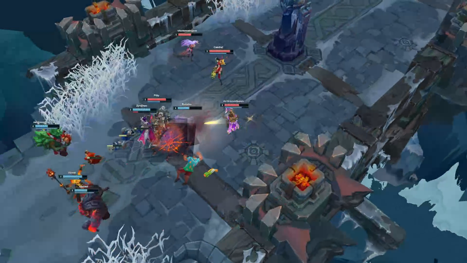
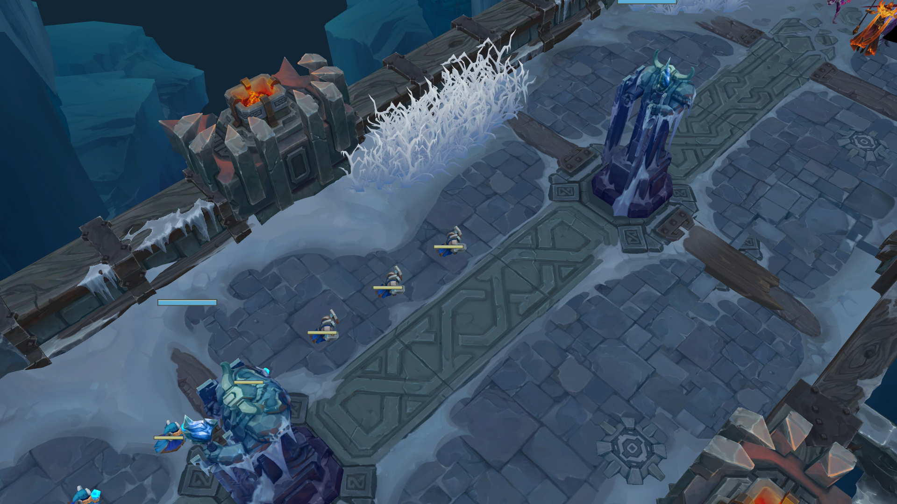

# Ordinary browser playback

[Watch the short browser recording](ordinary-play.webm).

The recording shows actual ordinary 1× playback from 01:18.75 to 01:23.25,
following Akshan in the primary Map12 replay. Build: `16.21.829.8620`; runtime
program: 38. The source canvas was 1920×1080 at device pixel ratio 1. The preview
is a frame decoded from the recording, reduced to 960×540 for review.

Capture uses the browser's canvas stream and MediaRecorder. Encoding/readback
overhead makes this visual evidence, not a frame-rate benchmark. The recorded
scene is a verified partial presentation: unresolved components stay omitted,
materials and world inputs have explicit approximation policies, and the latest
viewer has no integrated audio runtime. This clip does not establish final-world
coverage counts, arbitrary-match support or League reference fidelity.

The [master fidelity map](../AV-FIDELITY-MAP.md) explains the remaining gates.
The [research controls](../tools/research/README.md) document capture and diagnostic
commands. Raw replays, native images, prepared asset packages and browser profiles
remain local prerequisites and are not part of this evidence directory.

## Replacement replay and minion-wave jump regression

[Browser control results](replay-replacement.json) record the real decoder
loading 120 seconds, seeking to 110, and replacing it with a 60-second
reconstruction of the same replay. A diagnostic Worker wrapper selects the
existing decoder `endTime` input; it does not fabricate decoded events. A model
request stays held across 30 browser frames while Play and seek remain disabled.
Clicking a partially loaded champion roster raises no error. After loading,
the world is rendered at each starting time before minion-wave jumps from 46 and
58 seconds produce identical camera matrices at 60 seconds. The screenshot shows
that destination, not combat coverage or FPS.
